# DevMesh 产品需求文档

| 文档信息 | 内容 |
| --- | --- |
| 版本 | V10.0 |
| 状态 | 产品评审稿 |
| 更新日期 | 2026 年 11 月 10 日 |
| 产品形态 | B/S 对话式多智能体协作研发工作台 |
| 需求方 | 待登记 |
| 编写人 | 待登记 |
| 审核人 | 待登记 |

## 修订记录

| 日期 | 版本 | 修订内容 |
| --- | --- | --- |
| 2026-11-10 | V10.0 | 按六章结构整理；保留十个功能模块；明确使用对象、应用范围、协议接入、实施顺序和交付门槛，移除待决事项章及关联引用；统一两侧操作布局与交互原型 |

本文定义产品使用方式、功能、交互、业务规则和验收。正文规定本期产品要求，实际完成情况以对应版本的执行与验收结果为准。

## 目录

1. [项目背景](#1-项目背景)
2. [需求基本情况](#2-需求基本情况)
3. [项目方案概述](#3-项目方案概述)
4. [项目范围](#4-项目范围)
5. [功能需求](#5-功能需求)
6. [使用权限与职责边界](#6-使用权限与职责边界)

## 1 项目背景

将一个软件需求转化为可运行应用，需要衔接需求梳理、方案设计、开发实现和测试验证等工作。新建应用需要从目标逐步明确可交付的范围；已有应用迭代还需要在原有成果上处理新增功能和问题修复。

DevMesh 的提出，是希望将多智能体的分工协作用于完整的软件开发任务，使使用者能够围绕同一项目推进开发，并判断最终成果是否符合预期。本期以小型 Web 应用的新建和平台内已有应用的迭代为主要场景。

## 2 需求基本情况

### 2.1 需求概述

本次需求围绕新建应用、功能迭代和缺陷修复三类开发任务展开。使用者需要通过自然语言或 PRD 表达目标，确认需要完成的内容和验收要求，了解任务进展，并通过体验应用、检查交付内容确认结果。

DevMesh 需要由产品、架构、开发、测试四类 Agent（智能体）分工完成这些任务，通过 A2A 交接任务、同步进展和传递成果，通过 MCP 接入所需工具和项目资料。使用者应能在工作台中看清各 Agent 的实际贡献、交接结果和工具使用情况。

任务推进过程中，使用者还需要参与关键取舍、保留进度后继续，以及查看过往决定和成果。已接受的应用版本应能作为后续迭代的起点，使多次开发任务能够围绕同一应用持续开展。

### 2.2 主要使用场景

| 场景 | 触发情况 | 使用者需要完成的事 | 预期结果 |
| --- | --- | --- | --- |
| 新建应用 | 有新的业务目标，需要开发一个小型 Web 应用 | 说明应用用途、主要功能和业务规则，核对需求理解与验收要求，体验并检查交付成果 | 获得符合确认范围的可运行应用及必要交付材料 |
| 功能迭代 | 平台内已有应用已被接受，需要增加或调整功能 | 说明本次变化及需要保留的行为，确认影响范围，检查新增功能和原有相关功能 | 在原有成果上形成可验收的新版本，保留历史版本和记录 |
| 缺陷修复 | 使用已接受的应用时发现功能表现不符合预期 | 提供复现条件、实际表现和预期结果，按原问题检查修复效果 | 能对照修复前后的表现确认问题是否解决 |
| 关键取舍 | 需求变化或方案分歧影响后续工作，需要使用者决定 | 理解可选方案、依据和影响，作出选择或补充要求 | 后续工作依据明确，已有成果的保留与调整范围清楚 |
| 中断后继续 | 暂时不继续任务，或需要处理阻塞后再推进 | 保留进度，了解已完成与未完成的工作，确认继续的起点 | 从明确的进度继续任务，有效成果得到保留 |
| 查看历史 | 需要了解某次交付的过程、关键决定或成果来源 | 按任务或版本查看对应需求、决定和成果，必要时回看协作过程 | 能够追溯当时的依据，为检查成果和后续迭代提供参考 |

## 3 项目方案概述

### 3.1 产品定位与解决方式

本期面向个人开发者和小型研发团队中实际推进开发任务的人，统一称为“项目使用者”。产品按软件开发任务使用，不预设固定的日／周使用频率。

DevMesh 是面向软件需求交付的对话式多智能体协作研发工作台。用户提交目标后，平台组织产品、架构、开发和测试智能体完成需求理解、规划、实现、验证与交付；用户负责必要信息、关键取舍、过程控制和结果接受。

产品以项目长期保存应用资料、代码、任务和历史。一次任务表达一个明确目标；本次执行围绕该目标开展协作。用户接受的应用版本作为后续正常迭代的起点，运行环境停止不删除已保存的项目和成果。

### 3.2 用户参与与自动执行

| 情况 | 产品行为 |
| --- | --- |
| 需求提炼、资料读取、方案草拟 | 自动开展，结果和来源可查看 |
| 首次开始实现 | 执行模式使用明确目标的任务授权；计划模式须明确确认当前有效方案；两者均须通过原质量准入 |
| 已确认范围内的实现、测试、构建和演示准备 | 自动继续，展示真实进展 |
| 按原有约定修复明确缺陷 | 在已确认的重试和修复范围内自动进行 |
| 修改目标、验收标准、关键接口、技术约束、资料范围或预算 | 先展示变化及影响，再由用户确认 |
| 完成交付 | 用户审查并接受后确认完成 |

等待时间不会被解释为同意。用户手动暂停后，即使回答了问题或作出了裁决，系统也应等待“恢复”，再继续执行。

### 3.3 使用路径概览

新建应用从首页开始，已有应用从项目内继续迭代。主路径为“表达目标→理解与必要澄清→审阅计划→自动协作→验证和体验→用户接受”。变更、冲突与控制根据实际需要插入，不要求用户为每个内部工作反复确认。

总体流程、工作台和共用规则见 5.1；详细流程、页面和业务规则按模块集中于 5.2。

### 3.4 多 Agent 协作与外部能力接入

本期以多 Agent 分工协作为产品基础，通过 [A2A（Agent2Agent）](https://a2a-protocol.org/latest/)支持智能体间协作，通过 [MCP（Model Context Protocol）](https://modelcontextprotocol.io/docs/learn/architecture)接入工具与资料。三者在产品中的作用如下。

| 能力 | 产品要求 | 用户可见内容 |
| --- | --- | --- |
| 多 Agent 协作 | 产品、架构、开发、测试 Agent 分别承担需求理解、方案规划、实现和验证，基于同一目标协作 | 各 Agent 的职责、当前工作、输入依据、成果及未完成项 |
| A2A 任务交接 | 传递消息、按计划委派工作、同步进展并返回成果，使后续 Agent 能依据有效输入继续处理 | 谁向谁交接、交接任务、依据版本、接收与处理状态、返回成果及未决问题 |
| MCP 工具与资料接入 | 按任务需要和授权范围接入至少 5 项 MCP 工具或数据源，覆盖代码仓库、文档检索、测试执行、缺陷跟踪及 CI/CD 能力 | 实际服务来源、工具用途、调用状态、结果依据，以及连接缺项对任务的影响 |

例如，开发 Agent 完成代码工作后，通过 A2A 将确定版本交给测试 Agent；测试 Agent 通过 MCP 调用已接入的测试工具，并将报告及问题交回开发 Agent。工作台应能串联展示这次交接、实际测试结果和后续修复。

本期固定产品、架构、开发、测试四类 Agent，通过 A2A 传递消息、分发任务和同步状态；至少接入代码仓库、文档检索、测试执行、缺陷跟踪及 CI/CD 五项真实 MCP 工具或数据源。具体服务和模型由技术方案选择，平台维护人员预先配置连接，执行前检查可用性并保存本次实际配置。项目使用者无需配置模型或工具连接，可查看当次分工、接入来源、可用能力和实际执行结果。

## 4 项目范围

### 4.1 本期功能清单

| 模块 | 纳入内容 | 需求详设 |
| --- | --- | --- |
| 项目与任务管理 | 项目入口、搜索、改名、当前与历史任务、迭代起点 | 5.2.1 |
| 需求输入、理解与澄清 | 正文、附件、理解、来源、问题、回答和纠正 | 5.2.2 |
| 需求拆解、DAG 编排与计划确认 | 自动拆解、DAG 依赖编排、计划修改和执行确认 | 5.2.3 |
| 协作执行与过程查看 | 多 Agent 分工、A2A 任务交接、MCP 工具与资料使用、实际进展和成果 | 5.2.4 |
| 需求变更 | 提议、影响、确认、应用和放弃 | 5.2.5 |
| 冲突处理与人工决策 | 核实、比较、解释、选择、应用和复验 | 5.2.6 |
| 暂停、恢复、取消、重试与整次重做 | 控制、实际收尾、继续、失败重试、整次人工重做与执行限制 | 5.2.7 |
| 成果审查、验证、预览与交付 | 逐项要求、报告、缺陷、代码、预览、退回与接受 | 5.2.8 |
| 历史回放与导入导出 | 执行评测汇总、完整消息与事件记录、文件获取、导入校验和只读回放 | 5.2.9 |
| 执行配置查看与调整 | 当次实际配置、可用条件、限制和调整影响 | 5.2.10 |

以上为本期功能范围。任务控制支持保存当前进度、暂停后继续、失败工作重试及未接受任务的整次人工重做；历史记录用于查看与追溯，后续迭代从当前已接受版本开始。

本期十个功能模块均纳入交付，按以下顺序推进。消息、决策、工具调用及成果记录从第一阶段即同步建设，后续视图使用真实记录。

| 顺序 | 完成内容 |
| --- | --- |
| 第一阶段：打通端到端交付 | 项目与需求输入、MCP/A2A 接入、安全上下文共享、自动 DAG 编排、实现、验证、预览与可运行交付 |
| 第二阶段：完善协作控制 | 需求变更、冲突裁决、人工暂停与恢复、失败重试及整次任务重做 |
| 第三阶段：完善过程体验 | 执行评测、链路回放、导入导出、配置查看及页面交互；全过程记录在前两阶段持续保留 |

### 4.2 能力与交付边界

| 用户关心的问题 | 本期产品定义 | 不满足时的产品行为 |
| --- | --- | --- |
| 能创建什么 | 本期支持小型 Web 应用的表单、列表、基础增删改查、搜索筛选、状态流转和基础业务校验；任务看板、资源预约为范围示例 | 明确指出超出本期范围或实际运行条件不能满足的必要要求，建议拆分或调整；用户确认前保留原要求，不自动删减 |
| 能修改什么 | 修改平台内已经接受的应用，支持小范围新增功能和可复现缺陷修复 | 外部任意仓库导入、多代码库改造或未接受结果的直接续写不默认为已有能力，说明可用入口 |
| 什么叫可运行 | 对应交付版本能够按说明启动，提供实际可访问的体验入口，必要业务操作可检查；源码、说明和验证结果可获取 | 单纯生成代码、构建通过或网页端口可达不能代替业务完成，逐项列未完成条件 |
| 是否直接用于正式业务 | 本期交付经过约定验证的应用版本和必要运行材料；默认提供受限演示环境。正式发布到用户生产环境不属于默认自动操作 | 用户提出正式发布要求时，说明当前交付范围和仍需确认的部署、数据及使用条件 |
| 业务数据如何处理 | 应用业务数据默认在页面刷新、应用重启后保留；新版本影响既有数据时，提前说明保留或迁移影响 | 按约定实际验证刷新与重启；无法证明保留时不声称无损升级，没有用户明确确认不清空既有数据 |
| 用户需要准备什么 | 需求目标、必要业务规则、选定资料，以及缺陷的复现条件；模型、工具连接和运行资源由部署人员预先配置 | 缺少连接时仍可保存需求，说明阻塞及处理人，不要求普通用户在聊天里提交密钥 |

需求理解阶段展示“与当前能力匹配”“需要补充判断”或“超出当前能力”，并解释具体原因。存在不能满足的必要要求时，用户可修改本次范围、保存输入后结束；只有调整获得确认后才继续。

### 4.3 输入规模与操作默认值

以下为现有产品设计中的建议默认值，实际采用值在执行前展示。它们约束输入和操作行为，调整需明确范围并按对应功能规则处理。

| 项目 | 默认值与产品反馈 |
| --- | --- |
| 需求正文 | 最多 20,000 字；超限保留输入并提示 |
| 附件 | 单次最多 3 个，Markdown/纯文本，每个 2 MiB |
| 项目名/任务标题 | 分别为 1～80 字、1～120 字 |
| 并发 | 同项目一个活动执行；执行内默认最多两个角色并行；跨项目按实际资源排队 |
| 计划规模与修正 | 最多 30 项工作，计划额外修正最多 2 次 |
| 重试与修复 | 暂时且可安全重复的失败最多额外自动重试 2 次；自动修复最多 2 轮；手动操作不自动重置限额 |
| 执行预算 | 默认活动处理 60 分钟；人工等待、纯资源排队和已暂停时间单列；延长需确认 |
| 停止核实 | 超过 30 秒仍不明时说明原因并继续核实，不虚报已停止 |
| 回放包 | 压缩 200 MiB、解压 1 GiB、最多 20,000 文件 |
| 预览与材料保留 | 根据产品使用、数据保留政策和实际资源确定，分别展示日期；未确定则标待设置 |

## 5 功能需求

### 5.1 产品框架概述

#### 5.1.1 功能结构

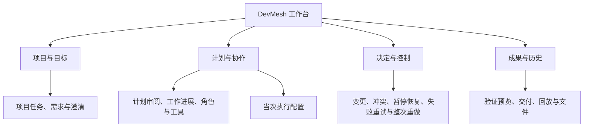

#### 5.1.2 总体业务流程

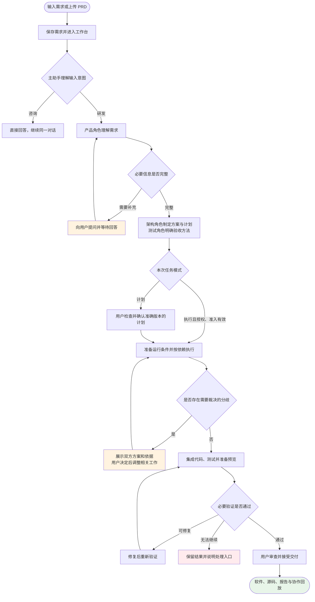

新建与迭代共享确认、执行和审查路径；迭代以当前接受版本为起点。总体图只说明主干，详细操作与分支以 5.2 各模块为准。

#### 5.1.3 工作台与信息架构

工作台采用“左侧项目导航、中间任务对话、右侧可收起执行详情”的分工。中间上方为按序保存的用户、主助手及真实进展消息，下方固定输入框；需求理解、必要澄清与准确方案确认通过同一对话完成。新建首页直接作为任务发起点，支持文字、仅附件或组合输入，主操作为“发送”，提供执行／计划模式；咨询不创建项目，明确研发目标才关联项目与执行。旧项目改名等管理操作保留兼容入口。顶部持续显示所选项目、任务、当前／历史、状态与阶段；执行控制仍针对准确执行。

| 区域 | 固定内容与入口 | 点击、返回与保持 |
| --- | --- | --- |
| 左侧导航 | 项目搜索、当前任务、历史任务；历史条目提供“回放”入口 | 选择后统一切换三栏上下文；切换前保存安全草稿，返回保留搜索与阅读位置 |
| 中间对话 | 需求输入、Agent 回复、简短进展、结果摘要与来源链接 | 输入框固定底部；输出区展示已提交需求、模型输出、理解与计划；澄清回答和计划确认在主区域，预览、回放、下载与配置按原入口打开 |
| 右侧工作区 | 可收起的“任务、协作、成果、预览、记录”五个一级页签；新建默认收起，桌面展开约320px，窄屏为覆盖式抽屉 | 页签只切换查看，不提交业务操作；任务内保留当前页签、筛选和所选内容，新消息不自动切走 |
| 顶部右侧 | 当前执行允许的暂停／恢复，以及“更多”中的取消、整次重做和本次配置 | 始终针对顶部标明的执行；历史查看时隐藏执行控制，显示“历史只读”和“回到当前任务” |
| 右侧局部操作 | 当前视图的查看、提交、下载、确认及预览／回放控制 | 主要操作固定在右侧面板底部；停止预览仅作用于预览，播放／暂停回放仅改变观看 |

| 右侧页签 | 包含内容 | 主要操作位置 |
| --- | --- | --- |
| 任务 | 当前任务状态、需求／计划版本及主区域定位；工作进度、待办、变更、冲突及控制收尾 | 理解、澄清、计划与DAG及对应回答／计划确认在主区域；其他执行详情按原视图处理 |
| 协作 | Agent 概览、A2A 交接、MCP 与内部工具记录、本次配置 | 查看交接／工具成果；配置脱敏查看和导出，顶部“更多”的本次配置定位到同一视图 |
| 成果 | 需求验收、报告与代码检查、覆盖、差异、交付材料 | 退回问题、必要人工检查、下载与接受交付在对应视图完成 |
| 预览 | 对应版本、可用性、实际地址、有效期与体验内容 | 新窗口打开、重新检查、停止预览均放在本页签 |
| 记录 | 执行总结、完整消息与事件、链路回放、导入导出 | 查看指标依据、播放与定位、导出／导入及下载均放在对应子视图 |

首次进入项目优先打开活动任务；右侧页签初始为“任务”，面板默认收起，发起任务不强制展开，已查看任务恢复用户手动开关。没有活动执行时查看最近任务。左侧选择历史任务后，中栏同步显示该次历史对话且输入区只读，右侧显示同一执行的资料；点击该条目的“回放”则定位右侧“记录／回放”。查看历史不暂停或恢复后台当前执行，后台新进展只提示，不自动跳回。

右侧支持调宽、收起及展开为大视图，适用于 DAG、应用体验、复杂比较和链路回放。展开只改变展示空间，保留中栏草稿、阅读位置、选中任务及右侧状态；收起或退出后恢复原布局。窄屏右侧以可关闭抽屉覆盖在主区域上，关闭或Escape返回原输入；澄清与计划确认持续在主输出区，切换详情不卸载草稿。

中栏输出直接承载需求理解、澄清问题与计划审阅，计划确认沿用原明确同意规则；变更、冲突或成果摘要可定位右侧对应内容。预览、回放和下载继续使用原详情入口，主区域与右侧不重复挂载同一确认表单。需要我处理的事项在右侧“任务”汇总，并以数量标记保持可见；各项处理仍遵守原有确认及状态规则。

工作台任务发起页采用2026-11-18用户确认的Paseo参考深色稿：石墨黑背景、近黑侧栏、细分隔线及灰白主操作；品牌置于左侧，顶部使用“工作空间／新任务”面包屑，输入框左下添加附件、右下发起任务。项目列表展示真实数据，搜索当前已加载项目；设置和附件管理保留按需入口。该页面以最新确认稿及本节上下布局为准；其余历史页面原型仍作为灰白／深蓝视觉参考，见[原型图索引](./原型图索引.md)。图中示例内容与项目不预填入真实工作空间。

新建页空白输出区展示三个需求示例：搭建业务系统、制作数据看板和创建展示网站。示例只在可编辑且正文为空时填入本机草稿并聚焦输入，不发起业务请求；已有草稿不被覆盖，所选附件保留，仍需用户明确发起任务。桌面横排卡片，窄屏紧凑列表，输出与底部输入各自保持可达。

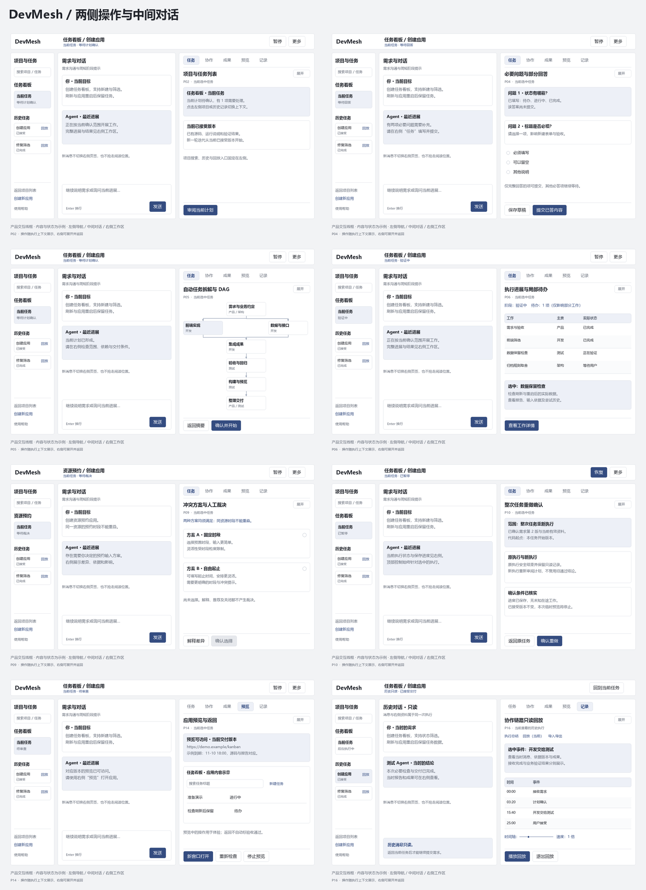

#### 5.1.4 通用交互规则

| 场景 | 统一交互规则 |
| --- | --- |
| 打开与返回 | 右侧保持同一工作区，一级页签固定；查看来源或报告使用视图内返回，不叠加抽屉。收起或退出大视图恢复原上下文与浏览位置 |
| 查看型关闭 | 右上关闭、Esc 和遮罩均只收起，保持筛选与位置，不执行确认、拒绝或取消 |
| 有未提交文字 | 关闭或切项目先保留安全草稿并提示未提交；保存失败则拦截离开，允许重试保存、继续编辑或明确放弃 |
| 必须确认框 | 取消执行、停止预览、接受整个交付使用简短框；外部关闭视同返回。提交中防重复，结果不明先核实原操作 |
| 输入与键盘 | Enter 在多行框换行；Ctrl+Enter 仅在表单有效且非输入法组字时提交；键盘可进入主要控件，错误后焦点到首个问题 |
| 动态消息 | 新消息不抢中栏阅读位置、表单焦点或已打开的右侧页签；显示进展提示和待办数量，由用户选择定位 |
| 窄屏 | 左侧导航用抽屉，右侧内容以有返回入口的全宽视图打开；保留表单和操作栏，退出回到原对话位置，不缩小文字强塞完整功能 |
| 草稿范围 | 未提交内容按当前访问身份、项目/任务和表单保存；不同项目不串用。承诺当前浏览环境可返回，不声称未定义的跨设备同步 |
| 历史与权限 | 历史和回放持续显示只读；当前操作前再次核实权限与内容有效性；访问失效先保存安全输入，再提示重新验证身份 |

取消执行、停止预览和接受交付通过独立短确认框完成，不嵌入中栏消息。计划、变更、冲突、报告和配置在右侧对应页签处理；比较空间不足可展开，返回后保留原选择与草稿。顶部执行控制、右侧预览控制和回放播放控制分别标明对象与作用。

#### 5.1.5 用户可见状态与成果有效性

顶部同时说明“本次执行处于什么状态”“正在处理哪个阶段”和“为什么需要等待”。阶段包括需求理解、澄清、方案规划、计划确认、环境准备、开发、集成、测试、构建、预览和交付审查。

| 状态 | 进入条件与主要反馈 | 可用操作及离开条件 |
| --- | --- | --- |
| 规划中 | 正在理解需求、制定方案或准备执行条件 | 查看、补充、暂停、取消；满足条件后执行，缺信息时等待 |
| 执行中 | 正在开展实现或集成工作 | 查看、补充、处理局部待办、暂停/取消；集成代码齐备后验证 |
| 验证中 | 正在测试、构建或检查预览 | 查看结果、暂停/取消；需要修复时回执行，齐备后待审查 |
| 等待处理 | 全部后续工作暂时受阻且无在途工作，或等待用户审查 | 按原因回答、确认、重试、审查或结束；也可暂停/取消 |
| 暂停中 | 已受理暂停，正在核实和保存 | 查看、核实、取消；材料完整保存后已暂停 |
| 已暂停 | 没有未核实写入，恢复进度已完整保存 | 恢复、取消或按条件整次重做；保存回答/决定不自动恢复 |
| 取消中 | 已受理取消，正在结束和保存 | 查看、核实；确认安全结束后已取消 |
| 已完成 | 必要交付条件满足且用户接受 | 原执行只读，可下载、回放或从当前接受版本继续迭代 |
| 失败 | 已明确无法继续且实际影响已保存、核实 | 原执行只读，可下载或回放；当前未接受任务可按条件创建整次重做的新执行 |
| 已取消 | 主动取消已安全完成 | 原执行只读，可下载或回放；当前未接受任务可按条件创建整次重做的新执行 |

有局部分支等待、其他分支仍可工作时，整体保持执行或验证状态，单独标待办。暂停、取消不能通过修改页面文字直接完成，必须与实际工作和保存结果一致。

工作详情显示等待前置、可开始/排队、执行中、等待处理、成功、失败或已取消，并说明当前原因和可做操作。重试新增尝试，保留原失败；暂停中断后允许重新开展该工作。

成果另标“当前可用”“暂待决定”“已不适用于当前要求”。一项工作过去成功，但要求或代码变化后，其结果可以仍保留为历史，同时不再用于当前交付。

连续点击、页面重连或请求响应丢失不应重复创建任务、决定或外部工作。系统先核实原操作，再显示结果。不同页面同时提交冲突选择时，只允许一次有效选择；后提交者看到已保存内容。

用户看到的计划、问题、变更或交付在提交前已更新时，应拒绝旧选择并提示查看最新内容。原执行已经结束时，迟到的成功、暂停或取消不能改变已确定事实。

#### 5.1.6 页面与功能对应

| 页面编号 | 页面或面板 | 打开方式 | 需求详设 |
| --- | --- | --- | --- |
| P01 | 首页需求输入 | 独立入口页 | 5.2.1.2 |
| P02 | 项目、任务与历史列表 | 左侧导航选择项目／任务及历史条目 | 5.2.1.2 |
| P03 | 对话及迭代目标 | 中栏仅沟通需求，继续迭代表单在右侧任务 | 5.2.2.2 |
| P04 | 理解与澄清 | 右侧任务／理解与澄清 | 5.2.2.2 |
| P05 | 计划审阅 | 右侧任务／计划，支持展开 | 5.2.3.2 |
| P06 | 工作概览、图与详情 | 右侧任务／工作进度与 DAG | 5.2.4.2 |
| P07 | 角色、交接与工具 | 右侧协作，内部切换概览、交接与工具 | 5.2.4.2 |
| P08 | 变更审阅 | 右侧任务／变更，底部确认 | 5.2.5.2 |
| P09 | 冲突处理 | 右侧任务／待决定事项，底部裁决 | 5.2.6.2 |
| P10 | 控制与收尾 | 顶部右侧控制，右侧任务显示收尾或重做 | 5.2.7.2 |
| P12 | 成果与验收 | 右侧成果／需求验收与交付材料 | 5.2.8.2 |
| P13 | 报告、缺陷与差异 | 右侧成果／报告，保留返回需求入口 | 5.2.8.2 |
| P14 | 预览 | 右侧固定预览页签，可展开或新窗口体验 | 5.2.8.2 |
| P15 | 导出与导入 | 右侧记录／导入导出 | 5.2.9.2 |
| P16 | 执行总结与回放 | 右侧记录；左侧历史条目可定位回放 | 5.2.9.2 |
| P17 | 本次配置 | 右侧协作／本次配置；顶部更多提供定位 | 5.2.10.2 |

5.2 的每个模块统一由业务流程、页面交互和业务规则组成；同一页面由一个模块完整定义，其他模块引用，避免同一按钮出现两种处理规则。

### 5.2 产品需求详解

#### 5.2.1 项目与任务管理

##### 5.2.1.1 业务流程

| 前置情况 | 点击继续迭代或修复后 | 下一步 |
| --- | --- | --- |
| 已有接受版本、无活动执行 | 在项目内打开目标表单，展示起点版本与摘要；选择新增功能或修复问题 | 新增写目标；修复写复现、期望、实际与必要条件；有效提交进入新任务 |
| 已有活动执行或已暂停工作 | 显示当前目标与状态，新目标仅存为待提交草稿 | 可前往当前执行；若要修改当前目标，明确走需求变更流程（5.2.5.1），不自动混入 |
| 没有接受版本 | 展示当前任务、已保存成果及未接受原因 | 尚未结束时可前往审查、恢复或重试；失败或取消后保留结果，并可按条件整次重做当前未接受任务 |
| 用户看着旧接受版本发起 | 提交前比较当前项目起点，若已更新则显示变化 | 用户重新确认使用当前接受版本后提交；查看旧版本只改变浏览内容 |
| 缺陷无法复现 | 展示尝试条件和缺少信息，保留目标 | 补充或暂缓，不能把“尝试定位”标成修复完成 |

提交后项目名保持不变，新任务标题可由本次目标生成；新增或修复不会覆盖原需求对话和原接受记录。

##### 5.2.1.2 页面交互

首页默认聚焦需求正文，提示“描述谁使用、希望完成什么、必须遵守哪些规则”。展示当前支持的正文/附件范围和可编辑示例；未提交不创建项目。

| 字段/操作 | 初始、约束与校验时机 | 点击或变化后的结果 |
| --- | --- | --- |
| 需求正文 | 多行，空白初始；最多 20,000 字，输入时显示字数 | 超长保留全文，显示超出数量；不自动截掉内容 |
| 上传 PRD | 每次总计最多 3 个，.md/.txt，每个最多 2 MiB | 选择后逐项显示读取中/可用/失败；超数或超限逐项说明，不开始研发 |
| 附件移除/重传 | 提交前可操作，提交中不可改变本次材料 | 删除仅移除对应文件；重传只重新读取该文件，保留其他成功资料 |
| 使用示例 | 点击填入可编辑内容；有现有输入时先问替换或返回 | 不自动提交、不自动创建；返回保留原文 |
| 开始创建 | 正文与可用附件至少一项有实际内容，且无未处理失败/读取中附件 | 点击后整份输入进入提交中；成功进工作台；结果未知按钮变“核实提交结果” |
| 首页草稿 | 按当前访问身份及新任务入口保存安全内容 | 离开返回可恢复；已提交成功只清除此份对应草稿 |

**交互原型 P01：首页需求输入**

展示正文、附件、可编辑示例与开始创建入口；填写和查看示例不直接启动任务。

项目列表默认每页 20 项，按最近更新时间从新到旧。搜索输入按点击搜索或回车生效，默认不筛选；搜索项目名与任务标题，显示本次条件，可一键清空。换条件回到第一页，翻页后保留条件，返回列表保留原位置。

| 列表元素 | 展示字段 | 点击与限制 |
| --- | --- | --- |
| 项目行 | 名称、最近任务、当前状态、未处理事项数、更新时间 | 点击进入当前活动执行，没有时进最近结果；不停止其他项目 |
| 待办数量 | 未解决事项数，零时不显示醒目标记 | 点击进该项目待办并选中首个需要处理事项 |
| 任务历史 | 标题、创建时间、结果、接受情况、应用版本和整次重做的来源执行 | 点某次执行进入其概览，已结束记录持续只读 |
| 继续迭代 | 仅已有接受版本且无活动执行时可提交新目标 | 条件不满足显示原因和当前执行/最近成果入口，不直接发起 |
| 改名 | 项目菜单打开简短表单，原名默认填入；1～80 字，去首尾空白 | 保存只改名称；空名就地错误；保存失败保留输入；返回不改名 |

首次空列表显示“创建第一个应用”并定位输入；搜索无结果提供清空搜索；加载失败提供重新读取。读取失败不出现“项目已删除”的误导。无权限项目不显示；进入后权限失效，展示不可访问并返回可见列表。

**交互原型 P02：项目与任务列表**

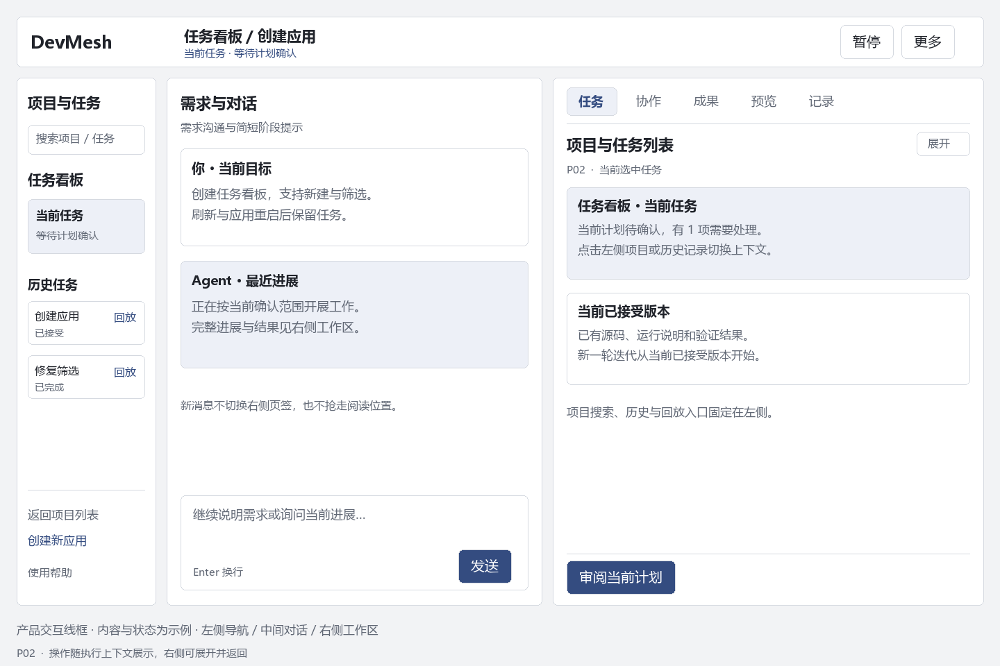

展示搜索、项目状态、待办与进入当前执行的路径；历史查看与继续迭代按条件开放。

**首次使用引导**

首页输入框提示用户说明“谁使用、要完成什么、有哪些必须遵守的规则”。无需填写长表单；提供任务看板、资源预约两条可编辑的示例需求，并标明仅填入示例，不会自动开始。

进入首个项目时，说明左侧项目与任务导航、右侧“任务”的进展与待办，以及右侧“成果”的验收与材料入口。引导可关闭，帮助入口可重新查看。工作台中遇到专业词语可就近解释，基础操作不以阅读技术文档为前提。

##### 5.2.1.3 业务规则

| 编号 | 类型 | 业务规则 |
| --- | --- | --- |
| 项目-01 | 事实 | 项目长期保存一个应用的需求、资料、代码、任务和历史，项目名称变化不改变应用归属。 |
| 项目-02 | 约束 | 同项目仅有一个未结束执行；暂停和等待人工处理仍占用该项目的活动执行位置。 |
| 项目-03 | 触发 | 首页首次有效提交后创建项目和任务；继续迭代在已有项目中发起，不要求重复建立项目。 |
| 项目-04 | 约束 | 正常迭代使用当前接受版本；未接受差异可以查看和下载，不自动成为新目标的代码起点。 |
| 项目-05 | 触发 | 没有接受版本且任务未结束时指向审查、恢复或重试；原任务已失败或取消时保留结果供查看，可按 5.2.7 整次重做当前未接受任务；存在活动执行时新目标先保留草稿，不混入当前目标。 |
| 项目-06 | 推论 | 切换项目、查看历史和修改项目名不停止后台工作，也不改变当前要求。 |
| 项目-07 | 约束 | 后续迭代从当前已接受版本开始；提交新任务前起点发生变化时，须重新说明差异并由用户确认。 |
| 项目-08 | 事实 | 项目名由首次目标生成，生成失败用“新项目＋创建时间”；任务标题根据本次目标生成，后续补充消息不自动改名，长度按 4.3。 |

#### 5.2.2 需求输入、理解与澄清

##### 5.2.2.1 业务流程

入口：首页“开始创建”。前提：当前身份可以创建项目；无需先填写项目名称或选择运行环境。

| 步骤 | 用户动作 | 页面响应 | 下一步或分支 |
| --- | --- | --- | --- |
| 1 | 填写正文，或选择文件 | 显示字数及逐文件读取结果；不提前开始研发 | 无有效内容时停在首页；正文与可用附件至少有一项有效 |
| 2 | 点击开始创建 | 校验当前输入；不通过时聚焦首个问题并保留其他内容 | 通过后按钮显示“正在提交”，禁止相同提交重复触发 |
| 3 | 等待受理 | 已确认受理后进入新项目，显示原始输入和“正在理解需求” | 受理失败可重试；结果不明先核实，不能另外创建 |
| 4 | 阅读需求理解 | 展示目标、功能、规则、假设、验收和来源 | 看懂且无缺项进入规划；需纠正时打开“补充或纠正” |
| 5 | 回答必要问题 | 按主题显示问题、原因和影响；未回答的必答项集中提示 | 可保存未完成回答；只有有效提交才改变问题状态 |
| 6 | 提交回答 | 显示“回答已保存，正在更新理解”，原问题暂时只读 | 更新成功后标已回答；保存失败保留答案；原问题过期则不套用旧答案 |
| 7 | 查看更新结果 | 展示本次补充带来的变化；仍缺必要信息时列新问题 | 信息完整后进入计划形成，不再增加一次无意义的“确认理解”按钮 |

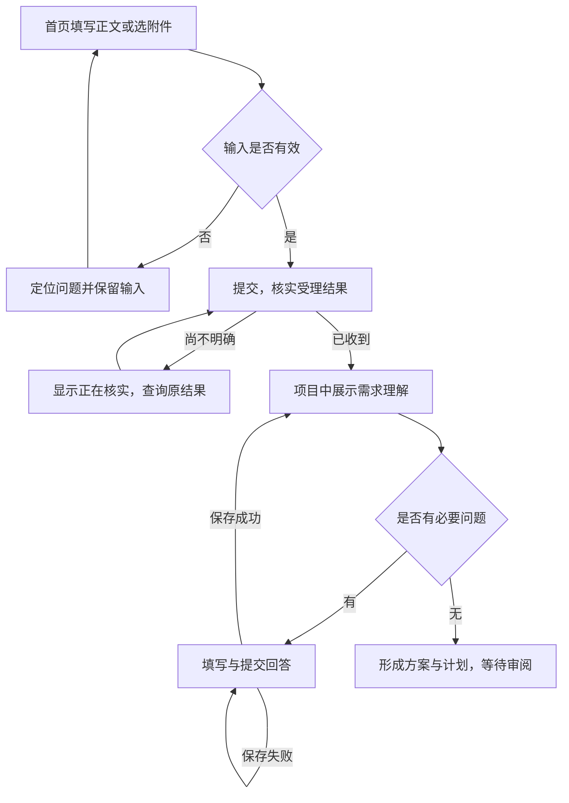

业务分支：附件有失败项时，用户须重传或移除，不能悄悄跳过；资料冲突时显示两处原文并提问；超出能力时说明无法满足的必要要求，调整范围前不开始实现。用户离开后再返回，仍能找到已提交原文、已回答问题与未提交草稿。

结束条件：当前理解满足规划所需信息，进入计划审阅流程（5.2.3.1）；或用户明确结束，保留已保存需求和理解。未回答与超时都不构成接受默认值。

##### 5.2.2.2 页面交互

**需求对话与目标输入（P03）**

入口：首页直接开始持续对话。主助手结合已保存上下文理解意图并自然回答；咨询、补充、澄清、进展、控制和后续目标均从同一输入框承接，完整方案、DAG及原工作记录按需打开。旧项目／Run管理视图仍支持原表单及未决请求恢复。

| 字段或区域 | 默认、可编辑与校验 | 操作和结果 |
| --- | --- | --- |
| 当前归属 | 项目、任务标题、当前或历史标记；只读 | 始终可辨别消息发往哪里，切换项目后不沿用上一项目的归属 |
| 工作模式 | 新会话默认执行；可选计划，明确“先给计划，不修改”按更窄权限处理 | 主助手判断咨询、开发、调整等意图；咨询回答不自动变成实施范围 |
| 消息正文 | 多行文本，单次 1～20,000 字；纯空白不可发送 | Enter 换行，Ctrl+Enter 或点击发送提交；中文输入法组字期间不发送 |
| 发送反馈 | 提交中保留原文可读，防止重复发送同一内容 | 成功后清除对应输入，新增消息并显示正在回答/分析；失败保留输入 |
| 继续迭代目标 | 默认当前接受版本；选择增加功能或修复问题 | 增加功能填写本次目标；修复展开复现步骤、期望、实际和必要条件 |
| 原有行为 | 展示来自接受版本的功能摘要 | 用户可指出本次必须保留的内容，理解卡和计划同步体现 |

完成后可在同一对话继续讨论或交办下一目标；需要新执行时按项目当前已接受版本建立新的Run，不复活旧执行。没有可用迭代依据或目标不明时说明需要处理的条件。旧工作台的下一目标草稿及原请求继续保留。

**按状态的行为：** 正在执行时，询问只回答不改计划；已暂停时允许提问、补充和保存决定，但旁边显示“当前已暂停，处理后仍需恢复”；取消中仅允许查看和查询收尾，新目标引导保存草稿；历史回放输入区隐藏。

系统回复更新时，如果用户已在对话底部则跟随新增内容；正在阅读历史时不抢位置，显示“有新进展”。引用来源在右侧面板打开，返回保持原消息位置。用途纠正入口放在消息下方；内容已经生效时先说明影响，再走变更，不能擦除已发生事实。

**交互原型 P03：需求对话与补充**

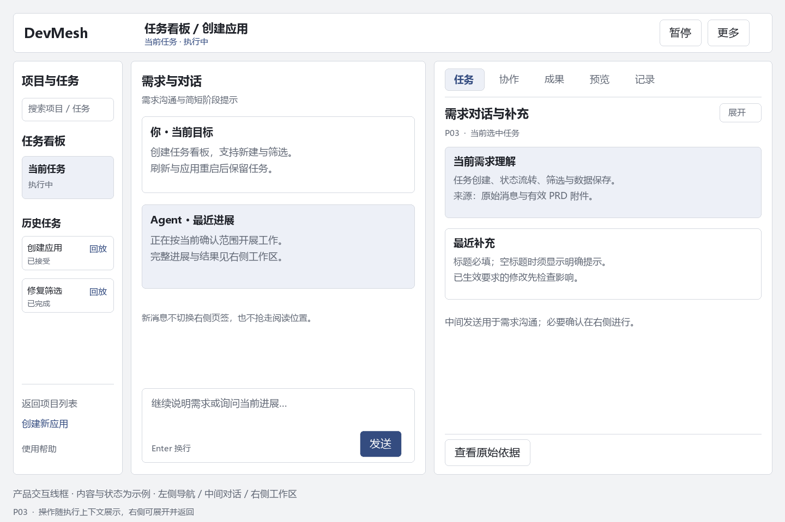

展示原始需求、Agent 理解、消息用途及补充输入，右侧保留需求依据。

**理解卡展示内容**

| 展示内容 | 应达到的效果 |
| --- | --- |
| 需求目标 | 用具体行为说明应用为谁解决什么问题 |
| 功能范围 | 列出本次要完成的功能，以及继续迭代时需要保留的原有行为 |
| 约束条件 | 说明必须遵守的业务规则、使用条件和已知技术限制 |
| 验收标准 | 说明在什么操作和条件下应出现什么结果，使用户能判断是否完成 |
| 已作假设 | 明确哪些内容来自系统假设，避免用户误以为已经确认 |
| 待补充问题 | 指出缺少的信息、影响哪项工作、是否必须回答 |
| 依据来源 | 允许查看对应用户消息或 PRD 片段，资料矛盾处突出提示 |

**理解与澄清表单（P04）**

入口：右侧“任务／理解与澄清”，或从右侧待办进入；中栏问题摘要或来源链接只定位同一视图。右侧按目标、范围、规则、验收、假设、待问与来源分区，默认展示必要问题及影响，回答提交操作固定在右侧底部。

| 字段或操作 | 具体要求 | 提交或打开结果 |
| --- | --- | --- |
| 问题标题 | 展示完整业务问题，不只显示“请补充” | 下方解释为何需要、影响什么、必答或可选 |
| 单选/多选 | 是否必答和可选数量随题明确；初始不替用户选答案 | 切换选项立即更新未提交答案，尚不解除等待 |
| 文字回答 | 每题最多 2,000 字；必答题空白不通过 | 错误就近显示，提交时定位首个错误，不清空其他题 |
| 其他说明 | 选择“其他”后展开，需补文本才能提交该选项 | 取消其他选项时保留其草稿供返回，不混入最终回答 |
| 使用默认值 | 仅存在明确默认答案的问题可见，先展示具体值 | 点击填入该值，仍需提交，不因不作答自动生效 |
| 保存草稿 | 有安全未提交输入即可使用 | 显示“草稿已保存，尚未提交”，必答待办仍在 |
| 提交已答内容 | 本次提交的问题已完整作答；未作答的问题仍待答，可选项未填不阻塞 | 显示正在保存，成功后区分已回答、仍待回答和更新中 |
| 补充或纠正理解 | 展开目标与纠正说明，必填具体文字 | 提交后在同一任务更新理解；已实施内容变化需审阅影响 |

问题较多时按主题折叠，标题显示该组已回答数/必答数；不以逐题强制向导阻止用户前后对照。可先提交已经完整回答的问题，其余问题仍等待；尚未填写的必答题不被视为已回答。提交时仅校验本次提交的答案，点击“提交已答内容”明确说明还有哪些题未解决。

**结果与异常：** 已提交题默认只读并可看原答案；“修改回答”重新展开表单。问题过期时显示原因和当前问题入口，旧草稿可复制参考但不自动带到新题。更新理解失败保留已保存答案，按钮为“重试更新理解”，不要求重复回答。

**交互原型 P04：必要问题与部分回答**

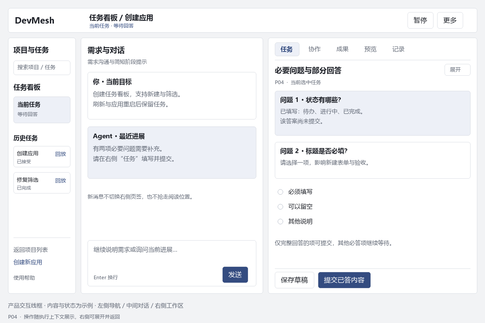

展示已填写但尚未提交的回答、未回答项及提交已答内容的入口。

##### 5.2.2.3 业务规则

| 编号 | 类型 | 业务规则 |
| --- | --- | --- |
| 需求-01 | 事实 | 原始正文、有效附件、资料来源、理解和回答分别保留，系统概括不覆盖用户原文。 |
| 需求-02 | 约束 | 正文和有效需求附件至少有一项；已选附件的失败或读取中状态须先处理，不能静默忽略。 |
| 需求-03 | 触发 | 目标、必要规则、验收不明、资料冲突、能力不匹配或复现条件不足时，提出真正影响后续工作的必要问题。 |
| 需求-04 | 约束 | 必答未解决时相关工作等待；可提交已完整回答的问题，但其他问题不自动变为已回答。 |
| 需求-05 | 约束 | 默认值必须有具体内容并由用户主动选择；无人回答、等待超时和草稿保存均不代表有效回答。 |
| 需求-06 | 推论 | 查询进度和解释不会产生新要求；系统对用途不确定时先说明并澄清，允许纠正。 |
| 需求-07 | 触发 | 已提交答案改变了已确认或已实施要求时，转入 5.2.5 的影响审阅；未生效输入可以继续编辑。 |
| 需求-08 | 约束 | 用户资料和工具结果仅作信息来源，不能扩大权限或代替用户确认。 |

**提问与理解原则**

优先一次整理当前真正影响规划的问题，按业务主题分组；不重复询问用户已明确提供的信息。后续发现新问题时说明触发原因，已有答案仍有效则继续沿用。

选择题应同时解释各选项的业务后果；“其他说明”允许用户用自己的话补充。技术问题先转成用户能理解的取舍，必要时展示推荐及理由。用户表示“不清楚”时，提供解释或可行建议；必要约束无法确定则保留等待，不能默认替用户决定。

用户可以修改未提交回答。回答已提交且尚未开始实现时，更新理解并重新检查计划；已影响实现时，展示变更影响再确认。问答中断后返回，能区分未提交草稿、已提交答案与已过期问题。

**需求理解示例**

| 项目 | 任务看板的示例内容 |
| --- | --- |
| 目标 | 帮助小团队记录任务并按状态查看当前工作 |
| 本次功能 | 新建任务、改变状态、按状态筛选、刷新后保留 |
| 必须明确的规则 | 任务标题是否必填、状态有哪些、保存要求是什么 |
| 验收示例 | 新建“准备演示”后出现在列表；切为已完成后在对应筛选中可见；刷新后该任务及状态仍存在 |
| 已作假设 | 如尚未要求多人账户，则明确“本次按单一使用场景规划，未包含多用户权限”并供用户纠正 |
| 来源 | 可定位原始消息或附件段落；系统补充的建议不伪装成用户原话 |

#### 5.2.3 需求拆解、DAG 编排与计划确认

##### 5.2.3.1 业务流程

入口：主助手在对话中给出方案及下一步。执行模式核实本次目标授权、必要资料和计划质量后继续；计划模式等待用户审阅并明确确认准确版本。完整计划可按需打开原详情审阅页。下表的人工审阅步骤适用于计划模式和旧任务，不将自动执行记成人工确认。

| 步骤 | 用户动作 | 页面响应 | 分支与继续方式 |
| --- | --- | --- | --- |
| 1 | 打开审阅计划 | 默认看到本次功能、关键约定、验收和限制；工作清单可展开 | 有必答问题未解决时说明原因，提供回到问题入口 |
| 2 | 查看专业方案或资料依据 | 在同一面板切换内容，不丢阅读位置 | 返回业务摘要后原计划仍选中，查看不产生确认 |
| 3A | 点击提出修改，填写意见 | 展开修改表单；提交后显示正在重新规划 | 修改中保留原计划为历史，不允许旧计划继续确认 |
| 4A | 检查新计划 | 先显示与上版相比的变化，再显示完整计划 | 可再次提出意见；修正失败说明原因并保留原意见 |
| 3B | 点击确认并开始 | 按钮显示“正在确认”，正文仍可查看 | 当前内容有效则保存一次确认，进入准备；无需再次弹同内容确认框 |
| 4B | 观察准备结果 | 中栏仅显示简短准备提示，右侧任务展示代码、依赖和运行检查的真实步骤 | 准备失败保留项目和计划，重试准备；开始前范围变化则重新审阅 |

确认按钮不可用时就近说明具体缺项，不能只用灰色表达。用户查看计划期间内容更新，顶部提示“计划已更新，本次未提交”，保留意见草稿并要求查看差异后重审。关闭面板返回原对话位置，项目待办仍在。

结束条件：按当前确认范围开始准备或执行；或保持待确认、继续修改、取消本次执行。计划讨论不改变已经完成的历史。

**自动拆解与 DAG 编排：** 系统根据当前有效需求、验收要求和已有应用，自动拆解工作并生成有向无环任务图（DAG）。先检查任务信息与依赖是否完整、必要验证是否纳入、是否存在循环等待，再向用户展示计划摘要和任务依赖。用户通过修改意见调整计划，生成新版本后查看差异并重新确认。

确认后仅启动前置成果有效、资料与执行条件齐备的工作；相互独立的工作按实际资源并行。前置工作失败或成果失效时，相关后续工作等待，其他独立工作按条件继续。需求或方案变化时重新检查受影响依赖，不直接沿用旧图的执行状态。

##### 5.2.3.2 页面交互

入口：右侧“任务／计划”，消息摘要可定位同一计划。右侧保留当前目标、计划版本与有效性，底部固定主要操作；展开或窄屏查看后，返回保持中栏对话与原浏览位置。

| 展示区域/字段 | 默认内容与交互 | 规则 |
| --- | --- | --- |
| 业务摘要 | 展开本次功能、关键约定、必要验收和已知限制 | 必须先于工作图和专业方案展示；缺项明确标识 |
| 交付检查约定 | 按本期统一门槛展示代码检查、必要测试、行覆盖率 ≥80%、分支覆盖率 ≥70% 及本次适用范围 | 可通过修改意见补充或提高条件，不能自行降低统一门槛；确认计划前明确适用检查与统计范围 |
| 版本变化 | 存在上一版时默认展示新增、删除、调整 | 用户能打开原要求对照；仅当前版本可确认 |
| 工作清单 | 显示阶段、工作名、负责角色和完成条件 | 点击工作在本面板切换详情，返回保留阅读位置 |
| 方案与依据 | 可折叠的取舍、资料来源和专业细节 | 不要求展开所有专业信息才允许确认，但重要取舍不能只藏在这里 |
| 修改意见 | 点击提出修改展开，多行，1～4,000 字 | 空白不能提交；正在重新规划时原版本只读 |
| 确认并开始 | 当前计划可行、必要问题与交付检查约定已明确、未暂停且无更新时可用 | 点击后就地显示正在确认，成功即进入准备；不再弹一次同内容确认框 |
| 暂停期间保存确认 | 执行已暂停且其他条件具备时，主按钮改为“保存计划确认” | 保存后仍暂停，顶部提供恢复；不能继续显示会立即开始的按钮文案 |

无效计划以问题列表说明缺少什么，提供补信息或调整目标入口。计划已更新时，底部操作锁定并提示“查看新计划”；用户草稿保留，手动查看变化后重新提交。只有重新规划本身失败时提供“重试规划”，不能提供绕过问题直接执行。

关闭面板、Esc 或点击遮罩只收起查看；安全未提交意见按 5.1.4 节保留。重新打开默认当前计划，历史计划另有只读标签，不能让旧按钮看起来可用。

**交互原型 P05：计划业务摘要与确认**

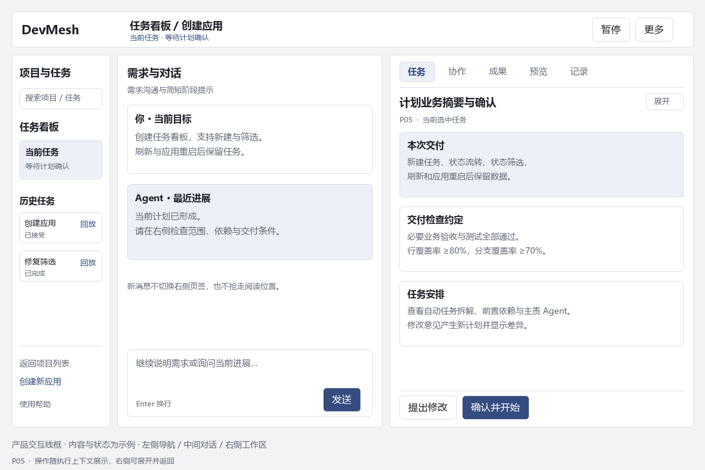

展示交付内容、验收办法、修改意见和确认动作；关闭面板不等于确认。

**任务依赖图：** 右侧“任务／计划”中的工作清单与依赖图可切换，默认清单；二者显示同一计划版本，保持当前选中的工作。每项工作展示目标、主责 Agent、前置工作、输入依据、预期成果和完成条件。依赖图支持缩放、适配全部和定位选中；点击节点查看详情，并突出前置与后续工作。查看不改变依赖或确认状态。

存在循环依赖、缺失输入、无主责工作或遗漏必要验证时，在问题列表标明涉及工作和受影响范围，确认按钮不可用并提供补充或重新规划入口。生成失败保留原需求及意见，重试只重新规划；新版本先展示任务、依赖和验证范围的变化，历史图保持只读。

**交互原型 P05：自动任务拆解与 DAG**

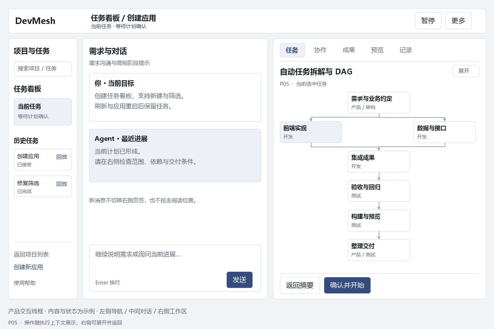

展示任务依赖、独立分支和选中工作详情；查看图不修改计划或依赖。

##### 5.2.3.3 业务规则

| 编号 | 类型 | 业务规则 |
| --- | --- | --- |
| 计划-01 | 约束 | 首次实现前必须有当前有效计划及明确执行授权；计划模式和旧任务须人工确认准确方案；范围、必要验收和重要假设在业务摘要中明确，不藏在专业详情中。 |
| 计划-02 | 约束 | 计划应有明确工作、负责角色、先后关系、输入、成果与完成依据，缺项或互相等待时先修正。 |
| 计划-03 | 触发 | 修改意见形成新计划后，旧版只读，原确认不自动用于新版；新增关键变化需再次审阅。 |
| 计划-04 | 约束 | 计划额外自动修正次数按 4.3 设置，耗尽后说明问题并等待补充、调整目标或结束。 |
| 计划-05 | 触发 | 未暂停时有效确认进入准备；已暂停时仅保存计划确认，仍需主动恢复。 |
| 计划-06 | 推论 | 关闭计划、阅读依据和稍后处理不产生授权，执行准备完成也不等于需求完成。 |
| 计划-07 | 约束 | 需求应自动形成可执行子任务及 DAG；每项工作具有明确目标、主责 Agent、前置依赖、输入、成果和完成条件。 |
| 计划-08 | 约束 | 生效计划的依赖关系必须无环；必要工作、输入、负责人或验证缺失时先修正，不能直接执行。 |
| 计划-09 | 触发 | 前置成果有效才允许开始依赖工作；独立工作按实际资源并行，局部阻塞不自动停止其他工作。 |
| 计划-10 | 触发 | 新增修复或复验工作时保留原任务与失败，形成后续工作及可追溯计划版本；保持依赖无环，不把已结束工作改成循环等待。 |
| 计划-11 | 约束 | 已确认范围内的修复按既定预算与规则继续；改变目标、必要验收或关键约定时须重新确认，旧确认不覆盖新增授权。 |

计划先展示已知限制和范围，估计必须注明依据及不确定性。没有可靠数据时显示“暂无可靠估计”，不以模拟倒计时或固定进度条暗示完成时刻。

产生额外工作时，说明新增功能、返工及重新验证范围；费用只有可获取时才展示，估算与实际分开。调整执行预算需用户明确确认，不能将“继续解释”“稍后处理”理解为增加预算。

#### 5.2.4 协作执行与过程查看

##### 5.2.4.1 业务流程

入口：进入项目默认的当前执行，或从项目列表的待办数量进入。

| 步骤 | 用户动作 | 页面响应与定位 | 下一步 |
| --- | --- | --- | --- |
| 1 | 进入当前执行 | 顶部显示目标、阶段与状态，中间仅显示简短进展，右侧任务展示完整工作和待办 | 有必须处理项则置顶对应待办；没有时显示正在开展与后续阶段 |
| 2 | 点击待办数量 | 打开当前执行待办列表，按影响分组 | 点击事项直接打开问题、计划、变更、冲突或交付，不要求在聊天中寻找 |
| 3 | 点击一项工作或图节点 | 右侧展开工作详情，选中对应图节点及成果 | 可以查看输入摘要、输出、失败或等待原因和尝试历史 |
| 4 | 点击相关报告或来源 | 在详情中切换到目标内容，顶部提供返回工作 | 返回后保持图位置、原筛选和工作选择 |
| 5 | 提交待办操作 | 就地显示保存、应用或核实过程 | 真正解决后移出待处理列表；仅收起或保存草稿不能移除 |
| 6 | 切换项目再返回 | 展示该项目最新真实状态，保留浏览选择 | 新消息不强制滚动离开用户正在阅读的历史，显示“有新进展”入口 |

局部问题只阻塞相关工作时，待办说明“影响部分工作，其他工作继续”。所有工作都不能继续时，主提示说明下一步需要谁处理。工作无变化但仍在进行时，显示当前工作、最近更新时间与可用控制；不能用假进度填满界面。

##### 5.2.4.2 页面交互

**工作概览、协作图与详情（P06）**

入口：右侧“任务／工作进度”。默认工作列表，可切换 DAG，选择保持在同一工作；中栏只显示简短阶段与最近进展，完整工作、状态、依据和重试入口在右侧。

| 元素 | 展示、默认与可选项 | 动作结果 |
| --- | --- | --- |
| 阶段概览 | 需求、计划、准备、实现、验证、审查；当前阶段突出显示 | 已发生阶段可看记录；未来阶段只说明后续内容，不伪造已开展工作 |
| 工作行/节点 | 工作名、主责、真实状态、等待原因摘要、尝试次数 | 点击打开右侧工作详情，不离开项目 |
| 状态筛选 | 默认全部，可筛进行中、待处理、失败、已完成 | 只改变展示；筛选后无结果可清空，不能误显示项目无工作 |
| 工作详情 | 目标、前置、当前状态、采用的要求、成果、检查、未完成项 | 点击成果或来源在同一侧栏切换，保留“返回工作” |
| 尝试历史 | 默认最近一次，旧失败按时间展开 | 不覆盖原失败；过期成果标不适用，不参与当前完成汇总 |
| 重试此工作 | 仅当前有效工作已确定失败、允许安全重复、预算足够且未暂停时可用 | 提交后显示新尝试；不能重试的原因就近显示 |
| 并行说明 | 显示实际重叠工作与时间，资源不足则显示排队 | 图上并排不直接出现“并行成功”标记 |

查看历史计划时固定标“旧计划，只读”，保留回当前计划入口；切回后恢复上次浏览位置。图支持缩放、适配全部、定位选中，不能拖动改变状态或工作关系。工作清单与图使用同一当前计划范围，失效工作在历史中查看，不混入当前完成数量。

**交互原型 P06：执行进展与局部待办**

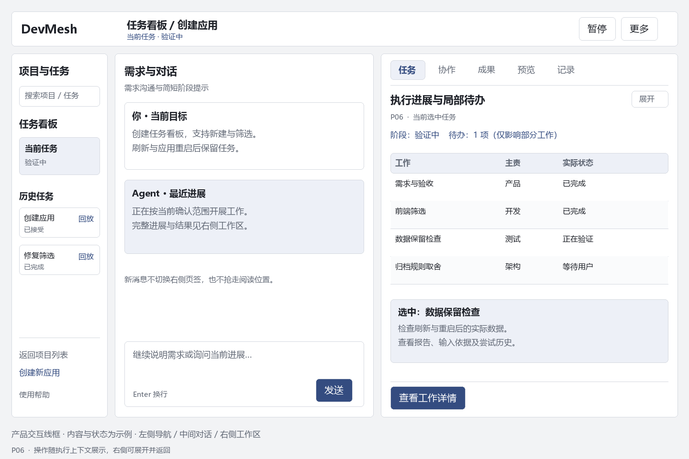

展示阶段、实际工作与局部阻塞，独立工作可继续，详情保持当前工作归属。

**角色、交接与工具（P07）**

入口：右侧“协作”，或从右侧工作详情的执行者、交接和工具来源定位。工作区内可切“角色概览”“交接”“工具记录”“本次配置”，一级页签不变；所见始终属于当前选中执行。

| 内容或筛选 | 默认与操作 | 反馈 |
| --- | --- | --- |
| 角色概览 | 产品、架构、开发、测试 Agent 的职责、当前任务及成果；未分配明确显示 | 在线、工作中和等待分开，不以动画代替实际状态 |
| 交接记录 | 最近交接在前，标明 A2A 协作来源，显示发送与接收 Agent、任务、依据版本、接收/处理状态、成果和未决事项 | 点击展开说明和对应成果；未接收或失败如实显示，无交接说明尚未发生 |
| 工具筛选 | 默认全部，可按用途、结果和所属工作筛选 | 同一执行内生效；清空恢复全部；无匹配不删原记录 |
| 工具详情 | 业务用途、所属 Agent 与工作、MCP 服务及工具名称、执行进度、开始/结束或最近核实、结果与证据；编码服务内部工具单独标明来源 | 脱敏原始内容单独展开；MCP 调用与内部工具记录可区分，来源未知时明确说明 |
| 失败记录 | 显示执行失败、连接失败或结果未知 | 读取原报告与重新执行区分；未知状态只提供核实，不出现重跑快捷按钮 |

点击角色或工具中的成果在当前面板打开，返回保留筛选和列表位置。日志内容按需加载，加载失败只重读该段，不改变业务结论。不展示秘密值或模型内部思维。

**交互原型 P07：A2A 任务与成果交接**

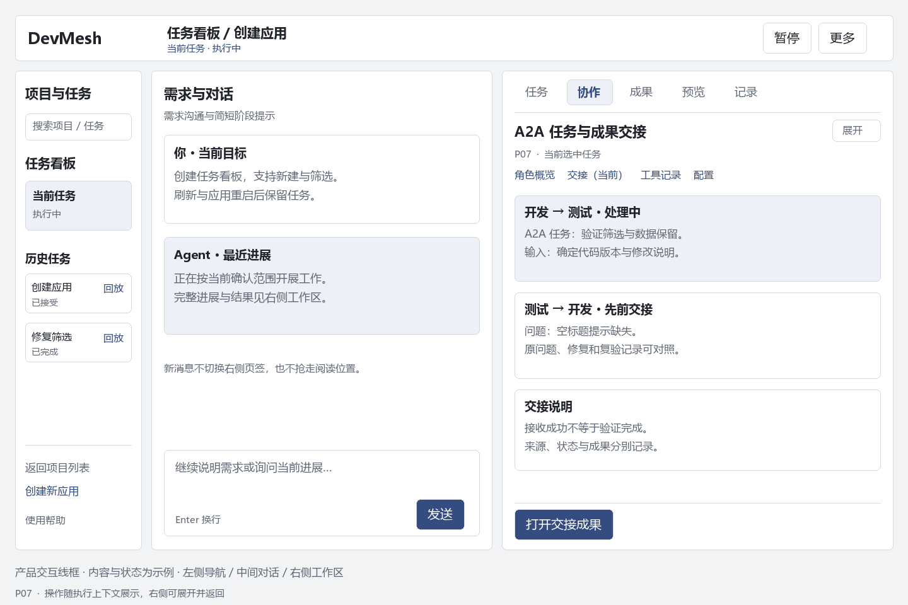

展示发送与接收 Agent、任务依据、交接成果及处理状态，接收与完成分开呈现。

**交互原型 P07：MCP 接入与实际调用**

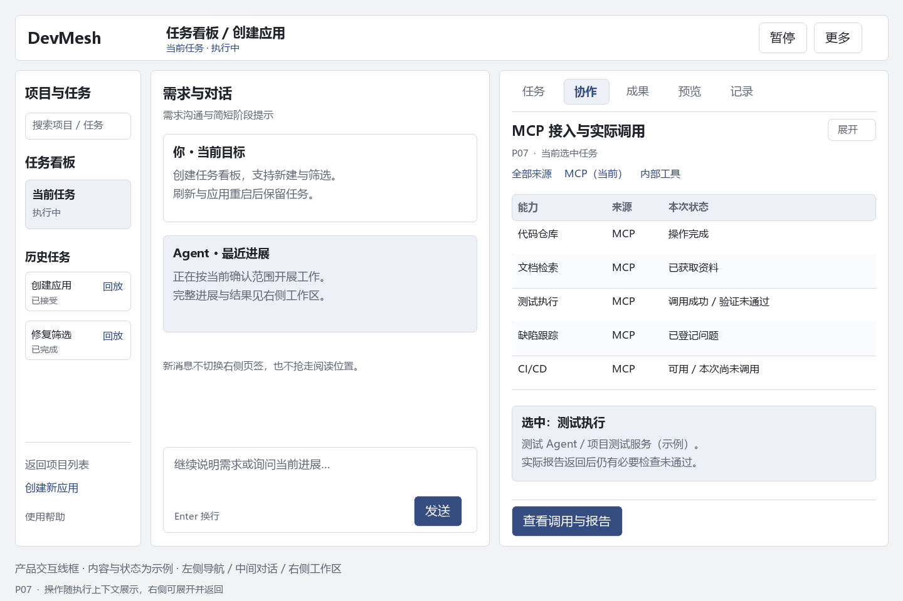

展示五类接入、来源筛选和实际调用结果；接入可用不代表每次任务都已经调用。

**待办列表**

待办按“必须处理才能继续”“仅阻塞部分工作”“可稍后查看”说明影响，默认优先显示必须处理项，同级按产生顺序。每项展示项目、目标、原因和进入处理按钮；数量按未解决事项计，不按消息条数计。

用户查看其他项目时，项目列表保留真实状态与待办标记；返回当前项目可见最新结果。取消、完成和需要处理的失败有持续状态提示。站内提示不自动代替确认，不默认新增邮件、即时通讯或浏览器通知要求。

当前工作长时间没有新消息时，说明当前事项、最近真实进展和更新时间。没有可靠预计时间时明确未知，不以假百分比或无限旋转代替工作说明。

##### 5.2.4.3 业务规则

| 编号 | 类型 | 业务规则 |
| --- | --- | --- |
| 协作-01 | 触发 | 当前计划取得有效任务执行授权或人工确认后自动准备代码、依赖和运行条件；新建基于已验证模板，迭代基于接受版本。 |
| 协作-02 | 约束 | 只有前置成果有效、资料与运行条件具备、必要决定已处理且执行允许时，工作才能开始。 |
| 协作-03 | 约束 | 可独立的工作在资源允许时并行；按 4.3 展示实际并行限制，资源不足如实排队。 |
| 协作-04 | 推论 | 局部分支等待不阻止独立工作；没有可继续工作且无在途工作时才整体等待。 |
| 协作-05 | 约束 | 每项开发修改与工作关联，不能相互覆盖未经确认的成果；汇总后形成确定版本供测试、构建和预览。 |
| 协作-06 | 事实 | 角色在线、实际工作、交接和成果是不同信息，消息多或名称多不等于发生有效协作。 |
| 协作-07 | 约束 | 实际调用、动作受理、执行完成和验证通过分别判断；模型自述不能替代真实结果。 |
| 协作-08 | 触发 | 准备或读取失败保留需求与成果，只补未完成步骤；原会话或工具结果未知时核实原工作，不盲目重复。 |
| 协作-09 | 约束 | 超过信息容量时优先保留有效约束、决定与验收；必要内容仍不足以处理时说明需要调整，不静默丢失。 |
| 协作-10 | 约束 | 产品、架构、开发、测试四类 Agent 分工明确，每项工作与实际执行 Agent、输入依据和成果关联；协作结论须能追溯到实际工作。 |
| 协作-11 | 约束 | Agent 间委派、状态同步和成果返回采用 A2A 协作，并关联对应工作与有效版本；发送成功不等于接收完成或任务完成，失败与未知分别展示。 |
| 协作-12 | 约束 | MCP 工具和资料仅在已授权范围内按任务需要使用，保留服务来源、用途、执行状态与结果；内部工具操作单独标记，不能作为 MCP 接入或调用的证明。 |

**智能体分工与交接成果**

| 角色 | 负责的工作 | 向后续角色提供的成果 |
| --- | --- | --- |
| 产品角色 | 理解用户目标、整理功能和约束、提出问题、明确验收 | 可检查的需求理解、验收标准、假设、来源和用户回答 |
| 架构角色 | 根据需求和现有条件提出方案，拆分工作并明确依赖与关键接口 | 方案、取舍、接口约定、计划，以及变化影响 |
| 开发角色 | 完成被分配的代码工作，说明改动并修复已确认缺陷 | 实际代码差异、修改说明、局部检查、已知风险和未验证内容 |
| 测试角色 | 明确验证办法，检查集成代码、登记缺陷、验证修复并准备运行证据 | 真实测试/构建/启动报告、缺陷与复验，以及可检查的应用预览 |

**A2A 消息、任务与成果交接**

Agent 间通过 A2A 传递消息、分发任务、同步状态和返回成果。工作台把消息与对应工作关联，展示发送与接收 Agent、业务内容、依据版本、时间、处理状态、成果和未决事项。首次发送、接收、处理中、结果返回以及失败或状态未知分别记录；收到消息不代表工作完成，状态未知时先核实原任务。

平台接入验收应能对照实际 A2A 交互及对应任务、状态和成果，核验任务分发、状态同步、正常结果返回，以及失败或取消后的反馈。界面展示与实际交接结果须一致，相关依据可在授权范围内脱敏查看。

**MCP 工具与资料能力**

本期至少接入 5 项符合 MCP 规范、可独立识别并实际使用的工具或数据源，覆盖下列业务能力。数量按具有不同实际能力的工具或数据源计，不按服务器数量、界面按钮或同一能力的别名计。接入验收逐项核验真实来源、可用能力和实际调用结果；单次用户任务按需调用，未使用不代表该接入失效。

| 接入能力 | 最低可用业务动作 | 用户可检查的依据 |
| --- | --- | --- |
| 代码仓库 | 查看任务相关文件、比较修改、保存或获取确定代码版本 | 仓库与文件来源、实际差异、对应版本和操作结果 |
| 文档检索 | 检索项目资料，并打开命中内容的原文 | 检索条件、命中内容、原文位置和资料版本 |
| 测试执行 | 发起测试、查看进度和报告、请求停止 | 实际检查项、运行记录、测试结果和停止核实结果 |
| 缺陷跟踪 | 登记问题、关联修复、更新处理和复验状态 | 复现条件、期望与实际、修复记录、复验及关闭依据 |
| CI/CD、构建与预览 | 触发约定的构建或交付流水线，查询状态、日志和构建成果，按交付范围准备预览 | 流水线来源、触发记录、状态、日志、构建版本与成果；需要预览时另有可访问地址和检查结果 |

P07 工具记录可按“MCP 接入／编码服务内部工具”、用途、结果和所属工作筛选，默认全部。MCP 详情显示实际服务与工具或数据源名称、执行 Agent、业务用途、调用状态、时间和结果依据；内部工具单独标明来源。连接可用、发现能力、调用成功和业务验证通过分别展示。

必要能力不可用时，列明受影响工作、最后检查时间与处理入口，相关工作等待；独立工作可继续。对失败调用可查看原因，对结果未知的调用先核实；重新执行须满足安全重复及当前执行条件。正式生产发布仍按 4.2 的交付边界处理。

**信息共享范围**

| 信息 | 共享原则 |
| --- | --- |
| 用户目标、有效决定、必要约束和验收 | 相关角色必须获得，并能查看来源 |
| 设计、接口和代码 | 按当前工作需要提供相应部分，避免所有角色获得全项目资料 |
| 失败和缺陷依据 | 提供给负责定位、修复或复验的角色 |
| 历史对话与说明 | 只共享与当前工作相关的内容；摘要保留原文入口 |
| 凭据及敏感内容 | 按权限隐藏或脱敏，普通提示词、日志、应用和导出中不出现原始秘密 |

信息过多时优先保留有效决定、必要要求和验收，缩小无关资料或历史范围。如果关键内容仍超出模型可处理范围，应说明需要拆分工作或调整资料，不能静默丢弃验收。

资料或代码注释中的指令不能自动扩大角色权限。敏感内容无法安全处理时，停止该次发送并说明原因，提供修改资料或处理连接的入口。

角色规划前的理解和验收准备同样保存真实工作记录。用户确认准备条件，不需要自行选择执行目录或安装命令；连接与运行条件需要处理时，说明影响和处理入口。

#### 5.2.5 需求变更

##### 5.2.5.1 业务流程

入口：对话输入选择“补充或修改”，或需求理解卡“补充或纠正”。前提：本次执行未结束；结束后的新目标走项目与任务管理流程（5.2.1.1）。

| 步骤 | 用户动作 | 系统和界面响应 | 分支与去向 |
| --- | --- | --- | --- |
| 1 | 发送变化描述 | 先显示系统理解的变化用途，不立即替换原要求 | 用途不明则请求说明；纯解释询问不进入变更 |
| 2 | 等待影响整理 | 变更卡显示“正在分析影响”，说明相关工作暂缓情况 | 分析失败保留提议并提供重试或放弃 |
| 3 | 打开变更审阅 | 并列展示原要求、新要求，以及保留、修改、新增和重新验证项 | 能看出正在生效的仍是哪版要求 |
| 4A | 选择暂不采纳 | 显示仍按原目标继续，并检查已中断工作 | 原提议保留为历史，不标成已实施 |
| 4B | 点击确认本次修改 | 保存后先显示“已确认，待应用” | 正在手动暂停时停在此状态，不恢复实际研发 |
| 5 | 查看应用进度 | 展示计划调整、原工作收尾及后续范围 | 成功后明确“新要求已生效”；失败保留受影响等待 |
| 6 | 应用失败后重试或放弃 | 重试只继续应用；放弃先检查实际改动是否符合原目标 | 可安全回到原要求后继续；无法证明时说明待处理，不假称已还原 |

同一时间仅处理一项待确认或待应用变化，后续提议在对话中显示“已保存，等待前一项处理”。前一项处理完后，结合最新有效要求重新分析下一项，不能沿用过期影响范围。关闭审阅仅退出查看，不撤回提议或自动接受。

##### 5.2.5.2 页面交互

入口：右侧“任务／变更”及待办“检查影响”；中栏只显示提议摘要并定位同一视图。右侧依次展示提议、当前要求、新要求和影响，分析未完成时显示真实进度，底部确认不可用并说明原因。

| 字段或操作 | 具体规则 | 结果 |
| --- | --- | --- |
| 新旧要求对照 | 逐条区分新增、删除、修改，原要求只读 | 来源可查看，不把模型概括替换用户原文 |
| 影响清单 | 保留、需修改、需重新处理、新增、重新验证分组 | 每项有原因；分析失败显示具体受阻信息 |
| 预算和数据影响 | 显示已知新增工作、是否改动既有数据、实际限制 | 无可靠估计就写未知；不能用零值代替未知 |
| 确认本次修改 | 当前影响完整有效、权限具备且无冲突的其他变化应用时可用 | 保存后已确认待应用；成功应用再显示新要求生效 |
| 暂不采纳 | 对当前待确认提议可用，不要求理由 | 提议结束为未采纳，沿原要求继续；已中断工作按实际恢复 |
| 补充变化说明 | 输入 1～4,000 字并重新分析 | 当前确认按钮停用，展示影响更新，需重新检查 |
| 放弃已确认变更 | 仅应用失败或尚未开始应用、可安全处理时提供 | 先说明已产生影响，核实并恢复原要求后继续，不承诺一键撤销所有操作 |

**状态顺序：** 分析中→待确认→已确认待应用→应用中→已生效；失败明确发生在分析或应用。已生效提议只读，之后纠正应新建变更。后续排队提议显示等待前项，不能直接确认旧影响结果。用户手动暂停时保存选择但不进入实际应用。

**交互原型 P08：需求变更与影响确认**

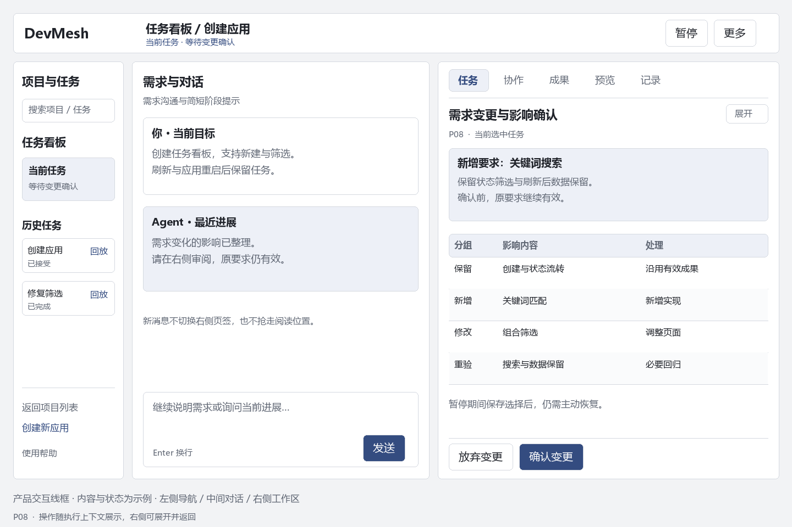

展示新增要求、保留内容和重新验证范围；确认与实际生效分别反馈。

##### 5.2.5.3 业务规则

| 编号 | 类型 | 业务规则 |
| --- | --- | --- |
| 变更-01 | 事实 | 提议、确认与成功应用是不同状态；新变化未应用前，原要求仍是当前有效依据。 |
| 变更-02 | 约束 | 同一执行逐项处理待确认或待应用变化，后续提议按最新有效要求重新分析，不能沿用过期影响。 |
| 变更-03 | 触发 | 先分析直接受影响工作与必要后续，说明保留、修改、新增、重新处理和重新验证范围。 |
| 变更-04 | 约束 | 相关在途工作先安全收尾或停止核实；结果暂不供后续使用，无关工作在范围明确后可以继续。 |
| 变更-05 | 推论 | 输入、约束、内容和验证仍适用的成果可以保留；不确定时重新处理并说明原因。 |
| 变更-06 | 触发 | 拒绝后沿原要求继续，实际中断工作重新开展；应用失败时继续阻塞受影响范围，不声称新要求已生效。 |
| 变更-07 | 约束 | 放弃已确认变化须核实已产生修改，必要时按原要求调整并重新验证，不能虚称自动撤销。 |
| 变更-08 | 约束 | 需求、接口约定或代码变化使相应后续验证重新检查；手动暂停期间只保存选择，不实际恢复。 |

| 变化 | 默认影响判断 |
| --- | --- |
| 需求内容变化 | 检查使用该要求的工作，以及依赖这些成果的后续工作 |
| 接口约定变化 | 检查相关前后端实现、契约检查及后续成果 |
| 集成代码变化 | 对当前代码重新进行必要测试、构建和预览，旧报告仍显示原适用版本 |
| 仅修改执行预算或排队安排 | 保留内容和依据仍有效的已完成成果，记录本次调整 |

#### 5.2.6 冲突处理与人工决策

##### 5.2.6.1 业务流程

入口：右侧“任务”的待决定事项；中栏冲突消息仅作摘要与定位。只有有依据的真实业务取舍才提供裁决，线索不足时显示待核实。

| 步骤 | 用户动作 | 页面响应 | 分支与完成判断 |
| --- | --- | --- | --- |
| 1 | 打开冲突 | 顶部说明同一问题、为何要选择、哪些工作等待；方案按业务差异比较 | 任一必要依据缺失时不允许确认，显示待补充 |
| 2 | 点击解释差异或查看依据 | 同一面板展开解释或来源；保留选择草稿 | 阅读和询问都不产生有效选择 |
| 3A | 选择方案并提交 | 无默认选项，选后显示影响摘要；可填可选意见 | 保存成功显示“已决定，待应用”，不会立即标解决 |
| 3B | 拒绝全部 | 切换到拒绝表单，理由必填 | 保存后等待新候选；原候选只读，相关工作仍等待 |
| 3C | 补充信息 | 打开补充输入并说明可能改变方案 | 保存后显示重新核实，旧选择是否失效有明确提示 |
| 3D | 稍后处理 | 关闭面板并回原位置 | 待办保留，无关工作按原规则继续 |
| 4 | 查看应用及验证 | 按已决定、正在应用、正在复验、已解决展示阶段 | 应用或复验失败保留原因与入口；实际复验通过才解决 |

依据更新使旧卡过期时，旧卡保留草稿供参考并跳转当前方案，不能自动把旧选项带到新方案。已手动暂停时只保存决定，恢复后才应用。选择影响原必要规则时，先按需求变更流程（5.2.5.1）确认要求变化。

##### 5.2.6.2 页面交互

入口：右侧“任务／待决定事项”或受影响工作。顶部固定问题与影响范围，面板内按业务维度比较方案，选择和确认固定在右侧底部；必要时可展开为大视图。

| 字段/操作 | 校验与初始状态 | 提交或展开后 |
| --- | --- | --- |
| 问题与依据 | 必须明确同一问题、双方出处和待决定原因 | 证据不足显示待核实，确认按钮不可用 |
| 候选选择 | 单选，初始不选；显示提出方、效果、限制、修改及验证 | 点击仅形成选择草稿，下方更新本方案影响摘要 |
| 推荐 | 有合理依据才标推荐，说明前提 | 推荐不等于已选，不自动提交 |
| 意见 | 选择方案时可选，最多 2,000 字 | 与本次有效决定一并保存 |
| 确认选择 | 有效候选已选、依据未更新时可用 | 成功先显示已决定待应用；处理阶段继续显示不再重复选择 |
| 拒绝全部 | 点击切换理由表单，1～2,000 字必填；有“返回方案” | 提交后显示等待新方案，旧候选只读；返回未提交表单保留草稿 |
| 补充信息 | 展开 1～4,000 字说明，可引用已选资料 | 提交后重新核实，说明旧候选是否失效 |
| 解释差异 | 在面板内展开说明，可继续追问 | 不改变选择或执行；只产生解释记录 |
| 稍后处理 | 点击收起 | 待办保留，回到原位置，无关工作继续 |

两页并发选择后，仅一项有效；另一页显示已保存方案和时间，并提示本次未提交，保留可查看的原意见。依据变化后方案过期，清除可提交选择但保留文字草稿供参考。完成应用且复验通过才在冲突列表移入已解决；不能用关闭面板表示已解决。

**交互原型 P09：冲突方案与人工裁决**

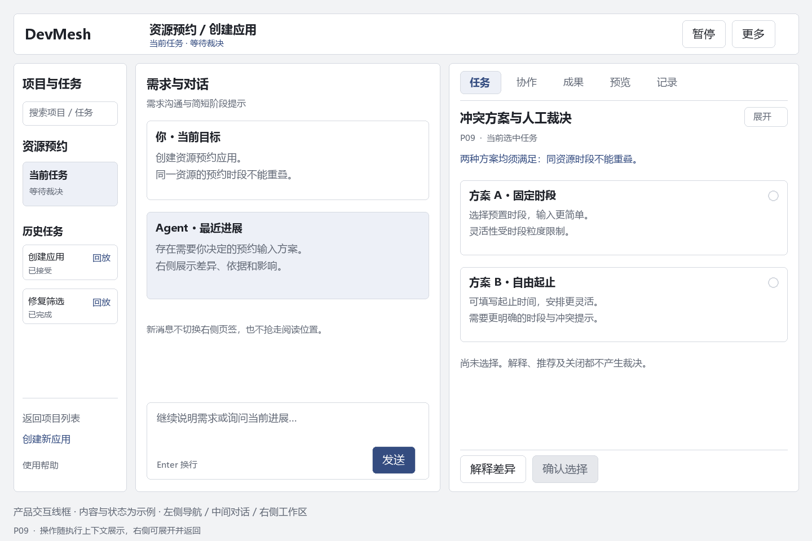

展示方案差异、依据和选择入口，解释方案或关闭查看不产生裁决。

##### 5.2.6.3 业务规则

**需要裁决的问题**

| 情况 | 识别与展示要求 | 后续处理 |
| --- | --- | --- |
| 不同角色提出互斥方案 | 确认双方讨论同一个问题，展示各自方案、理由、假设及依据 | 比较取舍并让用户选择，相关工作等待，无关工作继续 |
| 已确认接口与新方案不一致 | 展示原约定和实际差异，说明是否确实需要改变约定 | 保持原约定修复实现，或由用户确认接口变化后调整相关工作 |
| 代码无法安全集成 | 展示冲突文件、双方修改、共同起点和实际失败依据 | 提出可行调整方案，决定后重新集成和验证 |

| 编号 | 类型 | 业务规则 |
| --- | --- | --- |
| 冲突-01 | 约束 | 没有足够来源和双方真实取舍时先核实；实现违反唯一已确认要求时按缺陷处理。 |
| 冲突-02 | 约束 | 候选必须对应同一问题并说明业务效果、依据、限制、影响和验证；推荐不预选，不自动提交。 |
| 冲突-03 | 约束 | 违反原必要规则的方案不能当普通候选，若需放宽原规则则先按 5.2.5 确认变更。 |
| 冲突-04 | 触发 | 选择保存后展示待应用，再到应用和复验；只有实际应用且相关验证通过才标解决。 |
| 冲突-05 | 触发 | 拒绝全部重新提出候选；补充信息重新核实；稍后处理保留待办；关闭不是选择。 |
| 冲突-06 | 约束 | 同一有效依据只保存一次决定；依据更新后旧选择过期，不能用旧候选解除新阻塞。 |
| 冲突-07 | 触发 | 应用失败保留进展，安全重试；复验失败区分实现缺陷和新的方案取舍，分别修复或再次审阅。 |
| 冲突-08 | 约束 | 手动暂停时仅保存有效决定，恢复后才能实际应用。 |

**方案比较示例**

以资源预约为例，用户已经要求“同一资源的预约时段不能重叠”，但尚未确定时间选择方式。两个候选可以分别采用“固定时段选择”和“自行填写起止时间”。比较应说明：前者操作简单但时间粒度受限；后者灵活但需要更清楚的时间和重叠校验提示。两者都必须满足已确认的不重叠规则。

用户认为并无真实分歧时可补充原决定或双方一致的依据。系统核实后说明待办为何撤销或继续存在，不要求随意选项来消除误判。

#### 5.2.7 暂停、恢复、取消、重试与整次重做

##### 5.2.7.1 业务流程

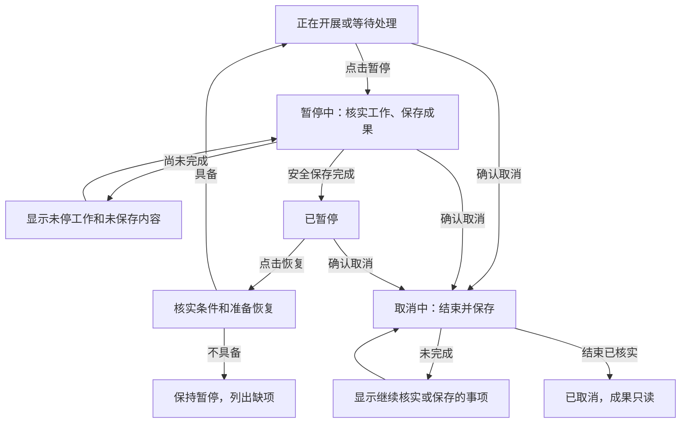

| 操作 | 具体交互 | 操作后的位置与选择 |
| --- | --- | --- |
| 暂停 | 点击即受理，不弹额外确认；顶部转暂停中，展开收尾事项 | 用户可关闭详情，顶部继续显示；所有实际收尾完成才变已暂停 |
| 恢复 | 已暂停时点击，按钮显示正在核实；列当前已保存进度、有效成果与缺项 | 成功回实际阶段；失败保持暂停，可补齐条件、重新核实或取消 |
| 取消 | 打开简短确认框，说明结束目标、保留成果及本次临时预览停止 | 确认后框关闭，顶部转取消中；结束后进入该执行的只读概览 |
| 关闭或反悔 | 取消确认前点返回或关闭，没有副作用 | 已受理取消后不能用关闭面板撤销，安全结束后原执行只读；已有接受版本时可另行提交迭代目标 |

暂停超过 30 秒仍未确认完成，展示具体待核实事项和最近检查，继续核实，不自动变已暂停。保存失败时就地提供“重试保存”；仅查看、重新核实和重复点击不会重启原业务工作。

**整次任务重做流程**

入口：顶部右侧“更多／重做本次任务”，在右侧“任务”展示影响与确认。适用于尚未接受交付的当前任务，失败或取消后也可按条件创建关联新执行；已接受交付通过正常迭代提出新目标。

| 步骤 | 用户动作与产品响应 | 继续条件与返回 |
| --- | --- | --- |
| 1 核实当前任务 | 展示任务、当前执行和是否已接受；仍在工作时说明须先暂停保存，提供“暂停并检查” | 采用现有暂停流程；原工作状态未知或保存未完成时只可核实，不进入最终确认 |
| 2 检查重做影响 | 展示原始需求、当前已确认的补充与资料、任务开始时的代码起点，以及整次重新执行范围 | 原执行的代码修改、验证和临时预览不作为新执行已完成成果；原记录保留，已接受版本不变 |
| 3 确认重做 | 用户检查影响后点击“确认重做” | 活动原执行先安全结束，再创建同一任务的关联新执行；同项目仍仅一个活动执行 |
| 4 审阅新执行 | 新执行显示来源、采用的需求与起点、全量工作和新一轮限制 | 重新检查并确认当前计划后才开始实现；重新确认不改写原执行的决定 |

尚未结束的原执行在重做确认后按取消流程安全收尾，结束原因记录为“用户要求整次重做”；已经失败或取消的原记录保留其终态。

最终确认前关闭重做面板，只保留安全草稿，已暂停的原执行保持暂停，不自动结束或恢复。确认受理后关闭面板不撤销操作；原执行已结束而新建失败时说明两项事实，提供“继续创建”，只继续原创建操作，避免多份新执行。

##### 5.2.7.2 页面交互

顶部右侧固定显示当前执行允许的暂停／恢复；取消和整次重做位于“更多”。中栏不重复提供执行控制。右侧“任务”展示收尾进度或确认内容，不随聊天滚动消失；历史查看仅显示只读及返回当前任务的导航。不可用操作就近说明原因。

| 当前状态 | 主操作 | 次操作和就近说明 |
| --- | --- | --- |
| 规划中、执行中、验证中、等待处理 | 暂停 | 取消；待办处理独立显示，不与暂停混成一个按钮 |
| 暂停中 | 查看暂停进度 | 取消；恢复不可用，说明仍在停止或保存 |
| 已暂停 | 恢复 | 取消、重做本次任务；操作前核实保存与当前任务条件，缺项就近说明 |
| 正在核实恢复条件 | 查看核实进度 | 取消；不重复发起恢复，仍保留暂停事实直到核实通过 |
| 取消中 | 查看结束进度 | 不再提供恢复、重试或新确认；只读查询与安全收尾操作可用 |
| 已完成、失败、已取消 | 查看成果或历史 | 当前尚未接受的任务可按条件整次重做；已接受应用从当前接受版本继续迭代，原执行保持只读 |

**暂停详情：** 分“正在结束的工作”“待核实事项”“尚未保存材料”“已保存进度”四组；每行有名称、实际状态和最近检查时间。无未完成项且材料完整才显示已暂停。关闭详情不改变暂停过程，顶部保留状态和再次打开入口。

**交互原型 P10：暂停收尾与状态核实**

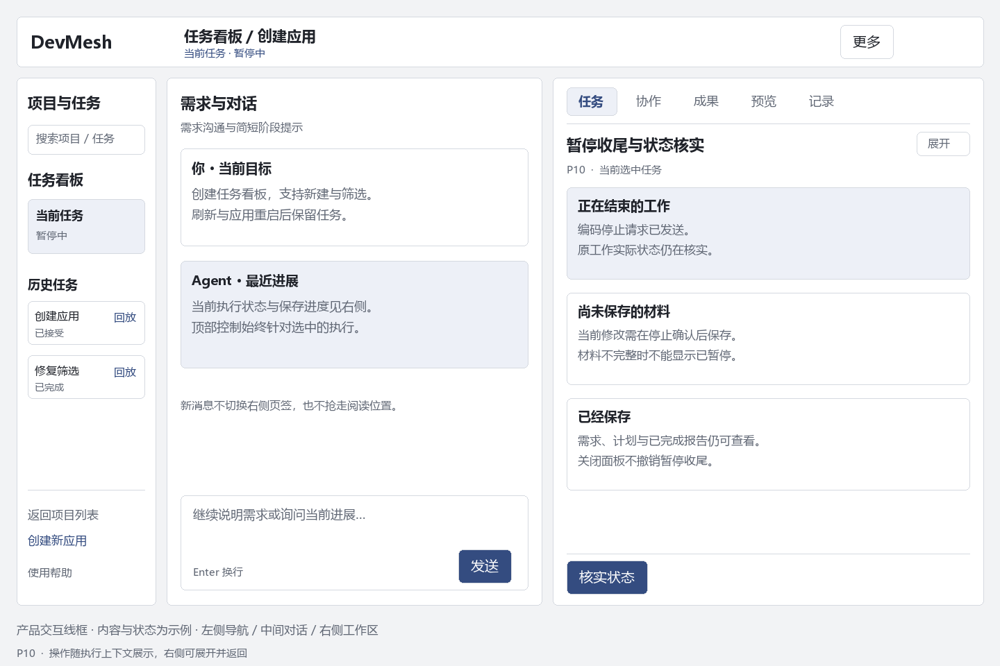

展示仍在结束、尚未保存及已保存事项，完成收尾前不提供恢复。

**失败工作重试：** 对当前有效且已确定失败的工作提供“重试此工作”，说明失败原因、输入是否仍有效以及可用次数。原工作结果未知时先核实；可安全重复且未超限时才创建新的尝试，保留原失败记录并回到同一工作详情。已暂停时须先恢复；整个执行已结束后，原记录保持只读。

**取消确认框：** 标题“结束本次执行？”；展示目标、已保存成果、未完成内容、本次未接受预览会停止、原接受版本不变；按钮为“返回”和“确认取消”。默认焦点在返回；Esc/遮罩按返回处理；确认后显示取消中，不能用再次关闭恢复工作。

保存失败只提供“重试保存”，结果未知只提供“核实状态”；两者不重开编码或测试。取消失败仍显示取消中及具体障碍，不提供无依据的“强制标记已结束”。

**重做确认面板（P10）：** 从顶部“更多”进入，在右侧“任务”展示“重做本次任务”，范围固定为整次任务。显示当前执行、需求版本、原始代码起点、全部重新执行的工作、原未接受预览将停止、历史保留及新执行仍需计划确认。按钮为“返回原任务”和“确认重做”，默认焦点在返回；保存未完成、存在未知在途工作、已有其他活动执行或交付已接受时不可确认并说明原因。

确认前需求、起点或任务状态变化时，保留说明草稿，提示重新检查，原确认不生效。受理后显示原执行收尾与新执行创建两个实际进度；重复点击或返回同一面板不重复创建。成功进入新执行的计划审阅，顶部保留来源及返回原记录入口。此操作不提供历史恢复点或局部工作范围选择。

**交互原型 P10：整次任务重做确认**

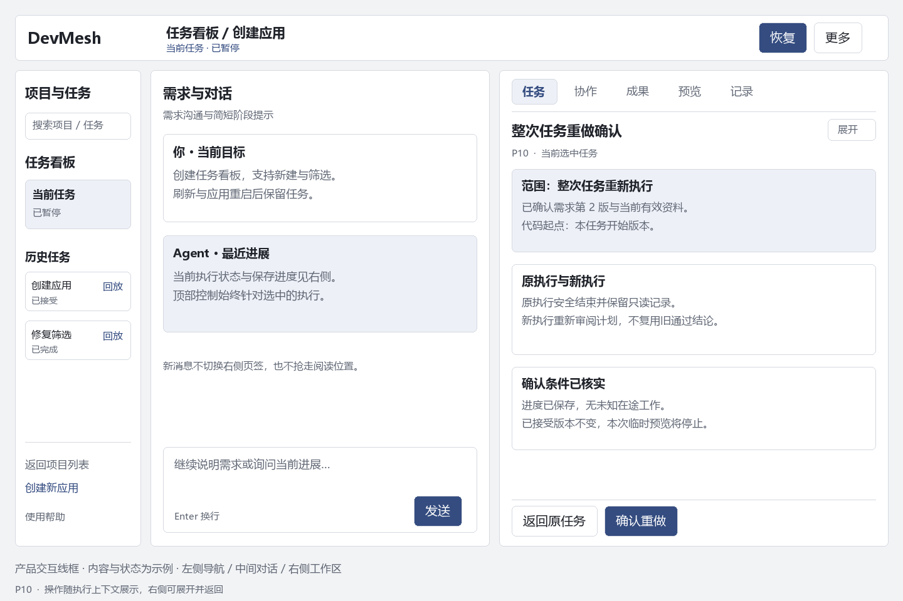

展示固定整次重做范围、原执行处理和新执行确认；不提供历史恢复点或局部范围选择。

##### 5.2.7.3 业务规则

| 编号 | 类型 | 业务规则 |
| --- | --- | --- |
| 控制-01 | 触发 | 暂停或取消受理后停止安排新工作，核实并结束在途动作，保存真实成果和进度。 |
| 控制-02 | 约束 | 停止请求、正在收尾和实际停止分别显示，材料完整保存后才能显示已暂停。 |
| 控制-03 | 触发 | 超过 4.3 的停止核实提示时长仍不明，继续展示待核实项和最近检查，不虚报已停。 |
| 控制-04 | 约束 | 恢复前检查有效要求、计划、配置、代码、成果、原工作状态和预算；临时条件已清理可先重新准备，材料缺失或原工作不明时保持暂停，列缺项并提供补齐条件、重新核实或取消；恢复沿当前已保存进度进行，不切换历史起点或静默回旧代码。 |
| 控制-05 | 推论 | 保存回答、计划确认或裁决不解除手动暂停；恢复后沿有效成果继续，中断工作重新尝试。 |
| 控制-06 | 触发 | 取消与暂停同时发生时取消优先；取消已受理不能靠关闭面板反悔，结束后原执行只读。 |
| 控制-07 | 约束 | 取消保留已有成果，不把未接受代码设为项目起点，也不承诺撤销已经发生的修改和数据变化。 |
| 控制-08 | 触发 | 确定失败且可安全重复时可重试；原状态不明、输入已过期时只核实或先处理变化。 |
| 控制-09 | 约束 | 自动失败重试与暂停中断后的继续分开记录；重复手动点击不重置次数、修复轮次和活动时间限额。 |
| 控制-10 | 计算 | 活动处理预算按实际经过的时间计算，并行不重复累加；人工等待、纯排队和已暂停时间单列。 |
| 控制-11 | 触发 | 达到限额后停止新增工作并安全保存，用户明确调整后才继续；不能因反复恢复自动续期。 |
| 控制-12 | 触发 | 服务重启先核实原工作：原暂停保持暂停，原暂停中/取消中继续收尾，旧结果只归原记录。 |
| 控制-13 | 约束 | 平台自动保存当前需求、计划、决定、配置、代码及未完成修改、有效成果、剩余工作和原在途事项状态，并展示最近保存时间；必要材料未保存时不能显示已暂停。 |
| 控制-14 | 约束 | 人工重做针对尚未接受交付的当前整次任务；使用最新已确认需求与资料、该任务开始时的代码起点，创建关联新执行，原记录只读保留。 |
| 控制-15 | 约束 | 原执行须已核实安全停止且进度已保存；用户确认后才结束尚在暂停的原执行，未核实写入不能与新执行并行。 |
| 控制-16 | 触发 | 重做范围、版本或当前执行条件变化时重新检查；确认前退出不结束原执行，确认后退出不撤销已受理操作。 |
| 控制-17 | 约束 | 新执行不复用原未接受代码修改或原验证通过结论，重新确认计划、限制及必要验证；原已接受版本和历史成果保留。 |
| 控制-18 | 触发 | 原执行已结束但关联新建失败时只继续原创建；重复请求定位同一结果，重做前后分别记录耗时、介入和成果。 |

暂停时已有可访问预览默认保留至到期，可单独停止；取消结束本次研发并停止本次尚未接受的临时预览，其他接受版本的预览不连带停止。结束失败或取消后说明原因、已保存和未完成内容，提供查看与下载入口；当前未接受任务可按本节条件整次重做，已接受应用按正常迭代提交新目标。

#### 5.2.8 成果审查、验证、预览与交付

##### 5.2.8.1 业务流程

| 步骤 | 用户动作 | 页面响应 | 异常与后续 |
| --- | --- | --- | --- |
| 1 | 点击检查成果 | 默认打开需求清单，顶部显示本次版本和必要检查汇总 | 仍有验证进行时显示待验证，不能提前接受 |
| 2 | 选需求并查看检查方式 | 侧面显示要求、预期、实际结果和证据，提供当前预览入口 | 证据读取失败显示原状态未知，不直接改为通过或失败 |
| 3 | 按说明体验软件 | 展示对应预览版本、演示数据和必要人工检查 | 预览过期先恢复体验条件；不沿用其他版本的人工结果 |
| 4A | 对某项提出问题 | 打开退回表单，默认带对应需求，填写操作、期望和实际 | 原范围问题进入修复；新目标先处理变更；输入错误就地提示 |
| 4B | 完成人工检查 | 对需要人工判断的项明确选择通过或不通过；不通过必填原因 | 保存时记录当前版本；版本更新后重新判断必要检查是否适用 |
| 5 | 点击接受交付 | 条件齐备才可用；打开简短版本摘要框，说明该版本将成为迭代起点 | 当前版本/预览/必要结果变化则退回审阅，不代替用户确认新内容 |
| 6 | 确认接受 | 保存成功显示已完成、接受版本及后续入口 | 保存失败留在审查，保留原接受版本；不产生半成功提示 |
| 7 | 获取交付与回放 | 源码、Demo、报告、协作可视化及各 Agent 的 Prompt 与配置逐项可获取；回放显示独立打包进度 | 打包失败只重试打包，不撤销已接受事实、不重跑研发 |

关闭接受确认框不保存接受。下载部分成果、查看预览、保存人工检查与接受完整交付是不同操作，界面分别反馈，不互相代替。

##### 5.2.8.2 页面交互

**成果审查（P12）**

入口：右侧固定“成果”页签，内部按“需求验收”“报告”“交付材料”组织，默认需求验收。工作区固定当前目标、审查版本、接受状态与必要条件，退回、下载及接受操作位于右侧相应视图。体验应用切到独立的右侧“预览”，不在中栏或成果内部重复展开应用。

| 元素 | 默认内容与字段 | 具体操作 |
| --- | --- | --- |
| 需求清单 | 要求名称、必要/可选、当前状态、检查方法摘要 | 默认全部，可筛未通过/未验证/待人工；点击一项右侧展开详情 |
| 需求详情 | 原要求及来源、预期、实际、适用版本、报告、限制 | 打开证据、前往预览、提出此项问题；返回保留筛选与选择 |
| 人工检查 | 只有标明需人工检查的项提供“通过/不通过”，初始不选 | 通过保存结论；不通过必填原因；版本变化后重新判断适用性 |
| 退回修改 | 可从整体或某项进入，显示当前版本及选中需求 | 复现操作、期望、实际分栏；至少有一项具体问题，总说明 1～4,000 字；提交后显示修复或变更去向 |
| 接受交付 | 必要要求、人工检查、预览和材料齐备且无未解决阻塞时可用 | 不可用时可展开缺项并直接定位；不能仅以灰色按钮表示 |
| 下载部分成果 | 有可获取内容即可操作 | 先说明未完成和未验证范围，不改变接受状态 |

**交互原型 P12：逐项成果审查**

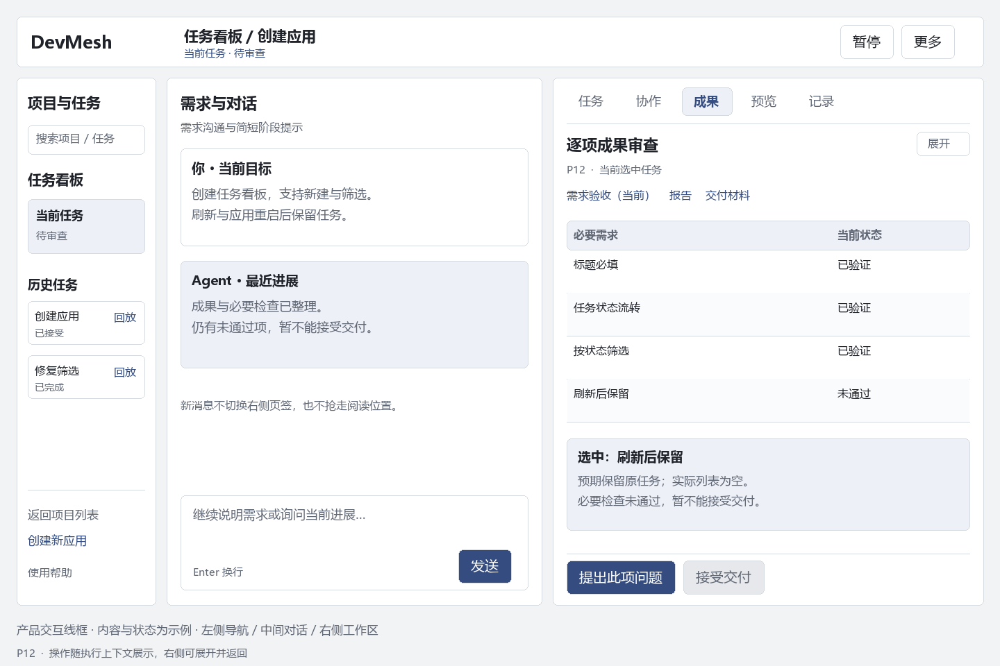

展示必要需求未通过时的退回与下载入口，接受按钮保持不可用。

**接受确认框：** 展示本次版本、完成功能、已知限制和“将作为下次迭代起点”；按钮“返回检查”“接受该版本”。不允许勾选忽略必要失败。确认中防重复；成功后显示完成与新起点；保存失败保留当前审查，旧起点不变。

**审查期间更新：** 顶部提示“成果已有新版本，请重新检查”，旧人工结果和意见保留为旧版本记录；不把草稿问题静默提交到新版本。用户点击查看新版本后先展示变化及需重新检查项，再启用操作。

**报告、缺陷与差异（P13）**

入口：右侧“成果／报告”及需求详情的证据链接。报告、缺陷与差异在同一右侧工作区切换，保留“返回需求”和原筛选，空间不足可展开，不覆盖中栏对话。

| 视图 | 展示字段与筛选 | 点击与结果 |
| --- | --- | --- |
| 报告 | 检查名称、通过/失败/跳过/未执行、适用版本、时间、范围 | 点击检查项看操作、预期、实际与日志；汇总未知项不显示为零失败 |
| 缺陷 | 标题、期望/实际、复现、严重程度、当前状态、代码版本 | 对照原失败、修复和复验；只有有效复验才关闭，不能点击强制改成功 |
| 差异 | 原接受版本与本次版本、文件新增/修改/删除、改动摘要 | 默认先看业务改动，再按文件展开；大文件给摘要和授权下载，不白屏 |
| 原失败与复验 | 并列说明相同问题依据和两次适用版本 | 可切换完整报告，保留原失败；没有复验则显示待验证 |

读取失败就地提示并重读原内容；验证已经明确失败时，连接问题不能抹掉原失败。复制或下载仅在授权范围内提供。无相关报告时说明尚未执行、不可获取或不适用，不能都叫“暂无数据”。

**应用预览（P14）**

入口：右侧固定“预览”页签；成果中的版本或预览来源链接定位同一内容。先显示可用性、对应版本和有效期，再提供新窗口打开、重新检查与停止预览；这些操作均在右侧，查看或体验不自动表示接受。

| 状态 | 显示内容 | 可用操作 |
| --- | --- | --- |
| 未准备/准备中 | 对应版本、构建/启动步骤和最近进度 | 查看日志；符合当前执行权限时可开始准备，已暂停或取消中不能新启动 |
| 可访问 | 对应版本、实际地址、最近检查、有效期、演示数据及体验步骤 | 打开应用、重新检查、停止预览 |
| 启动或入口失败 | 失败步骤、受影响版本、可确认结果 | 查看原因、核实或符合条件时重试；旧可用地址不冒充新版本入口 |
| 已停止/过期 | 原版本、失效原因和时间，历史状态 | 资源允许且执行状态允许时重新准备同版本预览；否则说明限制 |

打开在新窗口进行，主工作台保留原需求和检查位置；返回后不自动把人工检查标通过。停止预览前用简短确认说明仅停止体验实例、代码与历史保留。重新启动产生新的访问记录，原历史地址仍标失效，不改写过去交付。

**交互原型 P14：应用预览与返回**

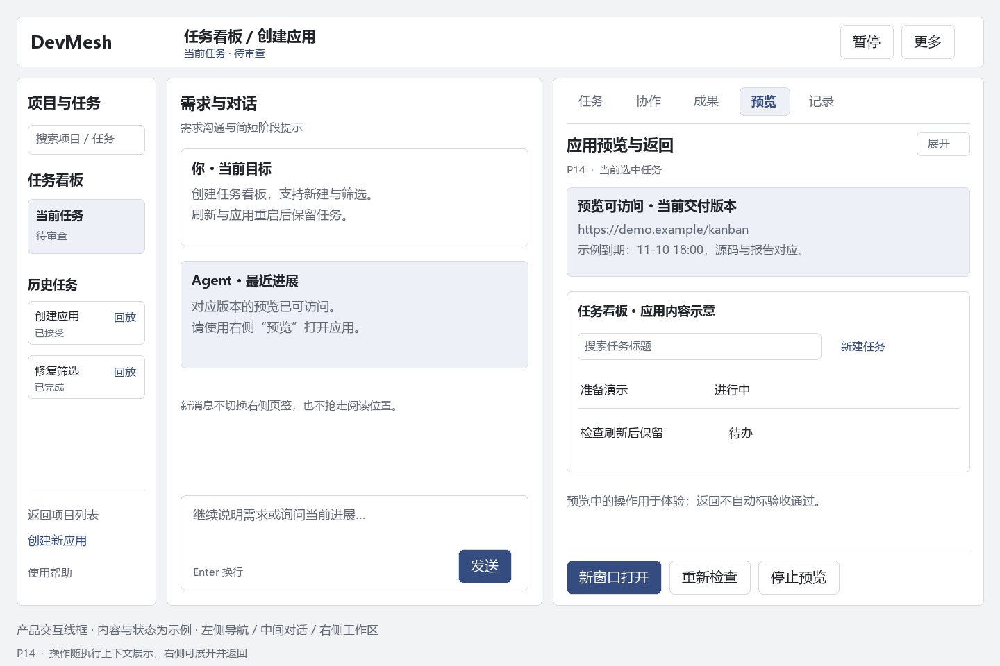

展示版本、示例地址、到期信息及新窗口体验；打开预览不自动标记验收通过。

**代码检查与测试覆盖（P13）：** 报告增加“代码检查”和“测试覆盖”视图，跟随当前审查版本。代码检查展示检查范围、采用规则、实际结论、问题级别和定位；覆盖报告展示行覆盖、分支覆盖及各自统计范围、已覆盖／总量、排除项、未覆盖的关键业务和报告来源。工具不支持或材料缺失时显示不可获取及原因，不能显示为零问题或全部覆盖。

查看某项问题可定位到对应要求、文件或测试依据，返回后保留报告视图与筛选。顶部展示统一门槛及本次计划中更高的已确认条件，按当前报告标达标、未达标或待验证；结果或必要报告未形成时保持待验证，不视为达标。当前版本变化后旧报告标原适用版本，重新检查后更新汇总。

**交互原型 P13：代码检查与覆盖门槛**

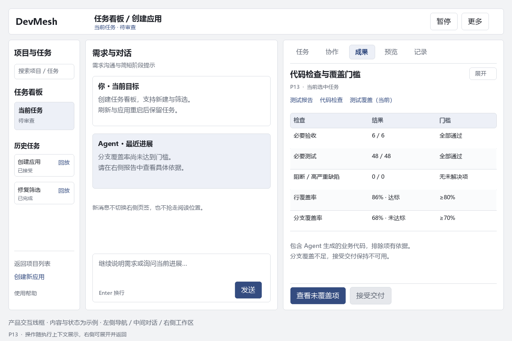

示例中行覆盖率达标而分支未达标，因此接受交付保持不可用。

##### 5.2.8.3 业务规则

| 编号 | 类型 | 业务规则 |
| --- | --- | --- |
| 交付-01 | 触发 | 产品智能体提出业务验收，测试智能体说明检查方法；用户确认计划时一并确认必要要求。 |
| 交付-02 | 约束 | 可补充检查或提高接受条件；改变需求预期及本次检查范围须经用户确认，并继续满足本期统一门槛，Agent 不能自行放宽。 |
| 交付-03 | 约束 | 测试、构建和预览对应同一确定版本；代码变化后旧结果继续标原版本，不代表当前版本通过。 |
| 交付-04 | 事实 | 需求结果分待实现、实现中、待验证、已验证、未通过、未验证；人工检查单独说明待用户检查。 |
| 交付-05 | 约束 | 必要检查未执行、跳过、缺报告、结果未知或人工未完成时，不能接受完整交付。 |
| 交付-06 | 触发 | 原范围缺陷进入修复与相关回归，新目标进入变更审阅；无法复现时保留尝试与缺条件，不声称修好。 |
| 交付-07 | 约束 | 接受针对用户看到的当前有效版本；接受保存成功后才更新起点，失败保留原接受版本。 |
| 交付-08 | 推论 | 下载、打开预览或保存人工检查不等于接受；终态回放打包失败只重试打包，不撤销接受。 |

**代码检查、测试与接受条件**

本期采用以下统一交付门槛，计划中列明本次适用检查及统计范围，成果页对照实际结果展示。任务要求可以提高门槛，不能由 Agent 自行放宽。

| 检查项 | 接受条件 |
| --- | --- |
| 必要业务验收 | 当前有效需求中的必要业务验收全部通过，需人工判断的项有明确有效结论 |
| 必要测试 | 本次计划要求的测试全部执行并通过；失败、跳过、未执行或缺报告均不视为通过 |
| 代码检查 | 适用的语法、类型、构建及必要静态检查无阻断级错误；具体检查规则在计划与报告中说明 |
| 高严重度缺陷 | 无未解决的高严重度缺陷；造成核心流程不可完成、数据丢失或必要业务约束失效的问题应修复并有效复验 |
| 行覆盖率 | 交付应用业务代码行覆盖率 ≥80% |
| 分支覆盖率 | 交付应用业务代码分支覆盖率 ≥70%；没有可统计分支时，报告明确标为不适用并附统计依据 |

覆盖率对应当前固定代码版本，统计范围包含 Agent 生成的应用业务代码。允许排除第三方依赖、构建产物及不含业务逻辑的声明／配置文件，并在报告中列明范围与原因；不能以“自动生成”为由排除应用业务代码。行与分支覆盖分别展示已覆盖量、总量和结果，必要覆盖数据不可获取时先补齐报告，不能推算为通过。

必要条件不满足时，成果页列出具体阻塞、对应版本和处理入口，不允许接受完整交付。修复后重新检查约定范围及相关业务回归，保留原失败报告；覆盖率达到门槛仍须通过全部必要业务验收和测试。

**缺陷与修复**

发现缺陷时，页面展示问题标题、严重程度、复现步骤、期望与实际结果、对应代码版本和失败依据。

缺陷按照“待处理→修复中→待验证→已关闭”流转。开发提交修改后进入待验证，由测试对同一问题复验；通过才关闭，失败回到待处理并保留原修复。只影响唯一既定要求的实现错误按缺陷处理。

修复前和修复后使用的验证依据应能相互对照。必要验收失败会阻止交付，不能仅因缺陷严重度较低就放行。

**有限修复**

已确认要求下的实现缺陷，在剩余预算内生成修复工作并继续验证。每轮修复都保留原失败、新修改和复验结果；不能把图中的原失败改成成功来隐藏过程。

自动修复默认最多 2 轮。达到上限仍未通过时，说明未完成内容，允许用户下载结果、补充要求、明确调整预算或结束处理。改变原验收预期需要先确认变更。

**版本、预览和业务数据**

接受的软件版本、当前可访问的预览和预览中的业务数据是不同信息。预览到期不代表源码、接受版本和历史被删除；用户应能查看原交付并在资源允许时重新准备相同版本的预览。

新版本预览应说明使用演示数据、全新数据还是保留的既有数据。业务数据默认持久化，必须按计划验证页面刷新和应用重启后的保留行为；新版本涉及数据兼容变化，先展示影响与可行处理，未经确认不得清空原数据。实际数据保留期限随使用条件展示，尚未确定时不以“源码已保存”代替数据保留承诺。

临时预览与正式业务使用的区别在成果页说明。运行说明需让接手者知道启动条件、必要配置、如何体验核心操作、数据保存位置和已知限制；具体技术步骤放在可下载的运行材料中。

**交付材料**

| 材料 | 必须说明的内容 |
| --- | --- |
| 应用、Demo 与需求清单 | 本次目标、交付版本、实际 Demo 链接及有效期、体验步骤、逐项要求与结果、未完成和已知限制 |
| 源码与运行说明 | 与交付版本一致的完整源码、改动说明、依赖、启动条件、必要配置与数据保存方式 |
| 验证与代码检查报告 | 适用版本、检查范围和规则、实际结果、问题级别、失败／跳过／未执行项及必要人工结论 |
| 测试覆盖报告 | 行覆盖与分支覆盖、各自统计范围和排除项、未覆盖的关键业务、已确认门槛及实际结论 |
| 协作可视化与回放 | 对应执行与计划的任务依赖图、Agent 分工和交接记录、完整性状态与可获取的回放材料 |
| Prompt 与 Agent 配置 | 各 Agent 实际采用的角色设定、可导出提示词及版本、模型、工具权限和执行限制，关联本次执行并脱敏 |

“交付材料”页签逐项显示查看／下载入口、适用执行与版本、生成或获取状态；外部 Demo 另标可访问性和到期时间。Prompt 与配置按 Agent 查看或导出，说明缺失或无法获取的项，不以当前默认配置替换当时值。接受前须能查看必要记录及交付内容，必要原始内容缺失时列入接受阻塞；最终回放文件可在接受后整理打包，打包或下载失败只重试获取材料，不改写接受结果，也不重新执行软件开发。凭据及模型内部思维不进入交付材料。

#### 5.2.9 历史回放与导入导出

##### 5.2.9.1 业务流程

| 步骤 | 用户动作 | 页面响应与完成判断 |
| --- | --- | --- |
| 导出 1 | 从当前或历史执行点击导出 | 打开内容范围说明，列执行状态和记录截止；运行中明确为快照 |
| 导出 2 | 确认生成文件 | 展示排队、整理、脱敏、打包、就绪或失败；可关闭后返回同一作业 |
| 导出 3 | 下载或重试打包 | 真实文件就绪后下载；失败只处理打包；下载授权失效可重新获取同一文件 |
| 导入 1 | 历史入口点击导入回放，选择文件 | 显示名称、体积及校验说明，未选择或超限不可开始 |
| 导入 2 | 开始检查 | 展示格式、内容和完整性结果；危险文件拒绝；不完整内容明确范围 |
| 导入 3 | 进入可查看内容 | 完整包进入回放；可验证片段经用户明确选择后只读查看并持续标不完整 |
| 回放 1 | 在概览中选播放或关键事件 | 按当时状态展示，观看不调用工具；可筛选但不改变历史事实 |
| 回放 2 | 查看当时成果或退出 | 返回保持观看位置；退出回进入前的项目或回放列表，不控制当前执行 |

回放仅用于查看当时的记录和成果。用户要继续开发时，退出回放并返回项目：未结束的任务按当前状态继续，新的迭代目标从当前已接受版本开始；导入包本身不创建可执行项目。

**查看执行总结：** 从右侧“记录／执行总结”查看所选执行的过程与结果汇总；相关指标或成果来源可定位同一视图，中栏不设置独立总结按钮。活动执行显示统计截止时间及“进行中”，已结束执行显示结束时间和实际终态。点击某项统计定位到对应工作、人工操作、消息、调用或报告，再返回时保持原位置；导出使用同一截止时刻和适用版本。

##### 5.2.9.2 页面交互

**导入导出（P15）**

入口：右侧“记录／导入导出”。导出与导入作为两个明确的子视图，各自显示原作业的进度与结果；交付材料中的回放文件链接定位同一记录。导入不启动研发执行。

| 字段或阶段 | 具体要求 | 操作与结果 |
| --- | --- | --- |
| 导出范围 | 说明本次需求、过程、成果、配置与指标；显示截止位置和完整性 | 执行中默认标快照；不能选择“完整终态”冒充尚未结束 |
| 创建导出 | 点击后显示原作业的排队、整理、脱敏和打包 | 可关闭后从材料列表回到同一次进度，不重复启动 |
| 文件就绪 | 文件名、大小、生成时间、包含范围、缺失 | 实际可获取才提供下载；过期授权重新获取同一文件 |
| 打包失败 | 失败阶段、已有材料和可重试原因 | 重试打包不重跑软件；必要源材料缺失则先说明无法完整生成 |
| 导入文件 | 单文件选择，显示名称与体积，限制在选择前可见 | 未选、超限或正在读取时不允许开始；替换前文件清除前一次未提交校验结果 |
| 校验中 | 显示格式、内容、一致性与必要记录检查进度 | 关闭面板可稍后回到检查结果；不会执行包内内容 |
| 校验结果 | 完整、不完整可查看、拒绝，列出具体项 | 完整时“进入回放”；可核实片段由用户选“仅查看有效片段”；拒绝时只可更换文件或返回 |

重复导入同一份内容提示已有回放并定位原记录。导入后的原始来源不赋予在线项目访问权，查看文件和下载继续按授权范围执行。

**交互原型 P15：回放导出与打包进度**

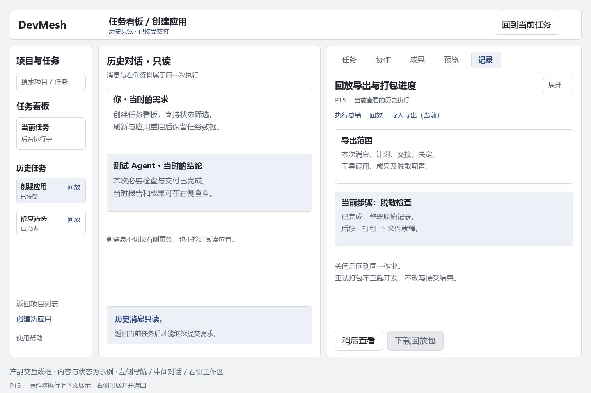

展示材料范围、实际整理步骤及关闭后返回同一作业，文件就绪前不开放下载。

**交互原型 P15：回放导入与不完整反馈**

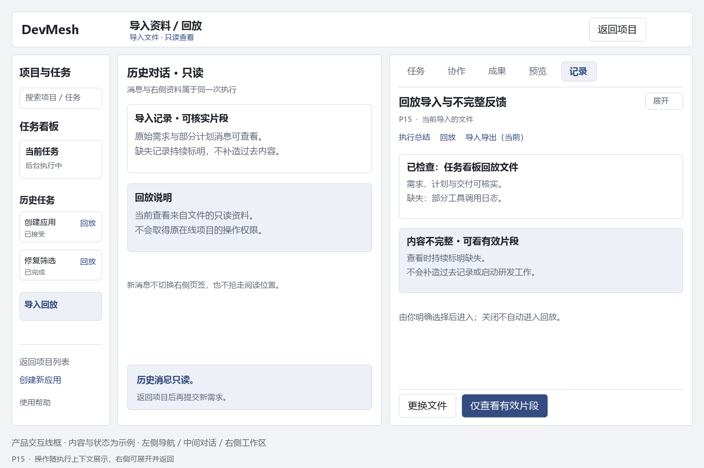

展示文件检查、缺失范围和仅查看有效片段的明确选择。

**历史与回放（P16）**

入口：左侧历史任务条目的“回放”，定位右侧“记录／回放”；导入结果也可进入同一只读播放器。选择历史任务时，中栏同步展示其只读消息，顶部标明历史上下文；默认停在回放概览，不自动播放或打开包内地址。

| 控件 | 初始及交互 | 对观看与返回的影响 |
| --- | --- | --- |
| 播放/暂停 | 默认暂停在概览，点击播放从起点；暂停后再播从当前位置 | 不开展任何实际研发工作，不与当前执行的暂停混用 |
| 速度 | 默认 1 倍，可选 0.5、1、2、4 倍 | 只改变播放间隔，切换不跳过关键事件 |
| 时间位置 | 可拖动，拖动时展示目标时间，松开定位 | 还原该时刻的真实状态；内容缺失时标未知，不补造 |
| 关键事件目录 | 计划、选择、失败、控制、交付按实际顺序 | 点击跳转并选中对应记录，播放默认暂停以便阅读 |
| 角色/类型筛选 | 默认全部 | 只减少可见记录，不重算成不存在的历史状态 |
| 当时成果 | 点击在右侧打开，带适用时间与版本 | 返回保留时间、速度与筛选；当时地址只读，不自动访问 |
| 退出回放 | 显示返回的项目或列表名称 | 回进入前位置；不改变后台当前执行 |

退出观看返回进入前的历史任务概览或导入回放列表，不自动切换或控制后台当前执行；需要继续开发时通过顶部“回到当前任务”或左侧当前任务明确返回。播放结束保持终态和关键成果，不自动重播或发起新任务。

**交互原型 P16：协作链路只读回放**

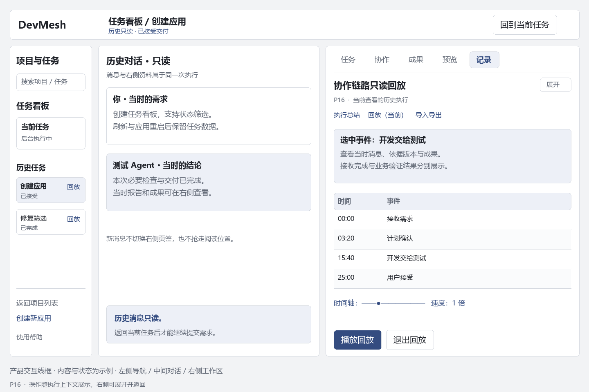

展示时间定位、事件、成果与只读边界，观看不触发真实工具调用。

**执行总结（P16）：** 右侧“记录”内按“Agent 参与”“人工介入”“耗时”“交付结果”分组，默认所选执行；可在同一工作区切换总结、回放和导入导出，执行与版本保持一致。展示已确认需求数、实际执行工作、有效报告与缺项。查看过程统计可展开对应记录，结果统计可进入需求或报告详情。执行未结束不显示最终结论，原始记录缺失时标统计不完整。

**交互原型 P16：执行总结与评测依据**

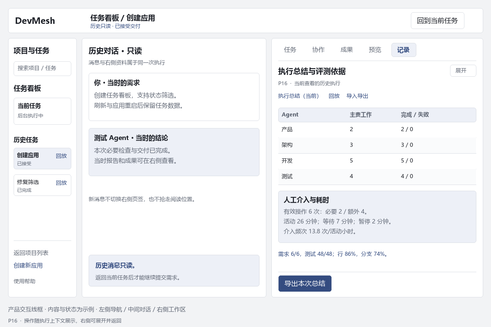

展示 Agent 参与、人工介入、耗时和结果，并可追溯统计分母与原始依据。

**全过程记录：** 按同一时间线串联用户与 Agent 间消息、Agent 间 A2A 消息与任务状态、决策、MCP 与内部工具调用、成果及适用版本，包含失败、拒绝、取消与修复。用户可按 Agent、事件类型、状态或工作筛选，点击事件查看脱敏内容与前后关联。各类记录缺失时明确缺失种类和时间范围，回放及导出持续标不完整；不补造过去记录，也不展示模型内部思维。

##### 5.2.9.3 业务规则

| 编号 | 类型 | 业务规则 |
| --- | --- | --- |
| 回放-01 | 事实 | 完整保存需求与资料、用户和 Agent 间消息、A2A 消息与任务状态、澄清、计划、工具调用、成果、决定、控制、失败和最终交付；每项关联当时执行与版本。 |
| 回放-02 | 约束 | 历史与成果保留当时版本；当前配置、代码和报告改变不能覆盖原记录。 |
| 回放-03 | 约束 | 回放只有观看行为，模型、编码和工具调用为零；包内源码不会自动运行，地址不会自动连接。 |
| 回放-04 | 事实 | 活动执行导出是截止当时的快照；结束后可生成终态记录。导出内容范围和完整性明确，重试打包不重跑研发。 |
| 回放-05 | 约束 | 敏感内容脱敏，缺少必要依据则列缺失，不宣称完整；格式、路径、体积和一致性不合要求时拒绝。 |
| 回放-06 | 触发 | 可确认的片段可由用户明确选择后只读查看，并持续标不完整；不能靠在线调用补造过去结果。 |
| 回放-07 | 推论 | 筛选和速度只改变观看，不改变当时状态；查看历史不会暂停或恢复当前执行。 |
| 回放-08 | 约束 | 导入仅提供回放内容，不创建可执行项目或授予在线原项目权限；继续开发须具备项目授权并满足当前任务或正常迭代条件。 |

**执行评测口径**

| 指标 | 统计口径与展示 |
| --- | --- |
| Agent 参与情况 | 按同一工作去重，列每个 Agent 实际参与工作数、主责工作数、完成／失败数及有依据的成果数；理解、规划等准备工作也保留记录。重复尝试另列次数，不重复增加工作数 |
| 人工介入次数 | 已有效保存或受理的回答、计划确认、裁决、变更、暂停／恢复、重试、整次重做和接受操作，按类型计数；必要确认与额外调整分栏。查看、草稿、无效提交和重复点击不增加次数 |
| 人工介入频次 | 有效人工介入次数／活动处理小时数，同时展示次数与分母；活动时间为零或缺失时显示不可计算，不填零值 |
| 执行与活动耗时 | 执行耗时为首次受理到结束或统计截止的实际时间；活动处理按实际工作时间段合并，并行不重复累加；整体等待人工、纯资源排队和已暂停时间分别展示 |
| 需求验证结果 | 按当前有效交付版本的必要需求去重，展示已验证／总数，并分别列未通过、未验证和待人工；分母为零时不生成通过率 |
| 测试结果 | 展示已通过、失败、跳过、未执行数量；通过率以实际已完成且有结论的通过与失败项为分母，跳过和未执行单列，不视为通过 |
| 覆盖与代码检查 | 引用当前版本的真实覆盖报告、统计范围、代码问题数量与级别；不可获取显示原因，不以历史版本或估计替代 |
| 缺陷与交付状态 | 展示登记、有效复验关闭和仍未解决的缺陷数；另列构建、启动、Demo 可访问性及用户接受状态，各自附对应版本和依据 |
| 协议与工具使用 | 按实际来源列 A2A 交接、MCP 调用和内部工具使用的次数、状态及结果入口；平台的 5 项接入验收与本次任务实际使用情况分别展示 |

统计来源于本执行的实际记录，失败尝试与人工介入不因修复成功而被删除。已失效成果保留过程记录，但不计入当前版本的通过结果；重做前后执行分别统计并显示关联；重做确认计入发起操作的原执行，新执行不重复计入，新一轮中的计划确认等操作单独计数。不把旧执行耗时或成功结论当成本轮结果。缺少记录时标明影响指标与范围，原始数量和分母可追溯，汇总与导出使用同一口径。

| 导入结果 | 页面行为 |
| --- | --- |
| 内容被篡改、文件危险或格式无法识别 | 拒绝导入并定位原因 |
| 关键记录缺失，无法还原完整过程 | 标注不完整，只展示能核实的片段，不提供虚假的完整进度 |
| 部分非关键日志缺失 | 允许查看可还原内容，持续显示缺失清单 |
| 内容完整且可验证 | 进入只读回放；原本是执行中快照时仍保留该标记 |

#### 5.2.10 执行配置查看与调整

##### 5.2.10.1 业务流程

入口：右侧“协作／本次配置”，顶部右侧“更多／本次配置”定位同一视图。

| 步骤 | 用户动作 | 页面响应与去向 |
| --- | --- | --- |
| 1 | 打开本次配置 | 展示本次实际采用的能力、限制和检查时间，不用当前部署替换历史 |
| 2 | 查看基础条件或展开专业信息 | 显示可用、缺项及影响；凭据只说明配置状态，不回显 |
| 3 | 需要调整当前设置时提出调整 | 先说明对象、新旧差异和受影响工作，按条件暂停；维护设置由相应授权承担 |
| 4 | 检查影响并确认 | 变化获得有效确认后保存；手动暂停的执行仍需恢复，不因解释或查看自动继续 |
| 5 | 返回原工作 | 保留浏览位置；旧执行和旧尝试继续保留当时设置 |

##### 5.2.10.2 页面交互

入口：右侧“协作／本次配置”。默认展示当次实际快照，分基础条件、执行限制和角色专业信息；当前部署配置是明确标注的比较视图，脱敏导出操作在右侧，不新增配置一级页签或中栏配置按钮。

| 内容 | 展示和操作 | 异常或权限 |
| --- | --- | --- |
| 基础可用条件 | 应用模板、必要工具/模型是否可用、最近检查 | 缺项说明影响和处理人；不诱导普通用户填密钥 |
| 本次限制 | 并行、次数、时长、预览及材料到期 | 未设显示待设置；改变限制走明确调整，不靠自然语言自动解除 |
| 角色与专业信息 | 各 Agent 实际模型、提示词、A2A 协作可用状态、MCP 服务及可用工具范围可展开 | 脱敏查看/导出；连接缺项说明受影响的 Agent 或工作，不展示秘密或无法获取的隐藏配置 |
| 调整请求 | 需要变更时说明修改对象、差异和影响，先暂停 | 有效确认后仍遵守恢复规则；没有权限只提供说明和处理入口 |

关闭面板回原位置；查看当前部署不替换当次记录，导出也使用当次实际值。连接可用仅说明最近检查结果，不等于已经交付软件。

**交互原型 P17：本次配置与脱敏查看**

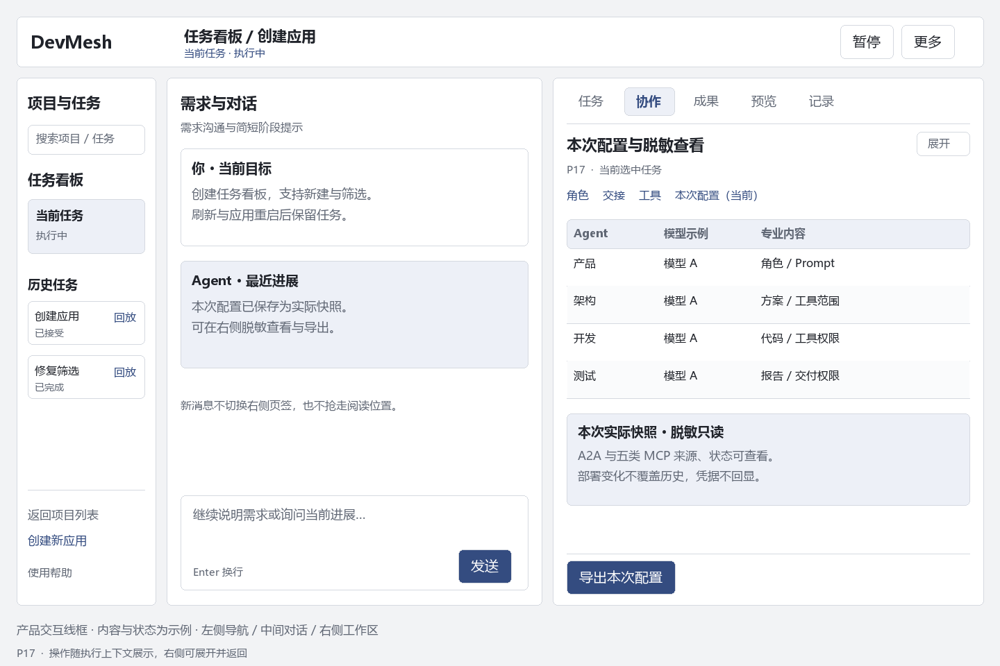

展示角色、模型示例、Prompt 与接入来源；普通查看不改变平台配置。

##### 5.2.10.3 业务规则

**连接状态**

| 显示状态 | 含义与用户反馈 |
| --- | --- |
| 未配置 | 缺少必要连接或运行条件，列出缺项与处理方式 |
| 检查中 | 正在检查连接或能力，展示步骤和时间 |
| 可用 | 最近检查通过，并展示检查时间 |
| 部分可用 | 列出不可用能力及受影响工作，其他已验证能力可以使用 |
| 不可用 | 相关工作等待，提供重新检查及联系部署人员的说明 |

| 编号 | 类型 | 业务规则 |
| --- | --- | --- |
| 配置-01 | 事实 | 当次配置、当前部署配置和历史配置分别展示，不以当前默认值替换过去事实。 |
| 配置-02 | 约束 | 普通用户只查看或导出脱敏当次设置；凭据和平台资源由相应维护职责管理，不在聊天中索取秘密。 |
| 配置-03 | 触发 | 必要能力不具备时可以保存需求但说明阻塞，不能假称已经开始实际执行。 |
| 配置-04 | 触发 | 部署更新默认只影响新任务；当前执行确需调整时先暂停、说明差异和成果影响、确认后再按恢复规则继续。 |
| 配置-05 | 推论 | 解释询问、界面筛选和播放速度不会改变模型、工具范围或执行预算。 |
| 配置-06 | 约束 | 次数、时长、工具和保留设置采用实际已展示值；用量或费用不可获取时显示未知，估算与实际分开。 |

### 5.3 产品验收标准

#### 5.3.1 通用完成条件

| 验收层面 | 必须能确认的产品结果 |
| --- | --- |
| 可理解 | 用户能说明本次范围、当前进度、等待原因、需要自己作出的决定及其影响 |
| 可操作 | 从首页到交付、从问题到继续都有明确入口；主要操作在失败、过期和只读状态下有合理反馈 |
| 可验收 | 每项必要需求有检查方法和适用版本，未完成、失败和未验证不会混成完成 |
| 可持续 | 接受版本、未接受成果、预览和历史清楚区分；迭代、暂停恢复、失败重试和整次重做不会让用户丢失目标或误用旧结果 |
| 可复核 | 业务结论可打开实际依据，角色交接、用户决定、失败修复和最终结果可连贯追溯 |

验收按实际需求、使用条件和对应版本检查；详细操作及预期结果见[产品验收场景](./DevMesh_产品验收场景_V10.0.md)。产品原型和线框用于检查设计，不能代替实际软件结果。

#### 5.3.2 功能与验收对应

产品验收以实际操作和对应版本的结果为依据。每条用例记录前置、动作、预期、实际结果和材料，不将设计说明当作已通过结果。

| 功能模块 | 主要检查内容 | 配套验收编号 |
| --- | --- | --- |
| 5.2.1 项目与任务 | 入口、搜索、起点、当前/历史和新目标归属 | U01、U04、D11、I01～I03 |
| 5.2.2 需求与澄清 | 输入、理解、来源、部分回答、默认值及纠正 | U02～U08、I04～I06、I31 |
| 5.2.3 计划 | 自动拆解、DAG、摘要、修改与有效确认 | P01～P03、I07～I09、R05～R07 |
| 5.2.4 协作 | 多 Agent 分工、A2A 交接、MCP 调用、局部等待与实际成果 | P04～P05、I10～I12、R01～R04 |
| 5.2.5 变更 | 原要求、影响、新要求生效及放弃 | P09、I13～I14 |
| 5.2.6 冲突 | 依据、解释、选择、应用及复验 | P06～P08、I15～I17 |
| 5.2.7 控制 | 暂停、恢复、取消、重试、整次重做与限制 | C01～C05、C07～C08、I18～I19、R08～R11 |
| 5.2.8 交付 | 需求、代码检查与覆盖、预览、材料和接受 | D01～D08、I23～I26、R12～R14 |
| 5.2.9 历史与回放 | 执行评测、消息与事件完整性、导出导入和回放 | D09～D10、I27～I29、R15～R19 |
| 5.2.10 配置 | 当次与历史、限制、变化和未知信息 | P10、D13～D14 |
| 共用交互与权限 | 授权边界、草稿、项目切换、键盘和窄屏 | C09～C10、D12、I30～I32 |

完整操作见[产品验收场景 V10.0](./DevMesh_产品验收场景_V10.0.md)。

#### 5.3.3 本次补充能力的验收依据

| 补充要求 | 必须能核对的依据 | 配套检查 |
| --- | --- | --- |
| MCP 接入与 A2A 协作 | 至少 5 项真实接入的来源、能力与逐项实际结果；A2A 消息、任务分发、状态同步与成果返回记录及协议交互核验结论 | R01～R04 |
| 自动 DAG 编排 | 根据输入自动生成的任务及依赖、计划校验结果、并行与等待的实际行为、修复后的计划版本 | R05～R07 |
| 整次任务人工重做 | 原执行安全停止、确认影响、新执行来源与起点、重新确认计划、原记录和重复请求处理结果 | R08～R11 |
| 代码检查与交付内容 | 当前版本的代码检查、覆盖报告、接受条件与逐项交付材料，实际可访问的 Demo 及脱敏 Prompt／配置 | R12～R14 |
| 执行评测与完整回放 | 可追溯的原始数量与时间、统计截止和分母、版本适用性、完整消息与决策／调用／成果记录 | R15～R19 |

接入和协作验收须有实际协议交互与业务结果依据；原始报文、兼容性检查步骤及工具实现由配套验证材料承载。文档与界面展示用于定位这些依据，不能独立代替实际接入、执行和交付结果。

## 6 使用权限与职责边界

### 6.1 使用权限与维护职责

项目使用者在授权项目内提交目标、确认范围、处理取舍、控制执行和审查成果。每次操作还受当前执行状态和内容有效性约束，不能仅凭“进入了项目”就操作所有历史内容。

同一使用者查看已经结束的执行或进入回放时，相关内容只读；这是页面和内容的操作规则，不是更换用户身份。只获得某份材料的查看权限，不表示获得原项目的操作权或其他私有内容的访问权。

平台维护职责负责模型和工具连接、凭据、运行资源及基础访问配置。普通任务页面提供本次实际配置的脱敏查看；维护配置本身不自动赋予操作任意项目、代用户确认或替用户接受交付的权利。

用户不能通过聊天或上传资料改变凭据、访问未授权项目，或让智能体降低已经确认的必要验收。详细的可操作场景见 6.2。

### 6.2 操作场景与访问范围

| 使用场景 | 可用行为 | 操作边界与反馈 |
| --- | --- | --- |
| 当前有效执行 | 在权限和当前阶段允许时提交、回答、确认、裁决、控制和审查 | 必要前置未满足时说明原因；不能越过其他项目或过期内容操作 |
| 已暂停执行 | 查看成果、保存回答和有效选择，按条件恢复、取消或整次重做当前任务 | 保存决定不自动恢复研发；未核实的工作不能重复启动 |
| 已结束执行 | 查看、下载授权成果与回放；当前未接受任务可按条件整次重做，已接受应用从当前接受版本发起新任务 | 原执行只读，不能在历史中重新确认、改写接受结果或恢复原运行 |
| 回放观看 | 播放、定位、筛选、查看当时内容和下载已授权材料 | 无真实模型、编码或工具调用；观看状态不能改变当前执行 |
| 仅开放查看的材料入口 | 只查看或下载被明确开放的内容 | 不提供原项目的裁决或执行控制，也不连带开放私有消息和配置 |
| 未获授权或授权失效 | 返回可见内容，按条件重新验证身份 | 拒绝操作，不泄露其他项目或材料详情，安全输入按规则保留 |

这些是同一产品内的访问与状态规则，不据此新增人类用户角色或角色切换入口。

任务发起输入区默认只保留正文、添加附件和发起任务。文件格式／大小／数量及拖拽说明收在添加附件的悬停和无障碍提示中；不符合要求时明确报错。上传历史与恢复移到“更多 → 附件管理”，正常草稿保存静默，保存失败／冲突和未知提交恢复继续显式显示。项目名称默认生成，创建后通过项目标题旁的重命名入口修改。

### 对话主助手增量（2026-11-18）

新对话采用用户／助手／进展的持久有序消息。模型决策先保存原请求，绑定输入版本；迟到响应不能实施旧动作，未知结果不自动重发。计划确认还绑定用户实际看到的Run、需求／计划版本、reviewHash和资源版本。“修改吧”不能批准未展示或已变化的计划。执行模式授权与人工确认分表审计，不改变最终接受版本的明确动作。

执行中补充先建立范围更新记录并关闭旧准入，真实工作及副作用核实收尾后才重排。人工暂停期间保存输入，恢复先理解新指令再开放旧执行；暂停中不以文字冒充物理完成。明确暂停／恢复／取消可直接文字引导，条件句不触发控制。“先讨论，不要改代码”收窄权限并暂停已授权实现。

主区保留底部输入，显示实际方案、工作进度及候选／已接受版本入口；不再默认挂载任务总览、下一目标管理表单或原始模型JSON。旧项目、原草稿、附件及未决请求仍由兼容入口读取。配置保存不等于运行时已生效，缺模型／执行资源明确说明且保留输入。服务可关闭新对话输入准入；读取、原请求核实及控制仍保留。

对话正文以安全文本节点展示段落、强调、列表和代码；模型提供的HTML保持文字，不执行。位于底部时新回复跟随输出并保留输入焦点，阅读历史或选择文字时不强制滚动。模型连接同时接受API根地址和完整chat/completions地址，既有保存值读取时规范化，不改写原密钥。

## 2026-11-18 桌面对话工作台优化增量

基于用户确认的桌面端提案实施两阶段优化：240px／64px可收起导航、上限840px对话与输入对齐、16px正文、112～144px初始输入及内容增长、轻量示例、用户气泡、折叠进展、新回复定位和按需336px执行详情。正文空间不足640px时使用覆盖面板。移动端专项优化暂缓。

会话输入仍先进行意图理解并给予自然回复，必要决定通过真实方案卡与文本引导承接。方案按钮直接保存所见版本确认；未接入执行环境时仅确认方案并说明条件。任务标题从已有明确目标提炼，可手动改名，人工名称优先；操作和原请求恢复均保留。

### 模式选择器补充（2026-11-18）

模式选择器补充：执行模式按明确目标在条件具备时推进实现和验证；计划模式先整理方案，确认后才获得实施授权。选择器提供选项说明、真实执行条件与选中状态；切换在下一次发送时生效，不直接控制活动任务。

### 执行详情页签恢复（2026-11-18）

执行详情保留任务、协作、成果、预览、记录五类导航，分别承接目标方案、权限分工与变更、候选交付、实际预览入口以及持久记录。对话式首页不能以简化界面为由丢失这些已有功能。无数据时说明空态，切换保留当前草稿和执行依据。

## 任务删除补充（2026-11-18）

任务列表菜单和当前任务页头提供删除入口，并确认移除范围。删除只移除任务对话，保留关联项目、代码、成果、执行记录及本机草稿。运行中先暂停，待状态及原效果明确后再删除。删除当前任务返回新任务入口，删除其他任务保留当前输入；刷新或断线可核实原删除请求，不能重复创建新请求替代未知结果。

## 工作空间管理补充（2026-11-18）

侧栏底部统一为当前工作空间切换器与独立应用设置；空间菜单提供创建／管理、附件和空间任务记录。工作空间同时组织任务并可绑定本地 Git 代码目录；名称必填，说明和目录可选。现有任务迁入默认空间，空间切换恢复各自草稿与任务位置，不暂停后台执行。空间可以改名、修改说明／目录；非空空间须先迁移或删除任务，至少保留一个空间。任务迁移保留已有代码和 Run 基础，活动或未知处理须先暂停／核实。
