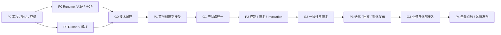

# DevMesh 实施文档 V1.0

日期：2026-11-10。实施基线：[技术设计 V1.1](./DevMesh_技术设计方案_V1.1.md)、[PRD V10.0](./DevMesh_PRD_V10.0.md)、[89 条产品验收场景](./DevMesh_产品验收场景_V10.0.md)。本文版本独立于技术设计版本。

本文将设计转为 **36 个开发工作包、P0～P4 五个阶段、数据库与接口实施顺序、联调步骤和发布条件**。所有工作包初始状态为 NOT_STARTED，负责人为待认领的职能角色；“交付物”和命令清单指后续研发要产出的内容，不表示这些代码、脚本或部署已经存在。

当前目录已有需求、设计、原型及核心 SQL 约束样例，尚无可运行的 DevMesh 产品工程。现有 24 张核心表的 19 项样例检查不能代替正式 migration、服务事务、真实协议联调和产品验收。实施先完成 P0 技术闭环，再以真实记录推进后续阶段。

## 1. 范围、规则与阅读入口

### 1.1 本次实施范围

交付一个基于 TypeScript／Node.js、Cordis、React 和 SQLite 的 DevMesh：四角色经真实 A2A 协作，五类 MCP 服务调用真实后端，生成应用在独立 Linux Runner 中执行；支持需求到接受、持续迭代、变更／冲突、暂停／恢复／取消、重做、历史与回放、配置调整。追加范围包括对外单 Agent／Agent 组服务，以及本地会话与文件存储。

内部 Agent 注册使用受控清单、数据库代际和内存投影；外部通过已发布 Card 和受控入口发现、调用。首版不实现无约束的 Agent 自注册、动态实例池或递归代理网络。多控制实例、PostgreSQL／对象存储迁移、任意外部仓库导入按设计中的触发条件另行立项。

| 实施必须保持的规则 | 研发检查点 |
| --- | --- |
| 同项目一个活动 Run，暂停／等待仍占用 | 数据库约束与准入事务共同检查 |
| 同 Run 最多两个角色槽位，同角色同时一个未结束 Attempt | RESERVED、STOPPING、OUTCOME_UNKNOWN 等仍计占用 |
| 需求理解／规划只允许受限 bootstrap；实施必须确认计划 | bootstrap 由平台定义，模型不能自授豁免 |
| A2A completed、成果验证通过、项目接受分别判定 | 不能凭模型总结、下载成果或打开预览完成 Run |
| 未知写操作先核实；停止必须有真实退出和保存证据 | HTTP 断开、租约超时、进程锁释放均不是已停止证明 |
| 已发布快照不可改，Run／Attempt 固定各自依据 | 变化走新版本、影响分析和授权，旧成果按指纹判定 |
| 计划最多 30 项；安全重试最多额外 2 次；自动修复最多 2 轮 | 各预算分开计，不能换 Task／操作键绕过 |
| 必要检查通过，业务代码行覆盖率 ≥80%、分支 ≥70% | 前后端按原始数量汇总，生成业务代码计入，缺报告不放行 |
| 用户确认、维护权限和外部服务权限分开 | 普通服务 token 不能代替计划确认或交付接受 |
| 会话索引与状态在 DB，正文和成果在持久内容库 | JSONL 为阅读投影；清工作区不清会话、接受证据和 dataset |

这些是实施约束，具体转换和异常语义以设计正文为准。开发发现矛盾时，在对应专题修订并同步主文后调整工作包；不能只在代码中更改产品含义。

### 1.2 文档分工

| 内容 | 权威入口 |
| --- | --- |
| 领域对象、状态、版本与并发 | [D1 领域模型与状态机](./design/01_领域模型与状态机.md) |
| 模型循环、内部注册、A2A/MCP、对外单 Agent／组 | [D2 Agent 与协议](./design/02_Agent与协议详细设计.md) |
| REST、事件、工作台、身份与发布管理 | [D3 API 与用户流程](./design/03_API与用户流程.md) |
| Runner、Git、停止、验证、预览、业务数据与部署 | [D4 执行恢复与交付](./design/04_执行恢复与交付.md) |
| 字段、事务、会话、文件目录和备份迁移 | [D5 数据与事务](./design/05_数据与事务.md) |
| T01～T24 专项、89 条场景与统计口径 | [D6 验证与验收追踪](./design/06_验证与验收追踪.md) |
| 开发顺序、任务依赖、交付和阶段完成判定 | 本文 §3～§10 |

本文的 P0-01 等是**工程开发任务编号**，与产品运行时 DAG 的 workId 无关。D5 的 T1～T8 是数据库事务编号，D6 的 T01～T24 是技术专项编号，实施记录须写明所属命名空间。

## 2. 开发环境与工程准备

### 2.1 技术基线如何落地

| 项目 | 实施选择 | P0 必须确认的产物 |
| --- | --- | --- |
| 语言／运行时 | TypeScript 6.0.x、ESM、Node.js 24，最低 24.9.0 | 经 Windows/Linux 验证的精确 Node 补丁、TS 版本和构建输出 |
| 包管理／构建 | pnpm 11.28.5 workspace、tsdown、tsx | 独立 pnpm-lock.yaml、packageManager、统一构建／开发脚本 |
| 服务与 UI | Cordis 受控闭包、Node HTTP + Express 5、React 18、Vite 8.2.2 候选 | Cordis 来源／修改／许可证；Vite 与 plugin-react 实际兼容组合 |
| 协议 | 官方 A2A JS SDK，A2A 1.0 JSON-RPC/SSE；MCP 官方 TS SDK v2 | SDK 精确版本和受支持绑定；真实 handler／transport 互通记录 |
| 存储 | node:sqlite Worker、本地 BlobStore、Git | 正式迁移版本、layoutVersion、目录校验、原子保存与恢复记录 |
| 模型 | DeepSeek 首个 Provider，部署指定 model ID | 模型容量、工具调用、结构化输出、超时和三类样本评测 |
| 执行 | Linux Runner，Docker + gVisor runsc | 管理 API、固定镜像 digest、真实子进程停止及隔离证据 |
| 质量工具 | Vitest、Playwright、coverage-v8、tsc、Oxlint | 统一版本、测试分组、原始报告与 CI 入口 |

这些版本沿用已评审设计的候选基线；首次安装不直接取所有依赖的 latest。P0 记录实际版本、来源和失败原因；需要调整选型时先提交兼容性结论。参考 `D:/yms/AI/deepseek-harness` 的接口和受控代码，DevMesh 使用独立 workspace，产物不能依赖该机器上的并列源码路径。

Cordis 闭包至少核对 cordis、cosmokit、include、loader、schemastery 及其 peers。存在原生加载相关依赖时，CI 产出目标 OS/arch 的预构建包或镜像；不能把“用户不需要 Python”误写成“源码构建永远没有原生工具依赖”。

### 2.2 开工所需资源与缺项处理

| 资源 | 提供内容 | 缺项时可做的工作／阻塞项 |
| --- | --- | --- |
| Windows 开发机 | Node、pnpm、Git，独立数据根目录 | 可做 UI、领域和协议单测；不能冒充 Linux 隔离验收 |
| Linux Runner 节点 | Docker/runsc、CPU/内存/磁盘配额、服务身份 | 未就绪可做契约；生成代码执行、停止和预览联调阻塞 |
| 模型访问 | endpoint、model ID、credentialRef、调用预算 | 可用固定测试 Provider 验证状态机；真实模型闭环不得记为通过 |
| 企业身份 | 浏览器 OIDC、服务 OAuth issuer/audience、测试账号与项目授权 | loopback 测试身份可做本机开发；共享部署及外部接入验收阻塞 |
| 依赖源 | 批准的软件源代理、镜像仓库 | Runner 安装依赖联调阻塞，不能开放任意出网绕过 |
| 域名与证书 | 平台、独立预览 origin、对外 Agent 入口 | 本机协议可验证；实际网络可达性及外部发布验收阻塞 |
| 持久盘与备份位置 | control／runner／backup 根目录、访问权限、容量与保留策略 | 文件落盘和迁移可先做临时测试夹具；正式环境准入阻塞 |

资源负责人在任务记录中填真实值或 credentialRef，不把秘密放进设计、源码、命令输出或测试报告。一个人可以承担多个职能；未指定人员时按以下责任分工认领，不据此推断团队人数或日历工期。

| 职能 | 责任 |
| --- | --- |
| 平台 | 契约、领域、存储、API、事务和准入规则 |
| Agent | Provider、Runtime、角色、A2A/MCP、注册与公共接入 |
| 前端 | 工作台、草稿、事件恢复、版本确认与历史只读 |
| 执行 | Runner、Git、模板、质量证据、预览和 dataset |
| 测试 | 故障注入、协议互通、场景与证据复核 |
| 运维 | 环境、身份、镜像、备份、容量、发布与恢复演练 |

### 2.3 工程目录与脚本交付约定

产品代码按技术设计第 5 章的 apps／packages 拆分。实施中优先建 packages/contracts、storage-sqlite、blob-store，再接领域、Runtime 和协议；不从一个可任意改表的全局服务开始。

| 模块组 | 首批提交内容 | 依赖约束 |
| --- | --- | --- |
| contracts | ID、错误、命令／事件、业务 schema、Runner permit、角色输出 | 不依赖数据库、UI 或模型 SDK |
| storage-sqlite／blob-store | Worker 事务接口、migration、内容发布、根目录检查 | 事务不做网络／模型／Git；禁止向 Worker 传任意 SQL 闭包 |
| domain／orchestrator | 唯一业务写入者、DAG 校验、准入、版本与控制 | 依赖接口；插件不能跨服务改表 |
| agent-runtime／agent-roles | ExecutionHost、SessionStore、ModelProvider、ToolExecutor、角色定义 | 输出需经 schema／证据验证；模型不发放许可 |
| agent-registry／protocol-a2a／protocol-mcp | 版本绑定、官方 SDK 适配、Inbox／Outbox、客户端 | 同进程也保留真实协议；缓存不能成为授权权威 |
| agent-invocation／a2a-exposure | 独立宿主、公共 Task、发布与服务 grant | 外部权限映射后才生成内部许可 |
| mcp-services／templates／artifacts | 五服务后端、首模板、报告和回放材料 | 有真实操作与版本依据；别名不重复算服务 |
| apps/server／runner／web | 组合根、进程启动、管理 API、工作台 | Runner 不写接受指针；UI 不直连内部 A2A/MCP |

下列脚本是 P0 起需逐步实现的工程契约；当前可运行范围以根 package.json 和 [工程说明](./docs/engineering.md) 为准，不能把本表中的后续脚本直接认定为已实现。新增脚本与对应功能在同一提交落地，失败应返回非零退出码，并在报告中区分未执行、环境阻塞和失败。

| 计划脚本 | 用途／完成阶段 |
| --- | --- |
| pnpm dev / pnpm build / pnpm typecheck / pnpm lint | 本机组合启动、构建和静态检查；P0；dev 默认仅 loopback，不自动发布外部入口 |
| pnpm config:check / pnpm storage:verify | 配置、路径、权限、布局和内容引用检查；P0 基础，P4 完整 |
| pnpm db:migrate | 单实例锁和备份前置条件下执行正式迁移；P0 起，不运行设计样例代替生产迁移 |
| pnpm test:unit / pnpm test:contracts | 领域规则、schema、边界和适配契约；P0 起 |
| pnpm test:integration / pnpm test:interop | 实际存储、服务和标准协议客户端互通；P0 起 |
| pnpm test:fault / pnpm test:e2e | 故障切点和完整浏览器路径；P1 基础，P2～P4 扩展 |

真实模型、Runner 和企业身份联调需明确环境参数；缺凭据不能静默跳过后输出“全量通过”。固定测试 Provider 仅用于可重复测试，所有报告标出 mock／真实组件范围。

## 3. 实施路线、阶段门槛与依赖

### 3.1 阶段交付

| 阶段 | 可以演示的结果 | 阶段门槛 |
| --- | --- | --- |
| P0 技术闭环 | 保存会话，真实 A2A 激活一个角色，经 MCP 在隔离 Runner 上完成动作，查询结果并停止 | G0：版本锁、干净安装、持久接收、内容恢复、真实工具停止、模板数据持久化与 Card 原型有证据 |
| P1 最小完整产品路径 | 从新目标到理解／计划确认、实现、验证、预览、人工接受 | G1：产品路径一真实完成；四角色和五类 MCP 可用；同版本交付材料与接受记录齐全 |
| P2 协作与恢复 | 暂停／取消／重做、局部变更、配置调整、崩溃恢复及独立 Invocation 内核 | G2：未知副作用不重复执行；旧依据不被覆盖；注册与存储同步故障可恢复；资源与归属隔离成立 |
| P3 迭代与对外接入 | 已接受版本迭代／修复、回放、数据升级、公开单 Agent／研发组接入 | G3：路径二至五通过；T17～T21 对应能力验证完成；外部服务保留人工边界；资料和数据可追溯 |
| P4 发布准备 | 在目标部署完成恢复、迁移、容量、权限与全场景验收 | G4：89 条产品场景和 T01～T24 各有真实结论；阻断项清零；部署与运维资料可执行 |



阶段门槛约束集成与开放范围；后续模块可在前置接口稳定后提前编码，但不能用提前写出的页面或 mock 绕过门槛。公共 A2A 原型仅在受控测试环境开启；对外发布必须通过相应专项。任何阶段的演示完成都不自动代表全量产品完成。

### 3.2 工作包状态与完成定义

工作包使用 NOT_STARTED／IN_PROGRESS／BLOCKED／IN_REVIEW／DONE；BLOCKED 必须记录缺少的资源、负责人和下一次核实条件。表中的责任职能是主责，测试负责独立复核证据。

日常进度统一维护于 [project/tasks.json](./project/tasks.json)，使用 `node project/manage.mjs render` 生成 [项目任务台账](./project/任务台账.md)；状态、负责人、阻塞、证据和阶段门槛不在本文另设一份可变记录。每次实施关联 OpenSpec 变更，具体操作见 [项目管理说明](./project/README.md)。

DONE 要求：实现与正式契约一致；新增／变更数据有迁移和升级检查；权限与失败路径可观察；适用自动检查通过；真实依赖联调已记录；没有用临时绕过替代不变量；有提交版本和可定位证据。纯契约任务可先完成，但依赖真实环境的任务不能因代码合并就记 DONE。

同阶段的前置编号表示必需的实现依赖；跨阶段还默认要求上一阶段门槛通过。前端可依合同夹具提前开发，最终 DONE 仍依赖真实 API 和事件联调。P0 完成后根据实际工作量和团队可用性编排日历；目前按依赖排序，不将未知团队人数换算成虚假上线日期。

## 4. 开发工作包

### 4.1 P0：先证实核心技术路径

| ID | 主责／前置 | 具体工作 | 必须提交的产物 | 完成证据 |
| --- | --- | --- | --- | --- |
| P0-01 | 平台；无 | 创建独立 workspace 和组合根，固定 Node/pnpm/TS，整理 Cordis 闭包和来源，加入构建／静态检查 | 根清单、锁文件、tsconfig、CI 基础、依赖来源记录 | Windows/Linux 干净安装和构建；T01 |
| P0-02 | 平台；P0-01 | 建立 ID、状态、命令／事件、schemaVersion、角色成果及 permit 契约，定义错误与版本校验 | contracts 包、OpenAPI 初版、正反样例、模块接口表 | 非法 schema、混用宿主 permit、旧版本条件被拒绝；T08/T12 基础 |
| P0-03 | 平台；P0-02 | 实现 SQLite Worker、事务入口和初始正式迁移，形成可用 Project/Run/Attempt 测试夹具、operations/Outbox | migration 管理器、领域事务接口、状态／并发约束测试 | 空库与升级路径；回滚、单活动 Run、未知 Attempt 不重跑；T07 基础 |
| P0-04 | 平台；P0-03 | 实现 BlobStore、会话索引、消息／步骤、上下文快照和授权引用，建立根目录校验 | 本地 Provider、SessionStore、写入操作、JSONL 投影生成入口 | 正文发布／索引提交切点；消息重启可读；附件可先于 Run 保存；T22 基础 |
| P0-05 | Agent；P0-03、P0-04 | 实现内部清单协调、端点版本、Registry 投影、官方 A2A handler 及持久 Inbox/TaskStore/AcceptedWork | 注册服务、A2A 适配包、受理事务原型、标准客户端夹具 | 真实 HTTP、同键重发唯一 Task、HTTP 先监听再自检；T02/T03/T17 基础 |
| P0-06 | Agent；P0-04、P0-05 | 接入 DeepSeek Provider、执行宿主、完整参数工具调用循环和四角色配置，冻结模型能力 | Runtime、RoleRegistry、Provider、真实模型样本与用量记录 | 模型回复先落盘再工具执行；步数／上下文／超时有效；T02/T22 真实链路 |
| P0-07 | 执行；P0-02 | 实现 Linux Runner 登记、start/get/stop/by-operation、租约和资源限制，固定运行镜像 | Runner 服务、镜像构建描述、API 与停止证据 | 真实子进程退出、响应丢失按原 operation 查询、容器不能访问控制密钥；T06/T12 基础 |
| P0-08 | Agent；P0-06、P0-07 | 接通官方 MCP Client/Server，先实现 repo 只读与 tests 长任务的真实后端 | MCP transport 适配、独立服务身份、job 查询／停止契约 | 实际经 Client/Server 调用；断连不重放未知写操作；T04/T05 基础 |
| P0-09 | 执行；P0-07、P0-08 | 制作 web-crud-v1 模板，验证前后端构建、数据保存、Vitest/Playwright 和 runsc 行为 | 模板版本、能力声明、锁文件、检查配置、镜像 digest | 任务看板基础行为与刷新／重启保留；真实安装、构建、停止记录 |
| P0-10 | Agent；P0-02、P0-05 | 完成公共 Card、对外路由与服务认证接入原型；验证官方客户端读取及发送 | Card schema 样例、版本／绑定兼容表、测试身份配置和接入样例 | T18 原型记录；明确测试环境与未开放能力，不宣称外部业务已完成 |

G0 联调使用真实模型、真实内部 A2A、至少已实现的真实 MCP 服务和真实 Runner 串起一次动作，并重启控制服务查回会话／任务。协议单测允许固定接收执行器；G0 综合证据必须换成真正的 Runtime，不能把固定输出当成模型交付。P0 的两类 MCP 闭环不计为“五类全部完成”，其余在 P1-04 落地。

### 4.2 P1：首次目标到人工接受

| ID | 主责／前置 | 具体工作 | 必须提交的产物 | 完成证据 |
| --- | --- | --- | --- | --- |
| P1-01 | 平台；P0-03、P0-04、P0-06 | 接 OIDC/Session 和项目权限，完成附件／消息／创建项目事务、operation 查询与 workspace 快照 | 身份中间件、T1 事务、上传与创建 API、事件基础 | 输入限额、重复创建、提交丢响应和跨项目读取检查；U01～U04、T08/T22 |
| P1-02 | Agent；P1-01 | 实现理解、来源定位、必要问题、部分回答、解释重试和只读 bootstrap 规划 | 四角色输入／输出契约、需求版本、问题／答案和计划草稿服务 | 矛盾有来源；缺必答不实施；重试不复制答案；U05～U08、I04～I06 |
| P1-03 | 平台；P1-02 | 实现 DAG 完整性、无环／规模校验、计划版本确认、准入和公平调度 | PlanService、Scheduler、T2 事务、槽位和预算持久记录 | 未确认不派实施；30 项／两槽／同角色一 Attempt；P01～P05、R05/R06 |
| P1-04 | Agent；P0-08、P1-01 | 完成 repo 文件读写／删除、diff／snapshot 与受控提交、docs、issues、pipeline，并与 tests 分别登记身份与结果 | 五类真实 MCP 服务、工具策略、schema 快照和副作用分类 | 每类至少一项真实动作；repo 经 MCP 实际编辑后提交，旧内容 CAS／原操作证明与未知不重放；pipeline 与 tests 不混作同服务；T04、R01/R02 |
| P1-05 | 执行；P1-03、P1-04、P0-09 | 从固定 SHA 建工作区，实现开发结果校验、串行集成、冲突材料保存和代码归档 | Git Provider、工作区管理、集成 operation、源码成果清单 | 不直写接受分支；commit 入受控仓库后才可回收；T05/T23 基础 |
| P1-06 | 执行；P1-05 | 实现精确 SHA 测试、报告解析、覆盖数量合并、缺陷／自动修复／复验和候选冻结 | ResultVerifier、缺陷记录、必要检查集合、ReleaseCandidate | 失败报告不等于通过；79/80、69/70 和缺报告边界；T10、R07/R12/R13/R19 |
| P1-07 | 平台／执行；P1-06 | 实现首次 dataset、独立 origin 预览、逐项人工检查、T5 接受和发布 Outbox | 预览网关、数据准备、人工审查／接受 API、完整交付 manifest | 下载不等于接受；接受版本与报告一致；发布失败独立恢复；D01～D08 |
| P1-08 | 前端；P1-01、P1-03、P1-07 | 完成三栏与五页签、计划/DAG/来源导航、IndexedDB 草稿、命令日记和事件补发 | 工作台完整首次路径、窄屏／键盘行为、只读上下文骨架 | 从空项目真实走完产品路径一；刷新不丢已提交内容，事件不抢焦点；T08 基础 |

G1 以全新需求创建任务看板，真实完成必要澄清、计划确认、实现、验证、预览与接受，并检查刷新／重启后的业务数据。保存原始模型／协议／工具／报告及接受记录；必要人工检查独立记录。P1 对基础安全停止和未知状态已有保护，P2 扩展完整控制与故障覆盖，不能在 P1 放任未知作业重跑。

### 4.3 P2：控制、变化与故障恢复

| ID | 主责／前置 | 具体工作 | 必须提交的产物 | 完成证据 |
| --- | --- | --- | --- | --- |
| P2-01 | 平台／执行；P1-05、P1-07 | 完整实现 pause/resume/cancel、两级 epoch、停止目标、材料保存、30 秒核实提示 | 控制状态机、逐目标收尾记录、恢复审查与 API/UI 事件 | 所有后代及 job 真实结束；保存失败只重试保存；T06、C01～C04 |
| P2-02 | 平台／Agent；P2-01 | 覆盖 Outbox/Inbox/工具/Runner/接受的崩溃切点、租约接管和迟到结果 | 启动恢复扫描、核实服务、故障注入脚本和矩阵 | 原键查原事实；终态不回退；手动暂停不被重启解除；T02/T03/T05/T07 |
| P2-03 | 平台；P2-01 | 实现变更排队、影响图、局部冻结、冲突依据、决定／应用／复验和 T3 | ChangeService、DecisionService、沿用／失效计算和完整交互 | A/C 冻结而独立 B 可继续；旧依据不生效；T09、P06～P09、I13～I17 |
| P2-04 | 平台；P2-01、P2-02、P2-03 | 实现安全重试、暂停准备重做、reviewHash、T4 原子重建与准备失败恢复 | 重试／重做 API、来源关联、独立预算桶 | 固定 UserTask.baseCommit；不复制旧未接受 diff；同操作唯一新 Run；R08～R11 |
| P2-05 | 平台／Agent；P2-01、P0-05 | 实现配置调整暂停／分析／确认，完整 Registry 运行同步与停用／回退规则 | 配置快照、绑定 revision、projectionRevision、诊断视图 | 丢刷新通知、旧探测迟到、旧清单回切拒绝；应用后仍暂停；T16/T17 |
| P2-06 | Agent／平台；P2-02、P0-10 | 实现 AgentInvocation 独立宿主、公共 Task/Inbox、T7、主体配额和授权映射 | Invocation 表组、独立会话／工具／任务映射、公共接收事务 | 同键同目标；缺信息补齐只准入一次；取消核实；不放宽 Run 外键；T20/T21 基础 |
| P2-07 | 平台／执行；P2-02、P2-04 | 实现分块日志、归档 ACK、存储 pin、GC 互斥、容量限制与恢复引用保护 | 内容维护作业、日志块索引、清理策略、存储诊断 | ACK 丢失不删文件；GC 与新引用不同时成功；磁盘满不报保存成功；T22/T23 |
| P2-08 | 前端；P2-03、P2-04、P2-05 | 补全控制进度、配置调整、冲突／变更队列、多页面竞争和断线恢复 | 全操作状态反馈、草稿保留、错误定位与 E2E | 旧确认 409/412；暂停只保存答案；关闭面板不取消后台作业；T08、路径五 |

G2 每个故障切点至少保存一次成功恢复证据；无法核实的远端动作应保持未知，而不是把“最终没有结果”算测试通过。独立 Invocation 在受控环境验证，不提前发布未完成授权与运维校验的技能。

### 4.4 P3：持续迭代、资料与对外服务

| ID | 主责／前置 | 具体工作 | 必须提交的产物 | 完成证据 |
| --- | --- | --- | --- | --- |
| P3-01 | 平台／执行；P1-07、P2-03、P2-04 | 完成接受后新目标／缺陷修复、数据隔离快照、迁移和两阶段接受竞态 | 迭代／修复流程、dataset 写门、迁移与发布恢复 | 旧版本仍写入时接受新版本不丢数据、不双写；T11、路径二／三／四 |
| P3-02 | 平台／前端；P2-07、P2-08 | 完成历史只读、回放、导入校验、截止快照导出和不完整资料提示 | Replay Reader、导入／导出作业、JSONL 阅读入口、资料 manifest | 回放真实执行调用为零；恶意包拒绝；截止范围一致；T13、D09/D10、R18 |
| P3-03 | 平台／前端；P3-02、P2-05 | 按真实事件计算活动区间、工作结果、人工介入与配置／Prompt 导出 | 统计投影、口径测试、协作／记录页完整内容 | 重复操作不重复计；未知区间不编造；重做分开统计；R14～R19 |
| P3-04 | Agent／平台；P2-06、P0-10 | 实现 Exposure 草稿／校验／发布／排空、T8、默认 Card、目录查询和服务 grant | 发布管理 API、公共 Card／路由、目录 Outbox、权限审计 | 卡片与路由同版本；旧任务固定目标；下线拒新保留查询；T18/T20 |
| P3-05 | Agent／测试；P3-04、P3-01 | 用独立标准客户端接入 tester 单技能和 dev-team 组，完成认证、流／查询、澄清和取消 | 外部接入文档、业务 schema、服务账号范围、真实请求／结果记录 | 单服务隔离；组映射唯一 Run；服务 token 不替人工确认；T18～T21 |
| P3-06 | 运维／平台；P2-07、P3-01、P3-02 | 实现备份清单、节点检查点、完整性、根目录迁移与隔离恢复 | 备份／恢复工具、storeId/layout 校验、演练初稿 | 缺 Runner 不能标完整；会话/Git/dataset 均恢复；旧控制实例不可写；T14/T24 基础 |

G3 逐一完成剩余产品路径及外部 Agent 接入。企业目录适配器只在选定真实目录后实现并联调；没有目录产品时，交付标准 Card URL、受控本地目录和 DirectoryPublisher 接口即可，不能伪称已被企业目录收录。

### 4.5 P4：验收和发布准备

| ID | 主责／前置 | 具体工作 | 必须提交的产物 | 完成证据 |
| --- | --- | --- | --- | --- |
| P4-01 | 测试；P3-05、P3-06 | 在同一候选构建上执行五条完整路径、89 场景和适用技术专项，复验修复 | 产品／技术验收记录、缺陷清单、版本与报告 manifest | 逐项有结论和证据；未执行不计通过；功能与协议分别签认 |
| P4-02 | 测试／运维；P3-05、P3-06 | 验证目标平台隔离、跨主体权限、代理 SSE、慢连接、容量、磁盘满和清理竞争 | 安全／容量／存储专项报告、实际配额与保留参数 | T12/T15/T23；记录负载、P95、队列和资源，不虚构容量承诺 |
| P4-03 | 运维／执行；P4-02、P3-06 | 在目标拓扑演练备份恢复、目录迁移、配置错误、升级失败与发布恢复 | 可执行 runbook、恢复记录、部署清单、兼容性／回退说明 | T14/T24；新目录验证前不破坏旧副本；未知 job 不重放 |
| P4-04 | 平台／运维；P4-01、P4-02、P4-03 | 汇总发布包、版本清单、运维交接和功能开放清单，复核阻断项 | 发布 manifest、制品校验值、账号／权限交接引用、发布检查记录 | G4 满足；目标技能只有专项通过才发布，生产入口不因内部注册自动开放 |

## 5. 数据库、会话和文件的实施顺序

### 5.1 正式 migration 批次

以下是依赖批次，不是可以直接执行的 SQL 文件名。每批拆成不可修改、带版本和校验和的增量 migration；同批互相引用的表在开放业务写入前完整创建并做外键检查。已有 [核心 SQL](./design/contracts/核心数据模型.sql) 用于对照约束，不能直接作为生产初始化脚本。

| 批次 | 内容 | 对应工作包／解锁能力 |
| --- | --- | --- |
| DB-A 存储基础 | migration 元数据、store/layout、content_objects、写入操作与基础维护索引 | P0-03/P0-04；合法落盘、对象核实、路径初始化 |
| DB-B 核心业务关系 | 核心 24 表对应的正式实现，含 operations/Outbox、Run/Work/Attempt、内部 A2A、工具/job、成果与候选 | P0-03；能构造符合约束的开发夹具并实现 T1/T2 等事务 |
| DB-C 会话、配置和注册 | role/config snapshots、会话／消息／模型步骤／上下文、注册代际／绑定／检查、执行许可 | P0-04/P0-05/P0-06；Runtime、注册和持久协议接收 |
| DB-D 产品流程外围 | 身份／项目成员、输入附件、问题答案、计划确认、变更／冲突、预算／控制、验证／缺陷、预览／dataset | P1 起至 P2；各业务模块完成前补对应迁移 |
| DB-E 对外服务 | principals/grants、Exposure、PublicTask/Inbox/events、Invocation 全部专属表及宿主引用 | P2-06/P3-04；独立执行、公共任务去重与显式发布 |
| DB-F 资料与维护补齐 | 日志分块、pin/GC、回放／导出、审计／统计补充、备份／迁移维护记录 | P2-07/P3-02/P3-03/P3-06；归档、回放、维护闭环 |

跨批依赖先落必要表：如 DB-C 所需配置表不能拖到 P2 才创建，DB-D 的基础身份和附件随 P1-01 首批落地。DB-F 中内容写入所需的 pin／维护基础能力在 P0-04 提前建立，P2/P3 再补完整作业；不允许 P0 出现无保护的文件写入窗口。迁移清单逐表对照 D5，避免只完成 24 张核心表就宣称数据库完整。

若正式 schema 需要比设计样例更强的内容对象外键、跨宿主约束或索引，先记录差异并补迁移测试。不能为了 Invocation 把工作流 runId 全部改可空。DB Worker 始终统一写入；SDK 不得另开业务数据库连接绕过事务。

每个 migration 至少验证：空库全量安装、上一受支持版本升级、故意失败回滚／保持可诊断状态、外键和唯一性、迁移后历史查询。迁移不得顺带删除历史资料；不支持降级时明确采用经过演练的前向修复或协调恢复。

### 5.2 会话与存储先实现哪些路径

1. 先实现 dataRoot 解析、layout 标记、锁、空目录初始化和未知非空目录拒绝；所有组件通过解析后的 StoragePaths 获取位置。
2. 实现写入操作、同卷 .part、哈希与大小验证、不可变发布，再提交内容和业务引用。恢复能区分“文件存在未引用”与“已引用文件缺失”。
3. 实现消息按 seq 追加、模型 step/context manifest 和工具关联；完整回复持久后才执行工具，浏览器保存回执对应已提交事实。
4. 再实现按 session 生成 JSONL、日志分块／ACK、导出及读权限；JSONL 删除或滞后不得影响真实恢复。
5. 最后开放自动 GC、空间限流和备份迁移；前提是引用图、pin、恢复材料与 dataset 保留已可验证。早期允许人工维护可重建缓存，不能先上一个按目录年龄递归删除的脚本。

目录树以 [D5 §7](./design/05_数据与事务.md#7-本地会话与文件存储布局) 为唯一维护来源。control、runner 和 backup 根目录分别配置；Windows 控制面与远端 Linux Runner 不共享宿主绝对路径。存储 key 和业务引用在迁移目录后保持有效。

### 5.3 事务与故障切点的编码要求

| 事务／路径 | 实施要求 | 至少注入的失败点 |
| --- | --- | --- |
| D5 T1 创建 | 原键、项目／Run、输入、operation、事件及 Outbox 同事务 | 提交后响应丢失，不能多建项目 |
| D5 T2 准入 | 输入／许可／端点版本、Attempt、槽位与投递同事务 | 提交前进程退出，不能残留半个槽位 |
| D5 T3 变更 | 先冻结并核实，再一次切换完整内容版本 | 停止或新计划准备失败，旧依据仍可查 |
| D5 T4 重做 | 安全收尾后原子关联旧 Run 与新 Run | 新工作区准备失败，只继续原创建 operation |
| D5 T5 接受 | 事务外数据准备，事务内固定证据和指针，提交后发布 | 提交后路由失败，接受事实保留并恢复发布 |
| D5 T6 注册 | 配置校验→DB→同快照内存投影；投影版本复核 | 提交后崩溃、通知丢失、旧探测迟到、旧清单回切 |
| D5 T7 外部受理 | PublicTask、Inbox、唯一宿主和 Dispatch 同事务 | 初次响应丢失、补充信息重放，不重复建宿主 |
| D5 T8 发布 | 发布版本、Card、路由与目录 Outbox 同事务 | 企业目录同步失败，不重跑业务、不覆盖旧任务 |
| 内容保存／清理 | 文件发布先于成功索引；DELETING 与新引用互斥 | ENOSPC、文件占用、rename/DB 切点、归档 ACK 丢失 |

## 6. 协议、Runtime 与接口联调

### 6.1 内部 A2A 和注册的联调步骤

1. 建真实 HTTP handler 和 Card 路由，执行准入先关闭；只读校验之后提交注册代际并重建 Registry。
2. 用官方客户端发送一个固定 operation 的开发夹具请求，确认 Inbox／Task／AcceptedWork 一次落库，提交前执行器调用数为零。
3. 在接收提交后切断响应，使用原键重发；检查 Task ID 不变、重复键异正文被拒绝、Runtime 不重复激活。
4. 替换夹具执行器为真实 Runtime，走模型、MCP、Runner；分别验证 input-required、成果分块、查询、断流和取消。
5. 停用端点、换清单、丢投影刷新、重启；核对 DB 与内存版本、旧 Run 绑定和在途查询目的地，禁止按最新地址重发未知操作。

SDK 适配的首要实验是能否控制受理事务和任务 ID。默认 handler 若在事务前启动执行，使用已验证的官方扩展点接管 RequestHandler／TaskStore 协调；继续由 SDK 编解码标准消息，不能靠进程内 Map 或私有 RPC 冒充持久 A2A。

### 6.2 Runtime、MCP 与 Runner 的联调步骤

按“准备输入快照→保存模型请求→调用 Provider→保存完整回复→登记工具 operation→实际调用→查询未知结果→保存结果→提交成果”的顺序实现。工具请求的完整 JSON、权限交集和剩余预算每次检查，不能执行流中间片段。

先在 repo 读取与 tests 作业上证实 transport、job 查询／停止；再接 docs 原文索引、issues 领域服务、repo 写入和 pipeline 编排。每个服务有独立身份、能力和真实结果；内部直接文件操作记 source=internal，经 MCP Client/Server 的才记 source=mcp。

Runner 必须覆盖两种宿主 permit，记录稳定 operationId；并发、网络、挂载和停止由管理服务二次检查。单服务 Invocation 只可修改自己的沙箱；Run 才能按已确认计划进入项目集成。预览实例和普通短命令使用不同保留／计时规则。

P1-07 接受准备先用前向迁移保存准确候选／reviewHash、原接受指针、镜像与数据方案，服务端预留原 releaseId／新目标 datasetId；REPLACE 另有绑定完整依据与主体的明确确认。显式策略登记及 PREPARED 的持久 ACK 不证明后端、迁移或健康就绪。每项目一项未核实准备，派发 ACK 丢失／UNKNOWN 跨重启只查原操作，不能重授或替换；仅准确从未派发的意图可由当前负责人显式关闭。fencing／排空／完整性、Runner 归属／健康凭证和 T5 分步实现与验证，不能凭持久意图提前通过。

接受服务另按 ACCEPTANCE 用途登记原服务请求及 Runner v7 预留／只读 profile／动作日志，固定原接受依据、数据回执和源／目标持有记录，不伪造预览 effect。作业、预览、接受服务共享同一 writer 的 slot／CPU／内存准入与跨用途 dataset 独占；UNKNOWN／重启继续计占用，只有未派发取消或准确原实例退出才释放。network／create／start 各有唯一持久派发，丢 ACK 只查原对象；独立服务 claim 绑定原接受 hash、serviceRequestHash、reservation／profile、release／candidate／review／数据方案／dataset／image／实例。HELD 只表示准备归属，不等于 T5 或 OWNED，不进入预览 TTL 清理。验证包括跨用途并发／容量／原动作恢复、观察 CAS／归属不可替换、事件故障原子回滚与旧迁移保留；实际 Driver、物理 fencing、完整 READY／安全撤销及 T5／发布分别验证，不能由日志测试替代。

原准备证明与当前可用性分开验证：不可变 proof 固定原数据／schema／迁移／完整性、源与目标物理 fence 和准确 Runner RELEASE_HELD claim；当前观察重新核实原 fence 持有／目标关闭及同实例健康，0～30 秒时效、准备版本／观察 sequence 双 CAS 和跨 UNKNOWN 的归属高水位阻止旧状态复活。默认实际后端关闭，控制器只有首次唯一许可可 prepare，之后只 inspect；事务故障须证明 proof／观察／Run 版本／事件一起回滚。受控字段测试不算物理排空、真实容器健康或 T5 通过，正向保留／替换、实际适配器及发布仍须独立执行。

显式 RunnerAcceptancePreparationBackend 组合实际数据文件、原 Runner 服务日志、ACCEPTANCE Docker Driver 与原端点 HTTP。接受容器整个 `/data` 只读且 APP_READ_ONLY=true，公共 OCI／runsc／非 root／只读根／资源／隔离网络核验与预览共用底层逻辑；用途和请求保持独立。缺 Linux、quota、networkIsolation 或物理 custody 关闭。Runner v8 只新增不可变完整 proof，preparedAt／custodyRevision 固定，当前观察独立更新；v2～v7 正文和旧历史不改。专项须覆盖真实文件／HTTP→READY→T5、动作及 proof 丢 ACK／重启、授权／fence／quota 变化、v7 活跃服务升级／故障回滚；只查原对象，不在 inspect 中补发缺失后继动作。实际物理部署、安全撤销、OWNED／发布另验，完整4.1不因局部组合测试提前勾选。

P1-07 发布须单独处理不可变只读准备实例到可写服务的转换：T5／开放逻辑写门不改变容器挂载或 APP_READ_ONLY。准确实例／归属、实际健康及写 fence 交接须有原操作与恢复证据，不能修改原准备 profile／proof 或同时放开旧新数据。独立 Runner v11 组件见后文“Runner 独立可写发布”开发增量；真实物理转换、默认装配及完整发布恢复仍须分别验收。

P1-07 安全撤销分为决定与物理完成。先实现 owner 的 requestAcceptanceAbort：独立 meta／Run scope／强 If-Match、原 operation／hash／revision、原因与明确确认；迁移40将完整决定／已有proofHash或null、原响应、Run版本／事件原子保存，与T5互斥。覆盖迟到READY／观察／源闭门、丢ACK／重启、撤权、过期依据、事务故障与39→40活跃历史保留。ABORTING立即关闭新准备权及当前READY，保留原state／proof／数据／目标CLOSED和占用。实际服务stop／rm、物理fence解除、源恢复与容量释放逐项另验；没有独立结果不标ABORTED、不重开旧门，完整4.1继续保留未完成。

Runner 服务清理用v9独立撤销记录与STOP／容器移除／网络移除日志，显式后端从控制库读取原决定，阻止无reservation时的迟到创建；未知CREATE ID保留占用。核实原profile／ID、CREATED或EXITED后按原ID非force／volumes移除，成功完整ID查询才证明消失。容器观察、REMOVED、容量释放和事件原子；网络后续在服务已释放后继续恢复。验证每动作唯一派发、丢许可／ACK只查原对象、事件回滚、旧data／claim／proof保留和v8活跃数据迁移／失败回滚。该服务清理不解除数据fence或控制面项目占用，不宣称源恢复／完整ABORTED；真实Linux／gVisor／配额与隔离另验。

T5 独立验证 owner 的 commitReleaseAcceptance 与可信 ReleaseAcceptor：事务外实际读取冻结材料并校验完整 hash 集合，事务内复核原准备／最新观察双版本、准确候选与完整审查／原指针／Run 代际／全部 READY 内容、健康／fence和未知写。迁移 39 保存不可变提交结论，原 SENT／UNKNOWN 派发历史不改为失败；仅已提交或准确未派发失败才解除项目未核实准备占用。Release、指针 CAS、必要人工完成覆盖层／Attempt／slot、Run COMPLETED、原响应、专用 promotion Outbox及事件故障必须全回滚。人工完成绑定具体人工结果，不改原自动 assessment／质量。并发、丢 ACK／重启、材料在读取期间变化、撤权、未知 HTTP 写及历史不可变分别留证。接受 ACK 恢复不再读文件或要求 Run 活跃；后续实际 OWNED／路由／开放新门／导出消费者另验，不能把独立本地事务通过写成完整服务或产品验收。

数据撤销单独实现 RunnerAcceptanceDatasetAbortBackend：从控制库和 Runner store 取得准确决定与已完成服务／网络清理；独立有界 Worker 排他刷新原目标目录的 abort-operation.json 后仅一次调用显式物理适配器。其永久撤权必须覆盖尚未落盘的原 acquire／在途写，目标保持 CLOSED、后继 fence 严格递增、准确源 release 归属恢复后仍标 CONTROL_CLOSED；恢复只查询原结果并排他保存 abort-receipt.json。验证并发、超时／丢回执、缺本地 fence、错误证明、部分日志／链接及保留／替换的原数据不变。缺适配器默认关闭；该证明不自动重开控制面源门、不解决原未知写／源服务或解除项目占用，不据此宣称完整 ABORTED。

数据归属增量须验证通用策略台账的 PREVIEW／ACCEPTANCE 区分、真实原准备 operation／requestHash、REPLACE 基线与复制 origin 分离、接受目标初始关闭及 proof 落库后的 WRITE_FROZEN。迁移 38 重建写门外键必须保持旧关闭门、未知写请求和历史原样；注入晚期故障后 schema、行、版本、迁移历史及外键 pragma 全部恢复。新元数据不证明业务文件、迁移、物理 fence 或 Release 已完成；源闭门与事件故障回滚、准确后端权限、丢 ACK 原记录恢复须单独验证。

接受文件适配器单独验证实际 SQLite EMPTY／DEMO、同 schema 保留快照和 REPLACE 新数据。原 ACCEPTANCE v2 journal 排他创建后才取得显式配置的源／目标物理 custody；新建及发布前重查授权和同一持有记录。迁移材料必须准确原引用／实际字节／SHA-256、显式操作者信任及受限 COPY_SAME_SCHEMA 声明，未配置任意生产迁移时拒绝。回执绑定实际数据／journal／custody 摘要，包含 WAL 已提交快照并隔离应用 UUID；中断、超时、丢 ACK、配额或授权失败保留原日志与半成品，恢复仅查询。测试中的受控 custody 只验证程序分支，不能代替实际写排空；MATERIALIZED 不产生准备 READY、服务实例、Release 或 T5，准确 Runner 服务与可信组合继续独立实施。

P1-07 预览清理区分原进程 EXITED 与原容器 REMOVED；从未启动的容器必须保存独立移除证明及匹配回执，不能伪造退出。容器／独占空网络使用原完整 ID、唯一派发和持久观察日志，移除未知不重发；容器消失观察、容量释放与历史同事务提交，已释放预留仍进入网络清理恢复扫描。未知创建无准确 ID 时继续占用，接受归属和 dataset 保留。Runner store 通过前向迁移扩充状态约束，不修改历史迁移正文；失败回滚后按同版本重试。验收对应 D07，Linux 物理移除、硬配额／宿主网络隔离和可信平台装配另留真实联调证据。

P1-07 预览访问分层实施：先用前向迁移持久固定可信 gateway／项目／配置摘要及原 dataset 写门，每次准入核实当前成员、准确目标、健康、期限与 fence；再接独立 host／可注册域、短期用途凭据、Cookie／iframe 及真实 HTTP。票据最长 60 秒、会话最长 5 分钟，独立用途／只存摘要，消费与原会话同事务，重复兑换不双建；HTTPS、host-only Cookie、准确平台 CORS、跨 origin 写拒绝及上游身份头过滤须真实验证。平台查询／页面 GET 不签票据，POST 访问由可信身份和准确平台 Origin 签发，浏览器确认跨站 Cookie 实际保留后再加载受限 iframe；本地平台 loopback IP 例外不用于共享部署。冻结材料下载复核原引用／hash／大小及当前成员，以 inert attachment 输出，不执行 HTML 或接受候选。最终方法／原始路径／正文／净化请求头绑定唯一许可，由原 Runner 本地转发；业务写键按主体／预览／配置隔离，重试返回原状态而不重发，模板客户端保留未确定原键。写门关闭与唯一派发同 writer 串行，原 DISPATCHED／UNKNOWN 持续计入未确定写，重启不重发、不靠超时消除，注销不排空原未知写。逻辑门归零及 HTTP 完整响应均不证明数据已排空，不产生 T5／Release 或自动重开；模板安全方法与后台写入约束、Runner 物理 fencing、浏览器隔离和真实网关装配分别留证。验收 D06／D08 及 T11 不以私有存储命令测试或响应头检查代替。

### 6.3 API 与 UI 的增量交付

业务 API 的完整字段以 [D3](./design/03_API与用户流程.md) 为准，统一认证→权限→原键去重→版本／状态校验。下面规定实现分组，所有修改接口包括错误／重复请求路径，不能只写成功分支。

| 分组 | 首批接口／消费方 | 交付工作包 |
| --- | --- | --- |
| 输入与理解 | attachments、projects、tasks、messages、questions:answer、understanding:retry、operations 查询 | P1-01/P1-02；前端输入／澄清 |
| 计划和派发 | plans:confirm/feedback、workspace、事件订阅、配置只读 | P1-03/P1-08；计划列表／DAG／协作 |
| 交付 | delivery-review、manual-checks、candidate:return/accept、preview:stop、成果导出 | P1-06/P1-07；成果／预览／人工审查 |
| 控制和变化 | pause/resume/cancel、works:retry、redo-review/redo、changes/conflicts 决定 | P2-01/P2-03/P2-04/P2-08 |
| 配置调整 | connections/checks、configuration-adjustments、预算调整受限入口 | P2-05；应用后保持暂停 |
| 历史与资料 | replay-exports/imports、replays 查询、下载续权、配置导出与统计 | P3-02/P3-03；只读组合不注入执行客户端 |
| 对外服务 | Card、公共 A2A、catalog、自定义 exposure 管理 API | P3-04/P3-05；服务 token 与浏览器 Session 分开 |

WebSocket 快照／补发使用服务端 eventCursor；慢客户端和游标缺口须能重同步。前端不根据自然语言或连接状态推断暂停、验证通过和接受；未提交草稿与已保存消息分别显示。右侧保持任务、协作、成果、预览、记录五页签；不要为接入各模块另造互不一致的工作台。

### 6.4 对外单 Agent／组的正式接入顺序

先完成 Invocation 与公共 Task 的持久内核，再开放 Exposure 发布；顺序为身份和项目 grant→受限技能定义→草稿校验→固定版本发布→独立客户端读取 Card→请求／补充资料→流和查询→成果与取消→排空下线。

正式联调至少包含 tester 的 `tests.verify-snapshot` 与研发组 `devmesh.web-build`。前者独立完成报告，后者映射既有 Run，计划确认和交付接受仍由授权人员完成。普通服务 token 的“同意”必须被识别为资料而非人工批准。

对接包交付 Card URL、认证方式、授权范围、业务 schema、幂等键规则、Task 查询／SSE／取消、人工待办和成果下载说明。示例域名替换为真实部署地址；默认 externalA2A 关闭，内部 Agent 注册成功不触发公开发布。

## 7. 验收追踪与持续集成

### 7.1 原产品范围的实现落点

| PRD 模块 | 主实施工作包 | 最晚验证阶段 |
| --- | --- | --- |
| 5.2.1 项目与任务 | P1-01、P2-04、P3-01 | P3 |
| 5.2.2 理解与澄清 | P1-02、P1-08、P2-08 | P2 |
| 5.2.3 DAG 与确认 | P1-03、P1-08、P2-03 | P2 |
| 5.2.4 协作执行 | P0-05～P0-08、P1-04～P1-06、P2-02 | P2 |
| 5.2.5 需求变更 | P2-03、P2-08 | P2 |
| 5.2.6 冲突决定 | P2-03、P2-08、P3-01 | P3 |
| 5.2.7 执行控制 | P2-01、P2-02、P2-04、P2-08 | P2 |
| 5.2.8 审查交付 | P1-05～P1-08、P3-01 | P3 |
| 5.2.9 历史回放 | P3-02、P3-03 | P3 |
| 5.2.10 配置 | P0-05、P2-05、P3-03 | P3 |
| 新增外部 A2A | P0-10、P2-06、P3-04、P3-05 | P3，发布前 |
| 新增本地会话与文件 | P0-04、P2-07、P3-06、P4-03 | P4 |

89 条场景的逐条设计关系继续维护在 D6，不在本文复制另一份容易漂移的编号清单。P4-01 必须遍历原文件的全部 ID，给出实际结果、构建版本、操作者和证据；原 89 条与新增技术专项分开统计。

### 7.2 T01～T24 实施责任与阶段

| 专项 | 主工作包 | 核心取证要求 |
| --- | --- | --- |
| T01 | P0-01 | 干净环境安装、Cordis 闭包和预构建分发 |
| T02 | P0-05、P0-06、P2-02 | 官方协议、持久接收、唯一 Runtime 激活 |
| T03 | P0-05、P2-02 | 状态映射、缺成果块、断流后原 Task 查询 |
| T04 | P0-08、P1-04 | 五个独立服务的真实动作与身份 |
| T05 | P0-08、P1-05、P2-02 | 丢响应后原操作核实，无重复写入 |
| T06 | P0-07、P2-01 | 子进程／远端 job 退出、材料保存和停止证据 |
| T07 | P0-03、P2-02 | 各崩溃切点的已提交事实与恢复结果 |
| T08 | P1-01、P1-08、P2-08 | 多页旧版本确认、重连与草稿保持 |
| T09 | P2-03 | 局部冻结、独立分支继续及集成前复核 |
| T10 | P1-06 | 覆盖率边界、必要集合、同 SHA 报告 |
| T11 | P3-01 | 旧应用并发写入时迁移／接受／发布竞态 |
| T12 | P0-07、P4-02 | 真实隔离、跨项目拒绝、角色权限边界 |
| T13 | P3-02 | 回放零执行、导入拒绝和缺失范围 |
| T14 | P3-06、P4-03 | DB／内容／Git／dataset 一致恢复 |
| T15 | P4-02 | 公平调度、慢连接、Worker 队列及实测容量 |
| T16 | P2-05、P2-08 | 调整失败不换绑定，成功仍暂停 |
| T17 | P0-05、P2-05 | 清单／DB／内存版本、停用保留与丢通知恢复 |
| T18 | P0-10、P3-04、P3-05 | Card 与外部实际 URL、身份、标准客户端互通 |
| T19 | P3-05 | 公共组任务唯一 Run，人工边界不可绕过 |
| T20 | P2-06、P3-04、P3-05 | 入站去重、补充消息、排空和跨主体隔离 |
| T21 | P2-06、P3-05 | Invocation 独立存储／许可／成果和全局配额 |
| T22 | P0-04、P2-07 | 会话保存切点、原输入、上下文和视图重建 |
| T23 | P2-07、P4-02 | 路径隔离、日志 ACK、GC 竞争与磁盘异常 |
| T24 | P3-06、P4-03 | 换根目录完整恢复、不覆盖旧数据、不重放操作 |

### 7.3 CI 分层与证据保存

| 层级 | 自动检查内容 | 使用条件 |
| --- | --- | --- |
| 每次变更 | 类型／lint、变更模块单测、契约样例、迁移约束和依赖边界 | 无真实模型密钥也能运行；只说明此层通过 |
| 集成候选 | 实际 SQLite/文件／HTTP A2A/MCP、幂等与恢复切点、浏览器契约联调 | 有对应服务环境；与 mock 结果分开 |
| 阶段验收 | 真实模型、Linux Runner、五服务、五条产品路径和对应技术专项 | 固定版本／输入／模型配置，记录实际成本与结果 |
| 发布候选 | 全部场景、目标身份／代理／权限、容量、备份恢复和运维演练 | 使用同一候选构建与实际部署配置摘要 |

工程测试覆盖率目标在 P0 另行登记；不能把生成应用的 80%／70% 质量门槛当成平台全部测试已充分的证明。必须测试关键不变量和失败条件，避免只写与实现逐行镜像的测试。

每份证据包含 taskId、专项／场景 ID、提交或制品 digest、环境、模型／SDK 版本、执行时间、操作步骤、预期与实际、结论、原始记录位置及文件哈希。建议研发证据存于受控制品空间，按 `evidence/<buildId>/<taskId>/` 归档；该路径是工程验收资料，不混入用户项目运行目录。公开报告先脱敏，失败记录保留原始来源。

状态使用 NOT_RUN／PASS／FAIL／BLOCKED；必要产品场景不能用空记录或环境缺失替代通过。仅在原需求明确允许时使用 NOT_APPLICABLE，并附依据；对失败修复后重跑受影响检查和完整路径，不覆盖原失败记录。

## 8. 部署、升级与恢复实施

### 8.1 预发布部署顺序

1. 确认制品 digest、Node/SDK/模板版本、目标平台、受支持 schema/layout 版本和回退条件，保留当前可恢复备份。
2. 配置独立 control、runner、backup 根目录、服务账号与权限，检查路径、容量、锁和 layout；不自动覆盖不认识的非空目录。
3. 配置身份、模型、软件源代理、镜像、内部清单和预览 origin。公共 Agent 入口保持关闭，直至专项通过与显式发布。
4. 在维护窗口执行正式 migration，启动持久服务；HTTP 先监听但执行门关闭，清单校验→DB 生效→Registry 投影→恢复扫描完成后开放允许的准入。
5. 接通 Runner 与五类 MCP，检查实际能力；某端点不可用阻塞其消费者，不能用 live 成功替代 readiness／能力检查。
6. 用隔离的验收项目运行读写与停止烟测，检查会话落盘、报表版本、预览数据和归档 ACK；禁止使用既有用户项目作破坏性验收材料。
7. 通过 G4 后按发布清单开放相应功能；公开 Card／技能仅在服务身份、项目授权和 T18～T21 通过后显式发布。

### 8.2 必须写入运行手册的操作

| 操作 | 必须检查的证据 | 出错后的动作 |
| --- | --- | --- |
| 服务重启 | 单实例锁、迁移、投影版本、暂停和未知任务 | 保持未核实宿主冻结，按原任务查询 |
| 更换模型／端点 | 新配置校验、影响审查、当前 Run 安全暂停 | 不兼容不换绑定，应用后不自动恢复 |
| 端点／Exposure 下线 | 禁新准入、在途归属、查询／取消路由保留 | 未结束任务继续核实，不改报 canceled |
| 磁盘不足 | 各盘容量、收尾空间、pin、待归档文件 | 限新写入，清可重建缓存，保护接受证据与 dataset |
| 备份 | 固定 DB/内容/Git/Runner/dataset 检查点、完整 manifest | 缺必要节点标 INCOMPLETE，不覆盖最后可恢复备份 |
| 恢复／搬目录 | 空目标目录、版本、哈希、旧实例已隔离 | 新位置验证前保留旧副本；登录会话失效；外部写入先核实 |
| 版本升级失败 | schema 兼容范围、已发生外部动作与可用备份 | 兼容才回退程序；否则按预演的前向修复或协调恢复 |

程序回退、数据库恢复和生成应用版本选择是三类操作。不能把控制平台回退当成撤销已接受应用的业务事实；恢复较旧备份后必须核实备份时间之后的外部作业和数据影响，不能自动重放 Outbox 或写工具来“补齐”。

## 9. 首轮启动清单与风险关闭

### 9.1 开始编码时的顺序

| 顺序 | 动作 | 可检查结果 |
| --- | --- | --- |
| 1 | 认领 P0-01～P0-10，登记职能负责人、测试负责人和资源缺项 | 任务记录有唯一主责；缺模型／Runner／身份有明确阻塞项 |
| 2 | 完成 P0-01 和 P0-02，固化最小契约与独立构建 | 新机器按说明能构建，契约正反样例可运行 |
| 3 | 实现 P0-03/P0-04，同时按契约准备 Runner | 能保存一条消息、重启读取，且没有模型／工具副作用 |
| 4 | 实现 P0-05/P0-06，与 Runner/MCP 联调 | 原键重发仅一 Task；一次真实模型工具动作可追溯 |
| 5 | 完成模板与对外 Card 原型，执行 G0 评审 | 确认 SDK、文件恢复、子进程停止和环境可行，再细化后续日历 |

以下命令只检查**当前已有设计材料**，不能作为 P0 产品工程完成的依据：

```powershell
node ./design/生成完整方案.mjs --check
node --test ./design/contracts/验证核心约束.mjs
```

### 9.2 需要优先关闭的风险

| 风险 | 最迟关闭点 | 责任与处理 |
| --- | --- | --- |
| Cordis 闭包／原生 peer 无法干净分发 | G0 | 平台提供实际构建记录；适配变更先验证再纳入版本锁 |
| SDK 默认受理流程不能与 Inbox 共事务 | G0 | Agent 完成 RequestHandler/TaskStore 原型；不能用内存去重替代 |
| 模型不能可靠形成合法工具参数或角色成果 | G0 | Agent 记录三组样本和失败；调整模型／Prompt/schema 后复测 |
| runsc 下真实构建／浏览器／停止不可用 | G0 | 执行验证镜像；替代专用 VM Provider 须满足同等隔离与停止专项 |
| 会话索引与文件落盘失配 | G0 基础、G2 完整 | 平台验证保存切点；未提交文件不算已保存，旧 JSONL 不作恢复依据 |
| 配置、DB 和 Registry 不同步导致错误派发 | G2 | 平台／Agent 验证代际、projectionRevision 与发送前复核 |
| 数据迁移和接受竞争导致丢数据或双写 | G3 | 执行完成写门和分阶段证据；失败不能提前切接受指针 |
| 外部服务绕过用户确认或复用错误宿主 | 对外发布前 | 平台／Agent 验证 service_grants、公共 Task 与 Invocation 边界 |
| 清理／备份漏掉日志、会话或 dataset | G4 | 运维／平台按引用图、ACK 和 manifest 验证，不以目录复制成功当恢复成功 |

## 10. 任务记录模板与发布交付清单

### 10.1 单工作包记录模板

| 字段 | 填写要求 |
| --- | --- |
| taskId／标题 | 使用 §4 的稳定编号，拆子任务时保留父任务 |
| status／负责人／复核人 | 初始 NOT_STARTED；实际姓名由实施团队认领 |
| dependsOn／阻塞项 | 前置任务、环境／权限缺项及解除依据 |
| 设计依据 | 文档、章节、基线哈希；若有设计变更给出对应修订 |
| 代码与迁移 | 提交／PR、修改模块、schema/layout 兼容性 |
| 验收 | 对应场景／专项、真实环境范围、执行步骤、结论与证据 |
| 失败与恢复 | 故障切点、已知限制、处理／回退方案 |
| 实际工作记录 | 开始／结束、剩余工作、复核结论；未结束不填虚假完成日期 |

每个阶段形成一份门槛记录：候选构建、纳入工作包、产品路径、技术专项、未解决缺陷、实际环境与签认结果。任务全部合并但门槛未通过时，阶段仍未完成。

### 10.2 G4 交付包

- 独立源码、锁文件、构建脚本、依赖来源与许可证，目标平台的预构建制品／镜像及 digest。
- 正式 migration、schema/layout 版本、支持的升级路径与恢复说明；不拿核心 SQL 样例代替。
- 配置模板、根目录／容量／保留策略、身份／权限和 credentialRef 清单；不包含真实密钥。
- Agent 定义与实际 Prompt/schema、协议版本／SDK 兼容表、五类 MCP 能力和 Runner 镜像清单。
- 首模板、能力限制、数据迁移、质量配置，以及五条完整产品路径的真实材料。
- 对外 Card／技能接入文档、授权申请方式、幂等／状态／取消／人工待办规则和发布范围。
- 89 条产品验收记录、T01～T24 专项记录、故障／性能／权限／存储报告和缺陷复验。
- 备份恢复、目录迁移、停止核实、端点下线、升级失败处理与日常排障 runbook。

只有制品、证据和目标环境相互对应，且适用阻断项已经解决，才记录 G4 通过。上线或公开发布使用实际部署变更流程，不因本文编写完成而发生。

### P1-07 撤销完成的增量实施边界（2026-11-13）

在原决定、Runner服务清理及数据撤销日志基础上实施控制迁移41、共享数据恢复协议、私有原后端完成事务与显式Runner组合器。完整完成证明固定原决定／清理／数据请求、严格后继fence，原SENT／UNKNOWN保留并另投影ABORTED。事务校验源指针、冻结镜像、准确源门、可写归属／新鲜健康及原写结局，原子保存结论、源门／历史、Run版本和事件，解除本准备占用；旧T5和目标门永久关闭。实际源服务恢复／可写发布适配器、保留迁移及替换的正式正向流程、物理与产品验收仍按原4.1／4.3范围执行，不以协议夹具替代。受影响P1-07开发证据及基线同步，正式依赖／G0门槛不变。

### P1-07 发布控制的增量实施边界（2026-11-13）

前向迁移42、原策略私有发布writer及显式ReleasePublisher实施独立PENDING／SENT／UNKNOWN／PUBLISHED。原T5回执与Outbox不覆盖；一次派发许可固定源／目标门和前代路由。稳定proof加新鲜原对象查询，准确可写归属／后继fence／原只读实例和网络消失／路由代际校验后，证明、数据状态、路由、目标开门、历史和事件同事务。恢复只查询原发布，未配置不派发。真实Runner独立可写服务及容量日志、物理guard与撤权、实际Release路由／访问和导出、正式保留迁移／替换及产品组合仍继续4.3／5.1；完整4.3不勾选。受影响设计／验收／OpenSpec／P1-07开发证据及基线同步，正式依赖和G0门槛不变。

## 附录：本次编写使用的文件基线

下列 SHA-256 记录本实施文档编写时读取的原始字节。后续设计修改应更新基线、评估受影响工作包并保留修订记录，不静默沿用旧验收依据。

| 文件 | SHA-256 |
| --- | --- |
| DevMesh_技术设计方案_V1.1.md | 39c337154c6a175544361b8f8a9b627c7cfd26b322855d26f871826936464bd3 |
| DevMesh_PRD_V10.0.md | 4683f2e77f7ec6c2605a63de27ca96a0bff3655f20477e50c10a00dcf249f4c5 |
| DevMesh_产品验收场景_V10.0.md | e68f4f4fb04d9fcea21a8f9e643bcd65ed6ad9c9270a68c43921b14dbec71b5f |

### P1-07 开发增量：Runner 发布退役交接（2026-11-13）

Runner前向迁移10、私有退役writer与显式RunnerReleaseRetirementBackend接入正式T5后的原请求核实。登记固定原prepared proof、服务journal和门basis；永久物理撤权后按准确原容器停止／移除、原网络移除。每步唯一SENT派发与独立观察，容量释放／REMOVED／历史同事务，原数据／只读profile／claim／proof保留。交接与原撤销决定互斥，dataset持续被交接占用，释放服务容量不允许别的用途抢占。

恢复仅查询已派发原步骤，不重发、不开下一未派发步骤；中断后可能安全停留未完成，继续协调协议另行实施。此增量不新建可写服务、不交接后继fence或路由、不开目标门、不保存PUBLISHED；物理Authority／Linux Driver仍须实际配置与验证。完整4.3、4.1及5.1／5.2继续，正式P1-07及G0门槛不因局部开发提前通过。

### P1-07 开发增量：Runner 独立可写发布（2026-11-13）

前向迁移11和显式 RunnerReleaseServiceBackend 在只读退役后登记后继 fence、原可写源清理、独立容量／profile、guard、创建／启动／健康、OWNED claim 和准确 route，稳定 proof 从原日志一次派生。job／preview／acceptance／release 共用预算；源消失观察、REMOVED、容量与历史原子提交。模板只读不写锁，发布锁置于临时根，启动／健康不改准备数据库；首次获准写请求才切 WAL。控制发布事务最终开门，Runner 不代替控制权威。

显式物理 provider 全部配置才准入；默认未启用。原阶段丢回执只查询，不发下一未派发阶段，显式继续协调仍待实施。真实物理 guard／fence／route、Release 入口与导出、默认组合、第二轮正式保留迁移／替换和产品验收继续；不提前勾选完整4.3／5.1／5.2，正式依赖和 G0 门槛不变。

### P1-07 Release 独立访问开发增量

迁移43独立 Release 请求／会话／凭据、统一 business_pending_writes，显式 ReleaseGateway、RunnerReleaseHttpTransport 与平台查询／领票／iframe页。当前准确发布路由与成员／原 Runner 健康核实后访问；写入一次派发，未知结果保留并阻止后继验收／切换；预览凭据不能互用。实现与组合说明见 packages/preview-gateway/RELEASE.md。默认身份／物理 provider／平台 listener 不自动启用，导出、阶段继续协调、门再次换代的正式恢复与完整迭代继续；本增量不改变正式状态或门槛。

### P1-07 发布继续协调增量

实现显式原阶段 resume 和 Runner v12 配额唯一派发，原 inspect／首次 publish 语义保留。验证实际 Worker 重启、阶段结果／本地回执／全局许可丢 ACK、未发生动作继续 UNKNOWN、并发唯一许可、当前授权变化和历史升级回滚。物理配额／fences／guard／Docker 为明确夹具，独立导出及默认组合和完整后继流程另验；本增量不能关闭正式 P1-07 或 G0。

### P1-07 已验收交付导出开发增量

迁移44、独立原版本 snapshot／材料保留、准确 Git 源读取、ZIP32 生成和原作业重试／下载；API GET不启动任务，显式宿主通过 ReleaseExporter 推进排队作业，接入见 packages/result-verifier/EXPORTS.md。归档失败或恢复不调用开发、迁移或发布，也不改验收。原配置／协作／质量／源码分别保留实际依据与处理清单；业务库和平台私有权限排除。产品界面与完整运行回放、正式后继保留／替换和实际物理验收继续；正式 P1-07 与门槛按整体证据评审。

宿主通过 `releaseExports.enabled: true` 显式启用本地持久队列消费，要求已有storage，缺省关闭；私有扫描当前成员原作业、最多两并发、每轮有界，活跃租约／普通FAILED不抢占或重跑。重启从QUEUED续跑，过期PACKING按原代际CAS重排，失败仍用户显式retry；停止先关闭API再取消并等待导出后关闭存储。配置、源码读取器和关闭路径已接平台宿主；此本地增量不启用身份／模型／物理后端，完整正式前置及阶段门槛仍单独评审。

### P1-07 React 交付入口开发增量

原 Release 页新增交付入口，独立 React 18 页与受保护本地 client.js；使用既有 tsdown 构建此小型嵌入入口并保留许可证，完整工作台沿用 React／Vite 选型。展示原接受版本／SHA、20条稳定游标分页、可见活跃任务2秒 GET 核实、后台暂停、单在途／15秒合作取消、当前原任务下载与服务端 canRetry。创建先保存标签会话原 UUID，回执未知时显式找回原请求；加载／轮询不自动创建或重试。撤权清除作业并关闭动作，暂时无法核实时关闭下载／写动作。

浏览器使用明确本地可信身份夹具验证，与真实 OIDC／Cookie 登录分开；HTTP 负例仍要求认证并验证成员及原创建者。独立交付入口不等于完整工作台、默认产品装配、完整后继 T5／换代源恢复或物理验收完成。P1-07 的正式前置及 G0～G4 保持单独评审。代码及开发复核见 project/evidence/P1-07/release-export-entry-development-review.md。

### P1-07 人工审查 HTTP／React 开发增量

补齐既有候选审查域的公共投影、逐项记录、退回／分类纠正／撤回与有界历史API，预览页进入独立 React 审查入口。用户必须填写实际操作／观察和明确结论；版本、预期及原自动检查保持原依据。标准原键／If-Match／当前记录CAS和owner权限由原Worker事务执行，旧成功回执不因后续版本或终态失效。新增服务端 canWithdrawRejections 为仍可交互的owner保留历史候选撤回能力，不开放历史批准。

创建前保存当前标签原payload／键／版本，未知结果显式找回，不自动提交／修复／接受；无法读取的旧填写不被新请求覆盖。非当前成员及viewer写入关闭，不可见对象统一404。两个嵌入页面各自构建到dist/web/export和dist/web/review，避免多入口IIFE不受支持或并行clean清掉其他资产，完整工作台选型仍是React／Vite。

真实本地Worker／HTTP／React／Edge开发验证与明确上游／浏览器身份夹具分别记录，见project/evidence/P1-07/review-entry-development-review.md。此增量属于5.1组合前置，不完成完整T5／发布、默认产品装配或后继保留／替换与实际物理验收，正式P1-07／G0～G4保持单独评审。

### P1-07 接受准备与T5 HTTP入口增量

准确候选的私有接受依据／准备列表与单条状态、原准备意图、独立替换确认、未派发关闭和已派发撤销入口复用既有领域；AcceptCandidate由早期三字段计划契约更新为完整两阶段正文，含runId、manifest、原准备request／revision、当前观察sequence／proofHash、原接受指针及明确ACCEPT_RELEASE。T5入口经ReleaseAcceptor读取准确冻结内容，默认未配置关闭。当前发布另查，不把当时PENDING解释成自动发布。

startPlatform显式acceptancePolicies指定项目已登记策略快照，仅在启用Input API时组合真实ReleaseAcceptor；不自动登记策略、安装身份或推进后端。原键成功恢复先于当前配置／新版本检查，仍检查当前owner与原正文；已提交丢ACK可在关闭新接受配置后核实，不重新读取或生成材料。状态投影去除目录、端点、后端主体和proof正文；原状态和分页只读。links.preparation连接准确准备查询，普通InputOperation仍只服务输入类操作。

本轮本地Worker／HTTP与实际材料字节预检验证独立记录；源码／OCI／Runner／fences／手工观察为明确夹具，不据此通过正式保留／替换、物理清理、Linux／gVisor、企业登录、完整工作台或产品验收。前置和门槛保持原状态。见project/evidence/P1-07/acceptance-entry-development-review.md。

### P1-07 私有接受React入口增量

实现准确候选接受view和当前成员保护的单入口React bundle，审查页跳转固定接受依据。数据方案和来源只读，替换、准备、未派发关闭、有理由撤销、最终接受分别明确确认，刷新／原准备切换清空勾选。原历史20项游标，UNKNOWN不重建，ABORTING显示清理待核实，成功回执与当前发布状态分开，连接原Release及独立导出。

每Run／标签页POST前记录原UUID／正文／If-Match，准备与T5丢HTTP应答后，重开Worker和页面仅显式核实原请求；新动作／自动重试关闭，损坏存储须核对后清除。撤权时清空受保护页面，页面查询不驱动可信后端。实际React／Edge、HTTP、Worker、CAS材料预检和T5开发验证另留原始记录；REPLACE／PRESERVE展示用例是明确响应夹具，不视为正式后继候选或实际数据迁移。完整4.1／4.3／5.1／5.2、默认后端消费装配、真实登录／容器／围栏及完整工作台验收继续；父工作包和门槛不由页面完成推定。

接受原准备历史使用同一Worker事务的有界投影，按原主体和完整候选／审查／数据／epoch／来源绑定仅在本页复用有效性检查；响应前再次复核成员，不跨请求缓存或放宽15秒浏览器请求限制。用例记录Worker往返预算、实际耗时、降权／恢复及撤权，避免20项历史按条重复核验导致页面超时。

### P1-07 可信接受准备消费增量

新增AcceptancePreparationConsumer及startPlatform的acceptancePreparation可信工厂，固定原项目／策略／主体／backendRef／Runner并在启动前核实DB登记；必须匹配acceptancePolicies启动快照。未配置默认不扫描，公共API不提供推进或proof回调。未决工作页只返回PREPARED／SENT／UNKNOWN并排除撤销／接受终态，旧历史不挡新准备。显式限制项目数、页预算、轮转和最多2个项目并发，重复tick合并，单项失败不阻断其他范围。

沿用原派发／观察CAS和丢ACK恢复，SENT／UNKNOWN只inspect原对象，独立周期更新原proof的当前健康；没有自动T5／发布／清理。停机先关闭新授权，preflight后复核，排空真实后端调用再关闭存储；不声称能强制取消未返回调用。开发测试使用实际文件Worker／平台start-stop，物理后端事实仍为明确夹具。正式4.1／5.1的后继业务链、真实Runner／gVisor、默认产品部署及阶段验收继续单列。

### P1-07 已接受发布消费增量

实现ReleasePublicationConsumer及startPlatform显式releasePublication工厂，原策略及五项绑定启动校验；只扫描当前已接受原Release未决发布，历史接口保持完整。原唯一publish与inspect／授权resume续接Runner原阶段，有限项目／页预算、轮转、最多2并发和tick合并。停止新接受入口后仍可显式恢复已接受发布，无默认物理后端；停机关闭新publish／resume授权并排空真实调用，再关闭Worker。验证默认关闭／错配启动失败、终态及过期历史过滤、丢许可／观察ACK后重开恢复、周期UNKNOWN续接、失败保留接受事实／闭门、并发／故障隔离和宿主停机／重启。真实物理Runner／路由／围栏／健康仍另行验收，完整4.3／5.1／5.2与正式阶段状态不因局部消费实现自动完成。

### P1-07 撤销后台协调增量

实现AcceptanceAbortConsumer及startPlatform的acceptanceAbort显式工厂，匹配原策略／项目／主体／Runner绑定，只消费已有原决定且无completion的准备。独立于新接受入口、原owner成员身份，有界轮转和最多2项目并发。RunnerAcceptanceAbortCoordinator串联原服务清理与finalizer，停止关闭新阶段／最终授权；数据Worker退出须排空未结束外部authority调用才释放名额。验证原历史过滤、丢完成ACK、周期UNKNOWN恢复、宿主默认关闭／错配启动失败／停机重启、实际Runner清理与数据文件保留、超时与停机时外部调用排空。物理adapter／永久撤权／源健康为夹具时明确记录；完整4.1／5.1／5.2、正式后继链与真实Linux验收继续。

### P1-07 接受数据准备的外部调用排空

LocalSqliteAcceptanceDatasetBackend跟踪父进程所有授权／custody／迁移RPC；Worker超时关闭迟到授权、终止线程，实际排空后才结束调用及释放并发名额。消费者停机复用该语义；不完整原日志继续只查询。适配器自行提供有界I/O，未返回调用继续占位。本增量不新增默认物理Authority、迁移或依赖，真实物理环境／完整后继链及正式门槛仍分别验收。

### P1-07 原预览可信后台消费

以startPlatform.previewLifecycle工厂显式安装PreviewLifecycleConsumer，按原DB预览策略核实完整项目／主体／后端／Runner绑定。复用原生命周期工作页、一次派发、周期健康、原到期停止和Release归属保护，有限范围／页预算、轮转、最多2项目并发。全部后续启动成功才开始消费；停止关闭新授权，预检后复核，真实排空后关闭存储。没有默认真实后端或自动dataset／owner决定／接受；无数据库迁移和依赖变化。真实TTL专项、Worker／Runner／HTTP开发验证与物理Linux、完整后继链、正式门槛分别留证。

P1-07补充可信previewDatasets宿主装配：只消费原owner数据准备，原策略核实、专用未决页及有界项目调度；DatasetPreparer／文件Worker最终授权和超时父RPC排空，保留原SQL与Runner格式。验证实际文件／Worker／宿主及丢ACK重开，不替代真实Linux／身份、完整后继与干净checkout验收。

P1-07预览管理API补充准确候选scope／受限history DTO、显式previewPolicies快照和owner独立创建／停止意图，原版本／UUID及关闭新策略后的原操作恢复；验证实际HTTP、文件／Worker、撤权／红线和Release归属。React管理页与完整后继／物理验收继续。

### 准确候选预览管理React页面增量

P1-07在已有owner意图API上补受保护管理页／脚本与审查入口链接、原请求持久恢复、数据及服务独立历史、分离确认和移动端显示。每个新增动作先保存严格原信封，GET／重载不重发；过期／撤权／损坏存储关闭新动作。后端策略关闭仍可读原历史并恢复已提交请求。UI有效期2～1440分钟，后台首次TTL60秒～24小时规则保持。以实际React／Edge／HTTP／控制Worker／真实应用数据测试留证，容器和上游事实单独标注；不推进后继T5、阶段门槛或正式工作包状态。

### 后继数据方案与替换确认顺序

P1-07修正REPLACE交付与准确候选确认的循环前置：交付仅收集规范原输出，既有接受域确认继续作为准备门槛。以同文件控制Worker数据库两轮Work评估／冻结／审查／T5、首轮实际HTTP业务写入及第二轮真实SQLite保留／替换验证；夹具复用准确新Run并隔离原归档／质量标识。记录旧构建失败、完整应用构建、最终输入／日志SHA和边界，不把受控OCI／物理事实或内部publishPlan夹具当完整工作台、后继发布、真实Linux和产品验收。

### 替换确认的追加历史

P1-07以45版控制迁移新增追加确认历史并复制原记录，保留首次decisionId锚点；原子记录新确认／operation并由当前审查准确匹配准备准入。沿用原API与独立明确确认，覆盖并发冲突、撤权、条件与原键语义、事务及升级回滚、真实后继替换和第二轮T5。原1～44版SQL、Runner实现／格式、默认后端及外部资源要求不变；开发证据与正式工作包完成、阶段门槛及产品验收分别登记。

再次确认的并发条件：成功确认推进Run版本；并发持相同旧If-Match的另一请求返回412，最新If-Match下重复当前已确认审查的新键返回409。保持原键恢复与当前权限核实，不调整版本前置校验顺序。

冻结依据仍有效时，其他当前owner不能借用原确认，须用自己的新原UUID和当前Run条件明确确认。历史按decisionId／reviewHash／actorId去重，原操作者和首次决定保留，撤权后原键回执不可恢复。

原冻结／上游操作依赖的主体权限失效时，候选继续陈旧，其他owner的确认不能恢复它；需要先产生有效候选。本次验证多个当前owner对仍有效候选分别确认，并验证原冻结主体失去owner权限（包括仅保留operator）时不放宽既有资格检查，不宣称完整owner交接产品流程。

### 同库两轮接受与第二次发布开发组合

P1-07补充同控制库两轮实际T5到第二轮发布的生产组件组合测试，覆盖保留／明确替换及发布后的实际HTTP数据语义、源退役与容量、路由代际和不可变历史。四个原清理／路由阶段丢ACK、最终控制ACK丢失及路由事务回滚均重开恢复原对象，不重做准备／T5或已完成的物理动作。共享开发HTTP夹具随实际挂载数据检查当前门，路由夹具区分历史和项目当前绑定。

本增量不改生产API、依赖、控制迁移1～45或Runner实现／格式。生产事务、SQLite文件、HTTP和Worker证据与源／模型／Runtime／OCI／物理事实夹具分开绑定；独立Release网关、完整工作台／D01～D08、干净checkout和真实身份／Linux验收继续，正式状态按台账证据评审。

### P1-08工作台本地输入基础

新增implement-workbench-first-path变更，按已有用户授权提前开发不依赖外部资源的部分；正式P1-08仍等待前置与G0。首先实现原生IndexedDB草稿CAS、主体／项目／Run／依据隔离、跨basis未决唯一锁和准确原命令历史；成功输入观察、清空原草稿及释放锁同事务。复用既有严格核心／包装回执契约，包装resource／links一致才采纳；不改变控制SQL、Runner、依赖或旧API。

独立浏览器模块构建和实际Edge／IndexedDB／HTTP／文件Worker用于基础验证。工作台React入口、三栏／五页签、导航／IME、WebSocket和完整首次产品路径继续按变更任务实施；不得以存储模块的开发验证完成工作台或T08验收。

### P1-08工作台页面与原提交入口

受保护`/api/v1/workbench/view`与`client.js`接入真实新项目／消息API，沿用现有React／Express／TypeScript与原生IndexedDB，无新增依赖或控制／Runner迁移。默认身份未配置时仍拒绝，不提供匿名主体。可选X-DevMesh-Principal绑定bootstrap与当前可信主体，在解析正文与副作用前拒绝账号变化；旧客户端不提供该头时保持兼容。新增OpenAPI入口并生成契约。

原提交先事务持久再发送；刷新不自动POST，原lookup404不换键，明确继续使用原正文／条件。保存失败保留本页输入并阻止切换，成功才显示本机已保存。三栏／五页签提供准确项目／Run导航与初始事实；旧读取取消／迟到隔离，历史及viewer不挂载命令输入。手动刷新保留草稿依据和焦点，basis变化明确切换，旧正文只作有界参考。账号变化／撤权清空当前保护内容并使迟到请求失效。

开发复核须保存实际页面／HTTP／文件Worker／Edge及390px截图证据；历史已接受Release为明确导航夹具，身份为测试接入点。理解／问题／计划详情、附件／新任务、准确候选交付链、WS／事件期间交互及完整首次产品路径继续。开发步骤完成不等于正式P1-08或T08验收，前置和G0仍按台账执行。

### P1-08理解、计划、来源与明确确认

implement-workbench-first-path的2.2接入既有understanding／plan review与准确版本、DAG／工作／来源内部栈，新增有界只读来源GET。来源必须绑定同Run消息或已保存依据中的准确artifact ID／SHA，需求按版本读取；UTF-8／大小／hash和异步权限复核、纯文本渲染及读取租约释放均纳入验证。公共错误码新增CONTENT_CORRUPT／CONTENT_TOO_LARGE，生成OpenAPI。

扩展现有IndexedDB严格日记支持独立plan-confirm表单，保持schema1和原项目／消息键兼容；绑定完整审阅依据，先本机事务后发送，重进不自动确认，原键恢复及条件拒绝保留。准确成功回执不改其他表单草稿。使用实际A2A／PreparationRuntime和受控模型输出建立计划，Edge／HTTP／文件Worker验证来源导航、丢ACK、旧依据、必要问题、viewer及真实事务abort，保留初次失败与修复来源。

本增量不新增依赖或控制／Runner迁移，正式P1-08仍等待前置／G0；开发步骤、同一Agent复核、正式门槛与产品验收分别记录。附件／问题回答／新任务、准确交付入口、WS和完整产品路径继续，真实模型／身份／Linux仍依用户要求留空。

### P1-08问题回答子链

2.3继续实施questions-answer独立本机表单与严格原信封，绑定准确Run／需求／问题版本及选项；不默认采用答案。事务CAS保存、导航排空和保留内存失败处理与已有输入保持一致，恢复已回答问题的原请求不依赖当前OPEN数量。旧schema1记录保持可读，不改控制SQL、Runner、依赖或既有API。

实际浏览器／HTTP／文件Worker与官方A2A准备路径验证草稿、默认选择、丢ACK、条件冲突和原生事务abort，并执行既有preparation版本／部分回答／崩溃恢复回归。子链开发复核和完整2.3分别登记；附件与新任务尚未结束，2.3保持未勾选，正式P1-08和门槛等待条件不变。

### P1-08 原提交关闭实施约束

在2.3输入恢复中补充Run原消息／回答／计划确认的STALE_BASIS明确关闭。先按当前权限读准确更高Run版本，再顺序原键lookup；仅includeAbsence=true的受保护200明确返回准确主体／scope／key及operation:null可关闭；撤权／不可见的404不构成证明，已有／未知操作走观察。IDB同事务CAS核实原观察／未决指针／原草稿版本，独立closure及closedKey保留旧正文与clientDraftId，禁止旧依据原地再次入队；不改原信封、不伪造成功、不自动换键或POST。实际浏览器／API验证顺序、迟到请求、同版本404、双页、成功／未知观察和事务abort；执行证据与正式验收分开。附件／新任务、缺计划时的原确认恢复入口及其他2.3工作仍须继续核实，不因本增量勾选整个任务。
