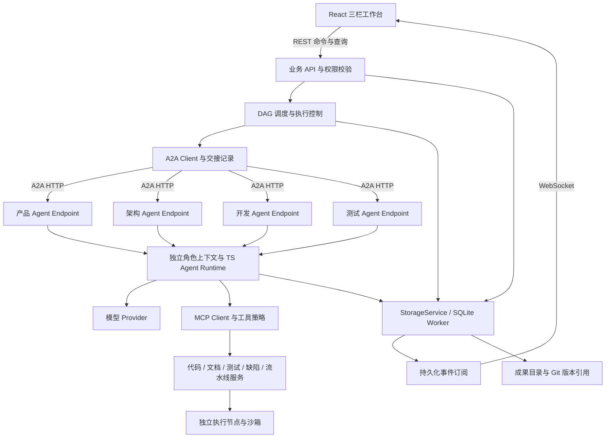
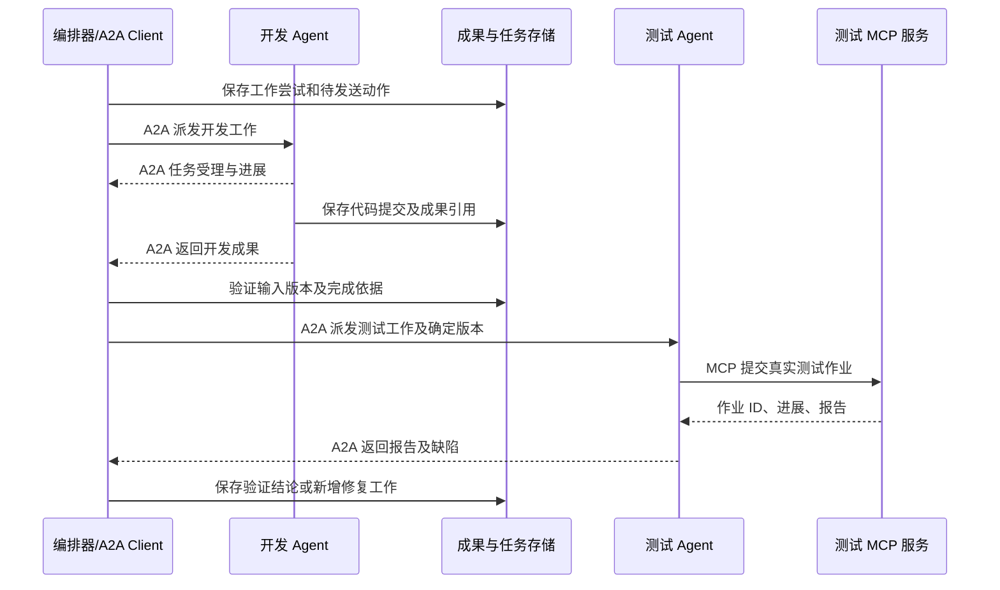
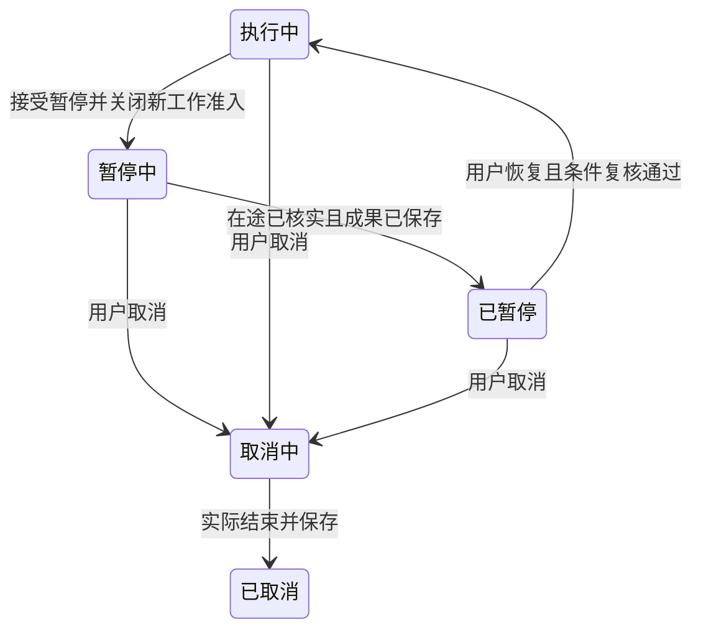
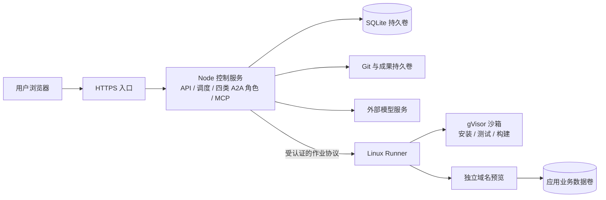

# DevMesh 技术设计方案 V1.0

> 历史版本：已由 [V1.1 详细设计](./DevMesh_技术设计方案_V1.1.md) 替代。V1.1 补齐了协议幂等、状态与事务、故障恢复、数据交付及逐项验收；当前实现以 V1.1 为准。

| 项目 | 内容 |
| --- | --- |
| 状态 | 第一版技术评审稿；用于工程拆解，不代表功能已实现或验证通过 |
| 日期 | 2026-11-10 |
| 产品依据 | [产品需求 V10.0](./DevMesh_PRD_V10.0.md)、[产品验收场景 V10.0](./DevMesh_产品验收场景_V10.0.md)、[原型图索引](./原型图索引.md) |
| 已确定方向 | 保留 A2A 多 Agent 协作和 MCP 工具接入；平台采用 JavaScript／TypeScript 技术路线 |
| 技术栈参考 | `D:/yms/AI/deepseek-harness`，本次查看的 HEAD 为 `ce7073d51254c26cd63b22a60835b8f948deb447`；所列依赖以本地清单为依据 |
| 部署基线 | 单实例控制服务、持久化数据目录、独立执行沙箱，面向个人与小团队 |

## 1. 设计结论与范围

采用 **Node.js + TypeScript + Cordis + React + SQLite** 构建工作台。平台以确定性的 DAG 调度器组织产品、架构、开发、测试四类 Agent，角色之间的任务交接通过真实 A2A 接口执行；Agent 通过 MCP 访问代码、文档、测试、缺陷和流水线能力。

平台使用统一 Node.js 运行环境。开发机安装 Node.js、pnpm、Git；需要构建、测试、预览生成应用时，连接已准备好的 Linux 沙箱执行节点。浏览器用户只需访问工作台。平台默认实现和首个应用模板均不依赖 Python。

本方案覆盖 PRD 的十个模块：项目与任务、需求澄清、DAG 计划、协作执行、需求变更、冲突裁决、执行控制、成果交付、回放与评测、配置查看。新建小型 Web 应用、已接受应用迭代及缺陷修复均在范围内。第一版方案对应完整本期范围，实施按里程碑递进。

产品默认值沿用 PRD：同项目一个活动执行；每次执行最多两个角色同时处理工作；最多 30 项当前计划工作；计划额外修正最多 2 次；安全自动重试最多额外 2 次；自动修复最多 2 轮；默认活动处理预算 60 分钟。所有实际值在执行前展示并写入配置快照。

第一版采用以下假设，可在评审后通过独立决策记录调整：模型通过已有服务调用，不部署本地模型；运行节点具备 Linux 容器能力；控制服务使用单机本地磁盘；暂无跨机高可用及外部任意仓库导入需求。部署限制不改变产品要求，缺少能力时显示具体阻塞。

## 2. 参考项目结论与技术选型

### 2.1 从 deepseek-harness 实际确认的技术路线

| 参考点 | 本地证据 | DevMesh 采用方式 |
| --- | --- | --- |
| Node.js、ESM、pnpm workspace | 根 `package.json`：Node `>=24.9.0`、`type: module`、pnpm `11.28.5` | 统一 Node 24 的受维护补丁版本、ESM、pnpm monorepo |
| TypeScript 与构建 | 根清单：TypeScript `^6.0.3`、tsdown `^0.22.2`、tsx `^4.23.13` | 严格类型检查；开发 tsx，发布使用构建后的 JavaScript |
| React 与 Vite | `apps/web/package.json`：React `^18.2.0`、Vite `^6.4.3`；根清单另有 Vite `8.2.2` | React 18.3 版本线；DevMesh 统一采用 Vite 8.2.2，单独验证插件兼容性 |
| Cordis 插件体系 | `docs/architecture.md`、`vendor/README.md` | Service／Provider／Consumer 分工、作用域、类型化事件和可释放注册 |
| HTTP 与实时通信 | `packages/host/webserver/README.zh.md`、`packages/api/gateway/README.zh.md` | Node HTTP 宿主、WebSocket 实时事件；DevMesh 自有业务 API |
| UI 样式 | `docs/web-styling.zh.md` | CSS Modules、clsx、统一主题变量和基础组件 |
| Agent 运行循环 | `packages/core/agent-loop/README.zh.md` | 模型请求→工具执行→下一步的 TypeScript 运行循环，能力通过插件注入 |
| MCP | `packages/mcp/mcp-client/package.json` | 参考已采用的 `@modelcontextprotocol/client` 2.2.0 |
| 持久化 | `packages/storage/storage-sqlite/README.zh.md`、`packages/session/session-persistence-jsonl/README.zh.md` | 使用内置 `node:sqlite`；吸收只追加事件思想，DevMesh 的权威事件与业务状态统一入库 |
| 测试 | 根清单：Vitest `^4.1.11`、coverage-v8；Web 清单有 Playwright | 单元、协议集成、无密钥回放、真实工具及浏览器端到端测试 |

参考项目的版本号描述的是当前本地清单，不等于这些版本已经在 DevMesh 中完成联合验证。尤其根清单与 Web 子包的 Vite 范围不同，不能直接把整套清单复制后当作兼容结论。

### 2.2 技术选型表

| 层次 | 第一版选择 | 选择理由及代价 |
| --- | --- | --- |
| 平台语言 | TypeScript 6.0.x，ESM | 前后端共享类型；降低多语言运行环境负担 |
| 运行时与包管理 | Node.js 24.x，最低 24.9；pnpm 11.28.5 | 与参考工程一致；精确补丁和依赖冻结到构建清单 |
| 前端 | React 18.3.x、Vite 8.2.2、CSS Modules、clsx | 适合三栏工作台及增量事件渲染；沿用参考项目的组件方式 |
| DAG 展示 | React Flow（`@xyflow/react`）+ Dagre | 支持节点定位、缩放、自动布局；关闭编辑依赖的交互 [S5] |
| 浏览器状态 | 类型化 observable store + `useSyncExternalStore`；草稿独立保存 | 参考 Harness 的状态快照方式；后台更新不覆盖视图选择和未提交内容 |
| 插件容器 | Cordis，使用固定来源的最小依赖闭包 | 角色、模型、工具、持久化可替换；需维护明确的来源与升级清单 |
| HTTP 接入 | Node HTTP 宿主 + Express 5 路由适配 | 平台维持轻量结构；A2A 使用官方 SDK 的 Express 适配，避免自写协议解析 [S1] |
| 前后端 API | REST 命令／查询 + WebSocket 事件订阅 | 业务请求便于幂等和并发校验；事件按游标恢复，区别于 A2A 的 SSE |
| A2A | 官方 `@a2a-js/sdk`，A2A 1.0，JSON-RPC over HTTP + SSE | 使用标准 Agent Card、任务、状态、成果、查询和取消能力 [S1][S2] |
| MCP | 官方 TS SDK v2；client 2.2.0 为候选冻结点，server 配套版本 | 本地参考工程已有客户端选择；远端用 Streamable HTTP，本地支持 stdio [S3] |
| Agent 引擎 | Cordis 插件化 TypeScript Agent Runtime | 与参考工程架构一致；本项目承担最小运行循环、工具记录和恢复实现，不叠加 LangGraph |
| 任务编排 | TypeScript DAG 调度器 + 持久化任务表 | 明确实现 PRD 的版本、限额、人工决定与终态规则；当前计划最多 30 项，便于完整校验 |
| 数据库 | `node:sqlite` + WAL；数据库 Worker 统一访问 | 单机部署无需单独安装数据库；同步驱动移入 Worker，控制主线程延迟 [S4] |
| 文件与源码 | 本地内容寻址成果目录 + Git 仓库／独立 worktree | 成果不可覆盖、代码有明确版本；后续可替换对象存储 Provider |
| 资料检索 | Markdown／文本解析 + 中文分词后的关键词检索 | 当前附件规模较小，命中必须返回原文和版本；首版无需向量数据库 |
| 模型服务 | DeepSeek 服务作为首个 Provider，配置化模型 ID | 与参考项目方向一致；模型和工具适配分离，不依赖某个具体模型别名 |
| 执行环境 | Linux 执行节点、Docker + gVisor `runsc` | 隔离生成代码；平台与执行节点分离，镜像预装工具链 [S6] |
| 测试与质量 | Vitest 4.1.x、coverage-v8、Playwright、tsc、Oxlint | 对齐参考工程测试习惯；验证行为、协议、恢复和交付结果 |
| 监控 | 结构化日志、健康检查、OpenTelemetry 接口 | 关联执行、工作、尝试及工具调用；持久化业务事件独立于诊断日志 |

版本策略：P0 生成 `pnpm-lock.yaml`、Node／pnpm 版本文件、容器镜像 digest 和协议兼容清单。已给出版本是选型基线，未给出补丁号的新增依赖在 P0 联调后精确冻结；发布构建不使用浮动 `latest`。A2A 协议版本、SDK 包版本、业务载荷版本分别记录。

### 2.3 参考与复用边界

DevMesh 建立独立工程，参考 Harness 的插件与事件设计。第一版不把整个 Harness 工作区作为生产依赖，也不假定其实验性 agent-team、脚本 workflow、桌面及 Python 扩展已经满足 DevMesh 的产品规则。

Cordis 采用参考仓库固定提交中的最小框架闭包，以受控源码依赖引入并保留许可证、上游提交及修改清单；正式编码前完成包闭包和干净安装验证。其他 Harness 组件先借鉴接口与行为，后续确需源代码复用时逐项登记。参考仓库保持独立，不通过绝对路径、跨目录 `workspace:*` 或开发机软链接参与部署。

首版自建的主要业务能力是 DAG 调度、版本有效性、控制状态机和交付门槛。A2A/MCP 报文及兼容处理交给官方 SDK。数据库、文件和模型访问通过 Provider 统一。

### 2.4 关键备选方案

| 决策 | 本版采用 | 备选及启动条件 |
| --- | --- | --- |
| Python 或 TypeScript | TypeScript | 已按用户环境偏好确定；Python 仅可能出现在用户另行选择的外部工具中 |
| Cordis 或 NestJS | Cordis + 轻量 HTTP | 已有企业 NestJS 公共服务需要直接复用时再评估接入；保持业务服务接口 |
| 自有 DAG 或 LangGraph.js／Temporal | 自有持久化 DAG | 出现跨机复杂长流程、业务恢复规则难以维护时评估；切换需迁移状态权威归属 |
| SQLite 或 PostgreSQL | SQLite 单实例 | 多控制实例、跨机调度或写入压力达到压测界限时迁移 PostgreSQL；届时补充事务和锁语义测试 |
| 数据库任务表或 Redis／消息队列 | SQLite 任务表及 Outbox | 多机消费者及吞吐需求明确后引入；消息系统不替代任务状态表 |
| 原生分工或 A2A | A2A 标准交接 | 本期明确验收要求，不将进程内函数调用记录冒充协议交互 |

## 3. 整体架构与工程组织

### 3.1 逻辑架构



控制服务默认为一个 Node 进程，数据库在 Worker Thread 中运行。四个角色各有独立 Cordis 作用域、会话与 A2A handler，部署在同一控制服务的不同路径，协作仍实际经过 HTTP 协议。角色数与 OS 进程数无须相同；后续可按注册地址拆成独立服务。

生成代码、依赖安装、测试命令和预览运行在执行节点，不能在控制服务进程中执行。MCP 测试／流水线服务仅提交受约束的作业，由执行节点管理进程和容器。

### 3.2 主控与四类 Agent

“主控”是平台的编排服务，包含输入路由、计划校验、调度和结果归档。需要模型判断的需求理解和方案规划分别交给产品、架构 Agent，保留原方案的四类业务 Agent；主控自身通过确定性代码实施授权和状态约束。

| 角色 | 主要输入 | 主要输出 | 可用能力 |
| --- | --- | --- | --- |
| 产品 Agent | 用户目标、附件、已有应用、有效回答 | 需求项、假设、澄清问题、业务验收条件 | 文档检索、只读项目资料 |
| 架构 Agent | 有效需求、模板能力、项目接口和约束 | 方案、接口、工作项、DAG、变更影响 | 文档和代码只读、结构化计划输出 |
| 开发 Agent | 分配工作、接口约定、确定代码起点 | 代码差异、提交、修改说明、局部检查、风险 | 工作区读写、受限命令、代码及缺陷 MCP |
| 测试 Agent | 验收条件、集成版本、缺陷依据 | 测试／构建／启动报告、覆盖率、缺陷、复验和预览证据 | 测试、缺陷、流水线及代码只读 MCP |

所有角色可以提出后续交接请求；平台检查当前计划、有效输入和预算后代为派发。记录同时保存成果提供角色、实际协议调用方和接收角色。例如“开发成果经编排器交给测试”，不能把实际由平台发出的消息记录为开发进程直接调用。

### 3.3 模块与目录建议

```text
DevMesh/
  apps/web/                       React 工作台
  apps/server/                    HTTP、WebSocket、A2A 宿主入口
  apps/runner/                    Linux 沙箱执行节点
  packages/contracts/             业务请求、事件、成果类型与载荷版本
  packages/core/                  领域服务、错误、权限与插件接口
  packages/orchestrator/          计划校验、调度、预算与控制状态机
  packages/agent-runtime/         模型循环、会话、上下文与工具执行
  packages/agent-roles/           四类角色 Prompt 与能力声明
  packages/protocol-a2a/          官方 SDK 适配、任务存储与事件归并
  packages/protocol-mcp/          客户端接入、能力发现与调用记录
  packages/mcp-services/          五类真实工具 Provider
  packages/storage-sqlite/        数据库 Worker、事务与迁移
  packages/artifacts/             文件、代码版本、报告和回放包
  packages/ui/                    主题、基础控件与事件视图
  vendor/                        固定来源的最小 Cordis 闭包
  templates/web-basic/            首个受支持应用模板
  deploy/                        控制服务、沙箱镜像与环境示例
  tests/protocol/                 A2A、MCP 真实互通
  tests/scenarios/                产品路径与故障恢复验证
```

Cordis 只管理进程内服务和生命周期，不充当跨进程消息队列。配置在启动时验证，动态配置变更仅默认影响新执行；活动执行采用冻结配置。插件卸载必须先停止准入、核实在途工作、持久化并释放资源。

## 4. A2A 协作设计

### 4.1 协议基线和接入

采用 A2A 1.0 与官方 JS SDK，首版启用 JSON-RPC 和 SSE，能力注册表记录每个角色的 Agent Card URL、版本、认证方式及 streaming 能力。Agent Card 使用显式配置地址；四个逻辑端点的路径分别为 `/internal/agents/{role}/a2a`，对应卡片为 `/internal/agents/{role}/agent-card.json`，由平台配置发现。该路径是本项目路由，不改变标准协议内容。

TaskStore 接口接入 StorageService，业务工作必须产生可查询的 A2A Task。SDK 内存默认存储仅用于单元测试。协议状态由 SDK 枚举及锁定规范编码；本项目字段放在版本化业务载荷／metadata 中，不能自行增加标准状态。

A2A 标准对象及操作采用官方定义；终态任务后续工作新建任务。平台的暂停、完成验收、输入版本和重试次数是额外业务规则 [S2]。

### 4.2 标识与结构化载荷

| 标识 | 归属与用途 |
| --- | --- |
| `projectId`／`taskId` | DevMesh 项目／用户任务；本表 `taskId` 是业务字段 |
| `runId` | 本次执行；整次重做产生新的 run |
| `planVersion`／`requirementVersion` | 派单依据；变更后校验结果适用性 |
| `workItemId`／`attemptId` | 逻辑工作／执行尝试；重试保持工作身份并新增尝试 |
| `remoteAgentId`／`a2aTaskId` | A2A 接收服务与其生成的任务 ID；组合使用，避免跨服务冲突 |
| `a2aContextId` | 接收方范围内的交互上下文，显式映射，不直接当成全平台 run ID |
| `messageId`／`operationId` | 协议消息标识／业务动作幂等标识；两者分别保存 |
| `codeCommit`／`artifactId` | 确定代码版本／不可变成果引用 |
| `executionEpoch` | 当前执行许可代际；暂停、取消、接管时改变，阻止旧执行者写入 |

以下为 DevMesh 业务载荷示意，不是直接可发送的完整 A2A wire JSON；由官方 SDK 放入标准数据部分并编码。

```json
{
  "schemaVersion": "devmesh.work.v1",
  "operationId": "op-demo-001",
  "runId": "run-demo-001",
  "workItemId": "work-test-01",
  "attemptId": "attempt-test-01-1",
  "requirementVersion": 3,
  "planVersion": 2,
  "executionEpoch": 7,
  "sourceRole": "developer",
  "targetRole": "tester",
  "objective": "验证任务看板的状态筛选和刷新后保留",
  "inputs": [
    { "artifactId": "artifact-requirements-03" },
    { "artifactId": "artifact-code-07" }
  ],
  "completionCriteria": ["必要用例全部执行并通过", "报告绑定输入代码版本"],
  "constraints": { "allowProductionDeploy": false }
}
```

大文件通过有权限的成果引用获取，协议中传摘要、标识、摘要哈希和必要数据。接收方验证执行许可、项目范围、版本及访问权，不能仅凭载荷中的 role 或 projectId 获得权限。

### 4.3 开发到测试的交接



同一角色在进程内使用工具时产生工具记录；跨角色交接产生 A2A 记录。单纯调用模型、连接 Agent 或展示角色卡片，均不作为 A2A 交接通过依据。

### 4.4 A2A 与业务状态映射

下表使用语义简称；wire 枚举由 A2A 1.0 SDK 序列化。

| A2A 语义状态／事实 | 工作尝试投影 | 平台行为 |
| --- | --- | --- |
| submitted | 已接收／排队 | 记录远端身份，等待真正开始 |
| working | 执行中 | 更新进展和活动区间 |
| input-required | 等待补充 | 建立待办；独立工作仍可执行 |
| auth-required | 等待连接处理 | 引导维护连接，不要求用户在对话提供秘密 |
| completed | 协议执行完成，待核验成果 | 报告、版本与完成条件通过后才将业务工作记成功 |
| failed／rejected | 失败／拒绝及原因 | 判断是否可安全重试，保留原尝试 |
| canceled | 远端任务取消 | 同时核实工具／沙箱在途动作，满足后才完成平台控制 |
| 无响应、断流或无法确定 | 最后已知状态 + 核实中 | 查询原任务；不推断成功或直接重跑 |

测试 Agent 可以完成一次“执行测试并产出报告”的协议任务，而报告中有失败用例。此时协议任务已完成、验证未通过、交付仍阻塞，三个结论分别保存。

### 4.5 可靠交付与恢复

1. 派发前，在事务中保存 attempt、operation 和 Outbox；事务提交后才发送 A2A。消息不能在业务记录之前发出。
2. 本项目 Agent 端维护持久化 Inbox，按认证调用方、operationId 和请求哈希去重。同一个动作重复送达返回同一个远端任务，参数不一致返回冲突。业务幂等独立于 SDK 和传输重试。
3. 已获得远端任务 ID 时，断流后优先查询／重新订阅原任务。首次响应丢失时，只有本项目已实现上述 Inbox 的端点允许以同一 operationId 再投递；外部 Agent 未承诺幂等时保持待核实。
4. 状态与成果更新按远端任务、消息／成果标识和事件去重键归并，防止重复报告、重复计数；终态后的晚到事件保留为诊断，不回写当前结论。
5. 平台不要求 SSE 保存全部历史。远端当前任务状态用于恢复，完整执行记录由持久化事件流与成果表提供。
6. 取消通过 A2A CancelTask 提出，并关联执行节点 stop 操作。请求已返回与外部命令已停止分别判断。无法核实时保持“暂停中／取消中”。

以上业务去重、版本和停止核实由 DevMesh 实现；采用 A2A 本身不自动提供这些业务保证。

## 5. Agent Runtime、上下文与模型

### 5.1 最小运行循环

运行时依次完成：读取当前执行许可→装配角色 Prompt、有效上下文和工具清单→请求模型→记录回复及工具请求→校验并执行工具→记录结果→决定下一步或输出成果。每一步均有独立 stepId；取消信号传播到模型连接、工具任务和执行节点。

四类 Agent 共用实现，分别配置 Prompt、模型、工具权限、输出 schema 和步数限制。初版不开放无限递归子 Agent；跨角色派单统一经过编排服务的执行准入。工具并行是角色内部能力，不突破执行、沙箱和外部系统的资源限额。

模型输出使用 JSON Schema 校验。第一次格式错误可在本工作剩余预算内请求修正，达到配置次数后报告失败；不能因为修正输出反复扩展任务范围。工作完成必须提供结构化成果及真实工具记录，最终自然语言仅用于说明。

进程重启后，已完成模型步骤、已知工具结果从日志恢复。模型请求结果未知时记录中断；只有确认没有外部副作用的步骤才可重新请求。工具调用已有作业 ID 时先查询原作业，不能靠重放整轮模型对话恢复执行。

### 5.2 模型选型与冻结

首个适配器对接团队可访问的 DeepSeek 服务，Provider 接口至少包含流式回复、工具调用、结构化输出校验、取消、用量和错误归一。部署配置指定真实服务与模型 ID；不能把任意供应商的兼容接口视为行为完全相同。

| 角色 | 选择标准 | 配置方式 |
| --- | --- | --- |
| 产品、架构 | 中文需求理解、长上下文、结构化计划和约束遵守 | `planningModel` |
| 开发 | TypeScript 代码修改、工具调用、错误修复 | `codingModel` |
| 测试 | 验收拆解、报告解释、缺陷复现与证据一致性 | `testingModel` |

第一版允许三个配置指向同一经过验证的模型，减少接入成本。模型名称由实际可用服务清单确定，不在没有凭据和评测的情况下宣称某个实例可用。P0 使用任务看板、预约约束、缺陷修复三组样本，检查 schema 合格率、真实工具调用、指令遵守、修复成功情况及可获取用量；结果进入配置冻结记录。

每次执行保留 provider、model、采样参数、实际 Prompt 版本、工具清单和限制。失败时默认保留原模型；切换模型需形成可见配置变化，活动执行按 PRD 的暂停和恢复规则处理。

### 5.3 上下文与权限

上下文由服务构造，包含相关需求、有效决定、验收、当前工作输入、必要接口和代码片段，保留原文入口及版本。只向当前角色提供工作所需内容。摘要包含来源引用，必要规则和验收不因压缩被静默移除；仍超限时拆分工作或请求调整资料。

模型可见输入先生成脱敏记录，秘密以凭据引用交由工具 Provider 使用。资料、代码注释和 MCP 返回文本作为任务数据处理，不能扩大工具授权。会话记录保存可解释的输入、输出、调用与成果，不要求提取或展示模型内部思维。

## 6. MCP 五类真实能力

### 6.1 服务选择

首版提供五类 TypeScript MCP Provider，可由同一服务进程承载不同端点，按实际独立业务能力计数。已有企业服务可替换 Provider，但本期必须逐项具备真实动作和结果，不能只展示连接成功。

| 能力 | 首版后端选择 | 示例工具（本项目拟定） | 实际验收证据 |
| --- | --- | --- | --- |
| 代码仓库 | Git CLI + 项目受控仓库 | `repo.read`、`repo.diff`、`repo.commit`、`repo.snapshot` | 实际文件、差异、提交 SHA、操作记录 |
| 文档检索 | 项目附件索引与原文存储 | `docs.search`、`docs.read` | 命中来源、段落位置、原文内容及版本 |
| 测试执行 | 沙箱作业服务 + Vitest／Playwright | `tests.start`、`tests.get`、`tests.stop` | 作业 ID、命令、退出码、测试与覆盖报告、停止核实 |
| 缺陷跟踪 | DevMesh 缺陷领域服务 + SQLite | `issues.create`、`issues.linkFix`、`issues.recordVerification` | 缺陷编号、复现、代码版本、修复关联及复验结果 |
| CI/CD | 沙箱流水线服务：安装、检查、构建、发布受限预览 | `pipeline.start`、`pipeline.get`、`pipeline.logs`、`pipeline.artifacts` | 独立流水线 ID、阶段、日志、构建成果及预览证据 |

测试 Provider 提供独立测试作业；流水线 Provider 负责完整构建和交付过程，可引用测试结果但不能将同一工具改两个名称计作两项接入。缺陷和文档 Provider 即使与平台共部署，Agent 调用仍经过真实 MCP Client／Server 链路。

### 6.2 接入与调用规则

优先使用 MCP 2026-07-28 和 TS SDK v2。参考项目的 client 2.2.0 作为冻结候选，server 使用兼容版本；旧服务按 SDK 支持的协议协商并记录实际结果，协商失败时明确不可用。远端连接采用 Streamable HTTP，本地受管进程可采用 stdio [S3]。

MCP 注册表保存服务身份、协议、工具 schema、实际能力、检查时间、凭据引用和允许角色。启动检查包含真实能力发现；完整接入验收再执行一项可核对的业务动作。单次任务按需调用，不强制每次使用全部五类能力。

每次调用记录 `toolCallId`、来源、所属 Agent／工作／尝试、输入摘要、操作幂等标识、返回状态、外部 jobId、成果和时间。`mcp` 与 `internal` 是不同来源；编码运行时的直接文件操作不能作为 MCP 调用证据。

长期操作使用本项目业务工具返回 jobId，再通过查询／停止工具管理。MCP 请求连接结束不代表后台任务停止；MCP 的取消能力与执行节点真实停止结果必须关联。首版不依赖某个可选 MCP Tasks 扩展才能完成产品控制。

## 7. DAG、版本与执行控制

### 7.1 计划生成与调度

架构 Agent 输出声明式计划：工作目标、主责角色、输入、输出、完成条件、前置依赖、必要验证和预期写入范围。平台通过 schema、引用完整性和拓扑排序验证计划；缺输入、缺验证、超过规模或有环时不能确认执行。

用户确认的是当前计划版本及摘要哈希。确认成功才进入准备与实现；需求理解和方案草拟可在确认前运行。平台调度器每次仅选取依赖成果当前有效、许可未暂停、资料和工具齐备、剩余预算充足的工作。

SQLite 事务完成候选选取、并发名额预留和 attempt 创建。首版只允许一个调度写入者，平台数据目录以进程锁和数据库实例身份防止启动第二个控制实例。异步 I/O 和多标签页操作仍通过事务及版本号处理竞争。

新增修复和复验创建后续工作及计划版本，保留原失败任务，当前 DAG 持续无环。所有依赖使用工作成果版本引用，不能只凭前置工作曾经成功就启动后续工作。

### 7.2 三层状态

| 层次 | 保存内容 | 判定依据 |
| --- | --- | --- |
| 执行 Run | 规划中、执行中、验证中、等待处理、暂停中、已暂停、取消中、已完成、失败、已取消 | 工作聚合、控制意图、在途动作和交付接受 |
| 工作／尝试 | 等待前置、可开始／排队、执行中、等待处理、待核实、成功、失败、已取消 | 当前 attempt、输入版本、协议反馈和实际成果 |
| 成果 | 当前可用、暂待决定、已不适用于当前要求 | 生成时版本与当前需求、接口、代码的对应关系 |

整体仍有独立工作可执行时保持执行中或验证中，并展示局部待办。只有全部后续受阻且没有在途工作，或等待最终审查时，才整体等待。协议终态、工作成功与用户接受分别保存。

### 7.3 暂停、恢复和取消



图为控制子流程，规划中、验证中等活动状态同样可进入暂停／取消；恢复后按实际阶段显示状态。

暂停受理时，事务保存控制意图，递增 executionEpoch，关闭调度和新副作用操作准入；已开始的命令进入停止或安全收尾。执行节点定期续租；续租失败或许可过期后停止新动作，并终止仍需写入的作业。平台仍须查询实际退出和保存情况，不能仅因租约到期声称停止。

平台对每项在途工作分别核实模型请求、A2A 任务、MCP 作业、文件写入、Git 集成和预览创建。操作可自然完成时保存结果；必须终止时先执行 stop，再查询进程／容器／流水线状态，保存未提交差异及日志。30 秒仍不明确时展示待核实原因并继续核实。

**A2A 没有被本方案定义为通用暂停协议。** 对在途任务，首版采用取消当前远端尝试或等待安全收尾的策略；保存后逻辑工作仍可继续。恢复时，已结束的 A2A task 不重启，创建新 attempt／新 A2A task，并引用保存成果。人工暂停中保存回答和决定，不发送继续执行消息；用户恢复后再处理。

取消与暂停并发时取消优先。取消完成保留已有材料，停止本次未接受临时预览，原已接受版本保持独立。服务重启时根据数据库中的控制意图继续核实；不会自动解除人工暂停。

### 7.4 重试、整次重做

确定失败、输入有效、可安全重复且预算允许时重试，新增 attempt。结果未知先核实；不能通过创建新 ID 绕过去重或限额。暂停中断后继续与失败重试使用不同原因码和统计口径。

整次重做只用于尚未接受的当前任务。确认前先暂停并保存；最终确认后安全结束旧执行，以最新已确认需求和原任务开始时的代码起点创建一个关联新 run。原未接受代码和测试通过结论不作为新起点，新 run 重新确认计划。新建失败按同一个重做 operationId 继续创建，避免多个新执行。

### 7.5 需求变更与冲突

变更按“提议→分析→待确认→已确认待应用→应用中→生效／应用失败”处理，同一 run 串行应用。未应用成功前原要求仍有效，但受影响分支冻结；无关工作可继续。应用事务切换 requirementVersion、planVersion 和成果适用性，新派单引用新版本。

影响范围包含直接引用该需求或接口的工作及其传递后继。代码变化重新验证对应测试、构建和预览；保留可证明仍有效的成果。分析不确定时标记需重新处理，不能凭模型推测沿用报告。

冲突记录关联同一问题、方案、来源、依据版本和影响。唯一有效决定通过数据库唯一约束及版本条件更新提交；关闭、草稿和解释不形成决定。应用完成且复验通过后才关闭冲突；暂停中仅保存选择。

## 8. 数据、事件与一致性

### 8.1 存储选择

SQLite 是本版业务状态与持久化事件的权威存储。数据库 Worker 独占同步驱动访问，启用 WAL、外键和显式事务；持久性参数采用需要断电保护的设置，并在目标文件系统上验证。数据库位于本机持久磁盘，不放在多机共享网络文件系统上。

与参考项目不同，DevMesh 不把 JSONL 与数据库作为两份独立权威日志。会话和领域事件写入同一数据库，JSONL 是导出／回放格式。事件通知只发送已经提交的记录，客户端快照可以重建。大文件存入成果目录，数据库只保存引用、大小、哈希和适用版本。

### 8.2 核心实体

| 表／实体 | 关键字段 | 主要约束 |
| --- | --- | --- |
| projects / project_members | projectId、owner、acceptedReleaseId、member 权限 | 项目访问与维护配置权限分开 |
| user_tasks / runs | taskId、runId、originRunId、baseReleaseId、state、epoch、revision | 同项目最多一个活动 run；终态只读 |
| requirements / plans | projectId、runId、version、contentHash、status | 已生效版本不可原地覆盖 |
| work_items / work_edges | workItemId、planVersion、role、inputRefs、completionCriteria | 依赖同一计划；发布前校验无环 |
| work_attempts | attemptId、workItemId、attemptNo、reason、status、epoch | 同工作尝试号唯一；原失败保留 |
| a2a_tasks / a2a_messages | remoteAgentId、a2aTaskId、contextId、attemptId、messageId、payloadRef | 接收端与任务 ID 组合唯一 |
| inbox / outbox / operations | caller、operationId、requestHash、status、resultRef | 同动作相同请求复用；不同请求冲突 |
| agent_sessions / agent_steps | sessionId、attemptId、stepId、modelSnapshot、inputRefs、status | 会话属于确定角色和执行；逐步记录 |
| tool_calls / runner_jobs | callId、source、service、jobId、epoch、status、evidenceRefs | 未知结果不能重跑；关联真实外部动作 |
| artifacts / artifact_inputs | artifactId、hash、mediaType、codeCommit、inputVersion、validity | 文件内容不可覆盖；版本关联可追溯 |
| decisions / changes / pending_items | basisVersion、draft、decision、applicationState | 同一有效依据一次有效决定 |
| defects / verifications | issueId、severity、codeCommit、testResult、fixRef | 复验通过才能关闭 |
| releases / previews / datasets | commit、reportRefs、acceptance、URL、expiry、datasetId | 接受版本、预览运行和业务数据独立 |
| config_snapshots | role、provider、model、promptHash、tools、limits | 不保存秘密值；执行引用固定快照 |
| events / activity_intervals | runId、seq、eventType、payload、occurredAt、observedAt | run 内 seq 唯一；按提交顺序回放 |
| export_jobs / import_packages | cutoffSeq、manifest、state、missingRanges | 导出重试不触发研发；导入只读 |

业务对象均有 revision；写操作携带期望 revision，在事务中比较更新。runs 的活动唯一性通过部分唯一索引或等价的项目活动指针事务约束保证，不能只依赖前端按钮。

### 8.3 事件格式与发布

```typescript
interface ExecutionEvent {
  schemaVersion: 'devmesh.event.v1';
  runId: string;
  seq: number;
  eventId: string;
  type: string;
  occurredAt: string;
  observedAt: string;
  workItemId?: string;
  attemptId?: string;
  operationId?: string;
  requirementVersion: number;
  planVersion: number;
  payload: Record<string, unknown>;
}
```

以上为对外序列化示意；工程内 opaque ID 使用 branded type，具体事件使用带判别字段的联合类型，跨进程／文件／模型边界进行运行时校验。

一次业务变化在同一事务中修改状态、增加事件和待发送动作。事务提交后，发布者读取 seq 增量通知订阅者。重发事件由客户端按 runId + seq 去重；慢客户端有缓冲上限，超限断开并从游标补齐，不能阻塞业务写入。

重连先获得快照及 cutoffSeq，再补齐之后的事件；若服务已无法提供完整区间，返回缺失范围并刷新快照。事件里的发生时间和平台观察时间分开保存，排序使用 seq，避免远端时钟漂移造成状态倒退。

### 8.4 外部操作和文件一致性

外部执行采用“至少一次投递 + 接收端幂等 + 状态核实”，不承诺跨模型、Git、容器和数据库的全局 exactly-once。

文件先写临时路径、同步并原子发布到内容寻址目录，再提交数据库引用。文件发布后数据库失败时形成可回收孤立文件；数据库不得先宣称文件已就绪。备份先获取数据库一致快照及文件 manifest，再复制其引用的不可变文件；恢复核对哈希并重建未完成操作，不能直接复制活动 WAL 文件当作完整备份。

代码集成使用独立 worktree、确定起点和项目级集成锁。开发成果先形成提交，再由集成服务按已记录集成动作应用；响应丢失通过提交和动作记录核实。不同工作不能直接同时写同一个 worktree。

## 9. 沙箱、应用模板和交付

### 9.1 执行节点

控制服务通过受认证 Runner API 提交任务。Runner 为每个 attempt 建立独立工作区，挂载必要资料、缓存和输出目录；统一管理 shell、文件修改、测试、构建和子进程。只允许受控参数，不接受 Agent 指定任意宿主挂载、容器特权或 Docker socket。

Linux 节点采用 Docker + gVisor，镜像预装固定 Node、pnpm、Git、浏览器和测试工具。资源限制包括 CPU、内存、进程数、磁盘及时长；网络按任务批准范围开放包镜像和必要服务。测试、构建与真实浏览器在 gVisor 下的兼容性列入 P0 验证，必要时使用专用隔离 VM Provider，不降级到控制服务直接执行。

Node.js 统一了平台语言环境，但构建预览仍需要 Git、浏览器及隔离执行环境。开发机可连接远端 Runner，无须本地安装全部工具链。安装包优先使用预构建依赖；干净 Windows／Linux 环境测试不得隐式要求 Python／node-gyp，发现原生依赖时选择预构建分发或调整依赖。

### 9.2 首个生成应用模板

首版限定一个经过验证的 TypeScript 模板：React + Vite 前端、轻量 Node HTTP／Express API、Node 内置 SQLite 业务存储。配套 Vitest 单元测试、Playwright 核心路径测试、覆盖率采集和启动说明。模板自身先通过任务看板、资源预约两类样例，再允许 Agent 基于模板修改。

生成应用的数据库与 DevMesh 平台数据库完全独立，每个项目的数据集有独立目录和访问范围。业务数据写入持久卷，不能放在容器临时层。测试使用独立测试数据，不直接修改用户演示数据。

已有应用迭代从当前已接受 commit 开始；新版本先用数据快照验证迁移和兼容，再按用户确认的范围处理正式演示数据。破坏性变更须明确确认，不能通过重新创建数据库完成升级。

### 9.3 代码集成与预览

并行开发各自使用 worktree；集成服务按依赖顺序将有效提交合成待验证 commit。发生代码冲突先保存冲突依据，按原约定可修复的进入修复工作，涉及方案取舍的进入人工裁决。

测试、构建、预览和最终源码包均引用同一个 commit。预览部署在独立 origin，使用受控访问令牌和明确到期时间，不共享平台登录 cookie。默认可在新窗口打开；嵌入预览采用受限 iframe 和专用域名策略。

### 9.4 交付判断

| 条件 | 平台检查 |
| --- | --- |
| 业务要求 | 当前版本全部必要需求通过；人工项有有效结论 |
| 测试与检查 | 必要测试全部执行并通过；没有阻断级类型、语法、构建或静态错误 |
| 缺陷 | 没有未解决高严重度缺陷；必要验收失败仍阻塞交付 |
| 覆盖率 | 行覆盖 ≥80%，分支覆盖 ≥70%；无可统计分支需真实依据 |
| 版本一致 | 源码、报告、覆盖率、构建和预览关联同一交付版本 |
| 材料 | 运行说明、需求清单、验证材料、协作记录及脱敏 Prompt／配置可查看 |
| 用户操作 | 对当前有效版本明确接受，事务成功后更新项目接受起点 |

覆盖率纳入 Agent 生成的业务代码。前后端分别报告，并从去重后的原始覆盖数量计算整体结果，不能简单平均百分比；排除项只允许第三方依赖、构建产物及无业务逻辑的声明／配置。下载、打开 Demo、A2A completed 都不会触发自动接受。

## 10. 工作台与业务 API

### 10.1 前端设计

保留 PRD 的左侧项目导航、中间对话、右侧五页签工作区，执行控制位于顶部。五页签为任务、协作、成果、预览、记录；需求理解与澄清位于任务页签，配置位于协作页签内。列表与 DAG 使用同一个计划查询结果，不另维护一套图状态。

浏览器状态分为服务器投影和本地交互状态：前者由已提交事件更新，后者保存选择、筛选、展开项、滚动位置和未提交草稿。后台事件仅提示新进展，不自动切换右侧内容或清除输入。切换项目和查看历史均显式绑定 projectId／runId，历史模式服务端也禁止写入。

计划、变更、冲突和交付操作提交依据版本；收到过期响应后保留草稿并展示新旧差异。重复点击复用 operationId。断线显示最后同步时间，恢复后查询原操作结果；不能将等待响应当作提交失败并自动新建任务。

基础控件集中管理 CSS Modules、主题变量、键盘焦点、窄屏和错误反馈。技术详情按需展开，普通使用者只需理解目标、影响、结果和下一步。

### 10.2 主要 REST 接口

下表为第一版业务 API 设计，路径不替代 A2A 或 MCP 标准接口。变更请求统一携带认证、operationId、预期 revision／内容版本；服务返回关联操作记录。

| 接口 | 用途 | 关键约束 |
| --- | --- | --- |
| `POST /api/projects` | 创建项目与首次用户任务 | 幂等；正文与附件先保存 |
| `GET /api/projects` | 项目列表、状态和待办 | 仅返回授权项目 |
| `POST /api/projects/{id}/tasks` | 已接受应用迭代／修复 | 固定接受版本作为起点，检查活动执行 |
| `GET /api/runs/{id}` | 执行快照、阶段、待办及 cutoffSeq | 历史与当前明确区分 |
| `POST /api/runs/{id}/messages` | 用户提问、补充、纠正或变更提议 | 分类结果可纠正；提问不直接修改要求 |
| `POST /api/runs/{id}/answers` | 保存／提交澄清回答 | 草稿与生效回答不同动作 |
| `POST /api/runs/{id}/plans/{version}/confirm` | 确认当前计划 | 旧版返回冲突；暂停中只保存确认 |
| `POST /api/runs/{id}/changes` | 提交变更分析 | 串行应用，分析未完成不能确认 |
| `POST /api/pending-items/{id}/decisions` | 提交变更或冲突决定 | 校验依据、可选项及一次有效选择 |
| `POST /api/runs/{id}/controls` | pause／resume／cancel | 先保存控制意图；异步核实状态 |
| `POST /api/work-items/{id}/retry` | 重试确定失败工作 | 输入、预算、安全重复和执行许可检查 |
| `POST /api/runs/{id}/redo` | 整次任务重做 | 旧执行安全停止；同动作只创建一个新 run |
| `GET /api/runs/{id}/delivery` | 逐项需求、报告与材料 | 必须标适用版本和缺项 |
| `POST /api/releases/{id}/accept` | 接受交付 | 当前版本全部门槛通过，事务更新项目起点 |
| `POST /api/runs/{id}/exports` | 创建回放导出作业 | 固定 cutoffSeq；重复请求返回同一作业 |
| `POST /api/replays/imports` | 校验并导入回放包 | 不创建可执行项目、不运行包内代码 |
| `GET /api/operations/{id}` | 查询丢失响应的实际结果 | operation 属于授权用户／项目 |
| `GET /api/runs/{id}/config` | 查看执行配置快照 | 脱敏；当前配置与历史分开 |

异步控制返回 `202 + operationId`，随后查询或事件通知；版本冲突使用 `409`，输入问题使用 `422`。错误体包含稳定 code、可显示说明、关联工作、是否可重试及下一步，绝不返回秘密或模型原始隐私内容。

WebSocket `/api/events` 支持按 runId 和 lastSeq 订阅。业务 commands 仍走 REST；关闭 WebSocket 不取消研发，页面刷新不会产生新的 run。

## 11. 回放、评测和配置

### 11.1 回放材料

回放包包含 manifest、需求和计划版本、用户及 Agent 消息、A2A 任务与交接、决定、MCP／内部调用、成果引用、报告和脱敏配置。manifest 记录格式版本、runId、截止 seq、文件清单、哈希、完整性及缺失范围。完整历史可包含正文文件；大成果按已说明的导出范围处理。

导出时选定截止 seq 并基于一致快照生成材料，进行中包标“进行中快照”。归档失败只重试归档；接受交付不因最终压缩文件失败回滚。链接到外部资料且未收录正文时，标明无法离线查看的范围。

导入限制沿用 PRD：压缩体积 200 MiB、解压体积 1 GiB、最多 20,000 文件。流式计数限制实际解压量；检查路径穿越、重复路径、符号链接及哈希，解压到独立临时目录。缺少非关键内容可以明确选择仅查看有效片段；缺失类型和范围持续显示。回放渲染器只读取事件和文件，不装载执行、模型或工具服务。

### 11.2 评测口径

Agent 参与按 workItemId 去重；理解和规划也计入真实工作，重试另列。人工介入按有效保存或受理的 operationId 计数，查看、草稿和重复请求不计。需求验证仅统计当前有效版本，跳过和未执行不算测试通过。

活动时间按工作区间取并集，两个角色并行不重复累计；整体人工等待、纯资源排队、已暂停时间单列。仍有独立工作执行时，局部人工待办不把整段时间变成全局人工等待。运行结束或统计截止时固定分母，零时间或缺少记录显示不可计算。

运行预算采用累计活动区间，不随恢复、重试或手动操作重置。停止收尾仍在处理实际工作时计入活动区间。重做前后 run 各自统计，以 originRunId 关联展示。

### 11.3 配置与凭据

运维配置通过受控文件／部署管理入口维护，普通用户只查看快照。配置分为角色、模型、A2A 注册、MCP 服务、模板、沙箱、并行与预算、保留时间。默认值经过 schema 校验后形成最终实际配置，缺项明确阻塞。

凭据存储使用部署秘密注入和受限凭据 Provider；配置与日志只保存引用，浏览器不获得模型或工具密钥。模型、工具连接的检查时间与最近结果可查看，但连接可用不代表本次已经调用。

## 12. 部署、权限与运行维护

### 12.1 最小部署



本机开发：Node 24、pnpm、Git，前端与控制服务本地运行；执行任务连接 Linux Runner。完整演示可用 Docker Compose 提供控制服务与持久卷；Runner 对 Docker 的控制接口只对受信任服务开放。

初始容量估算为控制节点 4 vCPU／8 GiB、Runner 8 vCPU／16 GiB，模型计算由外部服务承担；这是用于试运行的配置建议，不是实测容量承诺。沙箱资源和预览数量由平台配额控制，最终按 P0/P1 真实应用压测调整。

首版控制服务保持单实例，SQLite、成果目录和 Git 仓库绑定持久卷。扩容执行节点不等于可以扩容控制服务；多控制实例需要先完成 PostgreSQL、分布式准入和恢复策略改造。

### 12.2 身份与授权

共享部署对接企业 OIDC，平台建立用户与项目访问关系；服务端校验每项项目、执行和材料权限。平台维护连接的权限与代用户确认计划／接受交付的权限分开。开发模式仅监听 loopback，可使用受限开发身份，不能按此配置直接开放团队访问。

浏览器使用 HttpOnly／Secure 会话 cookie，写操作校验 CSRF／Origin。A2A、MCP 与 Runner 的服务调用采用限定 audience、作用域和有效期的服务凭据，并校验项目与执行许可。内网可达不等于允许调用；资料中的 URL 不能自动成为新 Agent 或新工具服务。

预览使用独立域名和访问范围。生成应用获得自己的数据目录及必要服务凭据，不获得平台数据库、模型密钥、宿主工作目录或控制 API 权限。

### 12.3 诊断与恢复

诊断日志统一携带 projectId、runId、workItemId、attemptId、operationId、toolCallId、a2aTaskId。指标至少包括：待派发数量、真实活动任务、待核实动作、数据库事务耗时、工具失败率、协议断流、沙箱资源及队列等待。

启动恢复先获取单实例所有权，再加载非终态操作；查询 Runner 作业和 A2A 任务，恢复待发送动作与事件订阅。旧 epoch 结果只归原记录，不进入新版本接受条件。必要材料缺失时建立待办，不能自动补造成功。

备份与恢复覆盖 SQLite、Git、成果和业务数据；分别配置保留期限。设计目标为已成功提交的数据能在普通服务重启后恢复，磁盘损毁恢复能力以备份策略和演练为准。首版不宣称无损跨机高可用。

## 13. 验证方案与需求对应

### 13.1 分层验证

| 层次 | 验证重点 | 工具／方式 |
| --- | --- | --- |
| 领域单元测试 | DAG 无环、版本失效、限额、预算区间、决定唯一、交付门槛 | Vitest、必要的状态转换组合测试 |
| 持久化集成 | 状态／事件／Outbox 原子性、并发确认、孤立文件、备份恢复 | 临时 SQLite + 文件系统故障注入 |
| A2A 协议互通 | Card、任务受理、流式进展、成果、输入补充、拒绝、取消与查询 | 官方 JS SDK Client／Server，真实 HTTP；保存脱敏交互 |
| MCP 实际接入 | 五类独立能力、工具发现、真实动作、失败与未知 | 官方 MCP SDK + 真实 Git／测试／文档／缺陷／流水线 |
| 故障恢复 | 派单响应丢失、断流、重启、晚到结果、停止失败 | 在关键持久化点注入中断，不以普通 happy path 代替 |
| UI 与回放 | 三栏状态保持、历史只读、草稿、重复提交、缺失记录 | Playwright、无密钥事件样例回放 |
| 应用交付 | 需求到源码、测试、预览、数据保留、用户接受 | PRD 五条完整路径，使用真实模型和沙箱 |

必须覆盖的故障场景：

1. 接收端已创建 A2A 任务但响应丢失，重新投递不创建第二个工作。
2. 开发完成后用户确认新需求，旧测试报告晚到仍只归旧版本。
3. 已受理暂停时另一页提交回答，执行继续保持暂停；恢复前核实在途写入。
4. 测试工具返回超时但后台进程仍运行，界面显示待核实且不允许直接重跑。
5. 取消时构建同时结束，保留真实成果但不将已取消执行改为成功。
6. 变更应用失败时原要求仍有效，受影响工作继续阻塞，无关分支按条件运行。
7. 整次重做的新 run 创建成功但响应丢失，重复点击返回同一新 run。
8. 导出中断、导入缺失记录、危险路径及解压超限均给出正确结果；回放不调用模型或工具。
9. SQLite 写失败或磁盘满时不能发布成功事件；对已产生的外部效果建立核实记录。
10. 当前代码覆盖率达标但必要业务验收失败，接受交付仍不可用。

### 13.2 产品需求覆盖

| PRD 模块 | 设计位置 | 验收重点 |
| --- | --- | --- |
| 5.2.1 项目与任务 | 8、10 | 同项目一个活动执行、幂等创建、迭代起点 |
| 5.2.2 需求与澄清 | 3.2、5、10 | 来源、假设、问题及回答有效性 |
| 5.2.3 DAG 与确认 | 7.1、10 | R05～R07；完整输入、无环、独立分支 |
| 5.2.4 协作执行 | 4、6、7 | P05、R01～R04；真实协议与工具结果 |
| 5.2.5 需求变更 | 7.5、8 | 逐项分析、确认与应用分离、成果失效 |
| 5.2.6 冲突裁决 | 7.5、10 | 决定唯一、依据版本、应用和复验 |
| 5.2.7 执行控制 | 7.3、7.4、12 | R08～R11；真实停止、恢复和整次重做 |
| 5.2.8 验证交付 | 9 | R12～R14；覆盖、版本、材料和接受 |
| 5.2.9 回放评测 | 8.3、11 | R15～R19；记录完整性、统计分母和只读回放 |
| 5.2.10 配置 | 2、5.2、11.3 | 实际配置快照、模型工具可用性、脱敏 |

第一版技术评审通过不等于上述验收通过。联调报告需要记录真实版本、输入、动作、结果和证据，模拟故障与实际发生的问题分别标记。

## 14. 实施顺序与交付物

| 阶段 | 主要工作 | 可检查交付物／退出条件 |
| --- | --- | --- |
| P0 技术基线 | 冻结 Node／pnpm／Cordis 最小闭包；A2A+MCP JS SDK 联调；SQLite Worker；沙箱兼容；模型样本 | 干净 Windows／Linux 安装报告、依赖锁、双角色 A2A 实际互通、一个真实 MCP 动作、一次停止核实、模型与沙箱报告 |
| P1 端到端骨架 | 项目、输入、澄清、计划确认、四角色、DAG、五类 MCP、模板及代码交付 | 真实任务看板从需求到预览；同版本源码和报告；全部五项接入证据；全过程事件从此阶段开始保存 |
| P2 协作控制 | 变更、冲突、局部等待、暂停恢复、取消重试、整次重做、恢复一致性 | 对应验收与关键故障注入通过，旧失败与旧版本保留 |
| P3 交付与过程体验 | 完整交付门槛、评测、回放导入导出、配置、三栏交互及权限 | 五条完整产品路径和 R01～R19 有真实结果；缺失记录与限制可解释 |
| P4 试运行 | 真实用户任务、容量测试、备份恢复演练与问题修正 | 部署手册、操作手册、验收报告、已知限制和下一版清单 |

不在缺少人员投入和模型调用条件时给出确定工期。研发可按三个并行工作面拆分：控制与数据、Agent 与协议工具、前端与交付测试；共享 contracts、事件和版本模型先行冻结。本文描述研发分工，不代表本次已经启动并行实现。

P0 的技术门槛是明确的工程验证任务：框架最小依赖能够干净安装；JS SDK 与 Node 基线兼容；A2A 的 TaskStore 能对接数据库 Worker；MCP 端点可实际调用；中断后有可查询结果；沙箱具备生成应用的运行条件。失败时形成具体替代决策，不通过改名或模拟记录绕过原 A2A/MCP 需求。

## 15. 关键决策与评审关注点

| 编号 | 本版决策 | 需要评审／验证的点 |
| --- | --- | --- |
| D01 | 延续 A2A + MCP + 四角色 | 编排器代理派发，日志同时保留实际发送方和成果来源角色 |
| D02 | 参考 Harness 的 Node／TypeScript／Cordis／React 路线 | 复用范围限定为固定最小框架闭包和工程思想；业务规则独立实现 |
| D03 | 单实例 SQLite + 数据库 Worker | 写入压力、事件增长与备份恢复；超出容量时迁移 PostgreSQL |
| D04 | 权威业务状态和事件同事务 | JSONL 作为导出格式；文件与外部动作采用可核实的分步提交 |
| D05 | 确定性 DAG 与插件化 Agent Runtime | Agent 可提出安排；用户决定、预算和准入由平台约束 |
| D06 | 四个逻辑 A2A 端点同进程，代码执行在独立沙箱 | 后续拆服务不改变协议；单控制实例的故障影响需接受 |
| D07 | 默认不引入 Python、向量库、Redis 或 MQ | 生成应用模板、真实浏览器和 Git 工具链仍需受管运行环境 |
| D08 | DeepSeek Provider 优先，模型实例按可用服务实测 | 确认可用模型、工具调用、费用可获取性和资料发送范围 |

尚需部署信息才能填写的配置值包括：模型 endpoint 与 ID、凭据引用、OIDC 服务、沙箱地址、预览域名、实际资源配额和保存期限。它们属于环境配置，不阻止按本方案拆分工程；没有配置或证据时界面必须如实标记不可用／待设置。

## 16. 依据与资料

### 16.1 产品及参考工程

本方案的功能与默认约束以 [DevMesh PRD V10.0](./DevMesh_PRD_V10.0.md) 为准；协议与技术选型是新增实现设计。验收编号来自 [产品验收场景](./DevMesh_产品验收场景_V10.0.md)。

本地参考文件：

- [Harness 根依赖清单](../deepseek-harness/package.json)
- [Harness Web 依赖清单](../deepseek-harness/apps/web/package.json)
- [Harness 架构说明](../deepseek-harness/docs/architecture.md)
- [Cordis 来源与修改清单](../deepseek-harness/vendor/README.md)
- [Web 样式约定](../deepseek-harness/docs/web-styling.zh.md)
- [HTTP 宿主](../deepseek-harness/packages/host/webserver/README.zh.md)
- [Gateway 与实时通信](../deepseek-harness/packages/api/gateway/README.zh.md)
- [Agent Loop](../deepseek-harness/packages/core/agent-loop/README.zh.md)
- [子 Agent 服务](../deepseek-harness/packages/subagent/subagent/README.zh.md)
- [工作流服务](../deepseek-harness/packages/workflow/workflow/README.zh.md)
- [MCP Client 清单](../deepseek-harness/packages/mcp/mcp-client/package.json)
- [SQLite Provider](../deepseek-harness/packages/storage/storage-sqlite/README.zh.md)
- [JSONL 会话存储](../deepseek-harness/packages/session/session-persistence-jsonl/README.zh.md)

以上相对链接适用于本机并列目录；外发文档时参考工程不在交付包内，需另外提供对应固定提交的资料。本方案没有修改参考工程。

### 16.2 官方资料

资料核对日期：2026-11-10。实现优先使用锁定版本文档；`latest` 页面后续变化不能自动修改已冻结配置。正文中的规范信息用于确认协议能力，DevMesh 的调度、权限、存储和验收规则为本方案设计。

| 标记 | 官方资料 | 用途 |
| --- | --- | --- |
| S1 | [A2A JavaScript SDK](https://github.com/a2aproject/a2a-js) | JS 服务端／客户端、传输适配和 TaskStore 扩展 |
| S2 | [A2A 1.0 规范](https://a2a-protocol.org/v1.0.0/specification/)、[任务生命周期](https://a2a-protocol.org/latest/topics/life-of-a-task/) | 标准交互、状态、任务身份和终态后续任务 |
| S3 | [MCP TypeScript SDK](https://github.com/modelcontextprotocol/typescript-sdk)、[2026-07-28 规范](https://modelcontextprotocol.io/specification/2026-07-28) | v2 客户端／服务端和协议基线 |
| S4 | [Node.js SQLite API](https://nodejs.org/api/sqlite.html) | 内置 SQLite API；采用同步访问时需隔离阻塞 |
| S5 | [React Flow 官方文档](https://reactflow.dev/learn)、[Vite 官方文档](https://vite.dev/guide/) | DAG 展示和前端构建 |
| S6 | [gVisor 文档](https://gvisor.dev/docs/)、[Docker 安全文档](https://docs.docker.com/engine/security/) | 容器运行边界、执行节点与隔离方案 |
