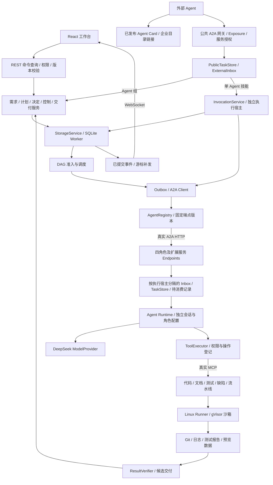
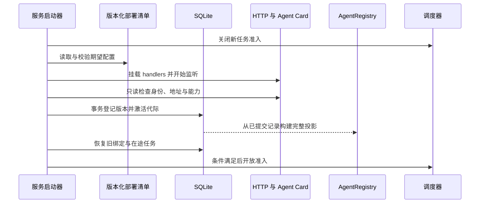
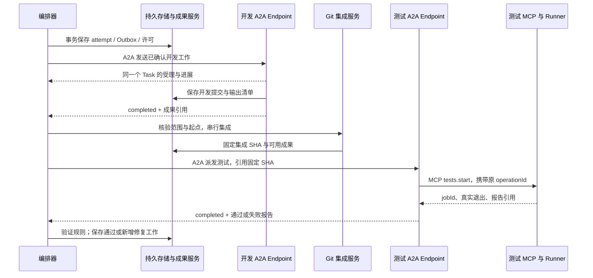
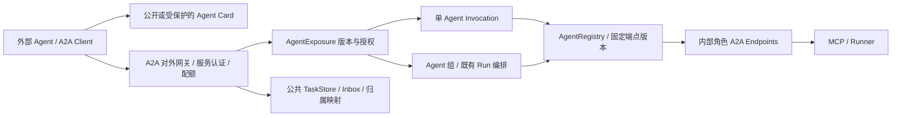
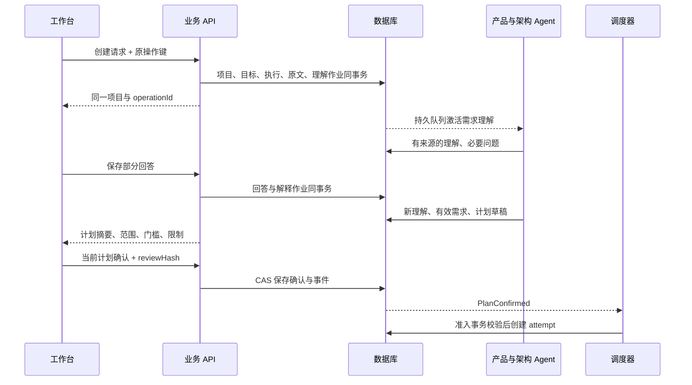
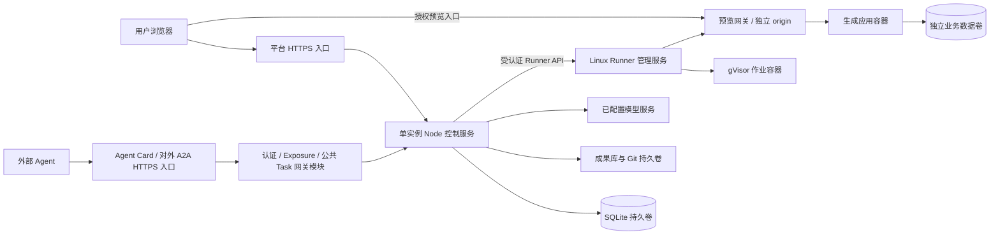

# DevMesh 技术设计方案 V1.1

日期：2026-11-10。状态：**详细设计评审稿 · 完整正文版**。产品基线：[PRD V10.0](./DevMesh_PRD_V10.0.md) 与 [89 条验收场景](./DevMesh_产品验收场景_V10.0.md)。本文替代 V1.0，包含总体方案与全部六份专题正文；不表示产品已经实现。

本文连续收录全部设计，保留 A2A 映射与时序、模型选择、事件时间与版本、部署配置、覆盖率合并、完整交付材料和当前执行配置调整流程。新增 **A2A 注册启动与代际管理，以及对外发现、单 Agent／Agent 组调用设计**：覆盖 Card、发布管理、服务身份、公共任务、独立 Invocation、恢复与专项验收。逐章核对记录见第 15 章末尾；SQL 附录只覆盖已明确验证的核心模型。

本地存储进一步明确为 **SQLite 保存会话索引与状态、本地内容库保存正文和成果、Git 保存代码版本**。第 14.7 节集中规划控制面／Runner／备份目录、会话类型、JSONL 阅读投影、归档与清理、容量以及迁移恢复；这些是待实现约定，没有在本机创建运行数据目录。

确定方向不变：**TypeScript / Node.js + Cordis + React + SQLite，保留真实 A2A 角色交接与 MCP 工具调用**。主控负责确定性的计划、授权和状态管理，四类 Agent 负责理解、设计、实现与验证。参考 `D:/yms/AI/deepseek-harness` 的技术路线，但 DevMesh 的领域规则、恢复语义和交付标准由本项目实现。

## 1. 这次修订解决什么问题

V1.0 给出了架构组件，但没有把组件之间的一致性边界定义清楚，直接交给开发容易出现各自解释。V1.1 按可实现的契约重写以下部分：

| 原来的缺口 | 本版明确的规则 | 详细设计 |
| --- | --- | --- |
| “版本变化后旧结果无效”过于笼统 | 资源 CAS、内容版本、runEpoch、workEpoch 分开；局部变更不冻结无关分支；按输入指纹决定沿用 | D1 §3、§4 |
| 只列状态名，没有准入和迁移条件 | Run 与 Attempt 转换表、终态不可回退、角色槽位、预算与 DAG 规则 | D1 §2、§5～§9 |
| A2A 网络重试可能再次创建任务 | 发送 Outbox；接收 Inbox、Task、AcceptedWork 同事务；Runtime 在提交后消费 | D2 §5 |
| 启动注册到哪里、谁是权威不明确 | 配置→DB→内存单向生效；首次初始化、版本冲突、运行同步、丢通知与重启恢复有明确规则；首版为受控注册 | D2 §5.1.1～§5.1.7；D5 §3.1、T6 |
| 外部 Agent 如何发现、调用单 Agent／组未定义 | 标准 Card 与受控公共 A2A 入口；组复用 Run，单服务独立 Invocation；发布、鉴权、任务去重与目录扩展 | D2 §8；D3 §8；D5 §3.2、T7～T8 |
| “停止、保存、恢复”缺少实际证据 | 逐作业停止、保存阶段、未知状态、Runner 租约和崩溃切点矩阵 | D4 §2、§4、§5 |
| 只有 API 名称，没有请求和并发语义 | 业务字段、幂等键、If-Match、reviewHash、错误码、异步 operation 和事件重连 | D3 §1～§4 |
| 数据实体表不足以约束错误实现 | 24 张核心表的可执行 DDL、复合外键、唯一索引、8 类事务与外围表字段；新增注册／外部表待 migration | D5 |
| 会话与文件只有“存本地”，没有完整目录规范 | 明确根目录和布局版本、DB／正文权威、模型上下文、控制面／Runner 归档、保留／GC／备份迁移 | D5 §3.3、§5、§7；D4 §9～§10 |
| “代码、报告、预览一致”无法计算 | 候选版本清单、逐需求检查、覆盖率分母、SHA 与配置指纹一致性 | D4 §6 |
| 接受新版本会不会丢已有数据未定义 | 隔离预览数据；冻结写入、准备迁移、提交接受、幂等发布分阶段处理 | D4 §7 |
| 参考 Harness 等于复制依赖，环境结论过早 | 区分已确认清单、复用范围、原生加载依赖和待联调版本 | 本文 §3 |
| 验收只有一组概括性条目 | 原 89 条逐项关联设计与检查方式；另列协议、恢复和数据专项 | D6 |

## 2. 阅读与实施索引

| 编号 | 文件 | 主要读者与内容 |
| --- | --- | --- |
| D1 | [第 10 章：领域模型与状态机](#10-领域模型与状态机) | 编排与后端：对象、不变量、计划、版本、并发、控制与重做 |
| D2 | [第 11 章：Agent 与协议详细设计](#11-agent与协议详细设计) | Agent／协议：模型、注册、A2A 状态与持久化、MCP、对外单 Agent／组发现与调用 |
| D3 | [第 12 章：API 与用户流程](#12-api与用户流程) | 前后端：接口、错误、事件、三栏交互、权限、配置调整、对外发布管理 |
| D4 | [第 13 章：执行恢复与交付](#13-执行恢复与交付) | Runner／交付：隔离、Git、恢复、验收、数据、部署和完整材料 |
| D5 | [第 14 章：数据与事务](#14-数据与事务) | 存储与领域：字段、事务、会话／文件目录、持久化、保留清理与备份迁移 |
| D6 | [第 15 章：验证与验收追踪](#15-验证与验收追踪) | 开发／测试／评审：89 条映射、专项验证、V1.0 全章节完整性核对 |
| SQL | [核心数据模型](./design/contracts/核心数据模型.sql) | 可执行的核心一致性模型；正式实现需继续补外围 migration |
| 检查 | [验证核心约束](./design/contracts/验证核心约束.mjs) | Node 内存数据库验证，19 项已通过；不依赖 Python |

D1 的领域规则、D2/D3 的协议与接口规则、D4 的执行事实、D5 的事务边界共同构成契约。遇到冲突先按 PRD 的产品规则修正设计，不能由某个 SDK 的默认行为改变产品含义。

第 1～9 章为总体架构、选型与实施安排；第 10～15 章为完整详细设计。文中 D1 §3 表示第 10 章中原专题第 3 节，D2～D6 同理。design/ 下的专题文件作为分工维护原稿保留，主文的专题正文由同一原稿整合，避免维护两套不同规范。

本轮重点入口：[内部注册的对象与位置](#11511-注册的对象位置与权威来源)、[配置／DB／内存初始化与同步](#11516-配置数据库与内存-registry-的初始化和同步契约)、[首版服务发现能力边界](#11517-首版能力边界受控注册不等于完整动态服务发现)、[外部发现与调用](#118-对外发现单-agent-与-agent-组服务)、[对外发布管理](#128-对外-a2a-接入与发布管理)。

存储规划入口：[本地会话与文件存储布局](#147-本地会话与文件存储布局)，其中第 14.7.2／14.7.3 节给出完整目录树，第 14.7.4 节说明会话记录如何保存和恢复。

## 3. 技术选型与参考工程的真实关系

### 3.1 已核对的依据

参考仓库本次读取 HEAD 为 `ce7073d51254c26cd63b22a60835b8f948deb447`；依赖结论来自当前本地清单，不能用 HEAD 代替工作目录内容校验。正式复用需另存 commit、文件哈希、修改清单和许可证。

| 本地证据 | 已确认事实 | DevMesh 的取舍 |
| --- | --- | --- |
| [根清单](../deepseek-harness/package.json) | ESM、Node ≥24.9.0、pnpm 11.28.5、TS 6.0.3 版本线、tsdown、tsx、Vitest、Oxlint | 采用同语言、包管理和构建测试习惯，独立锁文件 |
| [Web 清单](../deepseek-harness/apps/web/package.json) | React ^18.2.0、Vite ^6.4.3；根目录另有 Vite 8.2.2 | 不把两个 Vite 版本当成一个已验证组合；本工程统一一个组合 |
| [架构说明](../deepseek-harness/docs/architecture.md) | Cordis 插件、作用域、服务能力注入 | 采用生命周期与 Provider 模式，业务规则自建 |
| [Web 样式说明](../deepseek-harness/docs/web-styling.zh.md) | CSS Modules、基础组件与主题规则 | 同样不堆叠大型 UI 框架；实现自己的三栏工作台 |
| [MCP Client 清单](../deepseek-harness/packages/mcp/mcp-client/package.json) | client 2.2.0、配套 server 2.2.0／node 2.0.0；Harness 自身 peers 较多 | 直接用官方 SDK 做 DevMesh 适配，不为一个 MCP Client 拉入整个 Harness |
| [Vendor 说明](../deepseek-harness/vendor/README.md) | Cordis 固定来源及本地修改 | 固定闭包和来源；不按网上不同版本拼接 |

参考工程的动态脚本 workflow 与 DevMesh 的已确认 DAG 不等价；前者不能直接成为平台调度权威。参考 Agent Loop 的接口和恢复思路可复用，但不能假定已具备本设计的工作许可、成果有效性、人工决定和接受事务。

### 3.2 首版选型表

| 层 | 采用方案与版本策略 | 原因／代价 |
| --- | --- | --- |
| 运行与语言 | Node.js 24，最低 24.9.0；TypeScript 6.0.x、ESM | 与参考方向一致；生产冻结经验证补丁，发布 JS 不现场编译 TS |
| 包管理与构建 | pnpm 11.28.5 workspace、tsdown、tsx | 可独立干净安装；开发、构建、运行分开 |
| 前端 | React 18 版本线、Vite 8.2.2 候选；匹配的 plugin-react | 统一工具链；P0 验证插件、Node 与产物兼容，不直接复制参考 Web 的旧插件组合 |
| UI 与图 | CSS Modules、clsx、主题变量；React Flow + Dagre | DAG 图只表达同一计划数据，不作为第二个可独立修改的计划源 |
| 前端状态 | React + 类型化外部 store，useSyncExternalStore；IndexedDB 草稿 | 分离业务投影与视图状态；不直接引入整个 Harness client-store 依赖闭包 |
| 服务容器 | 受控源码依赖 Cordis 及必要闭包 | 作用域、生命周期和可替换服务；需维护上游补丁 |
| HTTP | Node HTTP + Express 5 路由适配 | 参考工程采用 Node HTTP；Express 是为官方 A2A 适配新增的选择，不宣称参考工程使用 Express |
| 浏览器通信 | REST + WebSocket，Zod 4 schema | 命令有明确幂等、查询可分页、事件可补发；不同于 A2A SSE |
| A2A | 官方 `@a2a-js/sdk`；A2A 1.0 JSON-RPC / SSE | 保留标准 Task、Message、Artifact、查询／取消；业务恢复另做持久适配 [S1][S2] |
| 注册与发现 | 部署清单 + SQLite 版本注册表 + 内存投影；对外 Agent Card / Exposure / 可接企业目录 | 首版为受控注册与健康管理；尚非完整动态实例发现；公共发现与内部寻址分开 |
| MCP | 官方 TS SDK v2；client/server 2.2.0 为本地候选基线 | 自有五服务真实接入；具体 transport 组合经联调锁定 [S3] |
| Agent 执行 | TypeScript Runtime + ModelProvider + ContextAssembler + ToolExecutor | 不引入 Python 环境；模型循环和受控工具执行分开 |
| 编排 | 自有声明式 DAG + 数据库准入事务 | 适配暂停、局部变更、人工确认和 30 项规模；承担状态机测试成本 |
| 数据 | `node:sqlite`、WAL、专属 Worker | 单实例易部署；同步 API 不阻塞 HTTP 主线程；该 Node 版本接口仍需按官方稳定性状态管理 [S4] |
| 会话、文件与代码 | SQLite 会话索引 + 本地内容寻址库、可重建 JSONL 阅读投影、Git 精确 SHA、隔离工作区 | 正文和状态有明确权威；根目录版本化；归档 ACK 后回收临时工作区；备份覆盖 DB、内容、代码与应用数据 |
| 检索 | 小规模文本分块、中文关键词检索、来源定位 | 当前附件规模无需向量库；未找到来源直接标未找到 |
| 模型 | DeepSeek 首个 Provider，部署填写 model ID 和容量 | 不把模型别名写死；角色 Prompt 和配置冻结可追溯 |
| 执行与预览 | 独立 Linux Runner，Docker + gVisor runsc | 生成代码与控制面隔离；Windows 开发需连接 Runner [S5] |
| 身份与访问 | 浏览器 OIDC + Session；外部 Agent OAuth 2.0 client credentials + service_grants | 复用企业身份系统；服务、维护与项目确认权限分别检查 |
| 质量 | Vitest 4.1.x、coverage-v8、Playwright、tsc、Oxlint | 覆盖领域状态、协议、真实工具、浏览器路径；不以 Agent 文案作验证 |

P0 必须交付精确 `pnpm-lock.yaml`、Node/pnpm 版本、镜像 digest 和 SDK 兼容表。本设计没有创建这些工程产物，未联调的补丁版本不能声称已冻结。协议版本、SDK 版本、DevMesh schemaVersion 三者分别记录。

### 3.3 Cordis 闭包与“JS 环境简单”的实际边界

当前清单中的起始闭包至少包括：

| 包目录 | 引入关系 |
| --- | --- |
| vendor/cordis | cosmokit、standard-schema；peer include、loader |
| vendor/cosmokit | 基础工具包 |
| vendor/include | cosmokit、js-yaml；peer loader、cordis |
| vendor/loader | cosmokit、schemastery；peer cordis、node-addon-require-builtin |
| vendor/schemastery | standard-schema、cosmokit |

其中 loader 声明了 `node-addon-require-builtin` 原生加载相关 peer。**因此“采用 TypeScript”不等于“原样安装整个 Harness 永远不需要本地编译环境”。**DevMesh 的默认交付要求是用户运行预构建包／镜像，不在用户机器上临时构建原生模块；CI 负责对应 OS/arch 构建与验证。

P0 在干净 Windows 开发环境与 Linux 容器分别安装这个实际闭包，验证加载、作用域释放、服务注册、原生模块分发。如果需要减少 loader 依赖，只能作为单独适配变更验证；不能先删 peer 再认为复用成功。用户日常使用通过浏览器，不需要 Python；源码构建机的底层工具依赖应在构建说明中如实列出。

### 3.4 备选与迁移触发条件

| 当前决策 | 暂不采用 | 重新评估触发条件 |
| --- | --- | --- |
| Node / TS 全栈 | Python / FastAPI | 用户另外选择的外部工具才单独隔离，不改变控制面默认栈 |
| Cordis + 轻量 HTTP | NestJS 全栈框架 | 企业已有必须复用的 Nest 服务资产或团队维护成本有实测优势 |
| 自有受限 DAG | LangGraph.js／Temporal | 出现跨机复杂流程或状态维护成本超出当前受限模型；先定义新权威存储和迁移 |
| 单机 SQLite | PostgreSQL、Redis 队列 | 多控制实例、跨机调度或单写入队列压测不达标；迁移锁和幂等语义不能省略 |
| SQLite Outbox | Kafka／RabbitMQ | 明确独立多消费者和吞吐需求；消息队列仍不替代领域状态 |

## 4. 架构、所有权与执行链路



首版四个角色是同控制进程中隔离的 Cordis 作用域与 A2A HTTP endpoint；不因同进程省略协议。模型会话和工作权限按角色／attempt 隔离。后续可拆角色服务，但接收端 Inbox、TaskStore 与 AcceptedWork 必须保持同库事务。

Agent 组对外是一项 A2A 服务，公共 Task 映射内部 Run；单 Agent 的受限技能映射独立 Invocation。对外网关首版是同控制服务的独立模块，内部地址不直接公开。Agent Card 说明能力、认证与调用 URL，发布到目录只帮助发现，不替代任务授权。

主控不是第五个任意发号施令的模型。输入理解调用产品 Agent，方案与 DAG 草稿调用架构 Agent；确定性程序检查当前依据、许可和预算后才调用开发／测试。开发可提出交接建议，但不能绕过编排器扩展任务。A2A 负责委派与交接，DAG 决定何时可运行，MCP 负责执行工具，存储与控制服务决定业务事实是否有效。

端到端路径：保存输入→理解与澄清→需求版本→架构与计划校验→用户确认当前计划→准入事务→A2A 任务→模型／工具循环→输出 schema 与实际证据验证→集成 SHA→测试／修复／复验→预览与数据方案→逐项审查→接受事务→保留可迭代版本。各阶段的失败保留原事实，不用更新聊天消息伪装成成功。

## 5. 工程组织与模块契约

```text
apps/web/                     React 工作台、历史只读视图
apps/server/                  HTTP/WS/A2A 宿主、启动恢复
apps/runner/                  作业登记、沙箱、停止与预览管理
packages/contracts/           Zod/OpenAPI、事件、角色成果 schema
packages/domain/              需求、计划、控制、交付领域服务
packages/orchestrator/        DAG 校验、准入、预算、核实调度
packages/agent-runtime/       模型步骤、上下文、工具运行
packages/agent-roles/         四类角色定义与 Prompt
packages/agent-registry/      定义、端点版本、清单协调、绑定与健康
packages/a2a-exposure/        公共 Card、发布、服务授权、PublicTask/Inbox
packages/agent-invocation/    单服务执行宿主、尝试、预算与成果
packages/protocol-a2a/        SDK 适配、Inbox/TaskStore/Outbox
packages/protocol-mcp/        官方客户端、能力快照、工具策略
packages/mcp-services/        五个独立注册的真实服务
packages/storage-sqlite/      Worker、领域事务、migration
packages/blob-store/          本地内容读写、路径隔离、写入操作与 Provider 接口
packages/artifacts/           内容文件、manifest、回放和导出
packages/templates/           固定模板、能力、验证配置与迁移
vendor/                       固定 Cordis 闭包与来源记录
tests/                        状态机、协议、故障注入、E2E
```

依赖规则：contracts 不依赖 UI／数据库；domain 依赖接口，adapter 实现 Provider；Agent 不直接操作领域表；Runner 不直接更新项目接受指针；UI 不直接调用 A2A/MCP；回放应用只注入读取能力。每个服务的唯一写入责任见 D1、D2，不能按开发方便跨模块改表。

## 6. 首个应用模板与产品限额

本期覆盖 PRD 的全部十个模块，不因采用首模板而删减平台功能：

| PRD 模块 | 设计范围 | 本文对应专题 |
| --- | --- | --- |
| 5.2.1 项目与任务 | 首次创建、已接受迭代、缺陷修复、同项目单活动执行 | D1、D3、D5 |
| 5.2.2 理解与澄清 | 原文与来源、假设、必要问题、部分回答、理解重试 | D1、D2、D3 |
| 5.2.3 DAG 与确认 | 声明式计划、完整性与无环校验、版本确认 | D1、D3 |
| 5.2.4 协作执行 | 四角色、真实 A2A 与五类 MCP、工具及成果追溯 | D2、D4 |
| 5.2.5 需求变更 | 影响分析、排队、确认、生效、局部冻结与沿用 | D1、D5 |
| 5.2.6 冲突决定 | 来源与选项、无默认预选、决定／应用／复验分离 | D1、D3 |
| 5.2.7 执行控制 | 暂停、恢复、取消、安全重试和整次重做 | D1、D4、D5 |
| 5.2.8 审查交付 | 同版本证据、质量门槛、预览、数据迁移和用户接受 | D4 |
| 5.2.9 历史回放 | 完整材料、只读导入／导出、统计口径与缺失标注 | D3、D4、D6 |
| 5.2.10 配置 | 当次／部署／历史快照、连接状态、当前执行调整 | D2、D3 §7、D5 |

首模板 `web-crud-v1`：React/Vite 前端、Express 后端、Node SQLite 业务数据、Vitest 单元／接口测试、Playwright 业务流程、Docker 运行描述。模板包含健康接口、参数校验、持久化目录、SQL migration 与回归检查；业务数据文件与控制面数据库完全分开。

能力声明包含：支持的业务模式、登录／权限能力、存储方式、外部依赖、可用 UI 基础组件、测试工具、数据迁移方式和已验证限制。P0 先验证任务看板的新增、状态、筛选及刷新／重启保留；后续计划必须检查需求与能力匹配。外部任意仓库导入、本地模型训练、默认生产发布、复杂分布式业务不作为首模板承诺。必要需求不支持时明确提出调整，不能悄悄删掉。

| 参数 | 产品默认值／规则 | 执行位置 |
| --- | --- | --- |
| 同项目活动执行 | 1，含等待及暂停 | 数据库唯一约束 |
| 同 run 并行角色 | 最多 2；首版同角色同时 1 个 attempt | Scheduler 与 role_slots |
| 当前实施 DAG | 最多 30 项；额外计划修正最多 2 次 | PlanService；bootstrap 不计入实施工作项 |
| 自动安全重试 | 最多额外 2 次；未知副作用先核实 | 独立重试预算桶 |
| 自动修复 | 最多 2 轮 | 新建修复／复验工作与计划版本 |
| 活动处理预算 | 默认 60 分钟；人工等待、资源排队和已暂停时间另列 | 活动区间并集；未知时间不编造 |
| 停止核实提示 | 30 秒后仍未知要显示详情 | ControlService 与 UI；非完成超时 |
| 输入 | 正文 20,000 字符；附件 3 个、单个 2 MiB | 前后端双重校验，后端为准 |
| 质量门槛 | 必要检查通过；行 ≥80%、分支 ≥70% | DeliveryService，不能下调 |
| 回放导入 | 压缩 200 MiB、展开 1 GiB、20,000 文件 | 流式隔离验证 |

产品值与新增工程默认值分开。所有生效值冻结到 run 配置，UI 展示实际配置和未配置项。数据、预览、源码、记录分别有保留策略，不能把保存源码误作保存业务数据。

外部 A2A 能力是本轮用户明确追加的设计范围，单列 T17～T21 专项，不把它伪装成原 89 条产品场景的一部分。第一版支持发布选定单服务和现有研发组；任意脚本上传、无界递归 Agent 组、未经项目授权的代码写入均不作为服务能力。Agent 组仍遵循原计划确认／接受规则，独立 Invocation 只交付所发布服务合同内的成果。

## 7. 实施阶段与完成证据

| 阶段 | 交付物 | 进入下一阶段的条件 |
| --- | --- | --- |
| P0 技术闭环 | 独立 workspace、锁文件、Cordis 闭包、单角色 Runtime、会话与内容存储、注册与公共 Card 原型、A2A/MCP 联调、Runner 与模板 | 干净安装；消息落盘／重启读取；真实 A2A 发送／重发／重启；外部标准客户端发现及认证原型；真实 MCP job 停止；模板持久化验证；原生依赖分发明确 |
| P1 最小完整路径 | 创建→澄清→计划确认→开发→测试→预览→接受；数据库 migration、API schema、基础权限 | 用新数据完成产品路径一；同版本证据齐全；失败与缺失不放行；无预置结果冒充生成 |
| P2 协作与恢复 | 局部变更、冲突、暂停／恢复／取消、重试、重做、租约、注册代际、外部任务恢复 | D6 故障注入通过；两页面竞争与离线重连一致；未知副作用不重跑；Invocation 与 Run 配额／归属隔离 |
| P3 持续迭代与资料 | 已接受迭代、数据迁移、回放、配置与统计、单 Agent／组发布接入 | 路径二至五；跨版本数据保留；89 场景记录真实结果；对外能力对应 T17～T21 通过后才允许发布 |
| P4 发布准备 | 完整备份恢复／目录迁移、容量、磁盘故障、归档清理、隔离与权限检查、运维说明 | T22～T24 及相关专项形成真实证据；填写实际限额／保留策略／部署信息，阻断缺陷清零；协议和产品验收分别签认 |

P0 未完成前不宜把后续排期当作确定承诺。当前最需要验证的是 SDK 接收事务适配、Cordis 依赖闭包、Runner 停止证据与生成应用的数据迁移路径；它们已列为具体阻断项，而不是留一句“后续完善”。

## 8. 本次实际检查与仍未完成的验证

本次已读取本地参考清单与原产品文档，提供核心 SQL，并在本机 Node v24.13.1 的内存 SQLite 上执行 **19 项约束检查，全部通过**，包括本轮补充的事件时间与版本保留检查。检查程序及限制见 D6。这里的结果证明设计样例的数据库约束可执行，不证明未来应用的全链路行为。

A2A/MCP 实际安装联调、Cordis 干净构建、模型输出、Runner 隔离／取消、业务数据升级、浏览器交互与容量均未实施验收。方案不以这些未做工作为通过条件倒填结论；编码时按 D6 记录真实证据。

本轮对外 Agent Card／请求示例已按固定 A2A v1.0.0 规范核对，并检查文档结构及示例语法；没有部署域名、开放端点或向企业目录实际发布。新增注册／公共任务／Invocation 表组为字段与事务设计，尚未写入核心 SQL，原 19 项检查不证明这些新增能力已经实现。

会话消息、内容对象、存储维护记录及目录树同样为设计补充；尚未完成正式 migration、磁盘满／断电／文件占用验证、归档 GC 和备份恢复演练。文档中的空间阈值、日志块大小与临时保留时间是待验证工程候选值。

## 9. 官方技术依据

- [S1：A2A 1.0 规范](https://a2a-protocol.org/v1.0.0/specification/)：任务、消息、成果与操作；SendMessage 的幂等需要实现方保证，不能仅靠 messageId 假定成立。
- [S2：官方 A2A JavaScript SDK](https://github.com/a2aproject/a2a-js)：标准协议与服务适配；DevMesh 的持久 Inbox 和事务顺序是本项目设计。
- [S3：MCP TypeScript SDK](https://github.com/modelcontextprotocol/typescript-sdk)：客户端／服务端与 transport 基线；以 P0 实际组合冻结版本。
- [S4：Node v24.13.1 SQLite 文档](https://nodejs.org/download/release/v24.13.1/docs/api/sqlite.html)：同步数据库接口与该版本 API；本次验证使用此 Node 版本。
- [S5：gVisor Docker 集成](https://gvisor.dev/docs/user_guide/quick_start/docker/)：Linux runsc 配置；实际隔离效果仍要按部署验证。
- [S6：A2A Agent 发现](https://a2a-protocol.org/latest/topics/agent-discovery/)：well-known Card、明确 Card URL 与企业目录发现方式；目录 API 需独立约定。
- [S7：A2A v1.0.0 协议定义](https://raw.githubusercontent.com/a2aproject/A2A/v1.0.0/specification/a2a.proto)：对外 Card、认证声明、消息与版本字段的固定校验依据。

参考工程的细分资料入口：[HTTP 宿主](../deepseek-harness/packages/host/webserver/README.zh.md)、[Gateway](../deepseek-harness/packages/api/gateway/README.zh.md)、[Agent Loop](../deepseek-harness/packages/core/agent-loop/README.zh.md)、[子 Agent](../deepseek-harness/packages/subagent/subagent/README.zh.md)、[工作流](../deepseek-harness/packages/workflow/workflow/README.zh.md)、[SQLite Provider](../deepseek-harness/packages/storage/storage-sqlite/README.zh.md)、[JSONL 会话存储](../deepseek-harness/packages/session/session-persistence-jsonl/README.zh.md)。这些是本机并列仓库链接；外发时另附对应固定来源资料，不假定收件人也有该目录。本次没有修改参考工程。

<!-- BEGIN: DevMesh V1.1 详细设计整合区 -->

## 10. 领域模型与状态机

本章对应专题 D1，以下收录完整正文。

适用版本：DevMesh 技术设计 V1.1。产品依据：PRD 5.1.5、5.2.1～5.2.8。本文规定领域行为；数据库约束见 [05 数据与事务](#14-数据与事务)。

### 10.1. 对象、身份与唯一写入者

| 对象 | 身份与生命周期 | 唯一业务写入者 |
| --- | --- | --- |
| Project | 长期应用；保存当前接受版本，不等于一次执行 | ProjectService |
| UserTask | 用户目标；新建／迭代／修复之一；整次重做仍属于同一 UserTask | TaskService |
| Run | 一次执行；首次创建或整次重做产生；终态业务结论不可修改 | RunService |
| RequirementRevision | 完整有效需求快照；条目具有稳定 requirementId | RequirementService |
| PlanRevision | 已验证的声明式 DAG 快照；发布后不可修改 | PlanService |
| WorkRevision | 逻辑工作某次内容定义；workId 跨计划稳定，定义变化增加 workRevision | PlanService |
| Attempt | 一次执行尝试；重试或暂停后重做增加 attemptNo | Scheduler |
| AgentSession | 某 attempt 的对话和工具历史；补充输入可继续同一会话 | AgentRuntime |
| A2ATask | 某接收 Agent 的协议任务；不可当作 runId | A2AAdapter |
| RunnerJob | 一次外部执行；独立 jobId、进程与资源登记 | Runner |
| Artifact | 不可变内容与哈希；适用性是单独关联记录 | ArtifactService |
| ReleaseCandidate | 固定代码、数据迁移方案、验收集合、报告引用 | DeliveryService |
| AgentDefinition / AgentGroupDefinition | 版本化实现／成员、技能与输出契约；内容不可变 | 受控插件发布 / DefinitionService |
| AgentEndpoint / RegistryGeneration | 端点版本与部署绑定代际；启动协调后生效 | AgentRegistrationService |
| AgentExposure | 对外 Card、路由、认证与内部目标；显式发布版本 | A2AExposureService |
| PublicA2ATask | 外部委托及其主体归属；映射完整 Run 或独立 Invocation | A2AExposureService / PublicTaskStore |
| AgentInvocation | 单服务技能的一次委托；有独立尝试、许可、成果与停止证据 | InvocationService |

各服务只能通过类型化领域命令请求数据库事务，插件、模型、HTTP handler 不能直接更新别的服务的表。SQL 层允许共库；写入责任仍唯一。Agent 的自然语言输出不能直接把 work、defect 或 run 置为成功。

新增的对外接入对象不改变原研发流程：Agent 组进入现有 UserTask／Run，单 Agent 技能进入独立 Invocation。Invocation 不使用虚假 runId，也不写项目接受指针；服务输出完成与完整研发接受分别判定。对外协议与宿主边界见 [D2 第 8 节](#118-对外发现单-agent-与-agent-组服务)。

### 10.2. 必须成立的不变量

| 编号 | 不变量 | 实施位置 |
| --- | --- | --- |
| INV01 | 一个项目最多一个未结束 run，暂停中、已暂停、等待处理也占用 | 部分唯一索引 |
| INV02 | 派发的输入是已发布版本，必要决定有效，执行许可开放 | 调度事务 |
| INV03 | 同一 work 同时至多一个未核实结束的 attempt | 部分唯一索引；不是只排除 running |
| INV04 | 已提交事件顺序与业务修改一致 | 状态、事件、Outbox 同一事务 |
| INV05 | 未核实的外部副作用不能因租约过期而重跑 | Attempt/Job 核实状态 + Scheduler |
| INV06 | A2A completed、work succeeded、验证通过、run completed 分别判定 | Adapter、Verifier、DeliveryService |
| INV07 | 终态工作不回退；修复新建后续工作，重试新建 attempt | 转换表 + 追加记录 |
| INV08 | 暂停期间可保存回答和决定，但不能派发、恢复外部写入 | controlGate |
| INV09 | 旧版本事实可归档；不能成为当前版本的交付证据 | 指纹与适用性校验 |
| INV10 | 接受的 candidate 必须是用户刚检查的候选版本 | ETag／candidateRevision + 接受事务 |
| INV11 | 每次外部操作都能找到业务 operation、许可及任务归属 | 工具入口 + Runner 登记 |
| INV12 | 回放只能读取快照，不拥有执行服务引用 | 独立只读应用组合 |

### 10.3. 版本的精确定义

#### 10.3.1 四种变化不能共用一个计数器

- `resourceRevision`：某个可修改资源的 CAS 版本，任何修改递增。用于两页面同时确认冲突。
- `requirementRevision`／`planRevision`／`workRevision`：业务内容版本。发布不可变；用于判断工作依据。
- `runEpoch`：整次执行许可的代际，整次暂停、取消、控制实例接管时递增。
- `workEpoch`：某项工作的许可代际，局部变更冻结、重试替换或撤销工作时递增。

执行许可包含 `(runId, runEpoch, workId, workEpoch, attemptId, grantId)`。局部变更只撤销受影响 work 的许可，独立分支的 runEpoch 不变化。整次暂停撤销整个 run 的新动作许可。

撤销许可禁止产生新的副作用，但仍允许旧 attempt 上传日志、退出状态及未提交差异。这些内容先作为历史／待核实成果接纳，再由适用性检查决定能否被后续使用；否则“一撤销就禁止保存”会破坏暂停保存要求。

#### 10.3.2 输入指纹与成果适用性

每次 attempt 保存 `inputManifest`，字段包含：需求条目 ID 与内容哈希、接口文档哈希、输入 artifact 哈希、精确代码 SHA、模板版本、检查配置哈希、相关用户决定 ID。对有序规范 JSON 计算 SHA-256，形成 inputFingerprint；排序规则、编码和 schemaVersion 固定。

Artifact 记录其生产 attempt、内容哈希及 inputFingerprint。适用性表的键是 `(artifactId, requirementRevision, planRevision, candidateId)`，保存 usable／held／stale 和 reason。原 artifact 不改写成“失败”。

| 输入变化 | 原成果的处理 |
| --- | --- |
| 仅说明文字、排队顺序或预算变化 | 对比相关输入指纹；相同则显式登记 carry-forward |
| 相关需求或接口变化 | 直接引用成果 held，确认应用后 stale；依赖后继重新计算 |
| 无关需求增加 | 未引用该条目的工作可继续，保留显式沿用依据 |
| 代码 SHA 变化 | 测试、覆盖、构建和预览报告不可直接沿用为新 SHA 的通过证据 |
| 仅模型配置变化 | 已完成成果可按原版本保留；新尝试使用新配置快照，禁止追改旧快照 |
| 无法判断依赖 | 标 held，补分析或重新验证，不默认 usable |

例如开发代码 C1 对应测试报告 T1；需求新增字段产生 C2，即使 90% 文件没有变化，T1 仍属于 C1。局部测试可用于诊断，但接受 C2 时必须有本次必要验收集合的 C2 报告。

### 10.4. 声明式 DAG

每个 WorkRevision 必填：workId、workRevision、role、goal、inputRefs、outputSpec、completionChecks、dependencies、writeScope、estimatedResources、requirementIds。InputRef 必须指向已有文件版本或前置工作声明的输出槽位。输出槽位使用稳定名称，例如 `implementation.commit`、`verification.report`。依赖边包含 requiredOutcome，区分成功依赖与 completed-with-findings（得到确定的失败／缺陷结果后进入修复），不能把后者用于交付成功判定。

`completionChecks` 采用受限规则类型：artifact-exists、schema-valid、commit-resolved、command-exit-zero、required-tests-pass、coverage-threshold、human-decision。模型不能提交可执行 JavaScript 作为判定器。DAG 是数据，平台程序解释执行。

计划发布校验依次进行：schema→引用存在→需求覆盖→输出能匹配输入→所有工作有主责→必要集成与测试存在→拓扑排序无环→规模与资源约束→写入冲突→权限与工具能力。错误返回定位到 workId／字段路径，不以一段笼统“计划无效”结束。

同一个 role 可以存在多个逻辑工作，但初版同 run 每个 role 最多一个占用执行槽位的 attempt，总槽位最多两个。前后端两个开发工作因此首版串行；开发与测试准备等无依赖工作可并行。以后允许同角色多实例属于并发配置升级，需要新增 worktree 和资源测试。

受影响依赖集合：以被修改需求／接口的直接消费者为种子，沿当前计划边求传递后继；若修改最终集成 SHA，加入测试、构建、预览和交付整理节点。新计划发布在一个事务内替换 currentPlanRevision，旧图只读。

### 10.5. 调度算法

```text
收到已提交领域事件 / 定时核实完成:
  对各项目按公平轮询选一个 run
  BEGIN IMMEDIATE
    校验 run 非终态，controlGate=OPEN，预算有余量
    求当前计划中依赖已满足、未冻结、无未结束 attempt 的工作
    按用户待办解除后顺序、拓扑层级、createdAt 排序
    排除角色槽位冲突、全局 Runner 无配额和输入缺失项
    选取不超过剩余角色槽位的工作
    冻结 inputManifest，创建 attempt 和 dispatch operation
    写入 WorkAdmitted 事件与 A2A Outbox
  COMMIT
  唤醒 Outbox sender（网络调用不在事务中）
```

资源槽位按 `reserved / submitted / working / stopping / outcome-unknown` 占用；不能因为网络中断就释放。等待补充且已证明没有在途工具的 attempt 可释放计算槽位，状态保留；继续该 A2A task 前重新取得槽位和许可，使用新的 activationId，attemptId 不变。

卡住的旧工作不会无限占用全部项目公平队列：其他项目继续轮询，但同工作保持待核实；没有证据时不为追求吞吐创建重复工作。

### 10.6. Run 状态与控制门

内部保存 `phase`、`controlGate`、`terminalOutcome`，用户展示状态由投影函数生成，避免三个字段互相覆盖。controlGate 为 OPEN／PAUSING／PAUSED／CANCELLING；terminalOutcome 为空或 COMPLETED／FAILED／CANCELLED。

| 当前条件 | 命令／事实 | 条件和原子动作 | 后续 |
| --- | --- | --- | --- |
| 非终态 OPEN | pause | CAS controlRevision；关闭准入；runEpoch++；记录各在途 stop intent | PAUSING |
| PAUSING | shutdown-evidence-ready | 所有副作用已终结，必要材料已持久化 | PAUSED |
| PAUSED | resume | 输入、配置、代码、余量、所有原作业均可核实；CAS | OPEN；调度受中断工作 |
| OPEN／PAUSING／PAUSED | cancel | 取消意图不可撤销；关闭准入；epoch++；保存停止目标 | CANCELLING |
| CANCELLING | shutdown-evidence-ready | 在途与未接受预览处理完成，必要资料保存 | terminal CANCELLED |
| OPEN | accept | candidate、验收证据和用户确认均有效；无新写入与未知任务 | terminal COMPLETED |
| 非终态 | 无法继续 | 先收尾并保存；已知失败原因，且不存在未知写入 | terminal FAILED |
| 任一终态 | 迟到结果／控制回执 | 记录历史诊断，不改变终态和项目接受指针 | 原终态 |

同一 pause 请求重发返回同一个控制作业；不同 pause 请求若已经暂停则返回当前状态且不增加人工介入。取消优先于暂停，但重发旧 pause 不得覆盖已保存的 cancel。

状态展示优先级：终态→CANCELLING→PAUSING→PAUSED→有活动开发/规划/验证→全局等待。局部待办和对账中标记单独显示；有活动分支时不能显示整体等待。

### 10.7. Attempt 转换

| 从 | 到 | 必要事实 |
| --- | --- | --- |
| RESERVED | SUBMITTED | 接收端持久化 A2A task 并确认 |
| SUBMITTED | WORKING | 已获槽位，Runtime 开始步骤 |
| WORKING | INPUT_REQUIRED | 问题已落库；无隐含后台写入才能释放槽位 |
| INPUT_REQUIRED | WORKING | 有效回答已保存、未手动暂停、重获许可 |
| WORKING | VERIFYING | A2A 成果已返回；业务验证器尚未确认 |
| VERIFYING | SUCCEEDED | 输出符合 schema、输入仍适用、完成规则通过 |
| 任一未结束状态 | OUTCOME_UNKNOWN | 请求丢失、进程失联或工具效果不明确 |
| OUTCOME_UNKNOWN | 已核实状态 | 原任务／作业证据；不靠超时推断 |
| 未结束状态 | STOPPING | 收到暂停／取消／变更冻结意图 |
| STOPPING | INTERRUPTED／CANCELLED | 原作业真实结束、材料保存；前者允许新 attempt 继续 |
| 未结束状态 | FAILED | 有确定失败证据且所有副作用可核实 |

成功／失败／中断／取消的 attempt 不复活。业务测试失败可以表现为：A2A completed→attempt VERIFYING→FAILED(reason=VALIDATION_FAILED)，随后另建修复和复验工作；不会修改历史为通过。

### 10.8. 人工回答、变更、冲突和重做

澄清问题具备 questionId + questionRevision + requirementBasis。部分回答按项提交，各自保存；更新需求理解通过一个后台 operation 处理，失败仅重试解释工作。答案落库成功不等于理解更新成功。问题已更新时拒绝旧题提交并保留草稿，禁止把旧答案自动套到新题。

变更 proposal 在队列中串行分析。确认基于 analysisId + basisHash；前序变更生效后，后续旧 analysis 失效并重新分析。确认后先冻结受影响工作，安全收尾，再准备新需求与计划，最终事务切换版本；应用失败保留原 current 指针和受影响冻结项。

冲突 Decision 具有 basisHash、选项版本、选中项或拒绝全部理由。同 basis 一次有效决定；推荐方案无自动预选。决定保存、实际应用、复验通过是三项不同事实，分别对应 decision、application、resolution 状态。

整次重做入口首先检查原执行：仍活动时由用户点击“暂停并准备重做”，完成暂停和保存后才展示可确认的最终影响；已有未知工作则先核实，不允许直接确认重做。redo operation 固定绑定旧 run、确认的需求版本、UserTask.baseCommit 和 redoReviewHash。确认前退出仅留下暂停；确认成功后活动旧 run 安全取消并标注 reason=REDONE，在同一个事务创建新 run并关联 originRunId；原本已失败／取消的旧 run 保持终态。若必要外部准备失败，新 run 已存在但处于准备失败可重试状态；重复提交返回这个 run。已接受 run 的请求返回 ITERATION_REQUIRED。

### 10.9. 输入与活动时间

输入正文按 Unicode 字符计数，限制 20,000；附件最多 3 个、单个 2 MiB，仅允许 UTF-8 Markdown／文本，校验实际内容、空文件和读取失败。附件状态独立；未准备完毕的附件阻止最终提交，用户移除该附件后其余输入可提交。

活动区间按真正开始处理／停止处理事件记录，半开区间 `[start,end)`。多个工作取区间并集，不能求和；停机后不能把整个未知时段计为活动。Runner 保留心跳和实际起止证据，无法还原则标时间不完整，预算采用最后可信已消耗量并阻止自动续期，待核实或由用户明确调整。

所有自动重试有固定 reason 和预算桶：transport 查询重试不增加逻辑工作数；failed-attempt 重试、interrupted-resume 和 validation-repair 分开计。超限只保存进度和待办，不静默开始新 run。

### 10.10. 对外 Invocation 状态与固定归属

Invocation 状态为 QUEUED／RUNNING／INPUT_REQUIRED／VERIFYING／STOPPING／OUTCOME_UNKNOWN／SUCCEEDED／FAILED／CANCELLED。输入与定义快照在受理时冻结；某个 invocation 最多一个未核实结束的 invocationAttempt，每次 activation 都重新取得预算、资源与许可。INPUT_REQUIRED 只有证明无在途工具后才释放计算资源；补充输入不会重复创建 invocation。

取消关闭准入并递增 invocationEpoch，逐作业核实和保存后才 CANCELLED；失联进入 OUTCOME_UNKNOWN，不因租约或超时自动失败后重跑。产出先 VERIFYING，经对应技能的 schema、来源、范围与完成规则检查后才 SUCCEEDED。终态不复活；需要新一次服务使用新的 clientRequestId。不得用独立 Invocation 绕过项目单活动 run 限制写入项目。

公共 Task 是协议投影：排队对应 submitted，执行／验证对应 working，等待必要资料／人工确认对应 input-required，已证实完成／失败／取消对应相应终态。停止中或结果未知保留非终态并带结构化进度，不能自行发明 A2A 协议状态。组模式从绑定 Run 的真实事实生成投影；同一公共 Task 的上下文可以延续，但不得在原 Run 结束后暗中绑定另一 Run。

#### 10. 接受准备撤销完成投影

准备派发状态与解决结论分离：SENT／UNKNOWN不会被撤销改写为FAILED。不可变撤销决定先投影ABORTING，完整恢复结论追加后投影ABORTED，解除本准备的项目占用；原错误、revision、prepared proof、决定及数据保留。ABORTED不复活原准备，不授权原T5、晚到观察或目标开门，也不创建Release或修改接受指针。

---

## 11. Agent与协议详细设计

本章对应专题 D2，以下收录完整正文。

适用版本：V1.1。本文指定待实现接口和处理顺序；接口名称是 DevMesh 设计，不假定参考 Harness 或官方 SDK 已提供同名业务能力。

### 11.1. 服务拆分及依赖

| 服务 | 对外方法 | 注入依赖 | 禁止直接负责的事 |
| --- | --- | --- | --- |
| RoleRegistry | resolveRole、snapshotRole | 冻结配置、模板目录 | 修改 run 状态 |
| AgentRegistry | resolveForRun、resolveForInvocation、getRegistration、listAvailable | 已提交端点版本、角色绑定、健康投影 | 把未落库配置当成有效路由 |
| AgentRegistrationService | reconcileManifest、activateGeneration、drain | StorageService、受控部署清单、CardValidator | 根据模型提供的 URL 自动注册 |
| A2AExposureService | publishCard、resolveExposure、admitExternalTask | 对外发布版本、服务身份、项目授权、公共 TaskStore | 透传外部 caller 的内部执行许可 |
| AgentRuntime | activate、submitInput、requestStop、inspect | ModelProvider、ContextAssembler、ToolExecutor、SessionStore | 跳过计划派发另一个角色 |
| A2AAdapter | 标准发送、查询、订阅、取消 | 官方 SDK、DelegationInbox、TaskStore、Runtime | 把连接状态当作完成 |
| DelegationService | dispatchWork、reconcileTask | Scheduler 许可、Outbox、A2A Client | 自行扩大工作范围 |
| ToolExecutor | execute、inspect、requestStop | Policy、MCP Client、JobRegistry、Runner | 隐式重试未知写操作 |
| ResultVerifier | verifyOutput | schema、inputManifest、实际报告 | 凭 Agent 总结直接放行 |

组件构造按 Storage→Artifact→Registry 服务对象→Provider→Runtime→A2A/MCP handler 的依赖顺序完成；先挂载 HTTP 路由并开启监听，再检查本机 Agent Card，最后激活注册表并开放调度。监听不等于允许执行：启动检查及恢复期间执行准入门关闭。详细启动阶段见 §5.1.3。关闭时先关闭准入，再保存／核实在途，最后释放插件和数据库 Worker。

Cordis 的事件用于同进程通知；跨进程消息和恢复依据只能使用持久化命令与事件。注册通过可释放 effect 完成；活动 run／invocation 的插件快照不能被热更新替换。首版生产禁用任意脚本配置与代码热重载。

### 11.2. 角色配置与模型选择

```typescript
interface RoleSnapshot {
  role: 'product' | 'architect' | 'developer' | 'tester';
  revision: string;
  provider: string;
  model: string;
  promptArtifactId: string;
  outputSchemaId: string;
  allowedTools: string[];
  maxSteps: number;
  contextLimitTokens: number;
  outputReserveTokens: number;
  requestTimeoutMs: number;
  maxReadOnlyRetries: number;
}
```

首版新增工程默认值：单次 activation 最多 40 个模型步骤；单模型请求超时 120 秒；无响应连接建立超时 10 秒；只读且确定失败调用最多额外重试 2 次，退避 1／3 秒并加入抖动。它们是可配置执行上限，不代表模型响应速度承诺。当前实际值冻结到配置并可查看；产品规定的整体预算优先。

上下文容量不写固定“128K”等未经验证值。ModelProvider 注册 modelCapabilities：真实上下文容量、工具调用能力、结构化输出方式、token 计数方法、最大输出。若服务没有可靠 tokenizer，使用保守估计并预留空间；超限返回 CONTEXT_LIMIT，不截掉必要要求。

首个 Provider 适配团队可用的 DeepSeek API。具体模型 ID 是部署必填项；无可用模型仍能保存需求，但不显示已经开始模型理解。供应商差异隔离在 ModelProvider，角色配置不能携带密钥。

#### 11.2.1 按角色选择模型与冻结配置

| 角色 | 配置别名 | 必须实际检查的能力 |
| --- | --- | --- |
| 产品、架构 | planningModel | 中文理解、长文来源定位、约束保持、澄清与声明式计划 schema |
| 开发 | codingModel | TypeScript 修改、完整工具参数、编译错误修复、遵守工作区范围 |
| 测试 | testingModel | 从验收生成检查、原问题复现、解释真实报告、失败和未验证区分 |

这些别名可以指向同一模型，避免未经评测先引入多供应商。P0 固定任务看板、资源预约不重叠、已标明来源的缺陷修复三组样本，保存模型 ID、Prompt、schema 合格率、工具参数有效率、约束遗漏、真实验证结果和用量。模型擅长自然语言不等于通过代码与工具样本。

完整角色配置快照除上面的接口字段，还包括 providerEndpointId、供应商支持的采样参数、能力声明版本、token 计数方法、promptHash、toolSchemaHashes 和 credentialRef。供应商不支持的参数在配置检查时拒绝，不能静默忽略。用量记录区分供应商返回值与平台估计；没有可验证价格／账单依据时费用显示未知。

ModelProvider 统一输出可展示文本、完整 tool calls、finishReason、requestId、usage 和分类错误，并支持 AbortSignal。取消 HTTP 仅停止模型连接，不代表工具停止。默认不自动换模型；当前 run 调整模型按 [配置调整流程](#127-配置查看连接检查与当前执行调整) 暂停、审查影响、应用新快照，旧 attempt 保留原模型与参数。

### 11.3. 模型循环与工具确认

下面以工作流 Attempt 为例；对外单 Agent 的模型循环通过 §8.5 的 ExecutionHost 使用同样的准入、持久化和停止规则。

```text
activate(attemptId, activationId, permit):
  核验许可与角色配置；装配有来源的上下文
  对每个 step:
    持久化 ModelRequestPrepared（inputManifest、脱敏请求、配置）
    调用 ModelProvider；增量仅用于 UI，最终回复持久化后才进入下一步
    若回复含工具请求:
      逐个解析完整 JSON；不执行未闭合的流式参数
      校验工具身份、参数、权限、资源范围及副作用等级
      先持久化 ToolOperation 与幂等键，再执行或提交后台 job
      保存真实结果后，将结果关联原 toolCallId 加入下一步上下文
    若回复为最终成果:
      校验角色输出 schema，保存成果并进入 ResultVerifier
      返回 A2A task 结果；由业务验证器决定工作结论
    每步重新检查许可、取消、预算和步数
```

单条模型回复包含多个工具时：只读工具可在配置并发内并行；涉及同一资源写入的调用串行；写操作与依赖其结果的读取按依赖顺序执行。模型给出的 toolCallId 仅在该回复内定位，平台 operationId 为独立稳定标识。

恢复时不重新执行已经有结果的 toolCall。模型回复已落库但工具尚未创建时，根据同一个 stepId + toolCallId 创建唯一操作；工具提交响应丢失时查原 operation/job。不能把整个模型步骤包在通用自动重试中。

Prompt 组成固定为：角色职责→任务与完成条件→必要约束和有效决定→输入来源→允许工具→输出 schema→剩余预算。上下文压缩保留来源列表、未决问题和验收；压缩结果也是版本化 artifact，原文可回溯。资料的矛盾必须指明各自来源，不自行选择其一；模型内部思维不进入产品记录、回放和导出，只保存可展示的回复、结构化动作及必要用量元数据。

SessionStore 采用 SQLite 消息／步骤索引和本地内容库：一个 attempt 对应一个 sessionId，多次 activation 可继续该会话；重试新 attempt 新建 session，并显式引用允许沿用的上下文。模型请求的 context manifest 和完整回复先持久化，再产生工具副作用。JSONL 是可重建阅读／导出投影，不能与数据库各自接受修改。实际目录、消息顺序、输入快照和恢复边界见 [D5 本地会话与文件存储](#147-本地会话与文件存储布局)。

### 11.4. 四类角色的输出约定

| 角色 | 必填输出 | 平台校验与后续 |
| --- | --- | --- |
| 产品 | requirements[{id,statement,sourceRefs,acceptance}], assumptions[], questions[{id,required,reason,blockingScope,defaultOption?}] | 来源可定位，必要问题可区分；默认值需用户主动选择 |
| 架构 | interfaces[], planDraft、risks[]、capabilityFit | 计划字段与 DAG 校验；必要范围不能被静默删减 |
| 开发 | baseCommit、resultCommit、changedFiles、checkRefs、unverified[]、handoffProposal | Git 确认 commit 和 diff；修改不越出工作区；集成服务处理后续 |
| 测试 | targetCommit、caseResults[]、coverageRef、defects[]、buildRef、previewRef? | 所有报告绑定 targetCommit；失败和缺失明确；按条件创建修复 |

`handoffProposal` 只是建议，包含目标角色、目标、引用成果和原因；编排器仅在当前计划已有相应工作或完成合法重规划后派发。Agent 不能自行在 A2A payload 中声明新授权。

角色输入与输出必须配套：产品读取原始目标、附件来源与已有应用摘要；架构读取已确认需求、模板能力、已有接口和预算；开发读取固定 baseCommit、接口、工作输入与允许修改范围；测试读取精确集成 SHA、必要验收集合、复现材料和检查配置。测试不能通过修改验收预期来“修复”失败；需要修改预期时回到需求变更流程。首版不开放无限递归子 Agent，新增跨角色工作都经过计划准入。

### 11.5. A2A 传输、身份和持久化

#### 11.5.1 拓扑

四个角色提供真实 HTTP A2A endpoint，可同进程部署。编排器以服务主体身份调用，记录 `actualCaller=orchestrator`、`originRole`、`recipientRole`。来自开发的代码经平台交给测试时，其内容来源为开发，协议发送方仍为编排器。界面显示完整链路。

首版内部仅启用 A2A 1.0 JSON-RPC + SSE；入口经过服务认证与角色 allowlist。卡片来自部署注册表，不允许模型任意提供 URL 后直连。SDK负责标准对象编解码，扩展载荷使用 `schemaVersion=devmesh.work.v1`。普通短问答可返回 Message，进入工作清单的任务必须返回可查询 Task。

每个角色固定平台路由 `/internal/agents/{role}/a2a`，Agent Card 在 `/internal/agents/{role}/agent-card.json`；这些是本项目部署路径，报文仍使用标准 SDK。AgentRegistry 保存 endpointId、role、cardUrl、cardHash、协议／SDK 版本、supportedSkills、streaming、认证引用与最后检查。注册后读取卡片、校验能力和目标地址，再允许派单；卡片变化触发兼容性检查，不能自动扩大授权。TaskStore 的内存实现只用于测试。

标识归属必须区分：UserTask ID 是产品目标；runId 是本次执行；A2A taskId 仅在 endpointId 范围内唯一；contextId 由接收端定义；messageId 定位协议消息；operationId 定位可去重的业务动作。不能直接令这六个标识共用一个值来代替映射。

#### 11.5.1.1 注册的对象、位置与权威来源

首版内置四角色采用**部署清单声明、启动时装载**。注册的是 Agent 端点和能力。Cordis 托管 AgentRegistry 等服务对象；AgentRegistry 提供业务寻址；HTTP 路由承接协议请求，三者职责分开。RoleRegistry 保存角色 Prompt／模型／工具配置，AgentRegistry 保存调用哪个端点。

| 层 | 具体内容 | 权威与更新规则 |
| --- | --- | --- |
| 版本化部署清单 | endpointId、角色、实现版本、地址／卡片、启用设置、认证引用 | 维护员声明本次期望配置；通过受控发布生效；不是运行时路由缓存 |
| SQLite 注册记录 | endpoint_registrations、registry_generations、role_endpoint_bindings、endpoint_checks | 已提交版本和生效代际是运行寻址与恢复的持久依据；历史不覆盖 |
| AgentRegistry 内存投影 | endpointId+revision 索引、role 到默认端点映射、能力与健康结果 | 由数据库重建；投影的 generationId 与 projectionRevision 均匹配数据库才参与准入；重启可丢弃重建 |
| Run 固定绑定 | run_endpoint_bindings、配置快照中的 endpointRevision | 执行创建时冻结；当前部署默认值改变不能替换旧 run 的目标 |

首版不引入独立 Nacos／Consul，也没有 Agent 自行对外注册的入口。对外发布 Agent Card 属于 §8 的 Exposure 管理，不能把内部 AgentRegistry 的全部内容直接公开。

#### 11.5.1.2 部署清单示例与版本判定

以下是 DevMesh 内部配置示例，不是标准 Agent Card；所引用的 origin、实现和凭据必须在部署中实际配置。

```json
{
  "schemaVersion": "devmesh.agent-registry.v1",
  "manifestRevision": "agents-2026-11-10-01",
  "internalOriginRef": "control.internalOrigin",
  "credentialRef": "service.devmesh-orchestrator",
  "agents": [
    { "endpointId": "builtin.product", "role": "product", "hosting": "local", "agentDefinitionRef": "product@1", "enabled": true },
    { "endpointId": "builtin.architect", "role": "architect", "hosting": "local", "agentDefinitionRef": "architect@1", "enabled": true },
    { "endpointId": "builtin.developer", "role": "developer", "hosting": "local", "agentDefinitionRef": "developer@1", "enabled": true },
    { "endpointId": "builtin.tester", "role": "tester", "hosting": "local", "agentDefinitionRef": "tester@1", "enabled": true }
  ]
}
```

本地地址由已验证 internalOrigin 与 §5.1 的固定路径生成。以后拆服务时 hosting=remote 并显式给出受信任 endpointUrl/cardUrl，endpointId 保持逻辑身份。每个角色在一个生效代际只能有一个默认目标；多实例负载均衡放在该目标后面，不能随机选择多个不兼容 Agent。

上述示例是四角色默认绑定；扩展服务条目使用 agentKey／agentDefinitionRef，可不声明 workflow role，按 §8.5 的服务路径生成地址。所有端点版本仍进入同一注册表，只有声明四角色绑定的条目进入 role_endpoint_bindings。无界面热加载与模型自行注册能力。

计算规范清单哈希时包含解析后的地址、实现／协议版本、已声明的期望能力及 credentialRef，排除密钥值与健康时间。远端实际观察到的 Card 哈希保存为检查事实，不反向修改期望清单。当前生效 manifestRevision 同哈希重复启动复用原配置；同 revision 不同哈希拒绝；内容变化需要新 manifestRevision。已经被替换的历史清单不会因重启重新成为默认，回退规则见 §5.1.6。一次清单引用多个不可变 endpointRevision，发布只改变默认绑定，不改写历史行。

#### 11.5.1.3 启动与首次注册顺序

1. 取得单实例锁，打开数据库并完成迁移，关闭调度和外部新任务准入；读取并校验清单。重复 endpointId、角色绑定冲突、未知实现或非法地址属于配置错误，不能继续发布半套绑定。
2. 构造角色 Provider／Runtime、内部 A2A handlers 和卡片路由；HTTP 开始监听。此时允许健康检查、卡片校验及经认证的恢复查询，新的执行请求返回服务准备中。避免“HTTP 尚未监听就请求自己的 Card”导致启动死锁。
3. 对本机／远端 Card 做只读检查，核对身份、协议、技能、地址、认证与实现可服务的版本。配置有效但某端点暂不可达，登记对应能力不可用；不能伪造在线，也不把所有独立能力一并判为失败。
4. 在一个注册事务中保存清单导入操作、缺少的不可变端点版本、代际默认绑定与检查结果，并切换 activeGeneration；同清单重复导入幂等。网络检查在事务外，提交时复核清单哈希。
5. 在同一个数据库读快照中读取 activeGeneration、projectionRevision 及关联记录，构建新的不可变内存索引，再原子替换 Registry 指针。替换前核对版本仍一致；有并发更新则按新快照重建。数据库已提交而进程在换缓存前崩溃，重启从数据库重建；缓存失败时保持准入关闭，不能回用旧缓存继续派单。
6. 扫描历史 run 的固定绑定和未终结 Task／job，保留手动暂停与未知作业。核心存储、注册投影和恢复扫描完成后开放 readiness；单 Agent 不可用表现为该能力阻塞，仍可保存需求、查询历史和运行其他具备条件的工作。



#### 11.5.1.4 寻址、投递与历史任务

创建 run 时，从当前生效代际冻结各角色的 endpointId、endpointRevision、cardHash、协议和认证策略引用。调度调用 `resolveForRun(runId, role, purpose)`；purpose 区分创建／继续工作与查询／停止已有任务，不能每次直接查“最新 developer”。

准入事务重新校验该绑定仍受允许、检查结果未过期、许可与资源有效，再把端点版本写入 attempt 的输入清单和 Outbox 目标。sender 在实际发送前再次检查端点的停用／准入状态。已发送结果未知时按原端点与原 operation 查询；不能改地址重发来绕过未知副作用。

同一 URL 升级实现不保证还能处理旧配置。内置接收端核验请求的 endpointRevision 和 roleSnapshot 是否在当前实现的可服务集合中；不兼容返回 ENDPOINT_REVISION_UNAVAILABLE 并建立待办。历史 Task 查询／取消使用原接收端映射与持久 TaskStore，不能解析成新实现的新任务。

#### 11.5.1.5 更新、停用、健康与恢复

首版端点地址／实现变更通过新部署清单发布并重启装载，生产不监听文件自动热改路由。健康状态在运行期更新；调整当前 run 的绑定使用 [当前执行配置调整流程](#127-配置查看连接检查与当前执行调整)，先安全暂停、说明影响、确认后新增 run 绑定 revision，应用后仍暂停。

| 变化／故障 | 处理规则 |
| --- | --- |
| 相同清单重启 | 复用端点版本，重新检查健康；不能重复增加注册业务记录 |
| 新清单发布 | 新代际成为新 run 默认；旧 run 的绑定保留，必要时运行旧实现或阻塞并显式迁移 |
| 健康失败／过期 | 暂停该端点的新派发，现有任务继续查询；恢复健康不解除人工暂停 |
| Card 语义变化 | 标 NEEDS_REVIEW，不直接接受新增能力；经过新端点版本发布才能用于新调用 |
| 维护员停用端点 | 状态转 DRAINING，立即禁止新工作／新 activation；保留原任务查询、停止和结果归档 |
| 清单删除旧端点 | 旧版本转 DRAINING 并取消默认绑定；历史引用和已有任务记录保留 |
| 已无在途或固定 run 引用 | 可转 RETIRED；查询保留在 TaskStore／归档服务，按保留策略处理 |
| 配置无效、DB 失败或代际不同步 | 不开放执行准入；错误可见，不用内存或旧部署默认值掩盖失败 |

endpoint 的生命周期 ACTIVE／DRAINING／RETIRED 与可用性 UNKNOWN／HEALTHY／UNHEALTHY／NEEDS_REVIEW 分开记录。拟定只读健康检查每 60 秒一次、结果 120 秒过期；实际值部署配置化。关闭服务不删除注册记录；计划性卸载先停止准入并安全收尾。强制撤销认证是独立维护动作，应记录可能无法继续远端查询的影响，不能借撤销动作宣称旧任务已取消。

#### 11.5.1.6 配置、数据库与内存 Registry 的初始化和同步契约

**单向生效链路为：部署配置声明期望 → 注册服务校验并提交数据库 → Registry 从已提交数据生成内存投影。** 运行时以数据库中的已提交版本和状态为准。禁止直接修改内存后异步补库，也不从内存反写部署清单；人工改表不属于支持的配置入口。

配置由唯一 `agentManifestPath` 指向的版本化清单读取；环境变量仅按部署 schema 解析地址／凭据引用等声明项，解析结果纳入规范配置哈希。读取或校验失败不等于空清单，不能据此下线全部端点。清单必须覆盖本次部署负责的完整端点集合；显式移除才执行既定 DRAINING 规则。

| 初始化或同步情形 | 数据库处理 | 内存与准入处理 |
| --- | --- | --- |
| 首次启动，数据库没有生效代际 | 完整校验后一次事务插入端点版本、绑定、检查、代际和生效指针 | 从已提交快照构建；完成前不开放执行 |
| 重启，清单与当前生效版本及哈希相同 | 复用版本和绑定；追加健康检查，不重复创建注册版本 | 丢弃旧进程内存，从 DB 重建；保留持久停用状态与旧任务绑定 |
| 部署新的、尚未导入的清单 revision | 校验后 CAS 切换新代际，历史版本继续保留 | 构建新投影并原子替换；新默认只用于新执行 |
| 同 revision 不同哈希，或清单损坏／缺失 | 拒绝导入；原记录保留，不当作删除命令 | 不开放新执行；可按已有授权提供历史查询与收尾 |
| 清单指向已被替换的历史 revision | 拒绝自动回切；需要发布新的 manifestRevision，显式引用拟恢复的配置 | 不因重启覆盖较新的数据库默认值；旧 run 也不自动迁移 |
| DB 提交前失败 | 全事务回滚；不能出现一半角色新、一半角色旧的代际 | 不发布候选内存投影 |
| DB 已提交，内存构建／替换失败 | 保留成功提交事实，不回滚为旧部署配置 | 标记不同步，关闭相关执行准入，重试从 DB 重建 |
| 内存丢失或通知丢失 | 不修改配置和持久业务事实 | 比对数据库版本并补建投影；旧缓存不可成为派发依据 |

generationId 标识不可变的部署绑定集合；新增 `projectionRevision` 标识影响寻址或准入的运行状态版本。激活代际、更新有效健康结果、停用／退役端点都在各自数据库事务中递增 projectionRevision。健康变化不制造新的 endpointRevision，也不覆盖清单的期望能力。

运行期间的同步步骤固定如下：

1. 检查服务在事务外探测端点；将结果写入 endpoint_checks，并在短事务内更新该端点运行状态及 projectionRevision。并发探测使用开始时分配的递增 checkSequence；较旧探测迟到只归档，不覆盖更新的已生效结果。
2. 维护停用操作同样先提交生命周期、原因、审计与 projectionRevision，再通知 Registry。重启导入相同清单不得仅凭 `enabled=true` 清除 DRAINING；重新启用须有明确维护决定与兼容性检查，保留审计。
3. 提交后发送进程内“投影需刷新”通知；通知只是加速信号。Registry 从同一 DB 快照重建索引，禁止逐条修改正在被调用者读取的 Map。首版拟每 5 秒比对一次 projectionRevision 作为漏通知兜底；该间隔不代表允许旧授权继续生效。
4. 每次执行准入事务及 Outbox 实际发送前仍读取 DB 复核代际、投影版本和目标状态。版本不符则拒绝使用该投影并触发刷新；停用立即阻止后续准入，不能等下一次缓存轮询。已经发送的任务按原任务映射核实，不能借刷新换地址重发。
5. DB 不可用、快照读取失败或版本无法核对时关闭新执行；仍允许的日志保存、原作业核实和停止按既定控制路径处理，不能把旧内存当成 DB 故障时的执行授权。

例如清单从 M1 发布到 M2：事务提交 G2／projectionRevision=12 后进程崩溃，重启从 DB 的 G2 重建，不再用内存 G1。若只是 G2 中某端点检查失败，更新到 projectionRevision=13；绑定集合仍是 G2，新的投影只改变该端点可用性，旧 run 的 endpointRevision 保持原值。

#### 11.5.1.7 首版能力边界：受控注册，不等于完整动态服务发现

首版设计包含部署清单注册、数据库持久化、内存寻址、健康检查、维护停用，以及对外 Card／目录发布。新增端点地址或实现仍走受控部署与启动协调；健康探测只检查已登记目标，不扫描网络寻找未知 Agent。

本版没有设计为 Agent 启动后自动自注册、按心跳租约自动维护实例池、订阅注册中心自动增删实例或自动负载均衡／故障切换。对外 Agent Card 的发现能力与这些内部动态实例管理能力分别说明；也不能把本文的设计约定写成已实现、已联调的功能。

今后若引入动态注册中心，须另行定义注册主体认证、实例 ID 与租约、增量订阅和断线全量恢复、实例选择、版本兼容、排空与在途任务归属，并作为 AgentRegistry 的受控数据源适配接入；仍保留已提交状态权威与运行绑定规则，不能绕过准入直接替换在途目标。

#### 11.5.2 业务载荷

```json
{
  "schemaVersion": "devmesh.work.v1",
  "operationId": "op_dispatch_01",
  "runId": "run_01",
  "workId": "work_test_01",
  "workRevision": 2,
  "attemptId": "attempt_01",
  "endpointId": "builtin.tester",
  "endpointRevision": 2,
  "grantId": "grant_01",
  "activationId": "activation_01",
  "runEpoch": 5,
  "workEpoch": 3,
  "requirementRevision": 4,
  "planRevision": 6,
  "inputManifestId": "manifest_01",
  "roleSnapshotId": "role_tester_07",
  "originRole": "developer",
  "targetRole": "tester",
  "requestedOutputSchema": "devmesh.test-result.v1"
}
```

认证主体、许可和完整目标从服务端解析，不能信任 body 的 originRole 代替授权。实际输入正文和成果通过已授权引用读取；引用范围不随模型请求扩大。

#### 11.5.3 发送方顺序

1. 调度事务保存 attempt、operation、dispatch Outbox、事件。operationId 在事务前生成并在响应丢失后复用。
2. Outbox sender 领取短租约，发标准 A2A 请求。每次网络投递有 deliveryAttemptNo，业务 operationId 和 messageId 不变。
3. 接收反馈映射到 `(agentEndpointId,a2aTaskId)`；响应和映射在事务中提交。
4. SSE 断开仅标 transportDisconnected，查询原任务，必要时重新订阅。最终状态证据落库后归并，不依赖浏览器连接存活。

#### 11.5.4 接收方：避免“双任务、单记录”

官方规范仅允许 SendMessage 可选幂等，不保证所有实现去重。因此入口增加 DelegationInbox：认证→解析 DevMesh 载荷→按 `(caller,operationId)` 检查请求哈希→在接收方事务内创建 Inbox 与预分配 A2A task、AcceptedWork 记录→提交→返回／订阅该 Task→Runtime 消费 AcceptedWork。

事务失败前不启动模型或工具。重发同哈希返回已有 Task，不再次调用普通 SDK 创建新 Task 的路径；同键不同哈希返回业务冲突。Adapter 在官方 request handler 扩展点连接 SDK TaskStore，必须控制任务 ID 和持久化顺序，不能在 handler 外简单套一个内存 Map。是否需要实现 SDK RequestHandler 接口由适配测试确定，标准协议层仍使用 SDK。

TaskStore、Inbox 与 AcceptedWork 共用 StorageService 事务接口，不能让 SDK 另开一份 better-sqlite3 连接。拆分成独立服务时，这三者仍须同属接收端数据库；发送端依赖网络幂等与核实，不依赖跨库事务。

DelegationInbox 只负责初次建任务。对已有 Task 的补充回答使用单独 MessageInbox，按 `(callerId, endpointId, messageId)` 去重；确认 taskId、contextId、问题版本与新的 activation 许可后，在同一接收事务保存消息、更新该 Task 并登记待激活记录，不新建 Task。同消息重发不再次激活。每次从等待恢复都重新取得角色槽位与 grant；attempt 上初次准入的 epoch 保留作历史，新的许可保存在 activation/grant 记录。暂停期间只有 Answer 落库，不能生成恢复激活。

若接入第三方 Agent 不支持上述业务扩展，则声明 `deduplication=unsupported`；发送结果未知后只查询已知任务或进入人工核实，不自动换新键重发。本期四个自有 Agent 必须实现幂等。

#### 11.5.5 多轮、取消和流式成果

input-required 保存 questionId 与 A2A task 的映射，回答后以原 task/context 发送新 messageId；被人工暂停时先保存答案，恢复后再投递。A2A task 已终态时，恢复逻辑工作创建新 Task；旧 context 只有接收端允许且来源范围一致时才复用。

auth-required 映射为连接认证阻塞待办，由有连接维护权限的人处理；不能引导普通用户把服务密钥写入聊天。认证恢复后仍重新校验许可及配置快照，再继续原未终态任务；认证完成本身不是工作完成。

CancelTask 表示取消协议任务请求。Runtime 必须逐一停止工具 job，保存日志与差异后才能形成可信取消证据；SSE 断开、AbortSignal 触发、模型请求取消都不能替代后台 job 停止。

Artifact 分块先写接收临时区，按 artifactId 和分块序号去重。最后一块到达、完整哈希校验和原子发布成功后才登记 READY；有 Task completed 但缺 artifact 最后一块时保留任务协议事实，业务工作仍等待补齐或核实，禁止采用半个报告。

分块序号与内容哈希是自有 Agent 约定的 metadata 扩展，不能假定所有标准 A2A 事件都自带全局可重放序号。第三方缺少该扩展时，断流后以任务查询得到的完整成果快照校验，不直接拼接无法去重的增量；没有完整快照则保持材料缺失。

协议状态和事件绑定远端 task；平台额外维护接收顺序与处理水位。旧事件不会使终态回退；只有新的明确业务动作能建立后续任务。

#### 11.5.6 A2A 与平台状态映射

以下是语义映射，wire 枚举由锁定 SDK 序列化，不能自行向标准任务增加“平台已验收”等状态。

| 协议事实 | 平台投影 | 下一步与限制 |
| --- | --- | --- |
| submitted | SUBMITTED，接收端已持久接受 | 不计为已经开始模型处理 |
| working | WORKING，记录实际活动起点 | 只在当前许可有效时推进 |
| input-required | INPUT_REQUIRED + 用户待办 | 无在途副作用才释放计算槽位；回答不解除手动暂停 |
| auth-required | 连接处理待办；保留原 attempt | 维护员修复认证，不向普通用户索取秘密 |
| completed | VERIFYING | schema、内容完整性、SHA、适用性及完成规则通过后才 SUCCEEDED |
| failed / rejected | 保存失败／拒绝原因，先核实副作用 | 明确无未知副作用才 FAILED；再决定能否安全重试 |
| canceled | 远端取消事实；本地 STOPPING 或核实中 | 工具／Runner 停止且材料保存后才结束 attempt／控制作业 |
| 断流／无响应／未知 | 最后已知状态 + OUTCOME_UNKNOWN 标记 | 查询原任务，不推断通过、不换键重跑 |

测试协议任务 completed 可以携带失败用例报告，此时业务验证 FAILED、交付阻塞；这三项必须同时可查询。

#### 11.5.7 开发到测试的实际交接



在“开发完成、集成未完成”时不能提前以开发工作区启动最终验收；集成失败保留原提交并建立处理事项。业务和协议记录同时保留成果来源角色与真实调用方。

### 11.6. MCP 接入与副作用分类

| 服务 | 操作 | 权限／幂等 | 输出 |
| --- | --- | --- | --- |
| repo | read、diff、snapshot | 项目与 commit 只读；可重试 | 文件／差异／SHA |
| repo | workspaceRead、writeFile、deleteFile | 专属工作区；写范围与旧内容 CAS；原 operationId 核实；实际 Runner／编辑器 fencing | 实际文件 SHA、原操作落盘证明 |
| repo | commit、integrate | 指定 worktree／baseCommit；operationId 去重 | commit、treeHash、冲突文件 |
| docs | search、read | 授权附件；版本固定 | 段落、offset、原文 artifactId |
| tests | start、get、stop | start 使用 operationId；结果未知查询 jobId | job 状态、报告引用 |
| issues | create、linkFix、recordVerification | create 去重，更新带 issueRevision | 缺陷与变更历史 |
| pipeline | start、get、logs、artifacts | stage 配置冻结；禁默认生产发布 | pipelineId、各阶段及成果 |

五个服务以独立 identity 注册实际能力；即使同进程，Agent 仍通过官方 MCP Client 调用 Server。一个工具的别名不重复计数。连接检查与每项实际动作验收分开。

首版 repo 由受控 Git CLI／仓库服务实现，docs 由附件原文与关键词索引实现，tests 由 Runner 上的 Vitest／Playwright 实现，issues 由缺陷领域服务与 SQLite 实现，pipeline 由独立流水线记录管理安装、检查、构建与受限预览阶段。tests 的单次测试作业和 pipeline 的阶段编排有独立身份、状态和结果，不能将同一调用改名后计成两个接入。单个 run 按需使用，不强制每次调用全部五类。

开发 Agent 通过 repo 的文件工具实际修改其工作区，再请求受控 Git 提交；不能用提交接口存在或测试手工写文件替代开发闭环。文件写入／删除先保存原意图，在当前授权与实际目录独占许可下核对旧 SHA（新建要求不存在），使用同卷暂存／原子替换或隔离移动，并保存原操作关联的文件身份／材料证明。未核实编辑阻止后续写入／提交；丢回复只查询原记录与证明，不重放编辑，也不能仅凭当前内容哈希相同确认旧操作。只允许批准范围内的有界普通 UTF-8 源文件，拒绝链接、敏感路径和任意命令。

远端使用 Streamable HTTP，本地受管进程可使用 stdio；协议协商实际版本保存到连接快照，协商失败明确阻塞。长期作业使用本文业务 job 契约，不把可选协议扩展当成停止控制必需条件。内部直接文件操作标 source=internal；只有实际经 MCP Client／Server 的动作标 source=mcp。

工作流工具权限从 roleSnapshot、已确认计划、项目 ACL、作用域 permit 四者交集计算。单 Agent Invocation 使用已发布技能的工具策略、固定输入范围、服务 grant 与 invocation permit 的交集，不能继承完整项目写权限。工具的描述、schema 或 `readOnly` 提示不是权限依据。服务端按固定副作用分类表执行，模型不能修改等级。

MCP 连接有 endpointId、协议版本、能力快照、健康状态、最后检查时间。schema 变化后标需要重新校验；已开始 attempt 使用旧快照，旧版本不可用则阻塞，不静默切到新签名。连接级重连不能重放未核实写操作。

长期工具返回 `{jobId,status,acceptedAt,queryTool,stopTool}`，原调用结果持久保存。进度通知可丢失，job 查询是恢复入口。stdio 仅启动部署批准命令，参数数组执行；禁止拼接模型文本到 shell 启动命令。

### 11.7. 超时和错误归属

| 情况 | 处理服务 | 是否自动重试 |
| --- | --- | --- |
| 模型连接建立失败、无工具动作发生 | ModelProvider | 在余量内重试，记 attempt 内请求次数 |
| 模型回复中断，部分文本已显示 | Runtime | 保留中断消息；执行过的工具先核实，不能整体重放 |
| schema 不合法 | Runtime | 最多一次输出修正；仍不合法则失败 |
| A2A 首次提交响应丢失 | DelegationService | 仅对已声明幂等的自有端点用原键重发 |
| MCP 只读查询失败 | ToolExecutor | 有限退避 |
| MCP 写动作响应未知 | JobReconciler | 查询原 operation/job；不能盲目重复 |
| Runner 失联 | RunnerReconciler | 查询与告警；许可失效不等于已停止 |
| 取消被拒绝或无法核实 | RunService | 保持停止中，显示具体未解决作业 |

本方案基线核对：[A2A 1.0 操作与幂等](https://a2a-protocol.org/v1.0.0/specification/)、[官方 JS SDK](https://github.com/a2aproject/a2a-js)、[MCP TS SDK](https://github.com/modelcontextprotocol/typescript-sdk)。SDK 的具体包版本仍需实际安装联调冻结；本文没有将文档能力当成已通过的实现。

### 11.8. 对外发现、单 Agent 与 Agent 组服务

本节是本轮新增的扩展设计：DevMesh 同时作为内部协作的 A2A Client／Server，以及供外部 Agent 调用的 A2A 服务提供方。单个 Agent 和 Agent 组都通过受控对外入口发布，内部拓扑可在稳定协议入口后演进。下列域名均为示例，不表示已经部署或向外发布。

#### 11.8.1 四种身份与组件边界

| 对象 | 作用 | 示例 |
| --- | --- | --- |
| AgentDefinition | 可加载的角色／服务实现、Prompt、输出契约和工具策略 | developer@1、tester@1 |
| AgentEndpoint | 一个可调用的内部／远端 A2A 实例地址及版本 | builtin.tester revision 2 |
| AgentGroupDefinition | 一组协作成员、入口技能、受限编排策略与输出契约 | dev-team@1，内部产品→架构→开发→测试 |
| AgentExposure | 对外身份、Card、公开技能、认证策略、配额及内部目标 | devmesh-dev-team、devmesh-tester |

四个产品角色仍是首版研发工作流的固定角色集合；可扩展注册使用字符串 agentKey／groupKey 和版本化定义，不以四值 role 枚举限制所有服务。新增实现经受控 TypeScript 插件发布；新增定义和 Exposure 不能让外部调用者上传任意脚本。服务技能使用独立 AgentDefinitionSnapshot，工作流继续使用 §2 的四角色 RoleSnapshot。

一个 Agent 组对外表现为一个 A2A Agent，有自己的 Card、Task 与 Artifact；组内仍用现有编排器和成员 A2A 交接。外部调用者只需理解组的输入和输出，不需要感知成员数量、运行地址或内部 DAG。对外 Group 的分解规则是 DevMesh 的业务设计，不新增 A2A 标准状态或私有传输方法。



对外网关首版是控制服务的独立路由模块，可由 HTTPS 反向代理转发；后续可拆成服务。它不直接转发到 `/internal/agents/*`，而是完成认证、业务接入和外部任务映射，再通过域服务或受限 Invocation 调度。

#### 11.8.2 外部如何发现 DevMesh

采用三种发现入口：已知 Card URL 的直接配置、已知域名的标准 well-known Card、企业目录中的 Card 链接。A2A 提供 Card 描述与上述发现方式；企业目录的查询／注册 API 由目录产品约定。仅发布 Card 不会让未知网络上的 Agent 自动知道本服务存在，需要通过域名、接入文档或目录分发入口。[官方发现说明](https://a2a-protocol.org/latest/topics/agent-discovery/)

| 使用场景 | 本设计地址／方式 | 返回内容 |
| --- | --- | --- |
| 发现默认研发组 | `GET https://agents.example.com/.well-known/agent-card.json` | 默认发布的 dev-team Card，包含对外调用地址 |
| 指定 Agent 组 | `GET https://agents.example.com/groups/{groupKey}/agent-card.json` | 指定组 Card；该路径是 DevMesh 自定义直接发现地址 |
| 指定单 Agent | `GET https://agents.example.com/agents/{agentKey}/agent-card.json` | 指定单 Agent 的受限服务 Card |
| 查询已发布目录 | `GET https://agents.example.com/catalog/agents?skill=tests.verify-snapshot` | 经权限过滤的 exposureId、Card URL、技能、版本和可用性；这是 DevMesh API，不是 A2A 标准注册接口 |
| 接入企业 Agent 目录 | 维护员通过 DirectoryPublisher 发布已批准的 Card URL 与元数据 | 外部系统先查询企业目录，再访问本服务 Card |

根 well-known 只代表一个默认对外 Agent，不返回所有内部角色的数组。单 Agent 若需要独立域名发现，可配置 `https://tester.agents.example.com/.well-known/agent-card.json`；多 Card 的自定义路径必须通过明确 URL 或目录告诉调用方。

上述路径参数 agentKey／groupKey 是 Exposure 的对外 publicKey，可以与内部定义名称不同。它在发布后保持稳定；内部更名或迁移不要求接入方修改 URL。相同内部实现可按不同受限技能发布多个对外身份，各自拥有授权和配额。

Card 由已发布 Exposure 快照生成，只包含对外身份、技能、输入／输出媒体类型、协议地址和认证要求。内部地址、项目列表、Prompt、工具密钥及组内详细拓扑不出现在公开卡片。涉密技能可以保护整张 Card，或在实现并声明 `extendedAgentCard` 后通过标准扩展卡片操作按调用方返回授权能力。

#### 11.8.3 对外地址与 Agent Card 示例

| 发布目标 | Card 中的 JSON-RPC URL | 内部映射 |
| --- | --- | --- |
| dev-team 组 | `https://agents.example.com/a2a/groups/dev-team` | GroupDefinition revision → 已有项目／Run 编排 |
| tester 单 Agent | `https://agents.example.com/a2a/agents/tester` | tester 的已发布服务技能 → Invocation → 固定内部端点 |
| developer 单 Agent | `https://agents.example.com/a2a/agents/developer` | 受限代码差异建议服务；不能直写项目接受分支 |

对外 URL 使用部署配置的 trusted publicBaseUrl 生成，不从请求 Host／转发头直接拼装。首期对外启用 A2A 1.0 JSON-RPC + SSE；HTTP+JSON／gRPC 可通过新增 adapter 扩展，未实现前不写入 Card。

下面是研发组的卡片设计示例，字段依据固定 [A2A v1.0.0 协议定义](https://raw.githubusercontent.com/a2aproject/A2A/v1.0.0/specification/a2a.proto)。应用 version 与协议 protocolVersion 独立；部署时由锁定 SDK 的类型／schema 生成并校验。

```json
{
  "name": "DevMesh Development Team",
  "description": "创建或迭代受管 Web 应用，交付版本化源码、验证报告和预览；实施计划与接受保留人工确认。",
  "version": "1.0.0",
  "supportedInterfaces": [
    { "url": "https://agents.example.com/a2a/groups/dev-team", "protocolBinding": "JSONRPC", "protocolVersion": "1.0" }
  ],
  "capabilities": { "streaming": true, "pushNotifications": false, "extendedAgentCard": false },
  "securitySchemes": {
    "serviceOAuth": {
      "oauth2SecurityScheme": {
        "flows": {
          "clientCredentials": {
            "tokenUrl": "https://identity.example.com/oauth2/token",
            "scopes": { "devmesh.group.invoke": "提交研发组请求", "devmesh.task.read": "查询本主体任务", "devmesh.task.cancel": "取消本主体委托" }
          }
        }
      }
    }
  },
  "securityRequirements": [{ "schemes": { "serviceOAuth": { "list": ["devmesh.group.invoke"] } } }],
  "defaultInputModes": ["text/plain", "application/json"],
  "defaultOutputModes": ["text/plain", "application/json"],
  "skills": [{
    "id": "devmesh.web-build",
    "name": "受管 Web 应用研发",
    "description": "根据目标完成理解、计划、实现和验证，按当前项目权限与确认流程交付。",
    "tags": ["web", "typescript", "development"],
    "examples": ["创建一个支持状态筛选和刷新后保留数据的任务看板"]
  }]
}
```

Card GET 可用 ETag 和短缓存；初始公开缓存上限拟定 60 秒。受保护／按调用方裁剪的卡片不进入共享缓存。缓存中仍有旧 Card 不构成调用授权：服务端对每个请求复核当前发布状态与权限。撤销发布立即关闭新请求准入，旧任务查询按归属和保留策略继续。

#### 11.8.4 外部请求与完整交互

1. 对方获得域名或 Card URL，读取卡片，选择支持的 interface 与技能。
2. 对方管理员在企业身份系统申请服务身份；DevMesh 管理员授予指定 Exposure 与项目／工作空间范围。对方从 tokenUrl 取得短期 access token。Card 只说明认证方式，不提供 client secret，也不自动授予项目权限。
3. 外部客户端向 Card 声明的 URL 发送标准 A2A 请求，携带 `Authorization: Bearer …`、`A2A-Version: 1.0`。JSON-RPC 的方法采用 SendMessage／SendStreamingMessage／GetTask／SubscribeToTask／CancelTask，序列化由 SDK 负责。[A2A 1.0 绑定与操作](https://a2a-protocol.org/v1.0.0/specification/)
4. 网关鉴权和准入后先持久保存公共 Task、Inbox 与目标映射，再返回 taskId。调用方通过 SSE 观察进展，断线使用原 taskId 查询；需要继续澄清时向原 taskId/contextId 发送新 messageId。
5. 成果作为标准 Artifact 返回，绑定固定源码／报告版本。大文件使用有权限的短期下载地址，URL 过期只重新签发下载权限，不重新执行任务。

以下为示意请求正文。params.message.parts 的 data 是本项目业务契约 `devmesh.external-request.v1`；projectRef、目标技能和上下文只作请求参数，授权以服务端 grant 为准。

```json
{
  "jsonrpc": "2.0",
  "id": "rpc-001",
  "method": "SendMessage",
  "params": {
    "message": {
      "messageId": "msg-ext-001",
      "role": "ROLE_USER",
      "parts": [{ "data": {
        "schemaVersion": "devmesh.external-request.v1",
        "clientRequestId": "build-request-001",
        "skillId": "devmesh.web-build",
        "projectRef": "project-authorized-001",
        "goal": "增加任务标题搜索，保留已有任务与状态",
        "inputRefs": []
      } }]
    },
    "configuration": { "acceptedOutputModes": ["application/json", "text/plain"] }
  }
}
```

普通文本请求也可使用：服务端从 Exposure 的唯一入口技能和服务 grant 的默认项目范围解析；技能或项目不唯一时先保存仅含待澄清上下文的公共 Task，返回 input-required，不创建执行目标。补齐后再原子准入，不自行选择或创建无归属项目。inputRefs 只接受已授权上传／成果／快照引用，不根据任意 URL 或宿主路径抓取数据。公开的技能文档应列出业务 schema、必要引用与错误，不能要求调用方知道内部 runEpoch、workEpoch 或 grantId。

#### 11.8.5 单 Agent 与 Agent 组的执行契约

**组调用**：公共 Task 绑定一个受管项目的 UserTask／Run。已授权的新建项目请求可进入 T1；已有项目仍受一个活动 run 的约束。额外请求不能悄悄合并到已有目标，应返回明确冲突或引导经授权的变更。一个公共 Task 对应一项委托，组内产生多个内部 A2A Task，不能复用同一个 taskId 代替父子映射。

保留现有人工边界：到计划确认、冲突裁决或交付接受时，公共 Task 可进入 input-required 并返回结构化 requiredAction、basisRevision 和受保护 reviewUrl。外部 Agent 可传递资料／澄清答案；凭普通服务 token 写“同意”不等于人类确认。第一版在 DevMesh 中由有权限的人完成必要确认后继续；将来若提供机器委托批准，需要单独定义授权契约，不能默认绕过本产品规则。组任务 completed 以所发布技能的完成契约为准；`devmesh.web-build` 默认要求交付接受成功，不能在仅生成代码时 completed。

**单 Agent 调用**：建立独立 AgentInvocation，发布窄范围服务技能，例如 requirements.extract、architecture.review、code.patch-proposal、tests.verify-snapshot。调用者提供授权输入快照，平台冻结 AgentDefinitionSnapshot（复用四角色时关联其 RoleSnapshot）、EndpointRevision、输出 schema 与预算。生成代码差异只能写 invocation 自己的沙箱／成果区；应用到项目必须进入正常 Run、计划与接受流程。

AgentInvocation 不伪装成项目 Run：它可以在产出符合该服务契约的报告／差异后完成，但不更新 Project.acceptedReleaseId、不占据“完整研发已接受”的结论。它有独立状态、尝试、步骤和工具记录，并受同一 Runner 全局配额与主体配额约束；未知写操作先核实、取消要真实停止。首版单 Agent 不接受任意宿主路径、仓库写权限或内部 permit。

Runtime 抽取 `ExecutionHost` 接口：提供读取输入、检查许可、保存步骤／工具结果、提交成果和停止能力。`WorkflowExecutionHost` 对接现有 Attempt，`InvocationExecutionHost` 对接新增 invocation 表组；共享模型循环和 ToolExecutor 策略，存储归属各自明确。Runner 操作登记通过稳定 operationId 关联宿主类型和宿主 ID；不能把 invocationId 填入原 attemptId 外键。

单 Agent 仍经真实内部 A2A 调用：使用 `schemaVersion=devmesh.invocation.v1` 的受控业务载荷，含 invocationId、invocationAttemptId、invocationEpoch、activationId、grantId、endpointId/revision、inputManifestRef 和 definitionSnapshotRef。接收端按 schema 选择对应 ExecutionHost／TaskStore；使用 invocation 专属 Inbox、Task 与待消费记录保持同事务，不能放宽原 run／attempt 外键来混存。通用 Agent 的内部路由可为 `/internal/services/{agentKey}/a2a`，已有四角色路由继续保留；对外调用者无权直接提交这些内部载荷。

#### 11.8.6 接收去重、隔离与任务映射

对外使用独立 PublicTaskStore／ExternalInbox，与内部成员的 A2A TaskStore 分开。现有 a2a_tasks 表必须引用内部 attempt，不能直接拿来存尚未分解的公共组任务。

初次请求以 `(principalId, exposureId, clientRequestId)` 去重；没有业务键时使用稳定 messageId。相同键不同正文哈希返回冲突，相同键同正文返回原公共 Task。JSON-RPC id 只关联响应，不作业务去重键。补充消息按 `(principalId, publicTaskId, messageId)` 去重，不再次创建整组任务。

信息齐全并通过准入时，同一个接收事务保存 PublicTask、主体归属、Exposure 快照、Inbox、业务操作和 Dispatch Outbox；组模式同时创建／绑定唯一 UserTask／Run，单 Agent 模式创建 AgentInvocation。仅待澄清的 Task 不写 Dispatch，补齐后的准入事务创建唯一目标。提交前不启动 Runtime。异步消费者只激活已经保存的目标；响应丢失返回原公共 taskId。基础准入冲突在创建执行副作用前返回，必要时记录 rejected Task 或标准错误，不能半建项目后抛失联错误。

每次 GetTask／ListTasks／Subscribe／Cancel／Artifact 下载都检查 issuer+subject、授权项目、exposure 与 task owner；知道 taskId 或 contextId 不能查看他人任务。首版限额按主体的活动任务数、请求频率、输入规模和累计执行预算计算；外部流量与 UI 共用实际 Runner 容量，不能让外部请求绕过全局配额。

外部 CancelTask 只作用于其拥有的委托及明确映射的工作；组委托触发既有 Run 取消收尾，单 Agent 委托触发 invocation 停止。所有后代和外部 job 核实后才返回可信 canceled 状态；授权范围不包括取消同项目其他来源的任务。流连接中断不触发业务取消。

首期使用轮询与 SSE，不声明推送能力。以后启用 pushNotifications 时再增加回调地址校验、发送身份、投递 Outbox、重试和失败可见性；只有实际实现并验证后才更新 Card。初版不因外部请求提供任意 callback URL 就主动回连。

#### 11.8.7 发布、扩展与迁移

发布由 ExposureService 管理：DRAFT→VALIDATING→PUBLISHED→DRAINING→RETIRED。VALIDATING 检查内部目标、技能 schema、权限／配额、域名证书和 Card；失败不发布。PUBLISHED 的不可变 exposureRevision 同时产生 Card 与路由策略，避免宣称的能力和实际 handler 不一致。版本内容、公开名称、内部 endpoint 和业务协议分别标识。

以上是首次发布生命周期；已有 PUBLISHED 版本时，新草稿及其校验有独立 draftStatus，当前入口继续提供已发布版本。新版本提交前不将现有入口退回 DRAFT；发布失败保留旧发布指针。已有 Task 的补充消息、查询和取消先解析其固定 exposureRevision／执行目标，不按最新路由另建任务。

默认部署关闭 externalA2A，维护员显式发布选定技能后开放。内部注册成功不自动对外发布；对外新调用冻结 exposureRevision 与目标定义。下线先取消目录展示并禁止新任务，保留已有 Task 的查询、取消和结果获取；在途全部结束且保留期满足才退役。旧客户端缓存不阻止立即撤销准入。

内部端点的期望配置由部署清单管理；对外 Exposure 由受权限控制的维护 API 显式发布，数据库中的已发布版本是权威，启动时恢复但不重复发布。externalA2A 总开关关闭新提交与发现展示；仍有在途任务时保留经认证的历史 Task 查询／取消入口。彻底关闭监听必须先排空，不能把配置关掉等同于远端任务已停止。

| 扩展需求 | 扩展位置与兼容要求 |
| --- | --- |
| 增加一个自有服务 Agent | 增加 AgentDefinition、内部端点、受限技能与 Exposure；不改固定网关路由分发算法 |
| 增加一个 Agent 组 | 新 GroupDefinition 的成员／DAG／契约校验后发布新 Exposure；拒绝递归组环与无预算分解 |
| 将成员拆到独立服务 | 更换内部端点版本与部署绑定，保持公共 Exposure URL；旧任务继续按原版本核实 |
| 接入企业／第三方目录 | 实现 DirectoryPublisher；外部目录保存发布元数据，不接管内部 Run 授权 |
| 多实例 A2A 网关 | 统一持久 PublicTaskStore、Inbox 与授权；SSE 重连可查原 Task；多控制写入前完成 PostgreSQL／分布式准入设计 |
| 新协议绑定或升级 | 新 adapter 与 Card interface；语义／schema 不兼容采用新技能或服务版本，旧任务查询协议保留到保留期结束 |

给外部接入方的最小交付包包括：Card URL、服务账号开通方式、授权项目范围、业务 schema／技能说明、标准请求样例、人工待办方式、幂等重试规则、状态／成果与取消说明。P0 做原型联调，P2/P3 完成注册与对外任务专项后再允许发布；目录地址与凭据由实际部署填写，本设计修改不等于已经上线外部端点。

#### 11. 撤销恢复的可信后端边界

完成协议由原配置backendPrincipalId持有，私有getAcceptanceAbortRecovery／completeAcceptanceAbort按原不可变准备、策略及决定校验，不以当前候选资格作为清理前提。owner可请求撤销，但不能提交清理成功标志。Runner组合器读取原控制决定、Runner SQLite清理、数据文件Worker回执及独立源服务查询；A2A／MCP／浏览器均不增加自行宣告完成的入口。物理恢复和源服务适配器须显式配置，缺配置不推断成功。

---

## 12. API与用户流程

本章对应专题 D3，以下收录完整正文。

适用版本：V1.1。业务与维护 API 路径以 `/api/v1` 为前缀；§8 单独列出的对外 A2A／Card 路由使用完整根路径。以下是首版业务契约，编码时转成 OpenAPI 与 Zod schema；不宣称已有服务可调用。A2A 协议请求不套用业务 REST 的响应 envelope。

### 12.1. 命令通用契约

客户端对每次用户动作生成 UUID `Idempotency-Key`，先存本地操作记录再发送；重发沿用原键。服务按 `(principalId, scopeId, key)` 去重，并保存规范请求哈希。同键不同参数返回 `409 IDEMPOTENCY_KEY_REUSED`。scopeId 为项目 ID；首次创建使用用户创建命名空间。操作键在项目记录保留期内不删除；离线草稿不包含服务密钥。

修改已有版本化资源必须传 `If-Match: "r17"`，业务载荷还要带所确认的内容版本。缺失前置条件返回 428；CAS 不匹配返回 412；内容已失效返回 409。校验顺序为认证→资源权限→原操作去重查询→新操作版本／状态校验：已成功请求的重发应返回原结果，不因现在版本增加而变成失败。

项目名称 1～80 字、任务标题 1～120 字；创建时可由平台生成，不作为提交需求的前置步骤。正文和名称按 Unicode code point 计数，不使用 JavaScript UTF-16 length 误算；超限仍保留输入。

返回约定：纯查询 200；单事务创建完成 201；已持久受理但需后台处理 202；非法字段 422；资源不向该用户公开时 404；权限不足但可知资源存在时 403；资源冲突 409；限流 429。502/503 不代表操作一定没有发生，客户端先查询原键。首版 JSON 请求上限 256 KiB，附件走独立流式上传。

```json
{
  "operationId": "op_01",
  "status": "ACCEPTED",
  "resource": { "projectId": "prj_01", "runId": "run_01", "revision": 18 },
  "links": { "operation": "/api/v1/operations/op_01" }
}
```

```json
{
  "error": {
    "code": "PLAN_SUPERSEDED",
    "message": "计划已经更新，请检查第 4 版后再确认。",
    "requestId": "req_01",
    "retryable": false,
    "details": { "submittedRevision": 3, "currentRevision": 4, "changedWorkIds": ["work_03"] }
  }
}
```

`GET /operations/{id}` 返回 ACCEPTED／RUNNING／WAITING／SUCCEEDED／FAILED／OUTCOME_UNKNOWN，包含已完成阶段、缺项、最近核实时间和可用动作。`GET /operations/lookup?scopeId=...&key=...` 用于“首个响应丢失，还不知道 operationId”；它仍检查主体权限。查询结果不存在只说明当前无持久记录，客户端可用原键再次发送，不能换键创建。

### 12.2. 请求、校验与落库边界

| 路径与方法 | 必填业务字段 | 条件、持久效果及返回 |
| --- | --- | --- |
| POST /attachments | multipart file、clientAttachmentId | 每文件独立 operation；流式大小／UTF-8／内容校验；返回 attachmentId、READY 或 FAILED |
| POST /projects | initialRequest.text、attachmentIds、clientDraftId | 同事务建 Project、UserTask、Run、输入与理解 operation；201；初始名称可自动生成 |
| POST /projects/{id}/tasks | kind、goal、attachmentIds、baseAcceptedReleaseId | 无活动 run；起点必须匹配当前接受版本；冲突返回 ACTIVE_RUN_EXISTS 并指向该 run；新目标草稿不覆盖它 |
| GET /projects/{id}/workspace | runId 可选 | 返回单一上下文快照、eventCursor、权限和允许动作；必须区分 current／history |
| POST /runs/{id}/messages | text、attachmentIds、clientMessageId、intentHint 可选 | 消息先持久化，意图判断异步；查询／解释不产生变更应用 |
| POST /runs/{id}/questions:answer | answers[{questionId,questionRevision,value}] | 仅提交已答项；全批校验后事务保存；返回 interpretationOperationId；不自动恢复暂停 |
| POST /runs/{id}/understanding:retry | failedInterpretationOperationId | 使用已保存答案重试解释；不复制回答、不增加回答介入数 |
| POST /runs/{id}/plans/{revision}:confirm | requirementRevision、reviewHash | 仅当前可确认计划；CAS 保存确认；OPEN 时发执行事件，PAUSED 时只保存确认 |
| POST /runs/{id}/plans/{revision}:feedback | text、workIds 可选 | 原计划立即标需修订、不可再确认；反馈落库后异步规划；保留反馈草稿 |
| POST /runs/{id}/changes | proposedText、sourceMessageId | 创建 proposal 和分析作业，不修改有效需求 |
| POST /changes/{id}:decide | action=confirm/reject、analysisId、basisHash | 串行队列、依据有效；confirm 202 并进入冻结／应用，reject 200 保留原范围 |
| POST /conflicts/{id}:decide | optionRevision、basisHash、optionId 或 rejectAllReason | 同 basis 只能一项有效决定；保存后应用与复验单独跟踪 |
| POST /runs/{id}:pause | reason 可选 | 关闭准入、epoch 递增、保存停止目标；202 返回 controlOperationId |
| POST /runs/{id}:resume | controlRevision、recoveryReviewHash | 必须已暂停且核实完成；通过时重新开放；否则 409 返回缺失材料或未知作业 |
| POST /runs/{id}:cancel | impactReviewHash | 影响摘要有效；进入不可撤销取消流程；202 |
| POST /works/{id}:retry | runId、failedAttemptId、retryReviewHash | 失败明确、无未知写入、输入有效、预算许可；新 attempt；暂停时只登记待恢复重试意图 |
| GET /runs/{id}/redo-review | 无 | 返回最新确认需求、原始代码起点、全部重做范围、阻塞条件和 reviewHash |
| POST /runs/{id}:redo | redoReviewHash | 绑定整个 UserTask；安全停止后创建关联 run；202；重复提交查询同一 redo operation |
| GET /runs/{id}/delivery-review | candidateId | 返回逐需求检查、证据、数据方案、接受条件和 reviewHash |
| POST /candidates/{id}/manual-checks | checkId、checkRevision、result、note、evidenceRefs | 人工结论独立保存；只能记录适用候选的检查，不改自动报告 |
| POST /candidates/{id}:return | requirementId、problem、evidenceRefs | 原范围缺陷走修复；新增目标先生成变更提案；允许用户纠正分类 |
| POST /candidates/{id}:accept | runId、candidateRevision、manifestHash、reviewHash、dataPlanHash、expectedAcceptedReleaseId、preparationOperationId／requestHash、expectedPreparationRevision／expectedObservationSequence、proofHash、confirmation=ACCEPT_RELEASE | 独立准备完成后实际复核冻结材料字节并执行T5；202的SUCCEEDED回执固定ACCEPTED及当时PENDING，发布另查；原键正文恢复先于新版本／配置检查 |
| POST /previews/{id}:stop | previewRevision、impactReviewHash | 只停止该预览，202 跟踪真实退出；不删除代码、记录或其他实例 |
| GET /runs/{id}/previews/{previewId} | 无 | 当前成员只读查询；明确未配置／恢复中／到期状态，不返回 Runner 端点或身份凭据 |
| GET /runs/{id}/previews/{previewId}/view | 无 | 只读预览入口；受限 iframe，GET 不签发票据或接受版本 |
| POST /runs/{id}/previews/{previewId}/access | 空 JSON；准确平台 Origin | 从可信身份签发一次性预览 ticket；不接受客户端 principal 或任意目标 URL |
| GET /runs/{id}/candidates/{candidateId}/materials/{key}/download | 无 | 解析原冻结交付材料，经权限及内容复核后以 attachment 下载；不执行 HTML、不接受或重新生成 |
| POST /artifacts/{id}/exports | format、includeRefs | 独立打包 operation；失败只重试打包，不回滚接受 |
| POST /exports/{id}/download-access | 无 | 重新鉴权签发短期下载凭据；原包哈希不变、不重做研发 |
| POST /runs/{id}/replay-exports | cutoffEventSeq、includeArtifacts | 固定截止快照；可导出执行中快照，明确 incomplete |
| POST /replay-imports | uploadId | 隔离校验与登记；返回 replayId；没有运行控制能力 |
| GET /replays/{id} | cursor／filter | 只读投影，无原项目权限的资料不暴露在线地址 |
| GET /runs/{id}/configuration | 无 | 返回当时配置快照、来源、限额；敏感值不回显 |
| POST /runs/{id}/budget-adjustments | expectedBudgetRevision、newLimit、reason、reviewHash | 作为配置调整的受限入口；先暂停、审查影响并确认；保存后仍暂停；不能降低统一质量门槛 |

长表中的 `reviewHash` 均由服务端对“对象 ID、有效版本、动作及影响摘要”计算并返回。它只用于绑定审查内容，不是授权令牌；权限仍由当前身份检查。

### 12.3. 从输入到开始执行的完整顺序



需求理解与规划本身是受预算和控制门约束的准备工作，不要求先确认尚未生成的实施计划；只有只读资料访问和保存分析成果权限。仓库实施、依赖安装及执行生成代码必须等实施计划确认。这样避免“所有 Agent 都要先有计划，计划又需 Agent 才能产生”的循环依赖。

输入意图保存 `classification={kind,confidence,source,basis}`。无法确定是查询还是变更时先要求说明；即使判为变更也只产生提案。已应用的误分类通过后续更正变更处理，不删除原生效记录。

### 12.4. 事件与重连

平台浏览器订阅使用 `/events` WebSocket，A2A SSE 是独立连接。事件字段如下；浏览器不得根据自由文本推断状态。

```json
{
  "schemaVersion": 1,
  "eventId": "evt_1042",
  "projectId": "prj_01",
  "runId": "run_01",
  "seq": 1042,
  "type": "AttemptStateChanged",
  "occurredAt": "2026-11-10T08:00:00.000Z",
  "observedAt": "2026-11-10T08:00:00.120Z",
  "timeSource": "producer",
  "resourceRevision": 18,
  "requirementRevision": 4,
  "planRevision": 6,
  "operationId": "op_01",
  "payload": { "attemptId": "attempt_01", "state": "VERIFYING" }
}
```

1. workspace 快照在同一个数据库读事务中返回投影与最后 `seq`。
2. WebSocket 订阅 `(runId, afterSeq)`；服务先注册有界实时缓冲，再读取历史补发，合并缓冲并按 seq 去重，避免“查完历史才订阅”的缺口。
3. 客户端仅按连续 seq 推进游标；重复丢弃，缺口先补查。慢客户端队列超过配置容量时发 resync-required 并断开，不能无限积压。
4. 权限变化、项目切换或断线后重新鉴权；游标不授予访问权。历史已归档则返回新快照与保留边界，不能把缺失事件伪装成完整回放。

模型 token 增量只作临时显示，不为每个 token 分配持久领域 seq；最终消息、工具动作、控制与决定必须持久化。断线后可恢复最终消息，未保存片段显示中断；不会用片段驱动工具。持久事件与 UI 临时增量使用不同消息类型。

occurredAt 是生产者提供的发生时间，observedAt 是平台接收并登记的时间；事件排序只用 seq。生产者未提供可信时间时，occurredAt 采用观察时间并标 timeSource=observed，不伪造远端发生时间。requirementRevision／planRevision 在准备阶段允许 null；有工作归属时同时保存 workId／attemptId。序列化必填字段由事件记录或当次持久 envelope 生成，不能查询“当前 run”补上已经变化的版本。

持久事件至少包括：InputSaved、UnderstandingUpdated、QuestionAnswered、PlanPublished／Confirmed、WorkAdmitted、AttemptStateChanged、A2ATaskObserved、ToolOperationUpdated、ArtifactRegistered、ChangeApplied、DecisionSaved、ControlProgress、ConfigurationApplied、CandidateUpdated、ReleaseAccepted、PreviewStateChanged 和 ExportUpdated。每类 payload 以 type 为判别字段验证 schema，字段不兼容时增加 schemaVersion，不让消费者猜字段含义。

### 12.5. 前端状态归属

| 状态 | 存储与键 | 更新规则 |
| --- | --- | --- |
| 业务状态、版本、权限、允许动作 | 服务端投影；projectId/runId/resourceId | 按事件版本替换；前端不乐观显示已暂停／已接受 |
| 正文、附件状态、未提交答案 | IndexedDB；userId/projectId/runId/formId/basisRevision | 输入即增量保存；登出清理本地敏感缓存；过期草稿可参考但不自动提交 |
| 当前页签、选中工作、滚动、阅读锚点 | 每个 workspace context 独立 UI store | 业务更新不重置；返回历史前保存当前位置 |
| 提交中的键与结果查询 | IndexedDB operation journal | 刷新后先核实原操作；明确完成才清除 pending 标记 |
| 回放播放位置／速度 | replayId 专用 store | 不与真实执行 pause、resume 共用命令 |

三栏共享 `WorkspaceContext={projectId,runId,mode:live|history|imported,replayId?}`。切换先取消旧读请求和订阅；迟到响应校验 contextToken，不能写到新项目。历史与导入模式从依赖注入层不提供 CommandClient，按钮隐藏只是第二层。

会话正文和附件的服务端索引／内容提交成功后才标“已保存”；本机 IndexedDB 中未提交草稿显示为草稿。重开页面从对应 run 的已提交消息和事件续读，不能读取服务器某个 JSONL 文件来猜当前状态。服务器文件、会话导出和 Runner 日志通过授权记录 ID 访问，API 不暴露任意宿主绝对路径；底层目录约定见 [D5 §7](#147-本地会话与文件存储布局)。

右侧固定五页签：**任务、协作、成果、预览、记录**。理解、计划、变更、冲突、收尾位于“任务”；配置与工具连接信息位于“协作”。从计划到工作到来源使用同一面板的内部导航栈，不连续打开多层抽屉。新事件只增加提示和未读数量；用户已在底部且未选择文字时才跟随消息滚动。

提交键处理：多行 Enter 换行，Ctrl+Enter（macOS 可映射 Cmd+Enter）或提交按钮发送；IME composition 期间 Enter/Ctrl+Enter 均不发送，并去除重复键事件。键盘可遍历关键待办与控制。关闭修改表单优先保存草稿；若 IndexedDB 保存失败，切项目／离开必须拦截并提供重试、继续编辑或明确放弃，不能静默丢失。非空输入应用示例先确认是否替换，示例只填文本不提交。

窄屏按左侧导航抽屉、中栏主区域、右侧全宽详情切换，顶部当前执行与待办入口常驻。取消／停止预览等确认框在真正提交前关闭不产生操作；提交受理后关闭进度面板不撤销后台作业。冲突推荐无默认选中项，“拒绝全部”必须有非空理由。不完整导入包先显示完整性说明，用户明确选择有效片段后才进入只读回放。

### 12.6. 状态反馈与权限

空列表、过滤无结果、加载失败、无权限、历史只读、后台待核实分别显示，不复用“暂无数据”。进度只显示真实工作数／事件时间；没有可靠估计展示未知，不能用时间流逝生成进度条。

首版使用组织 OIDC 登录、服务端 Session、HttpOnly/Secure/SameSite Cookie；开发环境可启用明确标识的本地测试身份，部署模式不得开放匿名项目写入。Cookie 写请求校验 CSRF 和 Origin；WebSocket 升级校验同源及 Session。OIDC 不可用时已存在只读会话依有效期处理，不能自动降级为管理员。

项目权限最小集合：viewer 查看授权成果；operator 提交、控制、决定、接受；owner 管理成员与项目保留配置。platform-maintainer 管理模型／MCP／Runner 连接，但不能仅因维护权限接受他人项目。每次 API、事件订阅、下载、预览入口都校验项目授权。首版是否映射企业现有角色由部署配置决定，但权限矩阵不能省略。

凭据存在部署密钥存储，业务记录只保留 credentialRef 和配置指纹。调试日志先去敏再写入；项目正文、附件和工具结果视为资料，不授予扩大权限的能力。下载响应禁止执行 HTML；Markdown 不解析原始 HTML，不允许 `javascript:` 链接。

### 12.7. 配置查看、连接检查与当前执行调整

#### 12.7.1 三类配置与五种连接状态

`DeploymentDefaults` 是当前部署默认值；`RunConfigurationRevision` 是某 run 在一个生效区间使用的完整配置；`RoleSnapshot` 是具体 attempt 实际使用的角色配置。普通部署更新只影响以后创建的执行；当前 run 仅在显式调整应用成功后新增配置 revision，已有 attempt 和历史不回写。

配置视图分基础条件、执行限制、角色专业信息，包含模板、模型、A2A、MCP、工具范围、Prompt、并发、次数、时间与各类保留日期。打开当前部署比较视图只比较差异，不替换当次展示值。敏感项显示 configured/credentialRef，永不回显秘密。

| 连接展示状态 | 来源与可用范围 |
| --- | --- |
| 未配置 | 必要地址、认证引用或能力声明缺失；列出具体项 |
| 检查中 | 有 checkOperationId 和检查阶段；不覆盖最近一次结果事实 |
| 可用 | 最新检查通过并展示 checkedAt；不代表本 run 已实际调用 |
| 部分可用 | 能力列表中部分通过；只有通过且仍适用的能力可准入 |
| 不可用 | 必要检查失败、过期需重查或原能力不再兼容；阻塞消费者 |

EndpointCheck 保存配置 revision、能力／工具 schema 哈希、checkedAt、结果与原因。健康检查和实际调用记录分开。重新检查只做身份／能力发现等批准的只读动作；需要付费模型探测或实际副作用的验证使用明确的维护测试作业，不在打开配置页面时自动执行。

#### 12.7.2 当前执行调整的状态与事务

调整对象限制为角色模型／Prompt、已批准的 A2A 端点版本和工具连接、并发／次数／时间和保留设置；模板或业务约束改变同时走需求／计划影响流程，不能借配置入口绕过范围确认。

1. 操作者提交明确的调整请求，说明对象和目标值。平台创建 adjustmentId；“暂停并分析调整”动作进入现有暂停流程。询问解释、查看比较或保存草稿不会暂停或改配置。
2. 安全暂停完成后，分析新旧差异、受影响工作、可保留成果和是否需要重新验证。维护员负责平台连接／资源的可用性配置；项目操作者负责是否将变化应用到本 run。二者权限不能互相替代。
3. 检查部署新配置与工具 schema、模型能力和配额。新限额不能低于已消耗量，不能抹除重试／修复历史；不能下调统一质量门槛或扩大为未授权工具。
4. 确认绑定 `basisConfigRevision + analysisId + diffHash + controlRevision`。重新检查仍为 PAUSED、没有未知写入、依据和维护校验仍有效。
5. 短事务新增不可变配置快照与 RunConfigurationRevision，更新有效绑定、预算 revision 和受影响 workEpoch，登记成果 held／复验要求，写 ConfigurationApplied 与操作结果。失败保留旧绑定；外部连接检查不在事务中进行。
6. 应用成功后仍 PAUSED；用户恢复时再核实必要条件。新 attempt 使用新配置，旧 attempt 保留原快照；已结束会话不伪装成使用新模型继续。

调整状态为 PROPOSED／WAITING_PAUSE／ANALYZING／WAITING_MAINTENANCE／REVIEW／APPLYING／APPLIED／REJECTED／FAILED。重复确认查原 operation；分析后配置或执行条件变化返回 CONFIG_BASIS_CHANGED，不自动套用旧确认。单纯修复同一连接的凭据且未改 endpoint／能力时登记维护审计与健康结果，不能顺带替换模型、Prompt 或工具权限。

#### 12.7.3 补充接口

| 路径与方法 | 关键字段 | 行为 |
| --- | --- | --- |
| GET /runs/{id}/configuration?compare=deployment | 无 | 返回当次、历史 revision 与脱敏部署差异，保留配置页面位置 |
| POST /runs/{id}/configuration-exports | configRevision、format | 导出指定当次值与 Prompt；不读取当前默认值拼装历史 |
| GET /connections/{id}/status | runId | 返回授权可见的能力状态、检查时间、受影响工作 |
| POST /connections/{id}/checks | expectedConnectionRevision | 有维护权限；只读检查也记 operation，重复键复用 |
| POST /runs/{id}/configuration-adjustments | requestedChanges、reason、pauseReviewHash | 有执行控制权限；暂停并建立调整分析；202 |
| GET /configuration-adjustments/{id} | 无 | 返回阶段、差异、影响、维护缺项和允许操作 |
| POST /configuration-adjustments/{id}:confirm | basisConfigRevision、analysisId、diffHash、controlRevision | 新依据全部有效才受理；202；应用后仍暂停 |
| POST /configuration-adjustments/{id}:reject | basisConfigRevision、reason 可选 | 保留原配置与暂停状态；不隐含恢复 |

以上接口沿用本章幂等键、项目鉴权和 If-Match；维护员对部署的操作不能凭维护权限确认项目调整。保留期限缩短涉及已保存材料时必须展示将到期的范围和日期；确认配置变化不会在同一请求里静默删除历史文件。

#### 12.7.4 内部注册表的可见性

连接详情返回 endpointId/revision、manifestRevision、activeGeneration、cardHash、生命周期、健康检查时间与过期时间，并区分“部署默认绑定”和“本 run 固定绑定”。维护诊断还返回数据库 projectionRevision、内存投影版本、同步状态和最近同步错误，不能只显示进程存活就认为注册已生效。平台维护员可查看脱敏的部署登记；项目操作者仅查看本项目使用的连接与影响。检查接口只刷新健康事实，不注册新端点、不把新 Card 的技能自动加入授权。

首版内部端点地址和实现通过受控部署清单启动协调，不提供开放的 `registerAgent(url)`。端点 DRAINING 停用与项目配置应用分别审计；旧绑定不能继续派新工作，查询／停止已有任务仍按原记录进行。注册启动、代际切换和恢复见 [D2 §5.1](#1151-拓扑)。

### 12.8. 对外 A2A 接入与发布管理

外部 Agent 使用服务身份的 OAuth 2.0 client credentials 与短期 Bearer token；浏览器继续使用 §6 的 OIDC Session。服务端校验 issuer、audience、有效期、scope、主体授权及 Task 归属，不能把服务 token 当作某个人的 Session。初版服务 scope 为 `devmesh.group.invoke`、`devmesh.agent.invoke`、`devmesh.task.read`、`devmesh.task.cancel`；具体项目／输入范围来自 service_grants，scope 本身不授予任意项目访问。调用接入包须说明各操作所需 scope；Card 中声明调用入口所需条件。

| 入口 | 认证与行为 |
| --- | --- |
| GET `/.well-known/agent-card.json` | 返回已发布的默认 Exposure Card；无默认发布时 404；按部署策略公开或保护 |
| GET `/agents/{agentKey}/agent-card.json`、`/groups/{groupKey}/agent-card.json` | 返回指定已发布 Card；检查公开范围，不包含内部地址 |
| GET `/catalog/agents` | DevMesh 自定义目录，按主体、skill、类型分页；只返回可见已发布项，默认需要服务认证 |
| POST `/a2a/agents/{agentKey}`、`/a2a/groups/{groupKey}` | 标准 JSON-RPC／SSE；SendMessage 等操作使用 A2A schema，不返回 `/api/v1` 的 operation envelope |

业务载荷和完整请求样例见 [D2 §8](#118-对外发现单-agent-与-agent-组服务)。标准协议错误通过锁定 SDK 的错误类型返回，认证失败使用相应 HTTP／协议机制；项目冲突、预算不足、缺少资料等业务原因放在约定的结构化错误详情／Task 消息。不得自创 A2A 方法来替代查询、取消和补充消息。

维护接口以下仍以 `/api/v1` 为前缀，由维护员管理对外 Exposure；service_grants 的项目授权还需要项目 owner 批准，维护员不能单方取得他人项目调用权。

| 路径与方法 | 关键字段 | 行为 |
| --- | --- | --- |
| POST /agent-exposures | kind、publicKey、agentKey/groupKey、definitionRevision、skills、visibility、authPolicy、quotaPolicy | 建立 DRAFT；publicKey 是稳定对外路径，目标只引用受控登记的定义与端点 |
| PATCH /agent-exposures/{id} | 草稿变更、basisRevision | 修改草稿，撤销旧校验结果；已发布版本内容不可改写 |
| POST /agent-exposures/{id}/validations | draftRevision | 检查 Card、技能、权限、固定目标及部署可达性；202，记录 validationHash |
| POST /agent-exposures/{id}:publish | draftRevision、validationHash、expectedPublishedRevision | 复核依据，事务切换已发布版本、Card 与路由；旧 Task 仍引用旧版本 |
| POST /agent-exposures/{id}:drain | expectedPublishedRevision、reason | 禁止新委托并撤下目录项；保留已有 Task 查询／取消，不强杀任务 |
| GET /agent-exposures/{id}/status | 无 | 返回版本、校验、在途数、下线阶段与目录同步结果 |

所有维护变更都记录 Idempotency-Key、资源 If-Match 和审计；外部 A2A 消息则采用 D2 定义的 clientRequestId／messageId 去重，不能让客户端误以为 JSON-RPC id 能保证幂等。发布回执仅代表本地 Card／路由事务生效；企业目录同步走 Outbox，失败单独可见且可重试，不伪称第三方已收录。

任务等待人类确认时返回受保护的 reviewUrl 与 requiredAction，由授权人员在 DevMesh 操作；URL 不包含访问令牌，不因外部消息里出现“同意”就代替确认。外部服务撤权后不能继续接收新执行／新资料，停止由维护控制流程兜底；已打开 SSE 也按授权变更终止，不能靠长连接保留过期权限。

#### 12. 撤销完成与原请求恢复

撤销决定受理后显示ABORTING；服务清理或数据回执单独完成均不改变该结论。只有原后端提交全套核实证明并成功提交控制事务后才显示ABORTED，用户可以重新准备候选。原始SENT／UNKNOWN及错误仍可追溯；重复完成返回准确原结果，不重复事件。源仍有DISPATCHED／UNKNOWN写请求、健康过期或旧服务归属未核实时继续展示待核实，不能以超时清除。

#### 12. Release 独立访问入口（2026-11-13 开发增量）

已增加 GET /api/v1/runs/:runId/releases/:releaseId、GET /view 和 POST /access 的显式组件。当前成员可读查询，GET 不签票据；仅当前接受指针对应的 PUBLISHED 原路由、准确 Runner 实例、当前 guard／fences 和实际 HTTP 健康均核实后 AVAILABLE。未配置为 NOT_CONFIGURED，未发布或事实不确定为 RECOVERING，历史版本为 NOT_CURRENT，不隐式回退。POST 要求空 JSON、平台准确 Origin 和当前成员身份。

独立 RELEASE 用途，dmr_ticket／dmr_session 与 __Host-devmesh-release Cookie；票据最长60秒、会话最长5分钟，哈希持久化，原子兑换，撤权即时检查。r-<摘要> 主机与预览 p- 主机分开。页面先 POST 领票、跨站兑换、GET 核实 Cookie，再加载受限 iframe；仅业务网关收到应用凭据，平台身份不透传。Viewer 只读；每项写与业务响应再次核实当前权限和原门。默认平台／物理适配器未启用，详见 packages/preview-gateway/RELEASE.md。

#### 12. 已接受版本交付入口（2026-11-13 开发增量）

GET /api/v1/releases/:releaseId/exports/view 提供独立 React 18 交付页，原 Release /view 链接到该页；历史已接受版本同样可导出。页面展示原接受时间、准确源码 SHA、当前／历史标识、作业状态及校验信息。GET 只读取原事实，不创建或重试。固定 client.js 也要求当前成员，使用本地 tsdown 浏览器构建、完整第三方许可证和 nonce CSP，不加载 CDN。完整工作台仍按 P1-04 的 React／Vite 选型实施。

创建只由按钮 POST 触发：先在当前标签 sessionStorage 保存每个 Release 的 UUID 原键，再提交；结果丢失或刷新后显示“核实创建请求”，仅用户点击才以原键核实，不在加载／轮询中自动 POST。不能保存原键时拒绝新建。成功后显示固定原任务；分页每页20条，以稳定游标前后翻页，当前创建任务另行固定展示。只有 QUEUED／PACKING 可见任务每2秒 GET 核实，后台标签暂停，单页单在途请求并有15秒合作取消；关闭页面取消在途请求，BFCache 恢复重新加载以鉴权。

canRetry 由服务端基于原创建者、当前成员及 FAILED／过期 PACKING 计算；客户端不推断所有者。重试发送原 generation，下载仅对 READY 原归档提供链接。状态无法核实时隐藏下载并关闭创建／重试，刷新可恢复；401／403／404清除作业并要求重新进入。Bootstrap JSON 转义 HTML 特殊字符，错误只映射固定用户文案。此入口未配置企业身份；实际宿主须注入可信 IdentityResolver，浏览器夹具不是登录实现。

#### 12. 候选逐项人工审查入口（2026-11-13 开发增量）

预览页链接到 GET /api/v1/runs/:runId/candidates/:candidateId/review/view，独立 React 页面展示准确源码SHA、候选资格、原自动检查、完整必要人工项和Run内当前退回。人工项每组20条，记录实际操作／预期／观察／证据和明确PASS／FAIL；预期来自原冻结条目，只读显示。退回明确区分原范围缺陷与新增范围，原范围须关联条目；纠正及有理由撤回都追加历史，不自动实施修复／变更。

同级 GET /review 返回公共投影与Run ETag；POST /review/results、/review/rejections 使用原UUID Idempotency-Key、Run If-Match和当前记录 previousResultId，原成功回执恢复先于新操作版本检查，仍复核当前owner。GET /review/history、/review/rejections/history 按条目／退回ID及 afterSequence 读取，默认20／最多100；/view 与 /client.js 也检查当前成员。不存在或不可见的对象统一404，其余陈旧审查以明确冲突返回；不暴露后端目录／策略或写入能力。该审查入口本身不触发接受；接受入口按下文单独的两阶段契约及可信装配执行。

服务端 canRecord 只对当前有效候选和可交互REVIEW的owner开放；canWithdrawRejections允许相同Run尚可交互的owner有理由撤回历史候选退回，历史不能新批准。该能力不参与reviewHash，也不改变原自动质量。仅审查全部通过且没有OPEN退回时显示“逐项审查已完成”；版本仍须独立准备和T5接受。

页面每个Run／当前标签最多一份待核实提交，先把原payload／UUID／If-Match写入sessionStorage，再POST；刷新后只由用户点击核实原请求，不自动改正文、换键或重发。无法存储或旧记录无法读取时关闭新提交，核对后可显式清除损坏的填写记录；服务端明确拒绝时，用户须刷新核对再决定放弃本次填写。失联关闭新提交，撤权清除审查／历史并关闭动作。单在途、15秒合作取消、离开取消，BFCache恢复重载鉴权。JSON转义、nonce CSP、React惰性文本与固定本地资产共同保护用户观察及错误元数据。

#### 12. 准确接受准备与T5私有入口（2026-11-13 开发增量）

GET /runs/:runId/candidates/:candidateId/acceptance 返回准确SHA、candidateRevision、manifest／review／dataPlan hash、原方案与当前接受指针、Run ETag、显式策略是否匹配、owner能力、替换确认及项目未决准备阻塞。GET /acceptance/preparations 默认20／最多100条原行序号游标；GET /acceptance/preparations/:operationId 返回原意图、当前resolution和readiness摘要。读取不驱动外部准备或刷新健康，能力投影只是当前观察，实际命令仍独立鉴权及CAS。

POST /acceptance/preparations 保存原意图；/replacement-confirmations 独立确认准确REPLACE；/preparations/:operationId/close-unsent 仅关闭从未派发；/preparations/:operationId/abort 记录有理由撤销决定。统一标准UUID及Run If-Match，原成功重放仍核实当前owner及原正文。撤销回执decisionState=RECORDED，不声明清理完成。已派发UNKNOWN不通过新意图、超时或普通关闭替代。

POST /candidates/:candidateId:accept 使用本节表格的完整两阶段正文，经ReleaseAcceptor实际读取全部冻结材料并校验SHA后才调用T5；客户端不能提交proof正文、端点／路径／后端身份或任意目标dataset。成功回执有原operationId和固定accepted结果，links.preparation指向当前成员可读的准确原准备URL；其当时PENDING不是当前发布状态。准备及撤销操作不冒充现有InputOperation，后者只查询其本来登记的输入类操作。原接受回执未知时以原UUID／正文核实，不发新键。

可信宿主通过startPlatform的acceptancePolicies提供projectId→已登记policyHash快照，Input API由宿主装配既有ReleaseAcceptor；默认不配置。DB中的策略须匹配冻结模板／数据方案；客户端不得选择未在宿主快照启用的策略。缺配置关闭新准备／接受，但成员读取原状态、owner核实已提交原请求及请求适用清理不依赖重启新后端。此入口不自动登记策略、派发准备或提供公共后端回执端点；真实准备／恢复器仍须可信装配。投影不返回原storageKey、Runner端点／主体、原prepared proof／claim或物理围栏细节。

#### 12. 两阶段接受的私有React页面（2026-11-13 开发增量）

候选审查可进入 /runs/:runId/candidates/:candidateId/acceptance/view；同级client.js只对当前成员返回本地React脚本，页面及脚本复用Input API身份、Host／Origin、无Cookie认证和no-store边界。nonce CSP禁止frame、对象、任意外部脚本与原生表单提交，固定接受依据以转义JSON引导；没有默认登录或公开入口。

页面展示准确SHA、candidate／manifest／review／dataPlan摘要、冻结／当前接受指针，INITIAL空／演示、PRESERVE_MIGRATE原迁移材料和REPLACE来源及初始数据均保持候选固定。REPLACE有独立确认，创建准备与最终接受分别勾选确认；刷新、切换原准备或失败会清除确认，避免将旧同意套用新观察。未配置、未审查、来源变化、项目未知操作及就绪缺失分别由服务端能力关闭；查询不驱动后端或刷新健康。

准备历史使用20项原游标，明确区分尚未派发、已派发、UNKNOWN和当前就绪／过期。未派发关闭与有理由撤销各自确认；ABORTING只表示决定已记录，仍显示清理待核实，不能呈现ABORTED。最终接受固定所选原准备revision、requestHash、原观察sequence／proofHash及其接受依据，不用当前候选摘要替换历史准备。成功显示原接受回执；当时PENDING与已接受版本页面的当前发布状态分开，可进入独立导出。

每Run／标签页在POST前保存原请求种类、正文、UUID及If-Match。准备、替换、关闭、撤销和接受均使用原请求显式核实，重新加载不自动POST；未知结果保留原记录，新动作关闭。明确拒绝后也须成功刷新并由用户决定才丢弃本次填写；损坏或不可写会话存储关闭新提交。当前成员撤权／降权发现后清空受保护内容并关闭操作；请求串行、超时有界、离页取消，BFCache恢复重新加载。

此页面是私有接受入口，可信准备后端advance／恢复消费仍另行装配，未配置时保持关闭。真实企业登录、完整React／Vite工作台、正向后继保留／替换业务链与物理容器验收继续单独完成。

原准备列表通过有界私有Worker请求，在同一次同步事务内读取准确候选／审查依据、全部原准备与readiness；相同原主体、候选版本、审查、数据方案、Run epoch和来源绑定的有效性只在本页事务内复用，不跨请求缓存。各条resolution、proof与当前健康仍独立投影，响应前再次复核成员；不会逐条往返Worker。公开能力属于读取时观察，不能替代写入时的当前owner、原正文／版本／观察校验；GET不更新健康或派发。

#### 12. 可信接受准备后台消费（2026-11-13 开发增量）

startPlatform可通过可信acceptancePreparation工厂显式装配接受准备消费者；没有工厂不扫描或派发。要求Input API、持久存储和acceptancePolicies启动快照；工厂绑定的project／policyHash须匹配该快照，并通过私有Worker读取核实已登记策略的backendPrincipalId／backendRef／runnerId。重复项目、禁用后端或无效限制拒绝启动，失败释放服务。后端实例不能从HTTP／MCP／普通JSON配置注入，不安装默认物理适配器。

私有未决工作查询排除FAILED、ABORTING／ABORTED和COMMITTED；历史不占消费页。最多32个显式项目、跨项目最多2个并行后端调用、每项目串行，有界范围／页预算和轮转游标；并发tick合并。PREPARED仍经preflight及writer一次性许可，SENT／UNKNOWN只查询原对象；周期独立核实当前健康，不改变不可变proof，GET不刷新。异常记录受限错误码并按轮询重试，不自动接受、发布或清理。

停机同步停止新扫描和派发授权，preflight之后及后端最终授权回调复核停止标志；已经开始的调用真实排空后才关闭Worker。后端接口没有强制取消，不能以超时竞赛假装调用结束或释放名额；实际适配器需自行提供有界I/O。此显式宿主能力不代表CLI默认安装真实Runner，登录／真实Linux与物理围栏／完整工作台仍另行验收。

#### 12. 可信已接受发布后台消费（2026-11-13 开发增量）

startPlatform通过显式releasePublication可信工厂安装原发布消费者，绑定projectId／policyHash／principalId／backendRef／runnerId和后端实例；默认无发布器。要求持久存储与DB已登记原接受策略完全匹配，不要求新接受入口或Input API仍启用，允许关闭新接受后恢复原已接受版本。所有绑定校验和后续宿主组合成功后才启动消费，配置错误拒绝启动并释放资源；外部适配器资源由构造者管理。

私有工作页只返回当前accepted_release_id的PENDING／SENT／UNKNOWN；已发布与被取代历史不占工作页，原历史接口保留。最多32项目、每项目唯一绑定、跨项目最多2并发、范围／页预算、轮转与tick合并。原PENDING经一次许可publish，SENT／UNKNOWN先inspect，仅在原continuation授权成立且后端提供resume时续接原Runner日志；未知已派发阶段只查询，未派发下一阶段仍经独立许可。不得重建Release／T5或重做数据迁移；缺后端／充分事实保持UNKNOWN。失败保留接受事实及关闭的目标写门，完整发布证明仍由writer原子核实并开门。

停机同步关闭新扫描、publish／resume最终授权；preflight后再次复核，实际调用排空后关闭存储。后端无强制取消，由实际适配器保证有界I/O；PUBLISHED不作为工作周期改写或延长健康。该宿主增量不代表默认CLI已安装物理Provider，也不替代真实容器、围栏、后继业务链或产品验收。

#### 12. 可信撤销后台消费（2026-11-13 开发增量）

startPlatform的acceptanceAbort可信工厂固定project／policyHash／主体／backendRef／Runner及原后端，启动核实DB策略，所有后续组合成功才开始扫描。仅要求持久存储；新接受入口关闭或原owner撤权后，已确认撤销仍由原后端恢复。默认不安装物理清理器。私有工作页只取存在原撤销决定但无completion的准备，原历史保留；最多32项目、每项目串行、最多2并发及范围／页预算、轮转、tick合并。

RunnerAcceptanceAbortCoordinator核实清理器与finalizer的Runner／controller／主体／backendRef一致，按原服务清理→数据永久撤权与原源恢复→控制面完成串联。未知已派发阶段只查原对象，不能重建准备、替用户撤销或删除dataset。完成仍由原writer核实准确proof、目标闭门、适用原源归属与新鲜健康／未知写屏障；缺证据保持ABORTING。

停止同步中止信号，原清理阶段许可前后、driver最终授权、数据Worker授权与进入后续finalizer步骤检查停止。数据Worker超时／退出后，父进程仍排空其未返回的authority RPC，之后才结束advance、释放名额或关闭存储。适配器无强制取消，须自行有界I/O；真实物理Driver／fence／源恢复与后继业务链继续单独验收。

#### 12. 原预览生命周期后台消费

startPlatform显式previewLifecycle工厂提供固定项目／策略／service主体／backendRef／Runner和PreviewExecutionBackend，启动按DB原策略核实，全部后续宿主组合成功后才扫描；默认无后端，持久存储必需，Input API／网关／身份单独装配。只恢复已登记原预览，不自动创建dataset或owner决定，不自动接受／发布。原一次启动／停止、SENT／UNKNOWN只查询、周期健康保持原receipt、确定键到期停止和Release归属保护沿用原内核。最多32项目、跨项目2并发、单项目串行、有界轮转／页预算和tick合并；stop同步关闭扫描及最终授权，预检后复核，实际调用排空后才关闭存储。

可信宿主可显式配置 `previewDatasets(services)`，核实DB原策略／项目／服务主体／backendRef／Runner，默认关闭且不依赖新入口、模型或身份。专用私有工作页只扫描已有DATASET_PREPARE未决操作，有限页／范围轮转、项目串行及最多2项目并发；原SENT／UNKNOWN只查、不重做初始化。不创建owner决定、预览或接受。准备器预检后复核停止，实际文件Worker建原日志前请求当前owner／候选／源与停机授权；超时关闭线程及迟到授权但等待已开始的父RPC排空后交还名额，宿主最后关闭存储。直接可信后端的可选授权保持兼容，宿主与准备器始终提供授权。

准确候选预览管理私有API新增workspace、dataset／preview详情与明确owner创建／停止意图。可信previewPolicies启动快照选择原策略供新数据／启动使用，默认关闭，不等于后端健康；既有历史与原键恢复保留。writer一次成员投影，数据／预览各1～20项独立游标，排除内部路径／Runner／实例／proof；创建沿用Run强If-Match和UUID，停止独立STOP_PREVIEW／原预览版本与impact hash、只USER并保护Release归属。GET不派发／刷新健康／接受。React管理页继续下一增量。

#### 12. 准确候选预览管理页面增量

preview-management/view和client.js为受保护成员入口；逐项审查提供管理链接。nonce CSP／转义初始JSON，GET不准备、派发、停止、签票据或接受。React显示固定候选、INITIAL或已接受来源隔离方案、数据／预览原记录和各10项独立游标；跨页保留选中原记录。数据准备、启动和原服务停止各自确认，刷新／切换／错误清除确认。启动有效期由UI选2～1440分钟，保存绝对expiresAt后再提交；服务端仍校验首次60秒～24小时，避免一分钟输入在网络传输后必低于服务端最小值。

每Run sessionStorage先保存严格原UUID／候选／完整正文及创建Run If-Match或停止原preview版本／impact hash，随后才POST；刷新／重进不重发，仅显式核实原提交。未知结果保留并禁止新提交，条件拒绝须刷新成功后再明确放弃；损坏／不可用存储关闭新操作。权限撤销清空受保护UI，pagehide取消请求、bfcache恢复重载。新创建默认关闭时保留历史及原停止／恢复。REPLACE接受计划在此仍使用来源隔离快照，替换确认留在接受入口。

#### 12. 后继数据方案与替换确认顺序

REPLACE交付是方案收集，先固定原作业输出与当前sourceReleaseId，再冻结候选并逐项审查。交付／冻结不要求尚未能够绑定候选的通用CHANGE批准，也不授权替换。接受页已有独立replacement-confirmations命令绑定准确候选／manifestHash／reviewHash／原接受指针／dataPlanHash／decisionId及owner、UUID、Run If-Match；确认后才允许准备。审查改变使旧确认失效。保留迁移的准确artifact与INITIAL来源限制保持；实际执行／T5／发布仍分离。

#### 12. 替换确认的追加历史

冻结方案的replacementDecisionId保持不变，首次确认保存为不可变锚点；审查变化后再次明确确认，使用新原UUID和当前Run If-Match，向acceptance_data_confirmations追加当前reviewHash的记录。旧确认仍可按原键恢复原回执，但不能授权新审查。同一owner以最新Run条件重复当前已确认审查时，新键返回409 ACCEPTANCE_REPLACEMENT_ALREADY_CONFIRMED。确认和准备均核对准确候选、manifest、来源、方案、decisionId和当前owner；旧键重放仍先核实当前权限。准备查询当前审查的准确历史确认，不改写首次决定。

再次确认的并发条件：成功确认推进Run版本；并发持相同旧If-Match的另一请求返回412，最新If-Match下重复当前已确认审查的新键返回409。保持原键恢复与当前权限核实，不调整版本前置校验顺序。

冻结依据仍有效时，其他当前owner不能借用原确认，须用自己的新原UUID和当前Run条件明确确认。历史按decisionId／reviewHash／actorId去重，原操作者和首次决定保留，撤权后原键回执不可恢复。

原冻结／上游操作依赖的主体权限失效时，候选继续陈旧，其他owner的确认不能恢复它；需要先产生有效候选。本次验证多个当前owner对仍有效候选分别确认，并验证原冻结主体失去owner权限（包括仅保留operator）时不放宽既有资格检查，不宣称完整owner交接产品流程。

#### 12. 后继接受到第二次发布

第二轮T5完成后，原只读接受服务仍须退役，随后由ReleasePublisher协调准确源服务停止／容器和网络移除、原围栏递增、独立可写目标及当前路由；完整证明落入控制事务后才开放目标。路由generation递增为2，旧dataset保持CLOSED并转为RETIRED。两轮Release／acceptance commit／promotion Outbox及原T5回执保留；发布状态更新不改写原接受回执。

源清理或路由丢回执时只查询原Runner journal和reservation，检查前不得重放物理动作；控制与Runner重开仍使用原证明。源容器消失的当前证明决定旧容量释放，不能仅凭发出删除请求释放容量。最终控制提交丢ACK时恢复已提交PUBLISHED；路由事务失败保留已完成T5和双门关闭，核实原完整物理证明后继续。

同库两轮真实T5后的本地组合验证已覆盖保留／替换数据和第二次发布，实际模板HTTP写入新目标、旧业务记录保留。共用HTTP夹具按当前挂载dataset查门，路由夹具按项目维护唯一当前绑定；物理围栏／guard／容器／网络／路由仍为受控事实，不代表真实后台写入隔离、Linux或独立Release网关验收。

#### 12. 工作台本地持久输入基础

工作台受保护React入口接入独立浏览器存储模块与初始三栏／五页签。IndexedDB草稿键包含可信主体／项目／Run／表单／依据，本地revision在同一事务CAS，陈旧页不得覆盖。原命令正文／UUID／条件在事务完成前不交给发送方；commands稀疏唯一pendingForm索引跨basis锁住同一主体／项目／Run／表单，版本变化不能绕过旧未知请求。原信封只读，非成功观察保持锁，准确成功输入回执与草稿清空／新clientDraftId／释放锁同事务；旧正文保留于命令历史。

原API POST包装回执与operation lookup核心回执分别按既有严格契约解析；包装的resource／links还须与原结果和operationId一致，再保存统一核心观察。损坏草稿、错位上下文或原命令路径关闭准入。浏览器schema版本独立，versionchange关闭旧连接，旧代码拒绝较新schema且不删除原数据。此模块不自行发HTTP、不替代服务端授权；页面负责保存提示、导航保护、显式恢复按钮，实时订阅继续实施。

#### 12. 工作台受保护入口与原提交恢复

新增GET `/api/v1/workbench/view`、`/api/v1/workbench/client.js`，复用默认拒绝未配置身份的Input API边界。页面允许准确projectId／runId选择，runId须同时有projectId；渲染前检查成员与执行归属，异步读取后再次检查成员。HTML使用nonce CSP、转义bootstrap和no-store；页面／脚本GET不创建项目、输入或其他业务操作。

bootstrap主体来自可信IdentityResolver；页面JSON请求携带可选`X-DevMesh-Principal`，服务端在解析JSON、保存内容或业务写入前核对当前主体。该头只限制已认证请求，不建立身份；不匹配403、重复400，旧客户端未提供时保持原行为。账号变化或当前执行不可见时清空受保护UI、推进本页请求代际并取消旧读取；迟到项目列表不能重新填回已清空内容。

新项目／补充输入先事务保存原UUID、原正文、clientDraftId和If-Match，完成后才POST。页面重进只加载本机状态，不自动发送；用户明确核实原提交，lookup404保留原记录，可再明确按同一信封继续。成功回执只证明输入已持久，不表示后台理解／执行完成。条件拒绝仍保留原信封，原提交只按下文已经核实的STALE_BASIS或REMOVED_ATTACHMENT规则明确关闭；不得通过换键或换basis绕过未决记录。

导航先完成当前本机保存，失败保留内存输入并阻止切换；允许重试或明确放弃本页未保存修改。快速切换取消旧上下文请求并按代际拒收迟到结果。每上下文保存当前页签／窄屏面板选择。历史／viewer上下文不挂载命令输入与本机命令连接；显示已保存输入并提供返回当前执行。手动刷新合并原消息ID，保留输入basis、草稿、焦点和选择；新Run版本须明确切换，旧草稿通过原生有界游标分页作为参考，复制正文后使用当前依据，不改旧请求。

Enter换行；Ctrl／Cmd+Enter提交时检查IME及重复键，操作期间同步互斥。五页签支持方向键／Home／End，窄屏按项目／输入／详情切换。附件和问题回答的本机开发验证范围见下文；新任务、准确候选交付导航、WebSocket和完整首次路径继续按OpenSpec实施，已有子链不等于完整工作台验收。

#### 12. 工作台理解、计划与准确来源

任务页读取真实understanding／plan review，核对项目、Run、需求／计划版本及Run资源版本；并发依据变化时提示刷新，不混合生成确认依据。理解、问题、分层DAG、工作和来源共用最多16层内部返回栈。工作详情按原计划显示目标、需求、依赖、输入、输出、检查、写入范围与资源估计；问题显示已保存状态／回答，并提供当前版本回答表单，不默认选择或回答。DAG仅使用服务端校验后的拓扑，图节点与列表进入同一工作详情。

新增GET /api/v1/runs/{runId}/sources?ref=<JSON>，严格接受message／artifact／requirement三种引用。同Run消息定位原正文；artifact必须以准确ID／SHA出现在已保存理解、需求或计划中，并为READY；需求按准确版本和ID读取。内容最多2MiB、严格UTF-8与SHA核实，异步读取后再次复核权限／来源。返回有界纯文本或需求对象，页面转义显示，不执行HTML、不暴露磁盘路径。读取可以登记并释放READ租约；不产生输入、确认或执行等业务事实。公共错误契约保留CONTENT_CORRUPT 409、CONTENT_TOO_LARGE 413及CONTENT_TYPE_INVALID 415。

计划确认使用独立plan-confirm本地原命令，绑定主体／项目／Run／Run版本／planRevision／requirementRevision／reviewHash及适用carryForwardHash。用户每次进入须重新勾选，事务保存原UUID／正文／If-Match后才POST；确认前保存输入区草稿。刷新和来源浏览不自动确认；丢ACK只明确核实或重用原信封。原键lookup404和条件拒绝均保留原锁，不自动换键；准确成功回执只释放本表单锁，不改消息草稿或历史。viewer／历史不挂载确认组件，确认回执不表示执行或发布完成。附件等已实施子链与余项按下文范围区分；完整2.3、交付导航和WS继续实施。

#### 12. 工作台问题回答与原提交

理解详情为当前非viewer成员提供独立回答表单，读取准确问题版本和原选项ID，不采用defaultOption；空项不入批次，用户可部分回答。questions-answer本机上下文包含主体／项目／Run、Run资源版本、需求版本和问题版本，选项仍按同版本快照验证。答案逐次事务CAS保存，本机事务提交成功后才显示本机已保存；内部返回、页签／项目切换及刷新均先排空，失败保留本页选择并阻止离开。多页陈旧写不能覆盖已保存内容；用户可重试保存，或重新勾选确认放弃本页未保存的回答后读取已保存草稿，读取成功前仍保留本页内存答案。该入口不删除持久草稿或待核实原提交。

原信封固定questions:answer路径、原UUID／批次／If-Match，事务入队后才POST。准确成功回执核实project／Run及interpretationOperationId，只说明答案已保存，后续理解仍待处理。重进不自动提交；即使服务端已ANSWERED或不再允许新回答，当前成员仍可核实原提交，恢复入口不依赖OPEN问题数量。原lookup404或版本／条件冲突保留原锁，不换键。

旧依据回答仅供参考，明确复制仍匹配当前问题版本／选项的内容后再审阅；未知原信封不可复制绕过。answers最初作为schema1的可选字段加入，当前由IndexedDB2继续兼容读取；旧项目／消息键及信封不变，不清库；严格校验答案范围／大小／去重，原成功释放仅对应表单。历史／viewer不挂载回答存储或写入客户端。附件子链按下文实现范围核实，新任务仍继续按2.3实施；过期原提交按下节的明确核实关闭规则处理。

#### 12. 工作台过期原提交的明确关闭

原消息、问题回答和计划确认保留既有原键重放及lookup恢复；单次404、412、409或网络失败均不能解锁。用户每次重新明确勾选关闭后，先读取受保护的准确项目／Run当前快照，核对非viewer及资源版本严格高于原If-Match，再顺序查询同主体／scope／UUID。已有操作按真实回执观察；后一次lookup须使用includeAbsence=true，200严格返回准确主体／scope／key且operation:null，才形成STALE_BASIS关闭记录；权限不可见的404永不构成不存在证明。默认lookup响应保持兼容，新增选择写入契约及OpenAPI。不能反转／并行读取，也不适用于无版本条件的新项目创建。

服务端这三类命令在同一事务里按原键重放，首次执行才检查单调Run版本；较新版本后不存在的旧请求以后也不能首次生效。本机关闭事务CAS核对原命令完整观察、未决指针和草稿版本；成功回执或其他页的观察不能被关闭覆盖。释放准确锁同时保留原信封、clientDraftId、原正文／答案，记录独立closure，不伪造SUCCEEDED，不清空草稿。旧依据草稿标记closedKey并拒绝原地新键入队；当前新依据仅明确参考／复制后重新审阅，不自动复制、换键或POST。关闭事务失败则原锁和内容保持。关闭字段最初兼容加入schema1，当前由IndexedDB2继续读取；旧草稿不清除，旧代码遇到不认识的关闭字段安全拒绝。

#### 12. 工作台原请求的独立恢复入口

当前非viewer的准确Run在新消息准入关闭、计划成为history／不可读、问题依据不可读时，显示对应原提交恢复区域，与正常表单互斥。恢复按主体／项目／Run／表单严格读取pendingForm索引，在只读事务验证完整原命令和准确草稿pendingKey／revision，不要求当前计划或问题依据，不创建草稿、UUID或新信封，不改schema1。历史Run／viewer不挂载本机命令客户端。

区域仅显式核实原键、继续原正文／原If-Match，或按顺序证明明确关闭；普通404／未知／权限失败保留原记录。原确认成功只表示旧计划的原决定，不确认当前新计划；终态恢复不开放新消息。当前计划确认另须与当前工作台Run／需求／计划／资源版本完全匹配；依据加载过程中的旧投影不能开放新确认。

#### 12. 附件本机日记基础（版本2，页面接入继续）

沿用原生devmesh.workbench，版本1→2只增加uploads及主体索引，不迁移或重写旧草稿／原信封／pendingForm唯一索引。每个文件保存原UUID、clientAttachmentId、准确名称、派生文本MIME、原字节和SHA-256，2MiB／UTF-8／无NUL及既有文件名规则先验证。选择与准确草稿uploadKeys／revision在同一事务提交；正文保存保留选择，解除选择不删除或取消原上传。当前每主体最多32份驻留内容、256条日记，未知结果不自动清理。

上传成功回执与附件GET观察分开保存；只接受准确附件ID、clientAttachmentId、名称、大小和READY，不能自造服务端hash字段。主输入入队比较完整观察／版本及准确原字节，冻结既有项目／消息attachmentIds；未核实、移除、损坏或并发变化均拒绝，不能省略为[]。真实服务端T1最终检查当前归属／READY，原请求冻结后不改附件。明确成功／失败后才可显式释放本机字节，保留原信封／hash／结果与观察；释放不等于服务端删除。

上述为本机存储与事务层的约束；页面附件选择／明确上传／核实与已知字节释放、永久移除原输入处置见下文已验证范围。服务端删除入口仍未提供，新任务继续实施；不得使用Run的STALE_BASIS证明关闭无版本的项目创建，附件子链也不单独完成2.3。

#### 12. 原结果反馈跨刷新保留

原操作成功或关闭已在本机事务提交后，结果反馈由工作台父层保存，与“正在刷新／刷新失败”分开显示，刷新导致的表单重挂载不清除已保存结果。切换项目／执行或身份、权限失效时清除该反馈；已过期页面的回调不能恢复旧上下文提示。反馈只说明原提交／原决定已保存，不表示后续理解、实施或发布完成；刷新仍不自动POST。

#### 12. 已保存结果的跨面板反馈

原请求成功回执或核实关闭已提交本机事务后，唯一结果提示放在共享顶部区；390px窄屏切换项目／输入／详情均可见，工作区刷新和子表单重挂载不清除。切项目／Run或身份／权限失效按原规则清除，旧上下文回调仍不得恢复提示。提示仅说明原请求结果，不能表示后续实施完成。计划尚在读取时显示读取中；读取失败且没有可读计划时显示“当前计划暂不可读”，不能显示“尚无计划”这一未经核实的事实。

#### 12. 附件永久移除的原输入处置（本机开发已验证）

原项目／消息的准确附件ID中若有永久REMOVED，先读取受保护的准确附件，再顺序读取原主体／scope／UUID的includeAbsence。工作台GET必须200；普通404、非200成功状态、未知操作、权限／网络失败均不证明不存在。已有操作转为观察原结果。服务端禁止移除已绑定附件，T1在首次准入检查READY，故永久移除后尚不存在的原请求以后也不能首次成功。此证明独立于STALE_BASIS，项目不伪造Run版本，消息也不假定移除附件会推进Run版本。

关闭事务比较完整原命令观察、原pendingForm、完整原草稿及revision；只释放准确未决锁，保留信封、clientDraftId、正文／名称／附件选择，独立记录REMOVED_ATTACHMENT证明和完整关闭前草稿快照，不伪造成功回执。仅用户明确“开始空白输入”时，再以完整关闭记录和关闭后草稿CAS生成新clientDraftId、单调增加revision及空正文／名称／附件选择；零自动复制／POST。项目和同Run版本消息均适用，刷新／导航不自动重开。

原草稿可选previousClosedKey沿准确上下文连接只读关闭历史，成功提交和普通保存保留该链接。每页最多10项，原envelope.draftRevision沿链严格下降，分页锚点也重新核实主体／上下文、根及下降关系；缺失、跨主体、循环／坏记录显式拒绝。旧依据即使只有附件，也能通过带关闭链接的参考草稿读取原记录。沿用IndexedDB版本2，不改SQL；旧代码对不认识的新字段拒绝准入而不清库。


#### 12. 附件选择与明确上传开发增量（本机开发验证）

本增量属于P1-08／implement-workbench-first-path的2.3，已完成上述范围的本机开发验证，详见附件选择与明确上传证据；正式前置、G0及完整产品验收未变。工作台复用IndexedDB2已有上传原日记，不新增SQL迁移、依赖或公共协议。

用户每次明确选择一个文件，本次输入最多3个，沿用1字节至2MiB的严格UTF-8文本、后缀／MIME／名称规则。先捕获File，在本机准确字节／SHA、原UUID／clientAttachmentId与草稿选择的同一事务提交后才清除页内File；选择或重进不会自动上传。校验／事务中止／配额／竞争失败保留未保存File，阻止导航和主输入；可重试保存或明确放弃，不能以清空选择绕过。文本保存队列与文件保存分离，离开前同时核对未保存正文与File。

明确上传只读取已提交原文件／身份，发送实际multipart；上传201须严格解析上传回执，原键lookup须受保护200且为准确操作记录，404／其他状态／网络或未知结果保留原记录。成功上传回执之外，独立受保护附件200与本机完整身份映射才建立当前可用观察。主请求冻结前重新核实全部所选附件，传入实际ID及完整LocalUpload快照，由本机事务比较选择／上传快照／草稿revision；未知、REMOVED、损坏、失权或并发变化不自动删成[]。服务端T1仍为最终准入。新项目允许仅附件；补充消息继续要求正文。

已选文件可明确从本次输入移除，这只改变本机选择，不执行服务端DELETE。上传库按当前主体隔离，显式打开后才读取，32份驻留文件／256条日记不变。未知结果不可释放或重建身份；已知结果可明确释放原文件字节并保留回执／hash／信封。旧READY可能已绑定其他输入，库不直接重选旧附件ID；再次使用须明确把可读已知结果原字节作为一个新File添加，产生独立上传身份和新附件，保留旧日记。已释放原文件需用户重新选择磁盘文件。

待核实主请求只读显示其原上下文的所选文件；不采用新basis的附件代替。页面保持原权限、账号失效、CSP和窄屏边界。现阶段不增加服务端删除交互。真实选文件、实际multipart／文件Worker、丢ACK、原键恢复、原生事务中止／双页竞争、失效附件和身份变化将分别验证；真实模型／OIDC／Linux和产品门槛仍未执行。


#### 12. 新任务原信封与项目依据日记（本机开发验证）

继续P1-08／implement-workbench-first-path的2.3，当前增量已经完成原生存储与项目版本证明的上述本机开发验证。新任务页面与完整2.3另行继续；正式前置／G0未变，不以基础模块代替产品入口。沿用IndexedDB2，新增task记录判别与可选字段，不改旧项目／Run表单键、SQL1～45、Runner或公共契约；旧代码遇到不认识的记录安全拒绝，不清库。

任务草稿按主体／项目／task／项目revision／准确baseAcceptedReleaseId隔离，runId固定null；任务草稿在尚无已接受发布时可记录baseAcceptedReleaseId:null，独立保存下一目标以满足PRD5.2.1；该上下文不能通过既有createTaskInput入队，不产生待核实命令或POST。取得已接受发布后明确切换依据，旧草稿只供参考和明确复制，不自动采用发布或生成任务。与当前执行消息、回答、计划确认草稿分开。kind可空、title可暂空以保存未完成目标；只有明确ITERATION／FIX和满足既有createTaskInput标题、目标、附件规则才入队。task字段不得出现在旧表单，任务不得包含项目改名或问题答案。标题是任务标题，项目名不变。

原命令scope为项目ID，路径projects/:projectId/tasks，If-Match使用项目revision；冻结kind／title／goal／baseAcceptedReleaseId／clientDraftId／原UUID，不借用Run版本。唯一pendingForm按主体／项目／task跨项目版本和发布依据锁定；新Run出现或createTask动作隐藏也不能绕过原请求，可从准确项目范围读取待核实原信封。重进不自动POST，明确原键查询／重放；成功必须是同项目、新Run初始revision1、项目revision=原依据+1，且task／message／understandingOperationId齐全。成功观察与只清空该准确任务草稿同事务，重置输入身份，原信封保留。

过期任务只用独立STALE_PROJECT_BASIS：先受保护200读取准确授权当前项目的更高project.revision，再按主体／项目scope／原UUID受保护200查询includeAbsence=true。已有操作走原回执，404／非200／未知／失权／同版本均无关闭证明。Run的STALE_BASIS不得关闭任务。原生关闭比较完整命令观察、pending索引和完整草稿snapshot，保留kind／title／目标／附件选择／clientDraftId；单独记关闭，不伪造成功。过期项目依据不能原地开始空白或重发新命令，必须明确切当前依据并审阅；旧稿和关闭快照可查。

任务附件复用准确原上传字节／READY映射与完整选择CAS。永久移除则沿用独立REMOVED_ATTACHMENT顺序证明及完整关闭CAS；只有该证明允许明确空白开始，清任务字段／选择、生成新输入身份并保留不可变历史。未知观察不得被证明覆盖，原生事务abort或双页竞争均不丢锁／原稿。已接受发布和终态Run在本轮测试中用明确SQL元数据夹具提供，后续创建任务／附件／原键重放走真实API、SQLite和文件Worker，不声称真实发布接受或物理停止。

后续页面须在执行中允许独立保存下一目标，但仅当前准确acceptedRelease且无active Run时提交；原任务丢ACK后即使新入口消失仍可恢复。历史／viewer不挂载命令连接，旧依据只供明确审阅和复制，不默认答案或生成假模型结果。


#### 12. 新任务目标入口与原提交恢复（本机开发验证）

继续P1-08／implement-workbench-first-path的2.3，复用已验证的task原生日记和项目依据证明，不新增SQL、依赖或公共协议。页面只在当前项目的非viewer上下文提供下一目标入口；历史／viewer不挂载任务本机命令连接。正常输入与目标表单互斥，通过已有保存／未保存File／问题回答及计划确认guard切换，失败保留当前内容并阻止离开。只有明确打开目标表单才读取相应草稿，不因打开或关闭而POST。

类型初始不选，用户明确选择新增功能或修复问题；任务标题可编辑，也可明确按目标／首个材料名称在本地生成120字以内标题，不调用模型、不启动研发、不改变项目名。目标、类型和标题随准确任务草稿保存，附件沿用原上传／READY全量核实和主信封快照CAS。当前活动或暂停执行仍可独立保存下一目标；没有已接受版本使用null依据只保存，提交按钮就近说明条件。切回当前执行保留目标，不能混入当前Run消息。

提交新任务前，独立受保护200重新读取准确当前项目，比较project.revision／acceptedRelease和createTask准入。条件已变时保留原稿／选择，零主命令入队与零任务POST；提示刷新、比较原／当前接受版本并明确切起点。切换依据形成独立空白草稿，旧稿仅在明确复制时带入目标／类型／标题，原clientDraftId、条件和旧附件ID不自动采用。准入读取之后的竞争仍由服务端T1和原信封恢复规则兜底。

原任务POST丢ACK后，即使新Run已存在、fresh createTask动作消失，当前项目仍按主体／项目范围读取待核实原任务并显示独立入口；不因重进自动POST。明确打开后核实原键或重放同一信封，成功核实只说明任务／目标已保存，进入返回的准确新Run。过期任务关闭使用STALE_PROJECT_BASIS顺序证明与全量CAS，随后进入当前项目；旧目标及完整关闭历史从任务旧依据参考可读。永久移除沿用REMOVED证明关闭和明确空白，清空当前任务字段／选择但保留原历史，不伪造成功。

本增量将用受保护生产页面／CSP、真实File chooser／IndexedDB和实际HTTP／文件Worker验证，并保存1440／390px截图。已接受版本和终态Run仍为明确测试元数据准备；模型／OIDC／Linux和完整产品／阶段验收不代签。上述范围已取得本机开发验证，2.3结合附件／回答已验证子链完成；详见任务页面证据，完整产品路径与门槛仍未验收。


#### 12. 交付候选入口与准确返回（本机开发验证）

2.4从工作台成果／预览页签读取准确Run的已冻结候选，按revision有界分页，明确选择后进入已有逐项审查、预览管理、接受页面。项目当前已接受版本单独显示其真实来源Run／候选和接受时间；当前执行不能冒用旧版本的接受身份。链接仅GET，不创建审查、数据、预览、接受、导出或访问票据。

新增受保护GET /api/v1/projects/:projectId/runs/:runId/delivery，复用存储getInputWorkspace、listReleaseCandidates、准确getReleaseCandidate及getReleaseExportEntry，无新控制库迁移。响应严格验证项目／Run／版本、成员、候选顺序和游标；选中项必须属于准确Run。异步读取后再次核实成员和完整依据，变化返回BASIS_SUPERSEDED，不拼接不同版本或默认选第一候选。不存在的选择可由用户明确重新选择列表，不修改原命令。

离开前排空现有正文／任务／答案／计划保存guard；页内未保存File阻止切换，需明确保存或放弃。随后保存严格、最多50条、按主体／项目／Run隔离的session阅读位置（页签、小屏面板、候选、分页游标），保存失败保留页面并阻止离开。它不保存凭据、原请求身份或授权，不能替代IndexedDB草稿。返回读取仍以服务端当前权限为准，坏记录只影响阅读位置恢复。

已有审查／预览管理／接受／已接受版本／导出页面在React根外显示返回导航。服务端checkInputAccess按实际目标Run生成准确项目／Run的默认链接；受保护共享脚本可读取最长8小时且主体／项目／目标Run准确匹配的session启动记录，将返回路径重建为原工作台Run，解决当前Run打开旧已接受版本后返回错误执行的问题。不接受任意return URL；启动记录不授予访问权限，目标页面身份始终独立绑定实际候选／发布。直接打开、记录损坏／过期／不匹配时保留默认链接。

缺模型／认证／Linux时仅显示真实已保存事实和目标页面的实际配置状态。本轮另将旧切换失败提示改成过去事实，并区分当前Run补充输入与下一任务。2.4已按实际本机检查完成，证据见准确交付导航开发复核；WebSocket和完整产品／门槛验收继续。

准确候选交付导航的OpenAPI同时列出有界delivery读取、工作台返回脚本，以及原有acceptance/view和client.js的受保护只读入口；页面GET不代表准备或接受命令。既有契约测试的旧路径总数／实现列表按实际已公开入口补齐，并保留共享schema、参数引用和GET边界断言。


#### 12. 实时事件服务（3.1 本机连接验证）

服务端选用ws 8.23.0（MIT）及@types/ws 8.18.2，浏览器后续使用原生WebSocket；版本与完整性由锁文件固定。使用noServer挂在实际平台HTTP宿主的/events，关闭压缩，限制并发升级、连接数、载荷、历史补发量、提交唤醒计数、发送字节与期限。共享HTTP原边界／可信IdentityResolver，底层请求类型为IncomingMessage（Express Request的基类）；升级要求准确同源Origin，principalId只作为当前身份匹配条件。Cookie／企业认证继续未配置，不授予默认身份。

Worker仅在已结束事务后发无payload提交唤醒；先订阅有界唤醒缓冲再按当前权限读取准确Run事件窗口，以连续seq补发，不把唤醒当业务事实。新增只读getInputEventWindow RPC，在同一事务返回head／保留边界；原HTTP事件分页形状不变，无SQL迁移。每页异步读取后、发送该页前重新鉴权及授权，空闲定期核实；游标超前、保留缺口、慢客户端或缓存超限明确resync并关闭。平台停止先关闭升级准入、撤销身份读取、清订阅与有界关闭，排空后再关存储。WebSocket关闭宽限不超过宿主shutdownTimeoutMs；它不改变其他既有后台服务的停止契约。模型临时token和客户端合并在3.2继续，不能写假持久seq。

实际升级路径为`/events?principalId=user_1&projectId=prj_01&runId=run_01&afterSeq=17`，必须同时满足可信身份、准确Host／Origin和当前Run成员权限；查询不得携带token、任意目标、重复或未知字段。未配置身份为503，无身份401，Origin／主体不符403，目标不可见404，非法订阅422，容量或停止503。普通HTTP GET不建立订阅。当前企业Cookie认证未配置，不能将上述URL当作匿名连接地址。

每帧严格包含`schemaVersion:1`、`projectId`、`runId`及kind对应字段；领域事件使用`{kind:'domain-event',event:<完整持久envelope>}`，不是自由文本。`subscribed`带afterSeq，`caught-up`带throughSeq；`resync-required`带最后实际发送cursor和RETAINED_GAP／CURSOR_AHEAD／BUFFER_OVERFLOW／SLOW_CLIENT／CATCHUP_LIMIT／STORAGE_UNAVAILABLE／PROTOCOL_INVALID之一。`authorization-lost`和`service-stopping`不含业务payload。断线可能来不及送达控制帧，客户端仍须重新鉴权／快照，不能据正常或异常关闭推断业务成功。服务不接受客户端命令，收到应用消息按1008关闭；授权失效1008、停止1001，其他resync通常1013，强制终止可能观察到1006。

默认上限：64连接、16待升级、每连接256条提交唤醒、每页50事件（最大200）、首次补发2000事件、256KiB待发送字节、5秒发送期限、10秒空闲重新鉴权／ping、250ms关闭宽限。压缩关闭、客户端应用载荷最大4096字节。所有上限在构造时校验；无未配置的无限队列。临时数据库缺失历史测试明确注入故障并恢复不可变触发器，不能据此宣称归档删除已经实现；背压测试cork实际服务端TCP写入，不替代真实远程网络验收。

选型来源：[ws官方README与认证示例](https://github.com/websockets/ws#client-authentication)，实际冻结版本按官方npm元数据与pnpm锁文件记录。真实文件Worker／平台宿主／网络连接完成本机开发验证，客户端接入、完整产品及正式门槛按后续步骤核实。


#### 12. 连续事件客户端开发增量（3.2未完成）

客户端从准确快照游标订阅同源WS，严格验证帧及项目／Run；已应用seq去重，未来事件最多200条／512KiB，发现缺口通过原授权HTTP每页最多200条补取、每轮最多2000条。冲突、缺失、溢出或断线以授权limit=1快照核实新游标后重连，旧连接／读取随代际取消。连接期限16秒，网络失败指数退避最多5次；自动重快照另有30秒5次预算，防止成功快照后的异常协议形成热循环，耗尽后保留明确重连入口。撤权立即停止并清空受保护页面。

事件只推进独立观察游标、固定高度进展提示及最多100条最近记录；重快照不替换正在阅读的工作区。明确“查看更新”仍先排空原保存guard，输入依据保留至用户明确切换，草稿／原信封／选择／页签／焦点不随事件重建。该观察器只有GET／WS读取，不读取本机命令日记或发送业务POST。

持久事件客户端的先前开发记录见project/evidence/P1-08/events-client-development-review.md；后续独立临时输出已按下节接入，历史记录保留当时验证范围。

#### 12. 工作台独立临时模型输出

Provider可显式配置responseMode:sse；未配置仍用原JSON，冻结配置不注入默认字段。按准确模型／请求ID解析UTF-8与SSE，须有完整结束及DONE；只读content回调不包含reasoning或工具参数。Runtime／Preparation在完整响应提交后才发送已保存状态及继续工具处理；失败／取消／截断／落盘失败发中断，未知请求不自动重试。

原同源WS增加token-stream／token-delta独立帧，以streamId和局部index识别，无领域seq、不入库、不补放。宿主publisher仅供受信内部调用，无外部上报API；发送前逐帧复核身份／成员，队列沿用256条和256KiB总字节预算。浏览器最多保留4个流、每流64KiB文本，React转义显示；缺片段、断线、溢出与补快照标记中断。临时更新不改变持久游标、工作区、草稿、输入依据、页签或焦点；重新加载只恢复原持久结果和准确依据草稿。

2026-11-16：完成3.2临时模型输出与中断显示，变更累计9/13。DeepSeek显式responseMode:sse按实际HTTP协议增量解析，默认JSON及旧配置hash保持；只读content片段独立streamId/index，无领域seq或历史重放，最终响应落盘后才显示已保存及执行工具。WS逐帧复核权限并有界排队；浏览器断线／截断显示中断，保留草稿、页签和焦点，刷新只读取已保存结果。最终协议18、Runtime／Preparation28、契约18、WS13、既有实时浏览器6及新实际平台浏览器3，共86通过，零失败／跳过／取消；构建／类型／Lint／OpenAPI通过。初次类型错误和浏览器旧依据草稿预期错误的准确输入／原日志保留，修复后验证通过。实际本地SSE／官方A2A／平台／文件Worker／Edge不代签真实模型、OIDC、Linux或完整产品验收。按用户指令完成本项后统一提交并暂停，不执行3.3或下一项；正式P1-08、P0-06及G0～G4不变。 证据：project/evidence/P1-08/model-stream-development-review.md。

#### 12. 键盘窄屏与事件期间交互验证（2026-11-16）

2026-11-16：P1-08完成3.3键盘／窄屏／事件期间交互验证与4.1集成回归，变更累计11/13。实际Edge157（headless）页面1通过：Enter换行、IME composition与repeat期间Ctrl/Cmd+Enter零POST、页签ArrowRight／End／Home、390×844无横向溢出且切面板不丢正文、截图及单次提交；实时事件6通过：快照缺口、真实TCP断线重连、乱序／重复帧、缓冲溢出、空闲撤权均保持草稿／页签／焦点／选区且零额外POST；交付导航1通过。仓库全量check执行到acceptance组，终止前顶层TAP 224通过、0失败，覆盖构建／类型／Lint及smoke／contracts／storage／content／a2a／runtime／runner／mcp／workspaces／input／events／preparation／scheduler／verification与部分acceptance；单个验收场景在宿主100%负载下耗时5～6分钟，故主动终止，未宣称全量全绿；构建与contracts:check另跑通过。完整验收组、完整13文件浏览器矩阵和真实OIDC／模型／Linux保持未执行，留待5.2与门槛复核；正式P1-08／G0不变，身份／模型／Runner为明确夹具。证据：project/evidence/P1-08/event-continuity-development-review.md、integration-regression-development-review.md。

---

## 13. 执行恢复与交付

本章对应专题 D4，以下收录完整正文。

适用版本：V1.1。本文约定各阶段可观察的证据，不把“请求已发出”写成“操作已完成”。

### 13.1. 进程与资源边界

控制面运行 Node.js，生成代码在独立 Linux Runner 节点执行。Windows 可以开发、运行控制面与工作台；正式完整验收连接 Linux Runner。Docker Desktop 可用于开发调试，不把它等同于已经验证的 gVisor 部署。

Runner 有受信任的管理服务和不受信任的作业容器。仅管理服务持有 Docker 接口；控制面、Agent 及作业容器均不挂载 Docker socket。作业由固定镜像 digest、允许的命令类型和参数组成，禁止模型传宿主命令或任意 bind mount。

| 资源 | 首版工程默认值 | 实施方式 |
| --- | --- | --- |
| 活跃生成／测试作业 | 单 Runner 全局 4；单 run 最多 2 个角色槽位；独立 invocation 共用全局容量 | 调度准入与 Runner 二次限流；超出排队 |
| 单作业资源 | 2 vCPU、4 GiB 内存、10 GiB 临时盘、256 PID | cgroup、配额与运行配置；根据模板压测调整并快照 |
| 单命令最长时间 | 10 分钟，且不超过所属 run／invocation 剩余活动预算 | Runner 计时与停止处理；预览为单独受保留策略管理的服务 |
| 停止宽限 | TERM 后 10 秒再 KILL | 进程组／容器级；核实退出码、挂载和子进程，不只杀父 shell |
| 网络 | 默认拒绝；构建可访问批准的软件源代理 | 网络策略与 egress proxy；屏蔽控制面、内网、云元数据和宿主 |
| 文件 | 只读镜像 + 本工作区 + 专属临时目录 | 非 root、drop capabilities、no-new-privileges、禁止越界符号链接 |

上述资源值是待压测的初始配置，不能作为部署实测容量。安装依赖的生命周期脚本也在沙箱中执行；软件源凭据由代理持有，不注入生成应用。模型和 MCP 的服务凭据绝不进入生成代码容器。

### 13.2. Runner Job 契约与租约

`POST /runner/v1/jobs` 接收 operationId、permit、imageDigest、workspaceRef、commandSpec、resourceLimits、networkPolicyRef、outputSpec。Runner 在本地持久登记 `(controllerIdentity,operationId,requestHash,jobId)` 后才创建容器；同键同哈希返回同 job，异参数拒绝。

permit 必须是服务端可验证的判别联合：`ownerKind=workflowAttempt` 时含 runId/runEpoch、workId/workEpoch、attemptId；`ownerKind=invocationAttempt` 时含 invocationId/invocationEpoch、invocationAttemptId。两者都有 grantId、activationId、资源范围和有效期。Runner 按类型核验对应宿主，不能接受混用字段或把 invocation ID 当工作流 attempt ID。独立服务只挂载其输入快照及专属工作区，不能获得项目仓库接受分支或原业务 dataset 的写权限。

`GET /jobs/{id}` 返回 QUEUED／STARTING／RUNNING／STOPPING／EXITED／OUTCOME_UNKNOWN，以及 containerId、实际起止、exitCode、logCursor、outputRefs、lastHeartbeat、stopEvidence。`POST /jobs/{id}:stop` 幂等；`GET /jobs/by-operation/{operationId}` 解决启动响应丢失。日志按 jobId + offset 续读，不能要求重新执行命令才能取日志。

许可分为控制面准入许可和 Runner 执行租约：拟定每 5 秒续租、15 秒失去有效续租后停止新子动作并终止该作业。许可过期期间的效果必须核实；不能假定网络分区发生时副作用瞬间消失。Runner 本地使用单调时钟计时，记录控制代际，拒绝旧代际续租。

Runner 重启扫描本地登记及 Docker 标签找到原容器：存在则接管监控；已退出则采集输出；登记存在但容器证据缺失则标未知。控制面只能在原 job 已确定停止后新建 attempt。租约到期、数据库锁释放、控制实例切换本身都不是重试依据。

### 13.3. Git 起点、集成和修复

Project 有受保护的 Git 仓库；每次 UserTask 固定 baseCommit 为创建时的已接受 SHA，新建应用固定模板初始 SHA。每 attempt 建立工作区分支，命名仅用内部 ID，所有命令参数数组传递，禁用 hooks、外部 Git helper 及不受控配置。

开发返回 resultCommit 后，集成服务先验证仓库归属、baseCommit、差异范围与 permit，按串行集成锁创建候选集成 commit。开发分支不直接更新项目接受指针。测试只 checkout 精确集成 SHA；不能测试不断变化的工作目录。

集成冲突保存 base/ours/theirs 和冲突路径，交回开发处理，或在涉及需求／接口决定时进入冲突流程。不能用自动覆盖选择消除冲突。局部变更后仍在进行的无关分支，在集成时重新验证依赖；若基础接口已变，不因它“之前是无关分支”而跳过检查。

测试失败建立 defect，保存复现输入、原失败、预期和证据。修复通过新工作接在失败结果之后：`开发 D1 → 验证 T1(失败事实) → 修复 D2 → 复验 T2`。失败节点作为“有确定验证结果”满足修复节点的进入条件，不作为“质量通过”满足交付条件；依赖边需显式 `requiredOutcome=success|completed-with-findings`，禁止给原 DAG 加回边。最多两轮自动修复，保留全部失败历史。

整次重做创建新工作区，只从 UserTask.baseCommit 和最新确认需求构建；原未接受的 diff、测试通过、临时预览不作为新执行的完成材料。旧 run 已失败／取消则保持原终态；活动 run 安全取消后创建关联新 run。数据库层失败可事务回滚；外部准备失败保留新 run 和原创建 operation，按钮“继续创建”只重试准备阶段。

### 13.4. 暂停与取消的阶段清单

| 阶段 | 执行动作 | 进度证据 |
| --- | --- | --- |
| 关闭准入 | controlGate 变更、runEpoch 增加；冻结待派发队列 | 控制事务事件 |
| 请求停止 | 对模型请求、A2A task、MCP job、Runner job 分别登记停止意图 | 每个 target 的操作键与回执 |
| 核实执行 | 原进程／远端任务查询；明确哪些已经退出、哪些未知 | query 时间、远端状态、stopEvidence |
| 保存材料 | 日志、已返回成果、工作区 diff、可恢复文件清单写入成果库 | 哈希、大小、READY 状态、恢复清单 |
| 处理预览 | 暂停保留现有预览至到期；取消停止本 run 未接受预览 | previewId 与实际停止结果 |
| 完成收尾 | 全部必要项成功才 PAUSED 或 CANCELLED | controlOperation 完成事件 |

超过 30 秒仍在核实时显示正在核实、未解决项与最近检查时间；不自动成功。保存失败只重试相应文件／阶段。记录停止证据后才能释放相关工作占用；若最终保存尚未完成，可以释放已证明空闲的计算资源，但 run 仍不能恢复。

暂停后保存答案、计划确认、冲突决定、重试意图都只落库，恢复事务一次性重新检查其有效性。恢复采用“旧 attempt 中断终结 + 新 attempt 使用已保存材料”的默认规则；只有无工具在途、协议任务未终态的澄清会话可继续原 attempt。恢复不是把被杀掉的 JavaScript 调用栈序列化后接着运行。

### 13.5. 崩溃恢复矩阵

| 故障切点 | 可见持久事实 | 恢复动作 | 禁止动作 |
| --- | --- | --- | --- |
| 用户命令提交后、HTTP 响应前 | operation 与业务修改已提交 | 原键返回原结果 | 新建第二个项目／run |
| attempt 创建后、A2A 发送前 | Outbox=PENDING | 原 operation 发送 | 新 attempt |
| A2A 接收端提交后、回应前 | Inbox 与 Task、AcceptedWork | 原键返回原 Task | 第二次 Runtime 激活 |
| 工具提交后、返回 jobId 前 | ToolOperation，无确定结果 | 用原 operation 查询 Runner／MCP | 换键重跑写操作 |
| 进程崩溃、容器还活着 | attempt 未终结、Runner 可查询 | 控制面先冻结准入，接管核实 | 直接把 running 变 failed 并重试 |
| 暂停部分完成后重启 | 控制意图与逐目标阶段 | 从未完成阶段继续，保持暂停意图 | 启动时默认 OPEN |
| 文件已发布、DB 未登记 | 孤立内容哈希文件 | 重试登记或延迟 GC | 当成交付成果直接引用 |
| DB 元数据 PENDING、上传不完整 | staging 记录与临时文件 | 续传／重传，READY 前不可用 | 用部分报告验收 |
| 接受事务提交前崩溃 | candidate READY，项目旧指针 | 原 operation 重新验证并提交 | UI 显示接受成功 |
| 接受提交后、路由切换前崩溃 | 新 acceptedRelease 与 promotion Outbox | 恢复路由发布，显示服务恢复中 | 回滚接受历史或重做研发 |
| 导出任务失败 | 已接受成果和 export operation | 只重新打包 | 改写接受版本 |
| 注册代际提交后、内存切换前崩溃 | registry_generations 与 activeGeneration | 重建完整 Registry 投影再准入 | 继续用旧缓存派单 |
| 对外受理提交后、公共 Task 响应前崩溃 | ExternalInbox、PublicTask、Run／Invocation 与 Outbox | 原业务键返回原 Task，查询原目标 | 新建第二份委托 |
| Exposure 发布后、企业目录同步前崩溃 | 已发布版本、目录 Outbox | 恢复发布元数据同步，旧 Task 按固定版本核实 | 为追目录同步成功重跑业务 |

控制服务单实例持有本机进程锁，存储不放 NFS；不同控制进程不可同时操作同一数据目录。启动扫描尚未终结 attempt／invocationAttempt、公共 Task、未确认外部动作、控制作业、Outbox、PENDING 文件、预览和发布操作。迁移、注册投影与本地恢复扫描结束前 readiness 显示恢复中；可以开放授权只读查询，不开放新执行。扫描后，对仍未知的宿主保持冻结，其余具备条件的独立任务可以准入；不能将某个远端失联转化为永久关闭所有独立能力。

### 13.6. 交付候选与质量判定

ReleaseCandidate 固定：codeCommit、requirementRevision、planRevision、templateRevision、checkConfigHash、requiredCheckIds、reportRefs、buildArtifactHash、previewImageDigest、dataPlanHash。材料变化产生 candidateRevision，不覆盖已审查版本。

验收矩阵一行对应一条有效必要需求，每条关联自动检查和必要人工检查。状态 PASS／FAIL／MISSING／NOT_APPLICABLE／STALE；总判定只能从结构化事实计算。NOT_APPLICABLE 必须有允许该情况的规则与证据，不能成为任意跳过按钮。

接受条件：所有必要需求通过；必要测试零失败、零跳过／缺失；代码与类型检查通过；业务代码行覆盖率 ≥80%、分支 ≥70%；统计分母为 0 的分支按 PRD 记录不适用及证据；无未解决高严重缺陷；源码、运行说明、逐项验证、协作记录与脱敏角色 Prompt／配置均可取；预览构建、报告、代码 SHA 一致；人工检查已完成；无未知写操作或待应用变更；数据处理方案有效。统一门槛不能由模型或普通预算调整接口降低。

覆盖率以模板配置的业务源码 glob 为分母，包含本次未执行的业务文件；只排除构建产物、第三方依赖、类型定义和无业务逻辑的固定配置，排除清单冻结在计划并可审查。Agent 生成的业务代码、含校验／权限／数据处理的模板代码都纳入统计。不得只统计被测试文件或临时增加排除项刷过阈值。空业务文件集合返回 COVERAGE_SCOPE_EMPTY，不能算 100%。

前后端分别提供原始覆盖报告，再按 `代码 SHA + 规范源码路径 + 行／分支标识` 去重，汇总覆盖数量与可覆盖总量：整体行覆盖率＝去重已覆盖行数／去重可覆盖行数，分支同理。不能平均前后端百分比，也不能对同一共享源码重复计分母；缺少一侧必要报告时整体结果为 MISSING。source map 必须映射到相同 SHA 的业务源码，无法映射的报告不可作为接受证据。

测试报告携带 checkId、代码 SHA、测试配置哈希、命令、退出码、起止、原始日志、结果文件哈希和执行环境。人工报告携带操作者、时间、候选版本、操作与预期，单独呈现。Agent 的总结只能作说明。

### 13.7. 预览、业务数据与接受的两阶段处理

平台数据库与生成应用数据库分离。应用使用 template 自带后端 SQLite，独立 datasetId；预览应用及其数据不共用控制面目录。预览记录 previewId、candidateId、imageDigest、datasetId、数据来源、过期时间、状态及访问策略。

首次预览使用声明的空数据或演示数据。迭代预览默认使用已接受数据的隔离快照，显示快照时间；预览测试写入不回写原数据。计划明确接受时采用保留并迁移原数据，还是经用户确认使用新数据。未经确认不清库，不把预览克隆数据无声覆盖原数据。

接受分两阶段，不能把外部数据迁移藏在 SQLite 事务里：

1. **准备**：用户确认接受后建立 acceptance operation，固定代码和数据策略。若保留原数据，应用网关关闭旧 dataset 的写入口并等待在途写入结束，快照最新数据；在新 dataset 执行已测试迁移与完整性检查，启动新镜像并验证健康。持有带 fencing 的写门，原预览可只读，明确显示准备进度。所有阶段幂等、可核实。准备失败保留原版本，核实未发生切换后重开旧写入口。
2. **提交**：在短事务中复查 candidate、当前接受指针、数据准备凭证和全部质量条件，创建 Release、更新 Project.acceptedReleaseId、完成 run、写入路由 promotion Outbox 与事件。事务失败不显示接受成功；已提交则接受事实不可回滚，路由失败单独恢复。

写门关闭期间所有应用写入口都受网关控制，模板不允许绕开网关的后台业务写入。新服务在数据库提交前不能对用户开放写入，旧服务在路由切换成功前保持写门关闭；切换依 releaseId 幂等完成，随后只给新 dataset 开放写入。若 Runner／网关失联，维持待核实，不同时打开两份数据。

准备证明与当前可用性分别持久化。证明固定原接受请求、候选／审查／数据方案、目标数据／schema／迁移／完整性、源关门与物理 fence、目标关闭 fence 和准确 Runner 服务／RELEASE_HELD claim，首次保存后不可替换。可信后端每次观察须实际重新核实原 fence 仍持有、目标仍关闭、原服务与归属仍有效且健康；0～30 秒的新鲜健康、观察 准备版本／观察 sequence 双 CAS 和跨 UNKNOWN 不回退的归属版本共同限定当前 READY。失联／过期保留历史但关闭当前可用性，不能凭原成功回执直接提交。唯一派发许可丢 ACK 后只查询原对象；准备 READY 不创建 Release。私有协议字段或逻辑零在途本身不能替代物理隔离证据，未配置实际后端则关闭。

接受与预览使用同一 dataset 台账，但策略用途和真实准备操作分别保留。接受意图登记独立 PREPARING 元数据及初始 CLOSED 逻辑门，不伪造预览 effect、不创建业务文件；准备证明落库才推进 WRITE_FROZEN。保留迁移记录物理 origin；REPLACE 仅保留原 baseReleaseId，不能声称复制了旧数据。接受准备数据无限期保留标记独立于预览 TTL。准确接受后端关闭源逻辑门须固定原操作／hash／fence；丢 ACK 恢复原闭门，不能超时重开。物理排空、Runner 服务、发布开放新门与 T5 仍是后续独立事实。

实际接受数据准备使用独立 ACCEPTANCE v2 journal，固定原接受请求、releaseId、目标 dataset 和应用 UUID；原 journal 排他创建后才可取得物理 custody。可信适配器须真实排除源／目标的全部写入及已准入处理，逻辑 CLOSED、零计数或本地进程锁都不够。适配器没有默认实现，缺配置不派发；新建前、取得 custody 前和快照后发布前均复核当前授权，持有证明记录后不可换代。工作线程超时或任何步骤中断保留原文件，恢复只核实原 journal／custody／receipt，不重新取得 fence、不重建数据、不补发迁移。

首版固定 web-crud-v1 同 schema 复制：PRESERVE_MIGRATE 的原 migrationRef 必须读取到准确材料字节、匹配 SHA-256 且在操作者可信摘要清单中，内容须是受限 COPY_SAME_SCHEMA 声明；任意 SQL／脚本和跨 schema 升级继续关闭。SQLite 一致备份包含快照时已提交 WAL，不复制未提交状态；新副本替换应用 UUID并执行固定 profile／完整性／容量检查。INITIAL／经原决定确认的 REPLACE 按 EMPTY／DEMO 新建，REPLACE 仍需原源 custody，但 origin 为 null。落盘回执绑定实际文件 hash／大小、原 journal／custody 文件摘要与迁移引用；目标未开放前恢复须核实相同文件字节。数据 MATERIALIZED 只是一项准备证据，不能直接视为完整 READY、服务健康、Release 或 T5。

模板只读连接须启用 SQLite 原生 readOnly／query_only，并保留既有 journal_mode；不能只拒绝 mutate 却在启动时切换 WAL、修改验收目标文件头。只读打开／查询／关闭保持原数据文件摘要，进程锁仍仅为准入约束，不作为其他写入已隔离的证明。

接受服务使用独立 ACCEPTANCE 原服务请求，固定完整接受依据、实际数据回执及原源／目标 fences，不能翻译成预览 effect。Runner v7 的独立预留、只读 profile 和 network／create／start 日志绑定准确 operation／release／dataset；动作先持久 SENT，只有一次 dispatch 才可执行，丢 ACK 只核实原对象。作业、预览与接受服务在同一个 Runner writer 核算 slot／CPU／内存，跨 controller／用途的 dataset 独占；UNKNOWN／重启继续扣除，未派发取消或准确原容器 EXITED 才释放。接受服务不进入预览到期／清理扫描。

接受服务的 `devmesh.acceptance-service-claim.v1` 与旧预览 claim 分开，固定原接受 hash、原服务 requestHash、reservation／profile、release／candidate／review／dataset／image 及原实例。新鲜健康与准确归属核实后才能取得 RELEASE_HELD，原 claim／实例／端口不可替换；HELD 丢 ACK 恢复原归属，不按 TTL 解除。HELD 仅为准备阶段记录，不能视为 T5 或 RELEASE_OWNED。

显式 `RunnerAcceptancePreparationBackend` 组合实际数据组件、Runner 原服务日志、直接 ACCEPTANCE Driver 和原端点 HTTP 健康检查；只在当前授权和原物理 fences 均匹配时创建／启动。Docker Driver 复用公共 OCI／沙箱核验，接受用途的整个 `/data` 只读挂载且 `APP_READ_ONLY=true`，固定 runsc、非 root、只读根、硬配额／资源、独占隔离网络与 loopback 发布端口。缺 Linux、quota、networkIsolation 或物理 custody 适配器不启用，平台启动不自动安装可信后端。

Runner v8 前向迁移保存不可变完整准备 proof，不修改 v2～v7 迁移正文／历史摘要。首次准确健康和 HELD 后固定 `preparedAt`、claim、custodyRevision、数据与 fences；后续真实健康／持有观察更新当前状态，原 proof 不随心跳或重启变化。数据、动作或 proof 回执未知时只查询原对象，不能重新初始化、重新取得 fence，或在恢复查询中补发尚未获许可的后继动作。完整 READY 须经控制面原准备／最新观察 CAS 接收；安全撤销、OWNED／路由发布和真实物理环境分别验收。

接受准备实例的只读挂载／环境和原 profile 不可变，T5 后仅开放逻辑写门不会使该实例具备写能力。发布必须独立验证准确原归属下的新可写服务、健康及写 fence 交接；不得改写准备 profile／proof、凭接受成功直接宣布应用可写，或同时放开旧新 dataset。当前已增加下文的 Runner v11 独立可写发布组件与受控联调；独立 Release 访问组件已增加；真实物理转换和默认平台装配仍须分别实施与验收。

安全撤销先保存 owner 的不可变原决定，绑定原准备 operation／正文／hash／revision、实际已有 proofHash 或 null、原因及操作者。Run scope／强 If-Match／明确确认的新命令与 T5 在同一 writer 互斥；已接受或原指针改变不能撤销，原依据失效或取消仍可关闭原执行权。ABORTING 关闭继续准备、当前 READY、新观察和源闭门；恢复准备器跳过，原后端只按原 hash 恢复决定。原派发历史、proof、目标 CLOSED、数据与占用保留。决定前已获许可的外部动作仍可能在途，拒收迟到 READY 不证明 Runner 已停；须按原对象核实。决定不证明服务已停／移除或物理 fence 已解除，不重开旧门、不生成 ABORTED；独立清理及源恢复证明齐全后才允许解除占用，完整安全撤销仍待实现。

T5 为独立 owner 命令，详细事务见 D5。可信调用层先实际读取冻结材料，原键成功恢复直接交回 writer 校验权限／原正文；新提交在本地短事务核实准确准备与最新观察、完整审查和指针，原子保存接受事实、必要人工完成、Run 终态及专用发布意图。原自动质量和评估不改写，发布失败单独呈现。该领域代码／受控后端验证不代表真实服务和物理 fence 已就绪，也不代表发布消费者已装配；完整 4.1／4.3／5.1 仍按各自证据验收。

Runner 服务撤销由显式后端按原主体读取准确控制决定，v9 保留旧迁移正文／历史并扩充 REMOVED，保存不可变原撤销记录和独立 STOP／CONTAINER_REMOVE／NETWORK_REMOVE 日志。即使没有 reservation 也封闭迟到创建；旧已获许可的动作仅允许查询原对象，未知 CREATE／未核实 ID 不释放占用。只有无容器动作的服务可取消；原 CREATED 不伪造 EXITED。每个外部动作只由唯一派发执行，Driver 核实完整原 profile、准确 ID 和停止状态，移除不带 force／volumes，原网络须为空。成功完整 ID 查询确认消失后，容器证明、REMOVED／容量释放和事件原子提交；丢 ACK／重启只查询，网络清理在释放服务容量后继续可恢复。数据／原 claim／proof 保留，物理数据 fence 和源恢复尚未核实则控制面仍 ABORTING，不能解除项目未核实占用或重开旧门。

服务／网络原清理已核实后，独立数据撤销后端按相同控制决定和 Runner 清理摘要保存原目标目录的唯一 `abort-operation.json`，绑定已见数据 journal／fences。物理适配器必须永久封禁原准备的后续 acquire／写入、核实在途操作，按原持有与递增 generation 恢复准确源 release 归属并保持目标 CLOSED；缺本地 fences 文件也须查询原物理记录。丢回执或重启只 inspectAbort，原完成证明写入独占 `abort-receipt.json`，不删除原业务数据或准备证据。准备 Worker 见撤销日志即关闭继续准备。物理源归属只标 CONTROL_CLOSED，控制面原门／未知写／源服务和项目占用仍须独立核实，不能仅凭数据证明自动重开门或标 ABORTED；未配置物理适配器默认关闭。

该规则覆盖“用户正在向旧版本增加任务，同时点接受新版本”的竞态。准备后代码、计划或数据策略变更则原接受操作失效并重新审查；正常新增业务记录由最终冻结快照纳入，不要求每条记录变化都重新确认产品计划。

准备意图先固定准确候选／reviewHash、原接受指针、镜像和数据方案，由服务端预留唯一 releaseId／新目标 datasetId。REPLACE 使用独立的准确主体确认；策略登记或 PREPARED 的持久 ACK 不证明文件、迁移、fencing 或健康已准备好。每项目仅保留一个未核实准备，只有一次派发许可；SENT／UNKNOWN 仅查原对象，不靠 TTL 重建。仅准确从未派发的意图可由当前负责人明确关闭，状态／历史／operation／事件同事务。

源代码接受与预览服务状态分别显示：提交成功后路由暂不可用，显示“已接受，预览恢复中”，不能说应用健康或篡改接受历史。预览到期停容器，保留代码、报告和数据按各自策略处理；到期时间未设置时明确待设置，不作永久保存承诺。

预览计算资源释放区分“原实例已退出”和“原容器已移除”。从未启动的 CREATED 容器不能伪造 EXITED；受信任 Runner 必须保存原启动／停止请求、profile 和完整对象 ID，在停止归属下显式移除原容器，并以成功查询确认该 ID 消失，记录独立 REMOVED 证明及 PREVIEW_REMOVED 回执。清理观察、容量释放与历史同事务提交；命令超时、非零、inspect 找不到、未知创建结果均不足以释放。容器和独占空网络分别保存唯一派发及观察日志，丢回执后只查原 ID，不重复移除；网络清理扫描包含已释放容量的原记录。接受准备持有或已接受归属、运行中／未知对象及未登记旧对象不能被预览到期清理。清理不删除 dataset，真实 Docker／隔离与平台装配必须另行验证。

### 13.8. 预览访问与回放包

生成应用运行在与平台不同的 origin；不得共享平台 Cookie、localStorage 或 Service Worker scope。访问入口检查项目权限，签发短期、仅预览用途的凭据；iframe 使用受限 sandbox，页面不能读取平台身份。源码下载以 attachment 提供，HTML 报告在隔离域或清理后的阅读器显示。

每个预览使用独立 host，正式部署还须与平台隔离可注册域及 Cookie 作用域；换端口或共享 path 不能满足完整隔离。可信装配固定 gatewayId、projectId、service principal 及配置 hash，访问绑定准确原候选／镜像／dataset／实例与 Runner loopback 端点。每次准入和发送前重新核实当前成员、健康、期限及原 fence；健康年龄须在 0～30 秒内，控制节点回拨后落在未来的原观察不能当作新鲜，原历史与未确定写保留。viewer 仅安全方法读取，owner／operator 可写预览业务，不扩大平台操作权限。Runner loopback 只能由具备原 Runner 身份的本地适配器连接，不能直接当成远端控制节点的本机目标。

短期用途凭据拆成一次性 ticket（最长 60 秒）和 session（最长 5 分钟），均不超过原预览期限；由可信网关使用 256 bit 随机数生成，控制数据库仅存 SHA-256、原目标及不可变消费／撤销历史。消费票据与创建唯一原会话在同一事务，丢 ACK 后只允许准确原内部参数查询，不签发替代会话。每个项目／成员最多 20 个有效未消费 ticket 和 20 个有效 session；逻辑容量与原写请求占用独立。

网关选用 Node.js 原生 HTTPS／HTTP，域边界用锁版本 tldts 及包含私有后缀的 PSL 解析，不以最后两段域名推断。每预览 host 由 previewId 摘要导出；独立可注册域、证书和路由来自可信配置，预览网关在 loopback-development 也使用 HTTPS 并核实连接来源。平台可信身份入口签发 ticket 后，浏览器仅向准确预览 host 的 JSON POST 兑换；核实准确平台 Origin／CORS，设置 host-only、Secure、HttpOnly、SameSite=None Cookie。预览业务写入必须来自该预览 Origin；所有请求的 Cookie／Authorization／Origin／Referer／代理身份头均不转发，上游 Set-Cookie／跳转头不向浏览器透传。CSP 限制 worker、父页面、连接及嵌套 frame；真实浏览器验证单独留证，不能只凭响应头宣称隔离已验收。

本地平台允许固定 loopback IP／端口作为平台 origin，预览仍为独立 DNS host／HTTPS，双方不能共享 Cookie 作用域；共享模式不采用该例外，仍要求平台 HTTPS 与不同可注册域。访问入口复用可信平台身份，状态／页面 GET 不签发票据；POST 需准确平台 Origin 和空 JSON。浏览器兑换后在原预览 host 查询会话，确认 Cookie 实际可用再加载受限 iframe，未配置、恢复、到期或凭据未保留明确提示。成果下载只从准确冻结材料引用读取，经原 hash／大小与发送前成员复核，以 attachment／octet-stream／nosniff／sandbox 返回；不接受任意路径或内容 hash，不产生接受事实。

原数据后端显式登记 dataset 写门；缺登记不开放访问。关门请求固定原 operation／hash，递增 fence 并保存不可变历史，与访问派发在同一 writer 串行。每个请求保存原方法／原始路径／body hash／净化后 headers hash、目标、用户及 fence，唯一许可后才可转发；旧缺少 headers hash 的记录只读恢复，不获转发。业务写键按 gateway 配置／主体／预览隔离并绑定稳定原请求；重试只返回原状态，不再调用 HTTP，模板客户端保留该原键。许可丢 ACK 或 DISPATCHED／UNKNOWN 重启不重发。已派发或 UNKNOWN 写请求持续计数，关闭门后允许按当前 fence 新准入安全方法读取。

Runner 转发器核实原预留、启动 hash、候选／镜像／dataset、实例、生命周期、新鲜实际 HTTP 健康与原 loopback 高端口，只在原 Runner 本地连接。不允许请求指定 URL、DNS 目标、重定向、连接复用或自动重试，限制正文／响应／时间／并发。业务 HTTP 构造前的明确拒绝可记录 NOT_SENT，构造后响应不完整保持 UNKNOWN；响应完整后先保存原传输观察，再复核当前会话／成员才返回正文。注销可撤销原会话，但不能解除已派发或未知写。

上述门及请求计数仅为逻辑准入。GET／HEAD 分类不强制应用数据库只读，模板安全方法无副作用及禁止后台绕写须另行验证；HTTP 完整响应（包括错误状态）不等于业务写成功或后台写入排空。T5 前还须核实实际在途处理及 Runner 停止／数据 fencing 等外部证明，不能用计数为零伪造 WRITE_FROZEN／迁移完成。关闭旧门后不靠 TTL 自动重开，须先证明未发生接受切换。本地私有授权表不代表 HTTP 网关、浏览器凭据或生产装配已经完成。

回放导出使用只读快照，manifest 保存 schemaVersion、project/run 标识、cutoffSeq、完整性、记录条数、文件路径／哈希／大小、缺失项、导出配置摘要。仅记录与授权成果进入包；凭据、平台 Session、运行授权不导出。

导入先在隔离目录预检：压缩总量 ≤200 MiB，实际展开累计 ≤1 GiB，文件 ≤20,000；拒绝路径穿越、绝对路径、符号链接、设备文件、大小伪报、递归压缩和未知 schema。规范化路径后拒绝重复条目，包含 Windows 大小写／路径分隔符折叠后重名，避免校验一个文件却读到覆盖后的另一个文件。流式计数，不信任 ZIP 中宣称的解压大小；哈希一致后才登记资料。危险包整体拒绝；安全但不完整包标 cutoff 和缺项，由用户明确选择后只读查看可信部分。

回放使用记录的历史事实生成投影，不解析历史动作去调用真实 CommandClient。过滤、播放、定位只改变播放游标。导入包里的 projectId 不获得在线项目权限；在线材料链接仍独立鉴权。对比和指标按 run 分开，重做关联不合并成绩。

### 13.9. 运行维护与退出策略

升级先关闭准入、完成或安全暂停在途、保存一致性备份，再迁移 schema。SQLite 使用一致性备份接口或维护窗口快照，不在运行中直接只复制 `.db` 而遗漏 WAL。备份集合包含控制数据库、会话／附件／成果内容、Git refs／对象、Runner 登记与必要归档材料、应用 dataset 和版本 manifest；密钥按部署密钥策略另行备份。生成中的 JSONL、缓存和视图文件不能替代这个备份集合；检查点、完整性与迁移步骤见 [D5 §7.7](#1477-备份迁移和后续存储扩展)。

恢复先在新数据目录验证 manifest／哈希／schema，启动只读检查后接管 Runner，确认旧控制实例不可写，再开放。失败不破坏原目录。数据库迁移仅在备份可验证且目标版本支持时运行；不承诺任意数据库降级。

指标至少包含 outbox 最老等待、未知外部作业数、收尾耗时、事件补发缺口、DB Worker 队列延迟、Runner 配额、成果登记失败、接受后发布积压、注册代际差异、端点健康过期和对外限流／拒绝量。日志关联 requestId/projectId/runId/workId/attemptId/operationId/jobId；外部链路再关联 exposureId/revision、principalId、publicTaskId、invocationId。真实凭据和完整敏感工具响应不得进入诊断日志。业务审计与普通日志分开保留。

首版故障恢复目标作为 P0/P1 压测指标拟定：已提交命令不丢失；控制进程重启后 60 秒内完成本地扫描；外部失联不设虚假完成期限。实际 RTO、容量和保留时间在部署验收填写，不把拟定指标写成实测保障。

### 13.10. 最小部署拓扑与配置



本机开发安装 Node、pnpm、Git，Web 与控制服务本机运行；没有部署 OIDC 的开发模式只监听 loopback。完整共享演示使用 HTTPS、企业身份和 Linux Runner；Docker Compose 可以组织控制服务与持久卷，但不能把只适用于开发的身份配置开放到团队网络。

控制节点试运行起点为 4 vCPU／8 GiB，Runner 为 8 vCPU／16 GiB，均为待压测建议。Runner 至少保留 1 vCPU／2 GiB 给管理与系统，准入取“全局作业数上限、剩余 CPU、剩余内存、磁盘和项目配额”的最小值。按每 job 2 vCPU／4 GiB，空闲上述节点最多容纳 3 个此规格 job；已有预览还要扣除其资源，不能因配置全局上限 4 就超额派发。

镜像预装固定 Node、pnpm、Git、浏览器及测试工具，digest 进入 run 快照。P0 必须验证真实 Playwright、构建、数据持久化和停止动作在 runsc 下的行为。兼容问题不能降级到控制服务执行生成代码；可切换经过同等隔离与停止专项验收的专用 VM Runner Provider，并明确记录 runtime 类型。

持久目录分为控制节点、Runner 节点和独立备份位置。以下为部署摘要；完整目录、会话格式、原子写入和清理规则统一见 [D5 §7](#147-本地会话与文件存储布局)，不维护另一套不同路径规范：

```text
<storage.dataRoot>/
  db/devmesh.sqlite                 控制状态、会话索引；含 SQLite 管理的 WAL/SHM
  artifacts/sha256/                 不可变会话正文、附件、模型载荷、成果
  repositories/<projectId>/repo.git/ 项目 Git 仓库
  views/sessions/<sessionId>/       可重建的 manifest／JSONL 阅读投影
  staging/                         上传、导入与导出的未完成材料
  logs/                            有界诊断日志
  cache/                           可重建缓存
<runner.dataRoot>/
  registry/runner.sqlite           本地 job、操作去重与停止证据
  workspaces/<attemptId>/           工作流尝试的隔离 checkout
  invocations/<invocationAttemptId>/ 单 Agent 尝试工作区
  datasets/<projectId>/<datasetId>/ 应用业务数据及原准备日志，独立保留
  job-outputs/<jobId>/              待归档日志块与成果
<storage.backupRoot>/<backupId>/    一致性备份集合和 manifest
```

控制面只能通过受认证 API 访问 Runner，不直接挂载 Runner 的所有工作区。备份读取采用明确的授权与一致性流程；临时目录清理不能连带清除 dataset 或未上传成果。控制面 Windows 示例根目录为 `D:/DevMeshData/control`，正式 Runner 示例为 `/var/lib/devmesh/runner`；部署按实际持久盘配置，不把示例路径写死在代码中。工作区需在实际结束、必要 Git commit 已入受控仓库、材料得到持久归档 ACK 后才能清理。

部署必填配置按以下分组检查，不在文档填入真实凭据：

| 配置组 | 必要字段 | 缺项时行为 |
| --- | --- | --- |
| server / identity | publicBaseUrl、bindAddress、OIDC issuer/client、sessionSecretRef | 共享部署无法鉴权则不开放写入口；开发身份仅 loopback |
| storage | dataRoot、backupRoot、layoutVersion、容量告警／限制值、收尾保留空间 | 根目录不可识别、无持久盘、不可写或空间不足不开放新执行；不能退回临时目录 |
| models | endpointId、modelId、credentialRef、已验证能力 | 可保存输入，相关理解／执行阻塞 |
| internalA2A / mcp | agentManifestPath/revision、internalOrigin、实现与协议版本、能力、serviceCredentialRef | 清单冲突不激活；端点暂不可用只阻塞消费者 |
| externalA2A | enabled、trusted publicBaseUrl、默认 exposureId、OAuth issuer/audience、允许 scope、请求／流／主体配额 | 默认关闭新外部委托；已发布版本从 DB 恢复；缺少真实身份与 HTTPS 不允许发布 |
| runner | endpoint、服务身份、dataRoot、镜像 digest、runtime、资源／日志配额 | 缺运行条件时允许需求／计划准备，禁止实际生成代码作业 |
| preview | 独立 origin、访问策略、到期策略、dataset 配额 | 不显示可用 Demo；交付按必要预览条件阻塞 |
| retention | 源码、成果、历史、业务数据、预览各自策略 | 未确定值显示待设置；不能当作永久保留 |

内部服务凭据校验调用主体、audience、作用域、有效期及对应宿主 permit；外部凭据按 service_grants 换成受限内部许可，不能透传用户提交的 permit。内网可达不代表有权调用。反向代理暴露业务 API、允许的预览入口以及显式发布的 Card／目录／公共 A2A 路由，内部 A2A/MCP/Runner 管理路径不公开。`/health/live` 只报告进程存活；`/health/ready` 返回迁移、恢复、存储和准入条件，单项端点可用性在连接详情体现。

外部 SSE 禁止代理缓冲，配置连接数上限、心跳和空闲超时；每次重连重新鉴权，并通过公共 Task 查询恢复。共享部署的域名、证书、反向代理路径与身份系统均须真实配置，发布 Card 中的绝对 URL 要从外部网络联调。对外网关首版与单控制实例共库；拆出无状态网关不等于允许多个进程同时写本机 SQLite。多控制实例启用前先完成共享存储、租约和分布式准入迁移。

### 13.11. 完整交付材料与可下载清单

交付候选必须有可检查的材料 manifest，不能只有一个源码 ZIP 或一段测试总结。下表是逻辑目录，实际成果可以分别下载；最终压缩包失败只影响打包，不改变已接受事实。

| 逻辑材料 | 内容与版本依据 |
| --- | --- |
| manifest.json | projectId、runId、candidateId/revision、codeCommit、需求／计划／配置版本、文件哈希、大小、完整性 |
| source/ | 精确 SHA 的业务源码、锁文件、migration；不含运行密钥、node_modules 和用户业务数据 |
| README.md / runbook.md | 安装、运行、测试、配置引用、数据保存／迁移、已知限制及实际验证环境 |
| requirements/ | 需求与来源、澄清、假设、有效决定、逐项验收状态 |
| plans/ | 已确认计划、DAG 与各次变更；每项工作的输入、输出和依赖 |
| reports/ | 前后端测试、覆盖原始数据、合并结果、代码检查、构建、缺陷及复验；绑定 SHA |
| collaboration/ | 消息、A2A 交接、MCP/内部调用、控制与决策记录；包含失败和实际调用方 |
| agent-config/ | 四角色实际 Prompt、模型／参数、允许工具与限制；记录各 attempt 的配置版本，不含秘密 |
| preview.json | 镜像 digest、代码 SHA、数据来源、访问方式、到期与当前状态；不嵌入长期访问令牌 |

必要材料缺失时列明缺项并阻塞相应交付条件；不是拿旧版本配置或报告补齐。用户单独下载部分成果不等于接受。导出包声明截止 seq 与包含范围；外部引用未收录正文时说明无法离线读取的范围。资料外发不包含业务 dataset，除非用户对数据导出另有明确授权及独立处理方案。

#### 13. 接受撤销完成握手

RunnerAcceptanceAbortFinalizer显式启用，按原决定查询已清理的原容器／网络和数据abort原回执，绑定controller及清理摘要。存在旧源时再查询原Release的准确镜像、恢复后fence、RELEASE_OWNED／READ_WRITE服务及30秒内健康；查询不启动服务或续约。控制writer复核旧接受指针、准确源门及未完成写请求，只重开本准备关闭的旧源门，门fence／revision各递增。未关闭的OPEN源门不制造关开历史，目标仍永久CLOSED。原物理适配器及可写发布转换独立实施，控制协议通过不能视为真实源服务恢复或完整4.1／4.3验收。

#### 13. 接受后的发布消费与恢复

T5原promotion Outbox不可变，原接受回执保留提交时的PENDING。独立release_publications投影当前发布状态，私有原策略后端以revision CAS取得唯一PENDING→SENT派发许可；丢许可ACK、SENT或UNKNOWN先查询原发布，不重新prepare、初始化数据、迁移或替换实例。显式resume可按文末v12协议继续原请求尚未派发的阶段，原全局publish不重派。ReleasePublisher仅显式注入可信后端，未配置时保持PENDING，不安装伪成功后端。

接受准备服务的只读profile、挂载和APP_READ_ONLY不改写。物理发布适配器必须永久撤销原准备，核实原只读容器及网络消失，另建不同reservation／profile／instance／network的READ_WRITE、RELEASE_OWNED服务。可写实例的每个入口必须受物理控制写门约束；目标fence严格继承原HELD并保持ARMED／CONTROL_CLOSED，源保持后继RETIRED／CLOSED，不能先开放裸可写HTTP再补控制状态。

派发基准固定目标门、原准备关闭的源门、原项目路由release／hash／generation。稳定发布proof绑定原Outbox／prepared proof、准确服务／路由和上述基准；恢复另提交30秒内原服务、路由及fences观察，不能重签proof延长健康。控制事务确认当前接受指针、准确数据快照、无未知写及相同基准后，保存证明／观察、CAS路由为上一代加一、目标dataset READY／源RETIRED、目标开门、历史及事件。旧接受事实不回退；之后查询历史PUBLISHED不代表当前健康或当前路由。

当前实现包括发布控制协议、writer、显式通用消费器及后文的 Runner v11 独立可写服务容量／持久阶段组件。独立 Release 访问组件见后文；真实物理撤权与 guard、实际路由和导出仍按4.3继续实施与验收，未启用默认平台装配。

#### 13. Runner 发布交接的只读服务退役

RunnerReleaseRetirementBackend只负责发布前半段，显式注入原控制存储、原准备controller、可信移除Driver和永久撤权Authority；缺任一配置关闭。适配器自行从控制库核实原SENT／UNKNOWN发布及固定basis，不能让调用方提交任意清理决定。原T5、prepared proof、服务profile／容器／网络与Runner本地稳定proof必须逐项一致。登记唯一交接后，按REVOKE_PREPARATION→STOP→CONTAINER_REMOVE→NETWORK_REMOVE顺序，每步独立持久SENT／OBSERVED和唯一dispatch。

Authority须永久撤销原准备的acquire／renew／写入，并核实之前已获许可的动作终止，不能用SQLite标志、文件或逻辑门替代物理保证。撤权证明之后才可停止／移除原只读服务；Driver执行前复核控制授权与原动作，移除采用准确ID和独立成功查询证明。容器消失观察、原接受服务REMOVED、容量释放和服务历史同一writer提交，网络消失另记。原profile、claim、prepared proof与数据文件保留；只读服务退役不转为可写、不开放写门、不完成发布。

登记ACK或任一步ACK丢失后，inspect只查询已登记原动作，不重复撤权／停止／移除，也不开始后续未派发步骤；跨阶段继续由文末v12显式resume协议执行。登记持续持有dataset交接占用，容器释放容量后也不能被其他预览或接受服务抢占。后继可写服务／容量及fence／guard协议组件见下一节；独立Release入口见HTTP节，真实物理适配器、实际路由和导出继续4.3，缺配置默认关闭。

#### 13. Runner 独立可写发布组件（2026-11-13）

RunnerReleaseServiceBackend 显式组合原只读退役、后继物理 Authority、可写 Docker Driver 与路由 provider，默认关闭。ARM_FENCES 严格继承原 HELD 的 fenceId／更高代／previousHoldHash，目标保持 CONTROL_CLOSED，源保持 RETIRED／CLOSED。迭代核实本地原 service／route／claim，准确清理源容器和网络后才分配独立可写容量；缺原本地证明的外部源关闭。

GUARD_ENFORCE 先于 NETWORK_CREATE／CREATE／START，覆盖物理代和控制门约束下所有业务数据写入；创建／启动前末次授权并复核完整 OCI／profile／配额／guard。健康后由 writer 生成 RELEASE_OWNED claim，再绑定准确前代路由的下一代。稳定 proof 从日志一次派生，返回观察前重新核实原对象／健康／guard／fence／route／旧实例消失，最终开门仍只发生在控制发布事务。

模板只读连接不在业务盘创建 writer.lock。可写发布使用 /tmp/devmesh-runtime 的运行锁，启动与健康不改业务数据库，首次获准写入才切 WAL；临时锁不充当跨容器排他。实际业务盘的直接写入与后台写入必须由物理 guard 阻断，缺 provider 不启用。inspect仍只查已有阶段，丢回执不重发或发下一步；显式继续协调见v12节，独立访问入口见HTTP节。默认装配、导出和物理环境继续，不提前完成整个4.3。

物理 guard 后续每次写准入须核实同一控制视图内接受指针、PUBLISHED、当前 route hash／代、原 claim／实例／profile／serviceRequestHash、READY dataset 和 OPEN 门；首次开门 fence／revision 为原 targetGate basis 各加一，原 datasetOperationId／datasetRequestHash 保持，close 字段清空。新的关闭或修订拒绝旧准入，排空在途写由物理 Authority 保证，后续重新开门不复用原许可。Routes.bind 只登记受控准备绑定，公开可见性服从控制库原子路由视图，不能提前切公共流量；入口授权和对外开放另行实施。

#### 13. Release HTTP 与恢复边界（2026-11-13 开发增量）

RunnerReleaseHttpTransport 必须显式绑定原 RunnerReleaseServiceBackend。固定 target 包含 RELEASE、项目／运行／版本／候选／manifest／policy、原准备／promotion／publication proof、原 reservation／profile／claim／完整容器和网络 ID、loopback endpoint 及 routeHash／generation。稳定证明只用于身份；发送前重新 query 原服务、guard／fences／路由、实际 HTTP 健康和当前控制授权，不创建／启动／绑定后续阶段。

ReleaseGateway 在独立 TLS 主机接受哈希会话，每次准备与一次派发都核实成员及当前版本。请求体和允许头摘要固定，原门 fence／revision 入请求摘要。仅一次 native loopback HTTP，无重试／重定向／客户端地址；派发 ACK 丢失不调用 transport，构造后的不完整结果 UNKNOWN，禁止重派。响应先持久观察再核实当前成员，不把撤权等同于业务未发生。请求／响应／并发／时限均有界。独立显式访问链路已实现；阶段继续协调见下节，默认应用装配和导出仍待完成。

当前重新开放后的门必须等于原发布证明的初次 OPEN；后继准备撤销后换代的原 Release，仍须原物理服务／guard／fence 恢复及新授权协议，不能据此增量宣称完整迭代恢复可用。

### 13. 发布阶段继续协调（Runner v12）

ReleasePublisher 在恢复 SENT／UNKNOWN 时先 inspect 原操作；只有显式后端提供 resume 且控制面 continuation 核验通过，才协调后继阶段。该核验固定原请求／basis、当前接受指针、关闭写门及无未决写，不重新接受或重新授予全局 publish。原 verifyReleasePublication 仍只接受 SENT。每个物理阶段的唯一许可位于 Runner 单 writer；已派发阶段只查询，前驱未核实不申请下一阶段，inspect 自身永不派发。退役和可写服务的登记／容量／profile／claim／proof 恢复相同原身份，配置或物理事实不匹配关闭推进。

PROFILE_PREPARE 把配额 prepare 纳入唯一阶段；prepare 前最后核实原控制和动作授权，prepared 只验证原目录及字节限额。Runner v12 对旧 profile 标 INSPECT_ONLY，不声称旧配额已完成、不在恢复中再 enforce；新 profile 同事务标 EXECUTE_ONCE，许可或结果未知仅查询。真实物理 provider、独立导出、默认装配、正式后继保留／替换和门换代后的源服务恢复仍按完整验收实施。

### 13. 验收数据准备的外部调用排空

验收数据准备的 Worker 退出与父进程调用排空独立：LocalSqliteAcceptanceDatasetBackend 跟踪原 Worker 发起的 preflight／acquire／inspect／verify、最终授权及可信迁移读取。超时终止线程并关闭迟到授权，实际 RPC 全部结束后才返回 UNKNOWN、释放有界名额或允许消费者完成停机；未返回的外部调用继续占位，适配器须自行限制 I/O。原日志、文件和物理 custody 保留，不完整原操作只查询、不重做 acquire／初始化／迁移。无原日志的只读预检不虚构派发；不安装默认物理后端，不改变持久格式。

### 13. 已验收版本独立导出（迁移44）

按原 Release 固定候选／源码 SHA、实际需求／计划／角色配置、控制事件 seq 和会话消息游标及正式材料引用，在独立事务登记 export job。QUEUED→PACKING→READY／FAILED；原创建者与当前成员、generation／claim token／租约共同控制材料读取和归档写入。失败需显式重排原任务；启用的宿主消费者可在原租约过期后按原代际 CAS 恢复崩溃打包。首次准备的 ZIP manifest／hash／size 不变，已注册丢回执查询 READY。材料 FK 阻止 GC，物理原字节恢复仍需 CAS 校验；打包不得执行工作、迁移、发布或改动验收。

已实现排队／列出／查询／重试／下载 API 和显式 ReleaseExporter／LocalReleaseExportSources。平台 `releaseExports.enabled: true` 显式装配本地消费者，默认关闭，要求持久存储；不依赖模型或 Runner。私有分页扫描只处理当前成员创建的 QUEUED／过期 PACKING，不自动重跑普通 FAILED；一轮有界、最多两并发。停止先关 API 准入，再取消并等待当前打包，最后关 SQLite；90秒协作取消不是底层调用已退出证明。原受控 bare Git／原正式内容、实际配置与协作记录进入有界 ZIP32 STORE，manifest逐项 hash／size／转换／排除范围，平台字段净化而项目源码／构建／镜像保留原字节；业务数据、平台权限与私有模型输入／推理不导出。交付 scope 完整不等于平台可回放备份。具体边界及接入见 packages/result-verifier/EXPORTS.md；产品界面、完整4.3／5.1／5.2与真实物理、后继流程继续单独验收。

#### 13. 交付页与导出消费者的职责

独立 React 交付页已接入原 Release 页面和现有导出 API，只管理原作业的显式创建／核实、状态、重试和下载。页面加载、分页、轮询和返回均不启动打包；只有配置启用的宿主消费者或显式 ReleaseExporter 推进持久 QUEUED。失联后的 sessionStorage 原键用于恢复创建回执，不保存票据／权限或材料正文。当前成员和原创建者约束仍由服务端逐请求执行，UI 中的能力投影不替代授权。

入口与实际归档通过本地 Worker／CAS／Git／HTTP／React／Edge 联合开发验证；上游 T5／镜像准入和物理事实为显式夹具，企业身份、完整工作台及真实 Linux、后继保留／替换流程继续独立验收。

#### 13.2026-11-16 P2-01 控制生命周期离线开发记录

2026-11-16：P2-01提前开发增量完成，变更8/8。新增迁移0046（run_control_targets、recovery_review_hash）、pauseRun／cancelRun／resumeRun／recordControlTarget／finishControl／getControlStatus／listControlRuns、RunControlCoordinator（显式ControlStopBackend、未知／STOPPING只inspect、保存失败只重试保存、30秒overdue）、受保护HTTP控制API与工作台控制状态（真实Edge断线重连验证）。受控后端测试覆盖pause／resume／cancel、崩溃重启、未知目标、保存重试与30秒提示；真实Runner／容器停止、真实模型／OIDC／Linux未执行，正式P2-01与G1～G4不变。


#### 13.2026-11-16 P2-02 崩溃恢复扫描离线开发记录

2026-11-16：P2-02提前开发增量完成，变更5/5。新增只读getRecoveryState与平台RecoveryScan：报告控制中的Run、活动／未知attempt、Outbox PENDING／LEASED／RECONCILE、未结束准备；不自动OPEN、不终结UNKNOWN、不重放外部动作，过期租约转RECONCILE待原键核实。崩溃矩阵覆盖暂停跨重启、未知attempt、租约过期与原键回报；recovery-scan 5/5。真实Runner／容器／工具／接受物理恢复未执行，正式P2-02与G1～G4不变。


#### 13.2026-11-16 P2-03 变更提案与依据决定离线开发记录

2026-11-16：P2-03提前开发增量完成，变更4/4。新增迁移0047与change_proposals；proposeChange／decideChange／getChange／listChanges及受保护HTTP API落地，依据hash派生、旧依据拒绝、来源唯一、终态保护；影响图／局部冻结／应用复验与T3未实现。change测试3/3、迁移7/7。正式P2-03与G1～G4不变。


#### 13.2026-11-16 P2-04 安全重做离线开发记录

2026-11-16：P2-04提前开发增量完成，变更3/3。新增迁移0048 run_redos与redoRun，仅从FAILED／CANCELLED创建固定baseCommit的新PREPARING Run，不复制旧计划／候选／diff，活动Run拒绝、同键幂等；受保护:redo API与REDO_REQUIRES_TERMINAL错误码。RetryWork审计确认仅契约、attempt级重建与预算桶未实现；材料复用矩阵／T4／T10未实现。redo测试2/2、迁移7/7。正式P2-04与G1～G4不变。


#### 13.2026-11-16 P2-05 配置调整离线开发记录

2026-11-16：P2-05提前开发增量完成，变更3/3。新增config_control generation与config_adjustments；propose／confirm配置调整要求PAUSED、代际CAS、应用后仍暂停、重启保持；受保护API与OpenAPI；Registry同步沿用既有manifest／projection测试不重写。配置与端点逐字段映射／T16／T17未执行。正式P2-05与G1～G4不变。


#### 13.2026-11-16 P2-06 独立 Invocation 离线开发记录

2026-11-16：P2-06提前开发增量完成，变更4/4。新增迁移0050 invocations与create／get／list／transition；受保护Invocation API与OpenAPI；同键幂等、同键不同请求拒绝、显式状态机与终态保护；公共Task/Inbox、主体配额与取消核实审计确认未实现。invocation测试3/3、迁移7/7。正式P2-06与G1～G4不变。

---

## 14. 数据与事务

本章对应专题 D5，以下收录完整正文。

适用版本：V1.1。可执行核心 DDL 见 [核心数据模型.sql](design/contracts/核心数据模型.sql)。DDL 明确覆盖关键一致性对象，不冒充完整产品数据库迁移；本章补齐外围表和必须由服务事务保证的规则。编码需以此形成正式增量 migration，不通过运行设计样例初始化生产数据。

### 14.1. SQLite 与数据库 Worker

首版一个控制实例、一个数据库 Worker、一个统一写连接。使用 Node 24 的 `node:sqlite`，WAL、`foreign_keys=ON`、`synchronous=FULL`、`busy_timeout=5000`。数据库位于本机持久盘，不放网络共享目录。Worker 队列有容量上限，过载在受理前返回 503；已持久受理的操作仍可按键查询。

主线程只能请求白名单领域事务，例如 `createProjectWithRun`、`admitWorks`、`recordDelegation`、`commitChange`、`acceptCandidate`；不能传任意 SQL 字符串或可执行闭包进入 Worker。一个请求内顺序执行 BEGIN／语句／COMMIT，任何异常回滚；网络、模型、Git、文件复制和等待全部在事务外。

读写均经 Worker；首版无需新增读连接池。大消息、日志和成果正文保存在内容文件，DB 保存索引与指纹，避免长事务阻塞调度。列表分页使用稳定 cursor，默认 50、最多 200 条；大报告按需加载。

### 14.2. 核心表及索引目的

| 表组 | 核心字段／关联 | 约束的含义 |
| --- | --- | --- |
| projects、user_tasks、runs | 当前接受指针、固定 baseCommit、来源 run、当前需求／计划、状态与 epoch | 项目仅一个非终态 run；origin 必须属于同项目同任务 |
| requirement_revisions、plan_revisions | revision、contentHash、完整 JSON；计划引用需求 | 版本不可原地更新，current 指针只能指向同 run 版本 |
| works、work_revisions、plan_works、plan_edges | 稳定 workId、内容 revision、role、依赖结果要求 | 同计划每个逻辑 work 一项定义；边端点必须在同计划 |
| attempts、role_slots | attemptNo、输入指纹、角色快照、准入 epoch、结束时间 | 同 work 未结束最多一个；同角色槽位最多一个；角色与工作定义必须一致 |
| operations、outbox | 用户／服务主体、作用域、键、哈希、响应；消息投递状态 | 业务动作去重与重复投递分开 |
| a2a_tasks、delegation_inbox、accepted_work | endpoint+task、caller+operation、待消费工作 | 接收端在启动 Runtime 前持久接受，重发可定位同 Task |
| tool_operations、runner_jobs | attempt+step+toolCall、稳定操作键、远端 job、停止证据 | 模型步骤恢复不重复调用工具；远端结果可核实 |
| events | runId+seq、operationId、schema、payload、occurredAt、observedAt、timeSource、当时资源／需求／计划版本 | 按 seq 排序；历史时间和版本不由当前 run 补算 |
| artifacts、artifact_applicability | 内容哈希、生产者、SHA、候选下适用性 | 事实与可用于本次验收分离 |
| decisions | subject、basisHash、choice、actor、operation | 同一有效依据不能保存两项相互矛盾决定 |
| release_candidates、releases | 固定候选清单、确认版本、接受人、数据准备引用 | 一个 run 只接受一次；接受记录与项目引用必须同项目 |
| acceptance_backend_policies、acceptance_data_decisions、acceptance_preparations／history | 显式可信准备策略、准确替换确认、固定接受依据与原外部操作 | 同项目复合归属、不可变请求／追加历史；一次派发，SENT／UNKNOWN 不替代，意图不等于 READY 或 T5 |
| acceptance_prepared_proofs、acceptance_preparation_observations | 原 request／数据／fence／Runner claim 不可变证明；当前健康与 fence 持有的追加观察 | 配置后端主体写入；proof 首次固定，准备版本／观察 sequence 双 CAS／时间和归属高水位拒绝回退；观察／事件／Run 版本同事务，过期或 UNKNOWN 关闭当前 READY |
| acceptance_commits、work_acceptance_completions、release_promotion_outbox | T5 的准确提交结论、独立人工完成覆盖层及原发布意图 | Release／准备／证明／观察复合引用；原 SENT／UNKNOWN 历史保留，提交后解除项目未核实准备占用；自动事实不覆盖，专用发布用途不进入普通 A2A 派发 |
| Runner acceptance_services／events、acceptance_service_profiles／actions | ACCEPTANCE 原服务请求／数据回执／fences、容量、只读 profile、唯一外部动作与原服务 claim | 独立 Runner v7；同 writer 与作业／预览共享容量、跨用途 dataset 独占；原身份／历史不可覆盖，UNKNOWN 保留占用，HELD 不表示 T5 |
| Runner acceptance_service_proofs | 原 reservation／requestHash／profileHash、完整 proof JSON／摘要与创建时点 | Runner v8 前向迁移；首次准确健康＋HELD 事务插入、禁止更新／删除；preparedAt／custodyRevision 固定，当前健康另查 |

DDL 中涉及同项目／同 run 的关系使用复合外键；只验证“ID 存在”不足以防止跨项目串用。平台接受指针故意引用 releases，不能指向普通 artifact 或未接受 candidate。

### 14.3. 必须补齐的产品表定义

下面列的是正式迁移需实现的字段，不是可忽略的未来需求；为保持核心 SQL 的可验证范围，没有把它们伪装成已经编写的迁移。

| 表／键 | 必填字段 | 状态、约束与查询索引 |
| --- | --- | --- |
| project_members `(projectId,userId)` | permission、grantedBy、revision、createdAt | viewer/operator/owner；按 userId 查询项目 |
| input_messages `messageId` | projectId、runId、author、bodyArtifactId、clientMessageId、classification、createdAt | UNIQUE(runId,author,clientMessageId)；正文原文不可改写 |
| attachments `attachmentId` | ownerId、uploadOperationId、name、byteSize、contentHash、artifactRef 可选、error | UPLOADING/READY/FAILED/REMOVED；同 clientAttachmentId 去重；创建 Run 前可引用 content_objects，绑定项目后再生成授权成果引用 |
| questions `(questionId,revision)` | runId、requirementBasis、prompt、required、blockingScope、options、defaultOption | OPEN/ANSWERED/SUPERSEDED；问题版本内容不可变 |
| answers `answerId` | questionId、questionRevision、value、actor、operationId、createdAt | 每次有效提交追加；当前指针 CAS；同操作同问题唯一 |
| interpretation_jobs `jobId` | runId、answerIds、basisHash、operationId、outputRequirementRef、error | PENDING/WORKING/FAILED/APPLIED；重试引用相同答案集合 |
| plan_confirmations `(runId,planRevision)` | requirementRevision、reviewHash、actor、operationId、createdAt | 不修改计划快照来添加确认字段；新计划需新确认 |
| change_proposals `changeId` | runId、queueNo、source、analysisId、basisHash、affectedWorkIds、decisionId | PROPOSED/ANALYZING/REVIEW/REJECTED/FREEZING/APPLYING/APPLIED/FAILED；UNIQUE(runId,queueNo) |
| conflicts `conflictId` | runId、basisHash、optionsRevision、options、sourceRefs、decisionId | decisionState、applicationState、resolutionState 分开；按 runId+待办索引 |
| role_snapshots `snapshotId` | role、revision、promptRef、provider/model、tools、limits、hash | 不含密钥；引用版本不可更新 |
| agent_sessions `sessionId` | runId、attemptId、roleSnapshotId、contextManifestRef、lastStepNo、lastMessageSeq、status、createdAt、closedAt | 一个 attempt 一个会话，可有多个 activation；UNIQUE(attemptId)；不复制旧步骤；会话关闭不删除记录 |
| a2a_message_inbox `(callerId,endpointId,messageId)` | taskId、contextId、requestHash、questionRevision、activationId、receivedAt | 已有 Task 的补充消息独立去重；与 Task/AcceptedWork 更新同事务，不使用初次建 Task 的唯一约束 |
| a2a_messages `(endpointId,messageId,direction)` | taskId、contextId、runId、attemptId、operationId、sender、recipient、payloadRef、occurredAt、observedAt | 保留发送和接收的实际报文引用；同方向重复投递单独记录 deliveryAttempt，不伪造新业务消息 |
| model_steps `(sessionId,stepNo)` | requestRef、responseRef、usage、providerRequestId、state、startedAt、endedAt | PREPARED/SENT/RESPONDED/INTERRUPTED/FAILED；工具结果关联原 step |
| execution_grants `grantId` | runId/runEpoch、workId/workEpoch、attemptId、activationId、scope、issuedAt、expiresAt | ACTIVE/REVOKED/EXPIRED；发放与槽位同事务；服务端检查而非信任 payload |
| control_targets `(controlOperationId,targetType,targetId)` | desiredAction、stage、lastCheckedAt、stopEvidenceRef、saveManifestRef、error | 阶段逐项持久；同目标重复停止不重复保存副作用 |
| budgets `runId` | revision、limits、consumedCounters、unknownIntervals、configSnapshotId | 提高预算需决定；按原因桶累计，重复操作不重新扣费 |
| activity_intervals `intervalId` | runId、attemptId、kind、start、end、sourceRef、certainty | PROCESSING/WAITING/QUEUED/PAUSED；计算并集，未知单列 |
| verification_checks `checkId` | candidateId、requirementId、kind、required、schema、targetCommit、configHash | 计划冻结必要集合；不得按实际执行结果缩小集合 |
| verification_results `resultId` | checkId、candidateRevision、targetCommit、status、rawReportRef、producer、createdAt | 追加事实；人工与自动分开；选用结果需同指纹 |
| defects `defectId` | runId、requirementId、severity、reproRef、expected、actual、sourceCheck、fixRefs、verificationRefs | OPEN/FIX_PROPOSED/REVERIFYING/RESOLVED；复验通过才 RESOLVED |
| datasets `datasetId` | projectId、originDatasetId、snapshotAt、schemaRevision、storageRef、retentionUntil | PREPARING/READY/WRITE_FROZEN/RETIRED/MISSING；原数据不能被预览写入覆盖 |
| data_preparations `preparationId` | operationId、sourceDatasetId、writeGateToken、targetDatasetId、migrationHash、evidenceRef | FREEZING/COPYING/MIGRATING/READY/PROMOTED/FAILED/UNKNOWN；同 operation 唯一；分步准备事实不等同接受 |
| dataset_backend_policies `(projectId,policyHash)` | purpose、policyJson、registeredBy、createdAt | PREVIEW／ACCEPTANCE 用途不可变；预览兼容视图不暴露接受策略 |
| dataset_preparations `operationId` | projectId、datasetId、requestHash、policyHash、purpose、baseReleaseId | 真实准备归属，只追加；接受不能伪造预览 effect；REPLACE 基线不等同物理 origin |
| previews `previewId` | projectId、runId、candidateId、imageDigest、datasetId、runnerJobId、expiresAt、accessPolicy | STARTING/READY/STOPPING/STOPPED/EXPIRED/UNKNOWN；接受版本来源独立登记 |
| replay_bundles `replayId` | owner、source、schemaVersion、cutoffSeq、integrity、manifestRef、missingRefs | VERIFYING/READONLY/REJECTED；导入 ID 不绑定在线项目权限 |
| exports `exportId` | operationId、sourceManifestHash、format、artifactRef、error | PENDING/WORKING/READY/FAILED；接受后仍可独立失败 |
| configuration_snapshots `snapshotId` | schemaVersion、publicValues、credentialRefs、sourceRevision、hash | append-only；历史从快照读，不拼当前配置 |
| run_configuration_revisions `(runId,revision)` | snapshotId、effectiveFromSeq、adjustmentId、actor、createdAt | 同 run 最新已提交绑定生效；旧 revision 不改写，attempt 固定自己的角色快照 |
| configuration_adjustments `adjustmentId` | runId、basisConfigRevision、requestedChanges、analysisId、diffHash、affectedWorkIds、controlRevision、decisionOperationId、state、error | 状态见 D3 §7；确认、应用和恢复分开；同 operation 唯一 |
| endpoint_registrations `(endpointId,revision)` | kind、agentKey、hosting、agentDefinitionRef、address、cardUrl、cardHash、protocol、sdkVersion、supportedSkills、capabilityHash、credentialRef、allowedRoles、configHash、createdAt | 内容不可变；地址／能力变动生成 revision；模型不能注册任意 URL |
| endpoint_checks `checkId` | endpointId、endpointRevision、checkSequence、operationId、capabilityResults、observedCardHash、checkedAt、expiresAt、status、error | 复合引用端点版本；UNIQUE(endpointId,endpointRevision,checkSequence)；按开始顺序防止迟到旧结果覆盖；检查不能替代真实业务调用 |
| audit_entries `auditId` | actor、projectId、action、operationId、decisionId、time、redactedDetails | 追加；授权拒绝与有效业务操作分开统计 |

模型步骤采用数据库索引 + 内容文件；不同时维护一份可独立修改的 JSONL 状态权威。可输出 JSONL 作为调试／导出格式，但恢复只依赖提交过的索引与对应内容文件。

实际接受 dataset 在 Runner 的受控根目录按 `datasets/<projectId>/<datasetId>/` 派生路径，节点身份和 control／runner／backup 根目录分离校验后使用；请求不能指定宿主路径。`operation.json` 的 ACCEPTANCE v2 原请求、`fences.json` 的原物理持有记录、`receipt.json` 的 v2 数据回执及 `dataset.json` 的应用 UUID 均排他写入，不覆盖不明文件；`preparing.sqlite` 仅属原操作，完成固定检查和最终授权／custody 复核后排他发布为 `app.sqlite`。中断半成品保留，不能按目录年龄删除或把重试解释成新初始化。

预览 v1 与接受 v2 的持久日志用途分别校验，接受源还须匹配原 releaseId／datasetOperationId。后续正常业务写会改变已接受源文件，因此作为复制源时核实原 journal／receipt 身份、marker 和当前 schema／完整性／配额，不强制等于初始准备时的文件 hash；新接受目标在尚未开放写入的恢复阶段则必须匹配原 hash／大小并拒绝非空 WAL／rollback journal。来源校验不代表源已物理冻结，最终 custody 仍由可信适配器核实。

#### 14.3.1 注册版本、代际与绑定

以下是本轮新增的正式迁移要求，与上面两张端点表共同实现 [D2 注册流程](#11511-注册的对象位置与权威来源)。不可变内容和可变健康／生命周期分表，避免为一次心跳改写已冻结版本。

| 表／键 | 必填字段 | 约束与查询用途 |
| --- | --- | --- |
| agent_definitions `(agentKey,revision)` | implementationRef、runtimeProfileHash、skills、schemas、toolPolicy、hash | 受控发布、不可变；字符串 key 不限四角色；可关联四角色配置模板 |
| agent_group_definitions `(groupKey,revision)` | memberDefinitionRefs、workflowProfileRef、entrySkills、input/outputSchemas、limits、hash | 内容不可变；成员必须存在；服务校验 DAG、递归环和预算 |
| registry_imports `importId` | manifestRevision、manifestHash、operationId、generationId、state、error | manifestRevision 唯一；同 revision 不同 hash 拒绝；未提交代际不可路由 |
| registry_generations `generationId` | manifestRevision、manifestHash、createdAt、bindingHash | 已提交绑定集不可修改；同清单重复启动复用 |
| registry_control `singletonId=1` | activeGenerationId、projectionRevision、resourceRevision、activatedAt | 唯一生效指针，切换 CAS；寻址／准入相关状态变更同事务递增 projectionRevision；没有生效指针时关闭准入 |
| role_endpoint_bindings `(generationId,role)` | endpointId、endpointRevision | 角色在同代际一个默认目标；复合外键指向真实端点版本 |
| endpoint_runtime_state `(endpointId,revision)` | lifecycle、latestCheckId、lastIssuedCheckSequence、lastAppliedCheckSequence、resourceRevision、drainReason、changedAt | ACTIVE/DRAINING/RETIRED；health 从对应检查读取；原子分配探测序号，较旧结果只归档；重启不得清除维护停用 |
| run_endpoint_bindings `(runId,configRevision,role)` | endpointId、endpointRevision、cardHash、protocol、authPolicyRef、registryGenerationId | 引用同 run 的配置 revision；不可变；当前配置调整新增整组绑定 |

新建 run 的配置与端点绑定必须在同一事务冻结。导入新清单不会改旧绑定；删除清单项只是取消新默认并进入 DRAINING。端点版本被 run、invocation 或 Task 引用时禁止物理删除。凭据轮换保持稳定 credentialRef，由密钥系统记录实际版本；轮换审计与卡片／能力版本变化分开。

内存快照保存 `(activeGenerationId, projectionRevision)`，内容必须从同一次 DB 读快照构造。运行健康／生命周期事务先更新事实和 projectionRevision，提交后才通知刷新；仅分配探测序号或归档已过时的结果不改变有效投影版本。丢通知由定期版本比对与准入时的 DB 复核兜底；内存永远不作为可独立写入的第二份权威。详细规则见 [D2 三者初始化与同步](#11516-配置数据库与内存-registry-的初始化和同步契约)。

#### 14.3.2 对外身份、公共任务与单服务执行

主体 principalId 是由可信 `(issuer, subject)` 唯一解析出的平台 ID，不能使用调用方任意填写的显示名。首次入站和后续消息有独立幂等键空间；即便知道别人的键或 taskId，也必须先校验主体归属。下表均为待实现设计，尚未加入核心 SQL 样例。

| 表／键 | 必填字段 | 约束与查询用途 |
| --- | --- | --- |
| service_principals `principalId` | issuer、subject、status、createdAt | UNIQUE(issuer,subject)；撤权不删除历史归属 |
| service_grants `grantId` | principalId、exposureId、projectId/workspaceId、allowedSkills、scopes、inputScope、limits、expiresAt、grantedBy、revision | 目标与项目 owner 授权均有效；新增执行实时复核，不只信旧 token |
| agent_exposures `exposureId` | kind、publicKey、draftRevision、draftStatus、publishedRevision、lifecycle、resourceRevision、visibility | SINGLE/GROUP；UNIQUE(kind,publicKey)；生命周期按 D2；新草稿不撤现有发布；只有发布指针可生成公开 Card |
| exposure_revisions `(exposureId,revision)` | definitionRef、targetBindings、skills、schemas、cardJson/hash、authPolicy、quotaPolicy、createdAt | 发布内容不可改；目标为 agent/group 二选一；固定端点版本和绑定集 |
| exposure_validations `validationId` | exposureId、draftRevision、basisHash、checks、expiresAt、result | 发布前仍在有效期，且 hash 匹配当前草稿与部署依据 |
| public_a2a_tasks `publicTaskId` | exposureId/revision、principalId、projectId/workspaceId、contextId、skillId、protocolState、statusRevision、snapshotRef、createdAt、updatedAt | 全局 taskId；按主体+exposure+时间分页；context 仅供同归属对话，不授予访问权 |
| public_task_targets `publicTaskId` | ownerKind、projectId、runId 或 invocationId | 一个 Task 恰有一个目标；CHECK 二选一 + 各自真实外键；Run 必须与公共任务同项目，Invocation 同主体／作用域 |
| external_inbox `(principalId,exposureId,keyNamespace,requestKey)` | requestHash、publicTaskId、operationId、receivedAt | namespace 区分 clientRequestId 与 messageId；相同键同 hash 返回原任务，不覆盖 |
| public_message_inbox `(principalId,publicTaskId,messageId)` | requestHash、operationId、inputBasisRef、receivedAt | 补充资料独立去重，校验 Task 归属与问题版本 |
| public_task_events `(publicTaskId,seq)` | type、payloadRef、occurredAt、observedAt、operationId | 状态与事件同事务；SSE 用于增量，GetTask 使用持久快照 |
| public_task_artifacts `(publicTaskId,artifactId)` | ownerKind、workflowArtifactId 或 invocationArtifactId、manifestHash、disclosurePolicy | 二选一并校验同宿主；对外 Artifact ID 是映射，不能按内容哈希绕过权限 |
| agent_invocations `invocationId` | principalId、scopeRef、exposureId/revision、definitionSnapshot、endpointId/revision、inputManifest、outputSchema、limits、state、epoch、revision | 独立宿主，不引用伪造 Run；状态见 D1 §10；固定输入、能力与目标 |
| invocation_attempts `invocationAttemptId` | invocationId、attemptNo、state、admittedEpoch、dispatchOperationId、startedAt、endedAt | UNIQUE(invocationId,attemptNo)；每 invocation 至多一个未结束 attempt；未知和停止中仍占用 |
| invocation_grants `grantId` | invocationId/epoch、invocationAttemptId、activationId、scope、expiresAt、state | attempt 与 invocation 复合外键；撤销禁止新动作但允许保存历史证据 |
| invocation_sessions / invocation_steps | sessionId、invocationAttemptId、stepNo、输入／回复引用、usage、状态 | 不使用原 agent_sessions 的 runId 外键；同 session 的 stepNo 唯一 |
| invocation_tool_operations `operationId` | invocationId、invocationAttemptId、stepId、toolCallId、endpoint、effectClass、requestHash、permit | 引用公共 operations；UNIQUE(invocationAttemptId,stepId,toolCallId) |
| invocation_runner_jobs `(runnerId,jobId)` | operationId、state、imageDigest、exitCode、lastCheckedAt、stopEvidence | operationId 唯一且引用 invocation_tool_operations；不写原 runner_jobs 的工作流工具外键 |
| invocation_a2a_tasks `(endpointId,taskId)` | invocationId、invocationAttemptId、contextId、state、snapshotRef | 专属 TaskStore，引用真实 invocationAttempt；与公共 taskId 分开 |
| invocation_delegation_inbox / invocation_accepted_work / invocation_message_inbox | caller/operation/hash、endpoint/task、activationId、接收状态；补充消息含 messageId | 对应 D2 §5 接收原子性与去重规则；与 invocation_a2a_tasks 同库同事务 |
| invocation_artifacts `artifactId` | invocationId、invocationAttemptId、contentHash、size、storageKey、inputFingerprint、state | 专属成果归属；共享物理内容库，但不混入必须有 runId 的原 artifacts 表 |
| invocation_events / invocation_control_targets | invocationId、seq 或 controlOperation/targetId、状态／停止／保存证据 | 事件与控制阶段持久，恢复不得依赖内存；按宿主查未终结控制项 |

operations／outbox 的现有结构不强制 run 外键，可复用；scopeId 使用 `project:`、`exposure:`、`invocation:` 等命名空间避免跨域碰撞。agent_invocations 内持久预算计数与未知区间，所有工具、尝试、事件和公共 Task 状态经同一 Worker 事务协调。原有 events、a2a_tasks、artifacts 等强制工作流归属的表保持明确职责，不能为了接入单 Agent 将全部 run 外键改为可空。

公共 Task 的初次接收可处于“缺少项目／技能信息”阶段：先只保存协议任务和待澄清上下文，此时没有执行目标。`public_task_targets` 的目标约束在进入可执行准入时成立，缺少该映射不能产生 Dispatch Outbox。它与一开始信息齐全的原子受理路径分别测试；补齐信息后用唯一 publicTaskId 在一个事务创建目标，不能重复建 Run。

默认发布映射与目录同步也须持久化：deployment 配置指定默认 exposureId；发布事务写入相应目录 Outbox，目录结果按 `(directoryId,exposureId,revision)` 幂等记录。目录是发现投影，不能反向成为内部授权或注册权威。

#### 14.3.3 会话、内容对象与存储维护记录

会话元数据与内容文件的归属需在正式 migration 中明确，不能把尚未创建项目的附件塞进必须引用 runId 的 artifacts。新增表的设计如下；原核心 SQL 样例尚不包含这些迁移。

| 表／键 | 必填字段 | 约束与责任 |
| --- | --- | --- |
| content_objects `contentHash` | byteSize、storageProvider、storageKey、state、createdAt、verifiedAt | 本地首版 key 为 sha256 路径；状态 READY/MISSING/DELETING/DELETED；只表示内容存在，不授予读取权限 |
| session_messages `(sessionId,messageSeq)` | messageId、activationId、stepNo、kind、bodyContentHash、toolCallId、sourceRef、createdAt | 引用 agent_sessions；按 seq 排序；业务消息键唯一；只追加，正文引用 READY 内容 |
| invocation_session_messages `(sessionId,messageSeq)` | 与上行相同的消息字段 | 引用 invocation_sessions，不能冒用工作流 sessionId；其会话同样对 invocationAttemptId 唯一 |
| context_snapshots `contextSnapshotId` | workflowSessionId 或 invocationSessionId、throughMessageSeq、manifestContentHash、summaryContentHash 可选、configHash、createdAt | 两种归属恰选一种并使用真实外键；记录实际输入顺序和压缩来源，不覆盖原消息 |
| object_write_operations `writeId` | operationId、purpose、ownerScope、stagingKey、expectedHash/size、leaseUntil、state、error | RECEIVING/SEALED/REGISTERED/FAILED；同逻辑写入键唯一；恢复按阶段核实 |
| job_output_chunks `(runnerId,jobId,stream,chunkNo)` | workflowJobRef 或 invocationJobRef、startOffset、byteSize、contentHash、receivedAt | 对应真实 job 外键；按流连续偏移验证；同块异哈希拒绝，接收落库后才能 ACK |
| storage_pins `(pinId,contentHash)` | ownerType、ownerId、reason、expiresAt、state | 用于上传、下载、导出、备份、GC 互斥；不能仅按过期时间解除未知执行的保护 |
| storage_maintenance_operations `operationId` | kind、scope、policyRevision、manifestHash、phase、resultRef、error | GC/BACKUP/RESTORE/MIGRATE；逐阶段幂等；删除前记录精确对象集合 |
| auth_sessions `authSessionId` | userId、tokenDigest、expiresAt、revokedAt、createdAt | 浏览器登录会话；Cookie 中的随机凭据不明文落库，不进入聊天导出／可读视图 |

attachments、session_messages、model_steps、context_snapshots 及工作流／Invocation 成果的内容引用统一指向 content_objects；正式迁移为对应字段补真实外键和大小一致性校验。归属与读取权限仍来自这些业务记录，不能仅凭 hash 下载文件。小型状态和结构化字段留在 SQLite，正文、完整模型请求／回复和文件字节进入内容库；同一内容可被多个合法记录引用而无需重复存储。

### 14.4. 八个关键事务

#### 14. T1 创建项目／任务

BEGIN IMMEDIATE → 原键去重 → 附件归属和 READY 校验 → 创建项目／UserTask／Run／原始输入 → 创建理解 operation 和 Outbox → 递增 seq 写事件 → 保存操作响应 → COMMIT。事务回滚则所有对象都不存在；成功后响应丢失可用原键查询。尚未上传的文件不能被假定在事务中上传成功。

#### 14. T2 工作准入

BEGIN IMMEDIATE → 校验当前 run、控制门、必要确认、依赖、预算、workEpoch → 校验固定 endpointRevision、生命周期、健康有效期和配置代际 → 校验现有 attempt 和角色槽位 → 创建 attempt、executionGrant、slot、含固定目标的 dispatch operation／Outbox → 事件 → COMMIT。单个 Worker 保证两个调度 tick 不会同时看到同一个空槽位；唯一索引提供第二道约束。

准备阶段的产品理解／架构规划使用平台定义的 `bootstrap work`，phase 限定 UNDERSTANDING／PLANNING，只授只读工具和分析成果保存。它们也有 attempt、槽位、预算、A2A task，但不要求实施计划已确认，也不计入实施 DAG 的 30 项。实施工作没有这个豁免。bootstrap 定义由平台版本控制，不能由模型自声明。

#### 14. T3 应用局部变更

第一事务：确认有效依据、写 decision、标 FREEZING、受影响 works 的 epoch++，保存 stop intents。异步阶段安全停止并保存，生成完整新版本并校验。第二事务：重新检查旧 current 指针和冻结完成凭证→插入需求／计划／work 定义快照→current 指针 CAS 切换→登记沿用和失效依据→清除合法冻结→APPLIED 及事件。失败不能切一半指针；受影响分支仍冻结、原需求仍有效。新的实施范围仍需要适用的计划确认，不能仅有一条笼统“同意变更”就获得未展示的新增实施授权。

如果变更确认界面已经展示完整的新实施计划、质量条件与 planHash，同一次明确确认可同时生成 ChangeDecision 和对应 PlanConfirmation；否则新范围计划要另行审查。计划内自动修复不重复要求确认，仍受已授权范围与修复预算约束。

#### 14. T4 安全停止后整次重做

安全停止在事务外完成并有持久证据。BEGIN IMMEDIATE → 原 redo operation 去重 → 检查旧 run、UserTask.baseCommit、最新确认需求与 reviewHash → 活动旧 run 改 CANCELLED(reason=REDONE)，原已结束 run 保持终态 → 创建同任务新 run 和来源关联 → 复制需求来源引用而非原实现成果 → 新准备 operation／Outbox／两边事件 → COMMIT。任何约束失败整个创建事务回滚，旧控制意图可继续查询；外部工作区准备失败不再创建另一个 run。

#### 14. T5 接受候选

数据／镜像准备见 [04 第 7 节](#137-预览业务数据与接受的两阶段处理)。可信 ReleaseAcceptor 在事务外按冻结内容引用读取实际材料，校验完整 SHA 集合与大小边界；它不代替实际准备后端。BEGIN IMMEDIATE → 当前 owner 权限 → 原幂等键／正文恢复 → 新操作复核强 If-Match、准确 preparation 原请求／revision、最新观察 sequence／proofHash、候选 revision／manifestHash／完整 reviewHash、Run 代际／需求／计划与 OPEN、原接受指针、全部 READY 内容及当前健康／fence／无未知写 → 插入不可变 Release → 接受指针 CAS → 不可变提交结论 → 必要人工完成／Attempt／slot → Run COMPLETED／endedAt → 专用 promotion Outbox／事件／operation 结果 → COMMIT。事务内只查本地持久证据；不得持锁执行 HTTP 或文件操作。

迁移 39 不改旧迁移或派发历史。acceptance_commits 固定 Release、本次接受操作、原准备、准确 proofHash 与观察 sequence；原 SENT／UNKNOWN 不改为 FAILED。项目唯一未核实准备由 writer 内查询和数据库准入触发器保障；只有该记录已有不可变提交结论，或准确从未派发的 FAILED，才不再占用；未知不能靠 TTL 解除。旧 Release 不回填伪造证明，新 Release 及提交／人工完成／发布意图禁止更新或删除。

迁移 40 追加 acceptance_abort_decisions：原准备为主键，唯一撤销 operation／decisionHash、准确 requestHash／完整决定正文、可空原 proofHash 外键及决定时点；禁止更新／删除。新 owner 命令在同一短事务内核实强版本、原请求与准备 revision、SENT／UNKNOWN、原接受指针及无 Release／提交，原子保存决定／操作结果／Run 资源版本／事件。T5 与撤销双向拒绝；迟到 proof／观察／准备更新／源闭门和目标开门受数据库屏障保护。原 state、数据、proof 和闭门不变；ABORTING 继续阻塞项目未核实准备名额。ACK 丢失恢复原决定但重验 owner，不含文件或网络 I/O。未来物理清理／源恢复需独立可信结果才可完成撤销，不能仅凭该表释放占用或改写 ABORTED。

Runner v9 使用独立 acceptance_service_aborts／acceptance_abort_actions，固定原决定、controller、可空 reservation 和三个清理动作。父接受服务表按外键检查／恢复的事务重建流程扩充 REMOVED，旧行／索引／触发器、v2～v8 SQL 和摘要不改。登记撤销与服务准入在同一 writer，数据库拒绝迟到创建／动作／新 proof；观察已派发原动作只为恢复身份。仅明确无容器动作可取消，容器消失证明与 REMOVED／容量释放／历史同事务；失败全回滚，网络后继独立保留。Runner 清理日志不写控制面 ABORTED、不释放数据 fence 或项目未核实占用。

数据撤销另在原目标目录独占刷新 `abort-operation.json`，固定控制面原决定、Runner 原清理摘要、已见数据 journal／fences；只有首次日志创建者取得一次物理撤销机会，日志或回执不完整时保留 UNKNOWN，恢复只查询原后端。`abort-receipt.json` 固定该日志字节摘要及永久撤权、目标 CLOSED、递增 fence 与原源 release 归属证明；本地无 fences 文件也必须查询原物理持有，不能当作从未执行。准备 Worker 见撤销日志即关闭继续准备，物理适配器还须封禁并核实在途迟到 acquire／写入。原数据及准备文件不删除，源标 CONTROL_CLOSED；控制面项目占用／ABORTED与旧门恢复仍需独立事务核实。

MANUAL_PENDING 只能来自冻结时已核实的最终 Tester：非 PASS 检查仅限必要人工项。T5 重新确认本候选完整人工 PASS 后，追加 work_acceptance_completions，固定原 assessment 证据与具体人工结果 ID／reviewHash，登记有效 Work success、结束 Attempt、撤销 grant／释放 slot并标记原 verification 已应用；原自动 assessment／质量／候选字节保持不变。不得把自动 FAIL 或缺材料解释成人工通过。

已提交原键恢复先于终态、健康过期和材料读取，但仍检查当前 owner 与原正文；因此丢 ACK 或重启不会再接受、迁移或增加发布任务。返回的原结果记录 ACCEPTED 与提交时 PENDING；实际发布状态须由独立发布观察提供。promotion Outbox 使用独立表，固定原接受请求、数据、镜像、HELD 服务及 fence；普通 A2A 派发不消费。后续 OWNED 确认、路由切换、开放新门和导出失败不撤销已接受事实，尚未实现的消费者与真实环境验证继续分别留证。

新 T5 只接受完整 ACCEPTANCE 服务 claim；旧预览 claim 的历史证明仍可读，不自动升级为新用途或据此新接受。

Runner 完整准备证明的插入是独立本地事务，不持锁执行文件或 HTTP。先读取原服务／profile，核实 HELD、准确实例和 0～30 秒健康再保存；原键恢复校验原请求与已存摘要并返回原字节。当前 READY 必须在此之前实际检查数据文件、同一物理 fences、原 network／container 和 HTTP 健康，不能把历史 proof 的存在解释成当前可用。v7→v8 失败回滚 schema／版本／历史，旧活跃服务及动作行保持原样。

#### 14. T6 注册代际激活

清单解析和 Card／网络检查先在事务外完成。BEGIN IMMEDIATE → manifestRevision/hash 去重与一致性校验 → 拒绝历史 revision 隐式回切 → 插入缺少的端点不可变版本 → 写注册代际、角色绑定和版本化检查 → 未继续声明的端点转 DRAINING → CAS 切换 activeGeneration 并递增 projectionRevision → 导入结果与审计 → COMMIT。相同当前清单只复用配置、登记新检查，不覆盖维护停用。事务后按同一 DB 快照构建内存索引并核对版本，再开放新准入；失败关闭准入，重启从已提交代际重建。启动和检查可重做，已经提交的配置版本不重复插入。

#### 14. T7 外部委托受理

认证在事务前解析；BEGIN IMMEDIATE → 复核主体与作用域授权 → 原入站键查重及 hash 比较 → 校验已发布 Exposure、技能、限额、输入和项目单活动 run → 冻结 Exposure／定义／端点／输入快照 → 创建 PublicTask 与 ExternalInbox → 创建并绑定 UserTask／Run 或 AgentInvocation → operations／Dispatch Outbox／公共事件 → COMMIT。组模式复用 T1 的领域事务步骤，不嵌套另一个独立提交。无参数执行条件时先保存 input-required 公共任务，不建执行目标；补齐后事务准入。若冲突返回错误，不能留下半个可调度目标。

模型循环、远端请求和工作区创建均在提交后消费。正常模式的公共 Task 与执行目标必须一同保存；补充澄清的准入使用公共 Task 版本 CAS 和唯一目标约束。查询旧键时授权仍需有效，但不因 Exposure 已进入 DRAINING 就创建另一个任务。Invocation 的内部 A2A 接收同样先事务保存专属 Inbox／Task／待消费记录，再启动 Runtime。

#### 14. T8 对外版本发布与状态投影

发布校验在事务外执行。BEGIN IMMEDIATE → If-Match 与 operation 去重 → 复核 draftRevision、validationHash／期限、目标版本及部署策略 → 保存不可变 exposureRevision → 原子切换 Card／路由的 publishedRevision → 目录同步 Outbox 与审计 → COMMIT。目录同步失败不撤销既有受理事实；DRAINING 在同类事务中撤新准入、写目录撤回意图。

执行结果变化时，在对应宿主状态事务内更新 PublicTask 投影和 public_task_events；不能仅由进程内事件监听器在重启后丢掉对外 completed。传输失败只重放事件或查持久快照，绝不重新执行宿主。公共 Task 不向其他主体泄露完整内部报文、Prompt、工具凭据或内部路径。

### 14.5. 文件与数据库一致性

会话正文、附件和成果统一采用内容寻址：`artifacts/sha256/<前两位>/<完整哈希>`。用户文件名仅作显示，不参与物理路径。上传按固定块流式写同卷 staging，检查大小和哈希、flush 后原子发布到内容路径；已有相同哈希文件校验后复用，不覆盖。之后事务登记 content_objects 与对应消息／附件／Artifact 引用。长上传可先登记 PENDING 或接收操作，但 READY 前不被下游使用。具体根目录、会话文件和维护规则见 §7。

文件写入失败不会生成 READY；文件发布后 DB 事务失败产生孤立内容，重试可按哈希复用；GC 仅删除超过宽限期且无引用、无有效 pin 的孤立文件。引用检查覆盖会话／上下文、附件、模型步骤、协议报文、工作流／Invocation／公共任务成果、回放和导出。清理与新引用登记经 StorageService／ArtifactService 协调，不以“查了一次没有引用”后直接删除。

已有 READY 内容不覆盖；发现丢失标 MISSING 并记录错误，不悄悄拿同名文件替代。业务适用性变化只改关联记录。删除成果必须经过保留策略与引用检查，接受版本、审计和用户授权的历史材料不可被临时工作区回收顺带删除。

### 14.6. 约束职责与验证边界

| 条件 | DDL 直接保证 | 仍必须由服务事务保证 |
| --- | --- | --- |
| 一个活动 run／一个未结束 attempt | 部分唯一索引 | 活动状态的业务含义、先核实副作用再结束 |
| 跨项目／跨 run 引用 | 核心对象复合外键 | JSON 中的引用鉴权、外围表同样补复合约束 |
| 用户操作去重 | principal+scope+key 唯一 | 请求哈希一致才返回原结果，权限仍有效 |
| DAG 无环、最多 30 项 | 仅拒绝自环并约束边端点 | 拓扑排序、规模、完整性、必要测试和写冲突 |
| 同角色与总并发 | role_slots 唯一角色 | 总槽位最多 2、全局 Runner 配额、未知状态占用 |
| 同依据一次决定 | subject+basis 唯一 | 依据当前有效、操作者有权、应用与复验 |
| 已结束记录不回退 | 核心终态／快照触发器 | 全部转换的许可条件、迟到事件仅作历史 |
| 接受正确候选 | 同项目引用、每 run 一次 | 精确 revision／SHA／全部门槛／数据准备 CAS |
| 事件与状态一致 | run+seq 唯一 | 同事务递增 seq + 状态 + Outbox，按序处理 |

核心 SQL 验证通过只证明所测试的关系与约束成立，不证明 A2A 互通、容器停止、模型行为或用户流程已经实现。新增注册代际、Exposure、PublicTask、Invocation 及会话／内容存储表组属于字段与事务设计，尚未形成可执行 migration，原 19 项测试不覆盖它们。专项验收见 [06 验证与验收追踪](#15-验证与验收追踪)。

### 14.7. 本地会话与文件存储布局

#### 14.7.1 根目录、配置和初始化

第一版本地持久化采用 **SQLite 索引／状态 + 本地内容文件 + Git 仓库**。这里的“本地”是服务所在机器的持久盘；浏览器机器只保存未提交草稿，不承担服务端会话的持久权威。控制节点和 Linux Runner 可以是两台机器，各自拥有数据根目录，通过授权 API 交换材料。

| 配置 | 用途 | 示例路径，仅用于说明 |
| --- | --- | --- |
| storage.dataRoot | 控制面唯一数据根目录 | Windows `D:/DevMeshData/control`；Linux `/var/lib/devmesh/control` |
| runner.dataRoot | Runner 本机作业登记、工作区与业务数据 | Linux `/var/lib/devmesh/runner` |
| storage.backupRoot | 完成备份包存放处；不得位于前两个根目录内 | 独立备份盘 `/mnt/devmesh-backup`；Windows `E:/DevMeshBackup` |

相应环境配置为 DEVMESH_DATA_ROOT、DEVMESH_RUNNER_DATA_ROOT、DEVMESH_BACKUP_ROOT，环境值优先于部署配置文件；启动时记录最终解析结果及来源。共享／生产部署要求显式绝对路径；本机开发允许使用明确提示的 `.devmesh-data/control`，相对路径以配置文件目录解析，不能随着启动 shell 的 cwd 改变。开发数据目录须排除在 Git、源码发布包和前端静态资源目录之外。以上是待实现配置约定，不表示现在已经创建这些目录。

启动依次规范化路径→验证目录不交叉且没有不受控的链接跳转→取得节点进程锁→检查写入、同卷原子发布和剩余空间→读取 layout 标记→打开／迁移数据库→核实必要文件引用。空目录首次初始化；非空且 layout 不识别时拒绝当作新实例覆盖。数据库已有数据但路径误配时不能悄悄新建空库伪装成“历史丢失”。

根目录 `storage-layout.json` 只记录 layoutVersion、storeId、nodeKind 和创建时间，不保存任务状态或凭据。数据库、备份 manifest 同时记录 storeId／layoutVersion，启动交叉校验；目录布局版本与 DB migration 版本分别管理。首版 `artifacts/` 和 `staging/objects/` 必须同卷，跨卷文件先复制到目标卷 staging 再校验发布。

#### 14.7.2 控制面完整目录

```text
<storage.dataRoot>/
  storage-layout.json
  db/
    devmesh.sqlite                 会话索引、业务状态、权限、操作与事件
    devmesh.sqlite-wal             SQLite 管理，不能当临时文件删除
    devmesh.sqlite-shm
  artifacts/
    sha256/<前两位>/<完整哈希>      会话正文、附件、模型载荷、报告、导出包等不可变字节
  repositories/
    <projectId>/repo.git/           项目受控 Git 仓库与被引用的 commit/refs
  views/                           可删除重建的阅读投影，不参与执行恢复
    projects/<projectId>/
      manifest.json
      runs/<runId>/manifest.json    会话、计划、成果和源码引用索引
    sessions/<sessionId>/
      manifest.json                会话归属、配置版本、已导出消息游标
      transcript.jsonl             按序展开的可展示消息，按需生成
      context.json                 指定步骤的上下文清单，按需生成
    invocations/<invocationId>/manifest.json
    exports/<exportId>/manifest.json
  staging/
    uploads/<uploadId>/             尚未完成的附件接收
    objects/<writeId>.part          待哈希校验与发布的内容
    imports/<importId>/             回放包隔离预检
    exports/<exportId>/             导出构建临时区；完成包转入内容库
  logs/control/<日期>/             脱敏运行日志，按文件大小轮转
  cache/                           可重建索引等缓存
  manifests/backups/<backupId>.json 备份完成凭证／定位信息，不代替完整备份
  locks/                           实例锁与维护锁
  trash/<gcOperationId>/            已确认无引用对象的隔离清理区
```

目录中的项目／会话名使用平台生成的稳定 ID，显示名称仅保存在 DB。会话 ID 全局唯一，包含工作流与 Invocation 会话；外部 A2A contextId、文件名、用户输入不直接成为路径。所有 storageKey 保存相对逻辑键，绝对根路径由运行时解析，方便迁移机器。

`views/` 的 manifest 携带 schemaVersion、sourceRevision／throughMessageSeq、generatedAt 和内容哈希。后台或按需从 DB 与内容库生成，临时文件完成后替换单份投影；滞后／缺失时标明并重建。手改 transcript.jsonl 或删除 views 不会改变聊天历史、执行状态或已接受事实。程序恢复读取 DB 和 READY 内容；管理员阅读／导出可以使用 JSONL。无需为每个 token 建一个文件，也不复制每个 session 的整份附件。

#### 14.7.3 Runner 目录与材料归档

```text
<runner.dataRoot>/
  storage-layout.json
  registry/runner.sqlite           job、操作去重、租约与停止证据；含其 WAL/SHM
  workspaces/<attemptId>/
    repo/                          工作流尝试的隔离 Git checkout
    tmp/                           安装、构建临时材料
  invocations/<invocationAttemptId>/
    repo/                          单服务输入快照／代码差异工作区
    tmp/
  job-outputs/<jobId>/
    stdout/000001.log              已封口日志块；当前写入块用 .part
    stderr/000001.log
    reports/                       待上传的测试、覆盖、构建等原始结果
    save-manifest.json             本作业需归档的文件、哈希和实际保存结果
  datasets/<projectId>/<datasetId>/ 生成应用业务数据，独立保留
    app.sqlite                     业务数据库及其 SQLite 管理的 WAL/SHM
    dataset.json                   固定模板与独立应用 UUID
    operation.json                 原准备请求；PREVIEW v1 或 ACCEPTANCE v2
    fences.json                    ACCEPTANCE 原物理持有记录
    abort-operation.json           原撤销决定／清理摘要和唯一数据撤销派发日志
    abort-receipt.json             原物理撤权与恢复证明，源控制门仍关闭
    receipt.json                   对应用途的不可变原准备回执
    preparing.sqlite               原操作的未完成文件，恢复不重新执行
  cache/                           已批准软件源的可重建依赖缓存
  logs/runner/                     Runner 管理服务诊断日志
  locks/
  trash/<gcOperationId>/
```

工作区与项目仓库不共用可写目录。控制面仓库和 Runner checkout 位于不同节点时使用授权 Git／快照传输，不假定能跨机器共享 git worktree 路径。用户可引用的 commit 必须已同步到受控项目仓库，并用保留引用保护；不能在唯一一份 commit 仍只存在于临时 checkout 时清理工作区。未提交差异、未跟踪文件和必要恢复材料按保存清单归档后才能回收。

Runner 上传成果后，控制面验证哈希、提交归属和内容引用，再返回持久 ACK；Runner 记录 ACK 后才解除对应本地文件的归档保护。网络断开或控制库写入失败时原文件仍待上传，重试使用原 job／块号／哈希，不重跑测试来获取报告。datasets 的保留与预览容器生命周期分开；停止预览、清理 workspace 都不能删除业务数据。

#### 14.7.4 会话类型、消息格式与恢复

| 会话／记录 | 归属和权威存储 | 生命周期 |
| --- | --- | --- |
| 工作台业务对话 | 以 runId 为逻辑会话键；input_messages、已提交领域消息／事件与正文引用 | 项目按 Run 展示；重做新 Run 保留旧历史和来源关联，不覆盖旧对话 |
| Agent 模型会话 | agent_sessions、session_messages、model_steps、context_snapshots | 一个 Attempt 一个 sessionId；多次 activation 可延续；新 Attempt 建新会话并引用获准沿用材料 |
| 单 Agent 服务会话 | invocation_sessions、invocation_session_messages 与对应模型步骤 | 使用独立宿主外键；不混入工作流 Run，也不复用其他调用方上下文 |
| 外部 A2A 对话 | PublicTask、消息 Inbox 与主体／Exposure/contextId 映射 | contextId 只关联协议上下文；每次读写仍鉴权，不能按同 context 自动共享数据 |
| 浏览器登录会话 | auth_sessions 与 Cookie；服务端只存令牌摘要 | 登录、过期和撤销；不进入模型上下文、聊天 JSONL 或业务回放 |

消息只追加，`messageSeq` 是会话内唯一连续顺序；业务事件 seq、模型 stepNo、A2A messageId 各有不同用途。kind 区分 user／assistant／tool-call／tool-result／context-summary；正文是 UTF-8 文本或带 schemaVersion 的 JSON，MIME、大小和内容哈希均可定位。工具请求与结果按 stepNo + toolCallId 关联，脱敏后的请求参数和实际结果分别保存。修正产生新记录及 sourceRef，不覆盖已经被执行依据引用的旧消息。

每次模型请求保存 context manifest：按顺序列出系统／角色配置引用、输入消息和材料哈希、压缩摘要依据、throughMessageSeq、模型配置及 inputFingerprint。上下文压缩生成新摘要和快照，原消息继续可追溯。模型内部思维不作为聊天或恢复材料保存；传输认证头、平台密钥和会话 Cookie 不进入载荷文件。用户提交的正文／附件保留原文与权限，不能为生成诊断日志而改写业务原件。

用户消息的正文文件发布与索引事务完成后才返回“已保存”；刷新从服务端按游标读取，IndexedDB 草稿不是另一份已提交历史。模型流式文本只用于临时显示；完整回复、工具参数与步骤记录提交后才执行工具。中途断流保存可展示的中断片段并标 interrupted，不把不完整 JSON 当工具请求。重启按已提交 model_steps 和工具 operation 核实，缺正文或上下文时明确缺失并阻塞相关继续动作，不能从 views 的旧导出猜测恢复。

#### 14.7.5 文件写入、日志分块和路径访问

BlobStore 首版提供受控的 stage／publish／openRead／verify／delete 接口，SessionStore、ArtifactService 使用逻辑内容引用，不自行拼绝对路径。发布顺序是登记写入操作→写同卷 .part→校验实际大小及 SHA-256→刷新文件并发布不可变内容→DB 事务保存内容与业务引用、操作结果及事件→返回确认。首次目录创建与 rename 的断电持久性按目标 OS／文件系统做故障验证；不能只凭 API 返回就宣称断电无损。

数据库提交失败可留下无引用完整文件，按原 writeId 重试或延迟 GC；反过来不能出现“业务索引 READY、正文仍未上传完成”的成功回执。恢复检查 .part／写入操作状态与完整对象：未完成传输可续传或重新接收，不能将任意 .part 扫描成成果。已有对象缺失或哈希不符标 MISSING，阻塞消费者并查备份；不生成同名空文件补齐。

大日志按 stream 分块，首版拟每块最多 8 MiB，最长 5 秒封口一次；job 结束时封口尾块。块有 chunkNo、startOffset、byteSize 和 contentHash；重复同块同哈希幂等，缺块显示缺口，实时尾流不代替已归档证据。日志达到作业预算后触发背压／停止并说明截断范围，禁止继续无限写盘或悄悄丢掉验证证据。实际块大小、日志限额在配置和专项验证中冻结。

读取从授权的 messageId／artifactId／exportId／jobId 进入，服务端解析对象；禁止提供 `GET /files?path=任意宿主路径` 或将 dataRoot 挂成静态目录。下载名与物理键分开，Range／续传仍检查权限。共享内容去重不产生跨项目授权；Windows junction／reparse point、符号链接、路径穿越、大小写与保留名通过统一路径层处理，管理服务创建目录并控制 ACL，模型和浏览器不能指定挂载根目录。

#### 14.7.6 保留、清理和磁盘容量

| 内容类别 | 保留与回收条件 |
| --- | --- |
| 会话、输入、成果、审计与协议记录 | 随所属项目／Invocation 的版本化保留策略；暂停、等待、未知作业及接受版本引用形成保护，不能按文件 mtime 自动清除 |
| views、派生索引、依赖缓存 | 可重建；没有活动读写／租约时按容量清理，不改变业务记录 |
| staging 未完成文件 | 写入 operation 已失败／取消或已核实废弃，且无活跃写入；拟定孤立宽限 24 小时 |
| workspace、job-outputs | 作业真实结束、材料归档 ACK、没有恢复引用后清理；拟定完成后额外保留 24 小时 |
| 诊断日志 | 拟定滚动保留 14 天并设总容量上限；必要审计／执行证据已单独归档，不靠日志轮转保存 |
| 业务 dataset | 独立项目数据策略；已接受版本或在用实例仍引用时禁止自动清除 |
| 备份 | 按部署指定的恢复窗口与容量策略；验证新备份前不因轮转删掉最后一份可恢复备份 |

上述 24 小时／14 天是工程候选值，部署可调整并保存策略 revision；未配置业务资料期限时不得推断为可删除，也不承诺永久存储。删除／缩短业务保留范围按已有项目权限和影响确认流程处理。物理去重按全盘实际字节计容量，项目配额另按本作用域引用的唯一内容总量计，不能因命中他人相同内容就绕过逻辑配额。

GC 先事务核实无业务引用、无 pin 和宽限期满足，将对象置 DELETING 并记录操作。新引用事务遇 DELETING 必须等待核实或重新发布，不能与删除同时成功。随后移入同卷 trash 并删除，成功后标 DELETED；崩溃／文件被占用则保留阶段，按原操作核实重试。目录批量删除同样逐项校验保留依据，不能拿项目目录名直接递归删除内容库。Git 对象清理遵守被保留的 commit refs。

容量在控制盘、Runner 工作盘和 dataset 盘分别监测。拟定使用率 80% 告警、90% 限制新大写入，同时按预计作业空间和收尾保留空间做准入，不只看百分比。达到限制后先清理可重建缓存，拒绝新上传／作业并显示原因；为停止证据、DB 和日志归档保留空间。ENOSPC、权限失败、只读盘或哈希错误均不得返回保存成功，也不能通过自动删除接受版本或运行中材料腾空间。

#### 14.7.7 备份、迁移和后续存储扩展

备份单位是**一致的控制数据库 + 被引用内容 + Git refs／对象 + Runner 登记及必要材料 + 应用 dataset**。会话已经包含在 DB 与内容库中，只复制 transcript.jsonl 不构成可恢复备份。views、依赖缓存、可重建镜像层可排除；密钥按独立密钥策略处理。物理控制库备份涉及登录会话等访问资料，按受限运维备份管理，不能充当可外发回放包。

备份过程：关闭新执行并安全暂停／核实在途→短暂冻结必要存储和应用写入口→产生 SQLite 一致性备份、固定 Git refs、Runner 材料与 dataset 快照→记录各节点检查点并 pin 所需内容→解除适当的写门→复制到 backupRoot 临时目录并校验→写 manifest 并标 COMPLETE。不得边复制仍在写入的应用 SQLite 文件边称其为一致快照。Runner 失联或必要材料缺失时备份为 INCOMPLETE，不宣称可恢复完整系统。

完整备份目录为 `<backupRoot>/<backupId>/`，包含 manifest.json、control/db、control/artifacts、control/repositories、runners/<runnerId>/registry 与已选材料／datasets。manifest 记录 storeId、layoutVersion、DB schema、节点与检查点、文件相对键／哈希／大小、缺项和加密策略引用。备份盘建议独立设备或存储服务；同盘复制只能覆盖部分误操作风险。

恢复到新的空根目录，校验版本、哈希、权限与引用完整性，确认旧控制实例不能继续写；重新检查注册绑定和外部 job，再按原暂停／未知状态恢复。登录会话失效并重新认证；恢复不自动重放模型或写工具。迁移 dataRoot 使用维护作业停写、完整复制、校验、修改根路径配置再启动，不边运行边移动目录；旧副本在新位置验证完成前保留。

将来接对象存储时替换 BlobStore Provider，继续使用逻辑 storageKey、内容哈希与业务授权；不把操作系统绝对路径写入消息或 Card。SQLite 仍只适用于当前单控制实例，不能因文件改到对象存储就直接开启多实例并发写数据库。

#### 14. 撤销完成事务与前向迁移41

acceptance_abort_completions以原preparation_operation_id唯一，固定decisionHash、完整evidence及SHA、源门原revision／fence／关闭操作和完成时间，禁止更新／删除。原准备和决定不覆盖。完成事实、源门准确CAS、门历史、Run资源版本和完成事件同一SQLite writer事务；任一点失败全部回滚。项目未核实准备准入同时排除已提交和已完成撤销的原准备；旧决定屏障永久阻止T5／目标开门。迁移41保留1～40正文与checksum，旧UNKNOWN请求、关闭源门及撤销决定原样保留，迁移失败恢复原DDL／历史／外键设置。

#### 14. 发布事务与前向迁移42

release_publications按原Outbox唯一登记，状态PENDING／SENT／UNKNOWN／PUBLISHED，revision和观察sequence分开计数；basis、dispatchedAt首次派发后固定。release_publication_observations按原expected revision／sequence及内容SHA准确重放；release_publication_proofs和release_publication_events追加保留。release_route_bindings为每项目当前逻辑路由，绑定不可变proof；初代必须无旧路由，后代必须准确原release／route hash且generation加一。

原后端提交观察、稳定proof、路由CAS、dataset状态、目标写门／门历史、发布状态／历史及终态Run资源版本／事件在同一writer事务，任何写失败全部回滚。源门保持原CLOSED及历史，源数据和原prepared proof不删除。PUBLISHED不再变更；准确重放在原授权及请求绑定后返回历史结果，不因健康过期、成员移除或后续接受指针变化重复发布。成员移除后原后端仍按原不可变策略恢复，普通成员不能派发或写证明。

迁移42保留1～41原字节／checksum，历史Outbox只回填PENDING和首条历史，不制造SENT、proof、路由或OPEN。旧撤销、未知原写及关闭源门不变；新T5的Outbox、发布PENDING和历史在原接受事务一起写入。迁移失败回滚DDL／历史／版本并保持外键约束。发布证明只允许开放本次准确原目标门，原撤销决定仍永久阻止目标开放。

#### 14. Runner 前向迁移10与发布退役事务

Runner v10增加不可变release_retirements和追加release_retirement_actions，绑定原release／preparation／reservation／dataset、完整发布请求、固定门及原服务journal；release、准备、预留和dataset唯一。旧v2～v9迁移正文和摘要不改，迁移失败回滚新表、触发器、identity版本和schema history，外键始终启用。已有v9对象不回填发布许可或成功证明。

交接与撤销决定互斥；数据库屏障阻止旧接受服务新动作／观察／proof／当前事实与其他用途dataset预留。原记录只读准确重放保留。每步固定完整请求和SHA，前序须OBSERVED，观察绑定原对象、原时间范围和永久撤权身份，完成观察不可更改。原容器独立消失证明与REMOVED、容量释放、历史在同一事务；历史写失败全部回滚，未知继续计入容量。原网络尚未移除的已释放记录继续进入按controller有界恢复分页；dataset交接屏障持续保留，后继可写服务须走独立受控交接，不能套用普通preview／acceptance预留。

#### 14. Runner v11 可写发布日志与共享容量（2026-11-13）

前向新增 release_service_handoffs／reservations／profiles／actions／events／proofs，保持原九份 v2～v10 SQL 字节。登记固定原退役 hash、控制 promotion／basis、controller、资源限制和原本地源 service。源唯一后继索引，原身份／profile／claim／proof 和已观察动作不可改写或删除；原源进入交接后不能再记录执行事实。

阶段唯一 SENT 派发与独立观察，前序完整才允许后序。源容器消失观察、旧可写 reservation REMOVED、容量和追加历史同事务，失败回滚；网络清理完才能预留新服务。全 Runner 单 writer 汇总 job／preview／acceptance／release 槽位／CPU／内存，未知状态继续占用；新服务不能绕过原退役 dataset 屏障抢占。新 profile 固定原数据目录与字节预算、独立名字和 guard 的物理 proof／门绑定 hash，内部生成 OWNED claim 和稳定 proof。控制库仍独立原子发布与开门，Runner 本地成功不能替代控制事务。

#### 14. 控制迁移43：Release 凭据与统一写屏障

release_access_policies／requests／request_events 和 release_tickets／sessions／credential_events 独立于 Preview；项目、版本、dataset、gateway／configurationHash、subject、原 target／requestHash 不可变。票据单次兑换与 session／历史同事务；数据库只存 token SHA，凭据 audience 固定 RELEASE。写请求 PREPARED→DISPATCHED 只有一次，UNKNOWN 不得改判 NOT_SENT；可私有记账，不因用户撤权丢失业务结果。

business_pending_writes 将 PREVIEW 和 RELEASE 的 DISPATCHED／UNKNOWN 写统一投影。门 pendingWrites、接受就绪、T5、发布和撤销恢复均使用该投影；新增 SQL 触发器在 T5、publication proof、abort completion 与门重开处兜底。关门原子递增 fence／revision，待发请求不再有权派发；在途未定写仍保留，不能超时清除。迁移1～42正文不改；43升级不创建假票据、假结果或自动发请求，历史原行／FK与失败回滚必须验证。

### 14. 发布继续协调的持久依据（Runner v12）

控制面新增私有 verifyReleasePublicationContinuation，只读取原 SENT／UNKNOWN 发布及当前准确 basis，不更改全局派发状态或接受事实。Runner v12 新增 release_profile_preparations 的 EXECUTE_ONCE／INSPECT_ONLY 原模式及 PROFILE_PREPARE 动作；升级复制既有阶段原行并把旧 profile 标为只查询，不填完成证明。旧迁移 SQL／历史行不改，v12 的 schema history／用户版本／DDL 同事务失败回滚。profile 创建与执行模式登记同事务；所有未派发阶段 actionBegin 均唯一，SENT／UNKNOWN 不重复物理操作。

---

## 15. 验证与验收追踪

本章对应专题 D6，以下收录完整正文。

适用版本：V1.1。设计依据：[产品验收场景 V10.0](DevMesh_产品验收场景_V10.0.md)。以下产品场景全部为**待实现、待执行**；本次只完成了第 1 节明确记录的设计样例检查。

文档缩写：D1=[领域与状态](#10-领域模型与状态机)，D2=[Agent 与协议](#11-agent与协议详细设计)，D3=[API 与交互](#12-api与用户流程)，D4=[执行与交付](#13-执行恢复与交付)，D5=[数据与事务](#14-数据与事务)。

### 15.1. 本次实际完成的设计检查

环境：Windows，Node v24.13.1；SQLite 内存库，未访问用户数据。运行方式：

```powershell
node --test ./design/contracts/验证核心约束.mjs
```

结果：19 项通过、0 失败、0 跳过。覆盖核心 24 张表的加载、外键检查、暂停占用项目名额、关联重做原子性、新建失败回滚、跨项目拒绝、未知 attempt 禁重跑、终态不能复活、角色槽位、操作去重、状态／事件／Outbox 回滚、接收 Inbox 冲突回滚新 Task、同工具调用唯一、计划边引用、同依据决定唯一、版本不可改和接受指针归属；本轮新增事件发生／观察时间与当时版本的保存检查。

这些检查未覆盖服务端授权、完整 DAG 无环校验、Runtime 恢复、真实 A2A SDK handler、容器隔离与停止、数据迁移或浏览器操作。不能把 SQL 检查说成 89 条产品场景已经通过。SQL 中 request_artifact_id 等设计引用的外围完整性，在正式外围迁移补齐后继续验证。

文档检查包括完整主文与专题的一致性、本地链接与页内锚点、Mermaid 解析、JSON／TypeScript 示例语法以及 89/89 验收编号对照。代码示例语法检查不等于业务正确性验证；验收编号覆盖也不等于 PRD 每条规则已经有足够实现细节，本次配置调整遗漏就是额外逐节核对 PRD 后发现的。

### 15.2. 技术专项必须形成的证据

| 专项 | 执行方法 | 通过判定与证据 | 阶段 |
| --- | --- | --- | --- |
| T01 干净安装 | 新 Windows 开发环境与 Linux 构建容器安装独立工程 | 锁文件可复现、Cordis peer 闭包完整、无外部源码路径依赖、原生模块来源与平台明确 | P0 |
| T02 A2A 互通与重复接收 | 标准 SDK client 发请求；接收事务后丢响应；原键重发；服务重启 | 真实 HTTP 记录、唯一 Task／AcceptedWork、一次 Runtime 激活；非自定义伪协议 | P0 |
| T03 A2A 状态与分块 | input-required、auth-required、completed、failed、canceled、rejected；乱序／重复分块和断流 | 原任务查询可恢复；终态不回退；缺成果末块不放行业务成功 | P0/P2 |
| T04 五类 MCP | 每个独立服务执行实际动作；repo 文件编辑→实际 Git 提交、旧 SHA／写范围拒绝、丢回复核实；断开再连；schema 改版 | 5 个身份和真实结果；文件编辑有原操作证明且未知不重放；别名不增数；不兼容变化阻塞相关工作 | P0/P1 |
| T05 未知写操作 | 工具已接收提交时丢响应，故意使查询暂不可用 | 同 operation 可追踪；不创建第二个 commit/job；独立分支仍可继续 | P2 |
| T06 暂停／取消 | 编码、安装、测试分别进行时暂停；进程树含子进程；使日志保存失败 | 准入已关闭；所有子进程／远端 job 有退出证据；重试仅保存；未知时不显示完成 | P2 |
| T07 崩溃切点 | 在 D4 §5 每个位置杀控制进程／Runner，保留实际故障注入标记 | 重启不重复执行；暂停保持；事件与结果可定位；日志包含操作键 | P2 |
| T08 多页面竞争 | 两页确认旧／新计划、不同冲突选择、并发接受、暂停后提交答案 | 单有效决定／接受；旧版本 409/412；草稿保留；不自动恢复 | P1/P2 |
| T09 局部变更 | A、B 独立，C 依赖 A；修改 A 所引用需求 | A/C 冻结、B 继续；B 集成前复核；旧报告只在原 SHA 可用 | P2 |
| T10 交付质量 | 行 79/80、分支 69/70、空分支、空业务集合、必要测试跳过／缺失 | 精确边界；缺失不放行；有效 N/A 有依据；报告 SHA 与候选一致 | P1 |
| T11 数据升级竞态 | 旧版本持续写入时接受新版本；准备／提交／发布各处中断 | 新写入在最终快照内；旧数据不清空；不同时打开两份可写数据；恢复可核实 | P3 |
| T12 沙箱与权限 | 越界文件、宿主／内网访问、其他项目成果、维护员接受他人项目 | 每一项实际被拒绝；生成代码读不到平台密钥或 Docker socket | P0/P4 |
| T13 回放只读与恶意包 | 不完整快照、路径穿越、压缩炸弹、符号链接、历史链接、回放播放 | 限制在实际展开流量生效；危险拒绝；读取片段需用户选择；真实模型／工具调用数为 0 | P3 |
| T14 备份恢复 | 关闭准入后备份 DB、内容、Git、dataset，恢复到新目录 | 哈希／版本一致；旧实例不能写；接受指针与实际数据匹配 | P4 |
| T15 负载与事件恢复 | 真实报告大小、慢浏览器、WS 断线、过载 Worker、多个项目排队 | 无无限缓冲；游标补发正确；公平调度；记录 P95 API/Worker 延迟与实际容量 | P4 |
| T16 当前配置调整 | 先暂停，修改模型／工具／预算；制造新旧依据冲突、连接校验失败与应用失败 | 旧快照不变；失败不换有效绑定；应用成功仍暂停；普通查看无副作用；维护权限不能代替项目确认 | P2 |
| T17 注册启动与代际 | 同清单重启；同 revision 改内容；本机 Card 未监听；DB 提交后切缓存前崩溃；删除／停用有引用端点 | 不重复注册、不死锁；错误清单不部分发布；缓存从 DB 恢复；旧 run 固定端点；健康失败只阻塞消费者；下线保留查询／停止 | P0/P2 |
| T18 外部发现与协议互通 | 独立标准客户端从 well-known／明确 Card URL／自定义目录进入；真实 OAuth、代理 SSE、GetTask 与 CancelTask | Card 按 v1.0 schema 验证；无内部地址泄露；URL 从外部可达；发现和实际调用一致；目录接口明确为自定义 | P0/P3 |
| T19 Agent 组边界 | 外部提交研发组任务、同项目并发目标、等待计划确认、普通服务 token 提交“同意” | 一个公共任务映射唯一 Run；冲突无半成品目标；人工确认不绕过；仅代码完成不能宣称 web-build 完成；内部 Task 可追溯 | P3 |
| T20 外部去重与下线 | 接收事务后丢响应、同键改正文、补充消息重放、缺输入后补齐、缓存旧 Card、发布并发、撤权和跨主体查询 | 同键仅同 Task／目标；冲突拒绝；DRAINING 禁新任务但保留授权历史控制；撤权长连接终止；无跨项目／主体泄露；目录重试不重跑业务 | P2/P3 |
| T21 独立 Invocation | 单 tester／developer 技能执行；固定输入变化；取消时 Runner 失联；与普通 Run 争用配额 | 使用独立宿主／Inbox／Task／成果，原 Run 外键不放宽；无项目接受指针写入；未知先核实；全局配额不能绕过；成果合同可验证 | P2/P3 |
| T22 会话与文件持久化 | 消息保存后丢响应；正文发布前／后、索引提交前／后杀进程；模型流中断；删除 views；换 attempt／activation；附件先上传后建项目 | 已确认消息仍可查；未提交内容不驱动工具；视图可重建；上下文来源／顺序明确；无虚假 Run 外键；缺正文明确阻塞 | P0/P2 |
| T23 存储隔离与归档清理 | Windows/Linux 路径、junction／符号链接；日志块重复／缺失；归档 ACK 丢失；引用登记与 GC 竞争；磁盘满／只读盘 | 越界和跨项目读取拒绝；唯一日志块可核实；未归档文件不清理；新引用与删除不同时成功；保存失败不报成功；dataset 与接受证据保留 | P2/P4 |
| T24 目录迁移与完整恢复 | 备份包含会话、Git、Runner、dataset；缺节点；换根目录恢复；误配路径或非空陌生目录 | 完整 manifest 与哈希验证；不靠 JSONL 恢复；不启动第二个写实例；新位置验证前保留旧副本；不重放写工具；未知状态和权限保持正确 | P3/P4 |

T17～T21 覆盖本轮新增的注册细化与外部 A2A 扩展要求，不计入原 PRD 的 89 条场景数量。新增表组与事务尚待 migration 和实现；上面的 19 项 SQL 样例检查不能作为这些专项的通过证据。对外发布必须等待目标技能涉及的专项实际通过。

T17 还必须覆盖三者同步的故障切点：空库首次初始化；缺失清单不能被当作空集合下线；旧历史清单不能隐式回切；相同清单重启保留维护停用；DB 更新后丢掉刷新通知；健康探测旧结果迟到；相同 generationId 但 projectionRevision 落后；内存构建失败或 DB 不可用。证据须能展示清单 revision/hash、DB 生效版本、内存版本和实际派发记录，证明没有按未提交配置或旧可用状态新增执行。

T22～T24 是本地会话与文件存储新增专项，与 T14 的备份恢复共同验收。目录树、保留候选值和新表字段均为设计约定；本次文档检查不等于已经创建运行目录、完成迁移或执行磁盘故障验证，原 19 项核心 SQL 检查不覆盖这些新增存储行为。

### 15.3. 89 条产品场景逐项追踪

每行“检查方式”是后续研发应实现的测试或人工观察，不是本次已取得结果。UI 文案、后端事实与真实外部证据需同时吻合。

#### 15.3.1 需求与计划

| ID | 设计落点 | 检查方式 |
| --- | --- | --- |
| U01 | D3 §3；主文 §6 | 新身份直接提交业务需求；无技术配置必填阻挡 |
| U02 | D2 §4；主文 §6 | 输入模板不支持的必要要求，检查 capabilityFit 与调整决定，原要求未删 |
| U03 | D1 §9；D3 §2 | 逐个注入超限／空／编码错误附件；其他附件与原文保留 |
| U04 | D3 §1；D5 T1 | 提交落库后丢响应，原键重发只得到同项目 |
| U05 | D2 §3、§4 | 给相互冲突的两份来源，输出问题指向两段原文 |
| U06 | D1 §8；D3 §2 | 部分提交后重开；已生效答案修改走变更而非覆盖 |
| U07 | D1 §8；D2 §4 | 超时与空提交均不选择默认；明确选择后才持久化 |
| U08 | D3 §3 | 纠正消息意图；未确认不应用变更，已应用保留更正链 |
| P01 | D3 §3；主文 §6 | 计划摘要包含交付、规则、门槛、范围和自动边界，用户复述确认 |
| P02 | D3 §1、§2；D5 T3 | 两页查看不同 planRevision；旧确认被拒绝且可查差异 |
| P03 | D1 §4；D4 §3 | 循环／漏测／缺输入分别返回字段错误；超修正限额停止 |
| P04 | D1 §5；D4 §3 | 冻结一个分支后另一个确有新活动事件，整体不误标等待 |
| P05 | D2 §4～§6 | 从开发输出追到真实 A2A Task、测试工具 job 和结果 SHA |
| P06 | D1 §8；D3 §5 | 解释选项、关闭返回均没有 Decision 写入 |
| P07 | D3 §1；D5 §2 | 同依据竞争选择只保存一项；另一页能看到已保存选择 |
| P08 | D1 §8；D3 §2 | 注入应用失败与复验失败，三个阶段状态分开 |
| P09 | D1 §8；D5 T3 | 拒绝无版本切换；确认仅在应用事务成功后切换 |
| P10 | D1 §9；本章 §4 | 无估计／时间未知时不生成假百分比或倒计时 |

#### 15.3.2 控制与成果

| ID | 设计落点 | 检查方式 |
| --- | --- | --- |
| C01 | D4 §4 | 停止查询超过 30 秒，仍显示暂停中、具体 job 和最近核实 |
| C02 | D4 §4；D5 §5 | 保存 diff 失败后仅重试保存，成功前恢复不可用 |
| C03 | D1 §6；D4 §4 | 暂停中取消，取消意图覆盖旧 pause 但复用已完成收尾 |
| C04 | D4 §5 | 清理临时 workspace 或使 job 失联，恢复返回缺项且不换 baseCommit |
| C05 | D1 §9；D3 §2 | 三类重试分别计数，重复点击不重置限额 |
| C07 | D3 §4、§5；D4 §5 | 页面与平台重启、切换项目，核实上下文与原暂停事实 |
| C08 | D1 §6；D3 §6 | 失败／取消后仍能读需求、材料、原因和重做入口 |
| C09 | D3 §5；D4 §8 | 三栏同步进入历史；导入项目 ID 不获取在线权限 |
| C10 | D2 §6；D3 §6 | 资料要求提权／含密钥时不改变授权、不输出凭据 |
| D01 | D4 §6 | 一项 FAIL/MISSING/STALE 阻止总通过和接受 |
| D02 | D3 §2；D4 §6 | 必要人工检查未记录时阻塞，实际人工结论单独展示 |
| D03 | D3 §2、§3 | 退回问题绑定需求；新增目标产生变更，可更正分类 |
| D04 | D1 §3；D5 T5 | 审查后候选 SHA 改变，旧 reviewHash 接受失败 |
| D05 | D4 §5；D5 T5 | 接受事务失败不显示成功；提交成功后打包失败只重打包 |
| D06 | D3 §2；D4 §6 | 下载／打开预览后接受表与项目指针不变 |
| D07 | D4 §4、§7 | 到期／取消只停指定未接受实例，代码与旧接受版保留 |
| D08 | D4 §7 | 原数据持续写入时升级，检查冻结快照和迁移后数据 |

T5 的本地技术证据必须分别覆盖新接受／原键恢复、准确准备 revision 与最新观察 sequence／proofHash、候选／reviewHash／指针、当前 owner、材料实际读取期间变化、缺材料与持久 UNKNOWN 写阻塞。逐个注入 Release、项目指针、提交结论、人工覆盖层／Work 结果／Attempt／slot／grant／verification、Run、专用 Outbox、事件及 operation 结果的写入故障，核实所有行与事件版本一起回滚。必要人工完成与全部自动完成两条路径分别验证；原自动评估、质量、候选和证明字节保持原样。旧预览 claim 可读与新 ACCEPTANCE 用途不可替代也要单测。该事务证据只覆盖 D01／D02／D04／D05／I25 的对应技术边界，不代替真实物理 fence、完整服务装配、发布／导出或产品人工验收；实际执行范围和未执行项见关联工作包证据。
| D09 | D3 §5；D4 §8 | 回放播放与真实 run 控制无调用关系，退出恢复阅读位置 |
| D10 | D4 §8 | 完整、缺文件、未知 schema、危险路径各有不同结果 |
| D11 | D3 §5、§6 | 空、过滤空、错误、无权、只读、窄屏逐态人工观察 |
| D12 | D1 §6；D3 §6 | 多项目待办有影响／定位；长工作显示真实最后事件 |
| D13 | D2 §2；D3 §7；D5 §3 | 改部署不改旧快照；当前 run 显式调整先暂停，应用失败不切换、成功仍暂停；秘密不回显 |
| D14 | 主文 §3、§6；D3 §6 | 缺模型／Runner／保留策略显示实际缺项，不伪称完成配置 |

#### 15.3.3 具体交互

| ID | 设计落点 | 检查方式 |
| --- | --- | --- |
| I01 | D3 §5 | 非空输入应用示例需替换确认；返回保留原草稿，无创建请求 |
| I02 | D3 §2、§5 | 移除失败附件后仅剩 READY 引用，原文仍可提交 |
| I03 | D3 §1、§5 | 提交未知时按钮查原 operation，不生成新键 |
| I04 | D3 §2；D5 §3 | 只保存第一题，第二题与草稿独立保留 |
| I05 | D3 §2；D5 §3 | 解释失败后原 Answer 仍在，重试用原 answerIds |
| I06 | D1 §8；D3 §1 | 问题 revision 变更，旧答案拒绝且可参考草稿 |
| I07 | D3 §5 | 计划→工作→来源返回同面板和原阅读锚点 |
| I08 | D1 §6；D3 §2 | PAUSED 下确认只写确认记录，无 dispatch Outbox |
| I09 | D3 §2；D5 T3 | 意见提交后旧计划不可确认，新意见与草稿均保留 |
| I10 | D3 §5 | 后台事件不改变中栏 scroll/focus/draft 或右页签 |
| I11 | D3 §5 | 列表／DAG／报告共享 selectionId 和可返回导航状态 |
| I12 | D2 §6、§7 | 未知写工具只提供核实动作，记录源 MCP/internal 分明 |
| I13 | D1 §8；D3 §2 | analysis 未完成时服务端也拒绝确认，不仅禁用按钮 |
| I14 | D1 §8；D5 T3 | 后一变更按 queueNo 排队；前项应用后重新计算 basis |
| I15 | D1 §8；D3 §5 | 推荐无选中值；空选择提交本地和服务端均拒绝 |
| I16 | D3 §2、§5 | rejectAllReason 空值 422；返回后草稿在、无决定 |
| I17 | D3 §1、§5 | 旧 optionsRevision 不能提交，旧草稿不自动套新选项 |
| I18 | D4 §4；D3 §5 | 关闭进度面板不影响控制作业，重开查询同 operation |
| I19 | D3 §2、§5；D4 §4 | Esc 关闭确认无 cancel 请求；已受理关闭面板不撤销 |
| I23 | D3 §5；D4 §6 | 切报告／预览后过滤保留；不自动写人工 PASS |
| I24 | D3 §2；D4 §6 | 人工 FAIL 返回到相同需求与 candidate，阻止接受 |
| I25 | D3 §1；D5 T5 | 确认框打开后版本更新，CAS 拒绝旧接受 |
| I26 | D3 §2；D4 §7 | 停止预览返回无动作；确认按 previewId 操作，不停其他实例 |
| I27 | D3 §1、§2；D4 §8 | 关导出面板后查询原作业；续下载凭据不重新生成研发 |
| I28 | D4 §8；D3 §5 | 部分包校验后先呈完整性说明，明确选片段才进入 |
| I29 | D3 §5；D4 §8 | 回放定位与播放位置稳定，所有执行 transport 调用为零 |
| I30 | D3 §5 | IndexedDB 写失败后切项目被拦截；重试／编辑／明确放弃 |
| I31 | D3 §5 | compositionstart 到 end 期间 Enter/Ctrl+Enter 不提交；正常 Ctrl+Enter 一次 |
| I32 | D3 §5 | 窄屏完整详情及主操作可达，回对话保留上下文 |

#### 15.3.4 协议、重做与统计

| ID | 设计落点 | 检查方式 |
| --- | --- | --- |
| R01 | D2 §6 | 五个独立 identity 各有实际结果，别名／仅握手不计接入完成 |
| R02 | D2 §6；D4 §2、§6 | repo/docs/tests/issues/pipeline 全链路实际记录，Demo 可达单测 |
| R03 | D2 §5；D4 §5 | A2A 受理、工作、成果、失败／取消都有标准报文及业务映射 |
| R04 | D2 §6；D1 §5 | 断一个必要 MCP，冻结消费者而非全 run，无关分支可执行 |
| R05 | D1 §4；D3 §5 | 列表与 DAG 同 planRevision，每 work 输入输出与完成规则可查 |
| R06 | D1 §4；D5 T2 | 校验失败的计划不能确认和准入；修订保留旧图 |
| R07 | D4 §3；D1 §4 | 失败结果允许进入修复边但不进入交付成功边；拓扑仍无环 |
| R08 | D1 §8；D3 §2 | 重做入口先暂停保存；最终确认前返回不新建 run、不取消原 run |
| R09 | D4 §3；D5 T4 | 固定原 baseCommit，新 run 重建计划确认，旧 diff/通过不复用 |
| R10 | D4 §5；D5 T4 | 创建阶段故障与重复继续使用原 operation；未知 job 阻止确认 |
| R11 | D1 §8；D3 §2 | 已接受返回 ITERATION_REQUIRED；旧 redoReviewHash 失效 |
| R12 | D4 §6 | 阈值、缺报告、高严重缺陷、N/A 依据逐项边界验证 |
| R13 | D1 §3；D4 §6 | 业务代码不被随意排除；新 SHA 不能沿用旧通过报告 |
| R14 | D2 §2、§4；D4 §6、§8 | 源码、Demo、DAG、Prompt、角色配置 manifest 同执行且脱敏 |
| R15 | D1 §9；本章 §4 | 重复键、重复状态动作、草稿不增介入；重试不增逻辑工作数 |
| R16 | D1 §9；本章 §4 | 并行区间取并集，等待／暂停另列，零／未知分母不可计算 |
| R17 | D3 §5；D4 §8 | 总结和导出同 cutoffSeq，重做 run 单独统计，查看不切对话 |
| R18 | D4 §8；本章 §4 | 缺消息／决定／调用／成果分别标缺失范围，不补造 |
| R19 | D4 §6；本章 §4 | PASS/(PASS+FAIL)，跳过／未执行单列；有效版本必要检查仍阻断接受 |

### 15.4. 统计可计算口径

所有汇总输入限定 `(runId, cutoffSeq, applicableCandidateId)`，导出和页面使用同一个聚合函数。历史事件保留尝试记录，当前结果从适用性投影选择，不从聊天“成功”关键词计数。

- 角色工作数：`distinct(role, workId)`；主责按 WorkRevision，实际参与有 activity／结果事实；attempt 数另列。产品／架构 bootstrap 也纳入参与记录，实施 DAG 数量单独计算。
- 人工介入：按有效操作所属类型统计唯一 semantic action；同键重发、已暂停时再次暂停、无效提交、查询与草稿不计。重做确认归原 run，新 run 不重复计；新计划确认正常计入新 run。
- 活动耗时：合并真实 PROCESSING 半开区间；例如 A 为 0～10 分钟、B 为 5～15 分钟，结果 15 分钟。执行总历时为受理到终态／截止；等待、排队、暂停根据全局区间分别计算并明确口径。
- 介入频次：有效人工介入次数 ÷ 活动小时数；活动为 0 或不完整则不可计算，同时列原始次数与缺失范围。
- 测试通过率：PASS ÷ (PASS + FAIL)；SKIP、NOT_RUN 另列，不纳入“已执行且有结论”分母，也不能让必要项因此放行；分母 0 不生成比例。
- 需求完成：当前有效候选中必要需求 PASS 数／必要需求总数；FAIL、MISSING、待人工分别列，分母 0 不生成通过率。
- 代码覆盖、构建、启动、Demo 可访问、接受均为独立事实，绑定实际 SHA 与报告；无法获得标缺失，不从历史版本估算。

### 15.5. 开发前需要关闭的具体事项

接受服务组合专项使用真实 Runner／控制面 SQLite Worker、业务文件和只读模板 HTTP，验证数据准备→原服务动作→HELD→稳定 proof→控制面 READY→T5；容器／镜像／物理 fence 若为夹具须逐项明示。覆盖整个 dataset 只读挂载、错误 OCI／用途／沙箱／端口拒绝，动作与 proof 丢 ACK／重启不重派、不补后继动作，撤权／fence 换代／quota 失败保持关闭，v7→v8 活跃历史保留及故障回滚。真实 Linux／gVisor、物理排空、OWNED／发布和完整产品验收仍需独立证据。

撤销决定专项覆盖 SENT／UNKNOWN 与已有 READY、原键丢 ACK／重启、当前 owner／撤权、准确 hash／revision／强版本、过期依据、T5 并发互斥和每个事务边界故障回滚。撤销后验证授权／READY 关闭、迟到 proof／观察／源闭门被拒、原状态／数据／目标 CLOSED／未核实占用保留及恢复不调用后端；迁移39→40保留活跃记录及DDL／history失败回滚。决定测试不代替物理停止、fence释放、旧门恢复或完整安全撤销验收。

Runner 撤销专项覆盖无 reservation 的迟到创建拦截、未派发取消、仅网络／CREATED／HELD 原服务清理、未知 CREATE ID 保持占用、STOP／移除许可及响应丢 ACK／重启、失败查询不能证明消失、容量／事件提交回滚、原 data／claim／proof 保留、v8活跃服务／证明向v9升级及历史写入失败完整回滚。直接 Docker argv／完整 profile 核验和实际控制／Runner Worker 的原决定组合分别验证；受控容器与 fence 明示，物理 Linux／gVisor、源恢复与完整 ABORTED 不由此通过。

数据撤销专项验证真实文件 Worker 的独占日志／并发唯一执行、最后授权失效、超时／丢物理 ACK／丢本地回执后的原查询、不完整／链接日志关闭、原决定与 Runner 清理摘要绑定、无本地 fences 但已 acquire 的恢复、错误 fence 后继／源 release 拒绝，INITIAL／保留／替换的原业务文件与准备证据不变。实际控制面 ABORTING／目标 CLOSED 保留；受控物理永久撤权／源归属证明与真实环境排空、源门恢复、项目占用解除及完整 ABORTED 分别标记，不互相替代。

| 事项 | 本版已经作出的决策 | 仍需取得的实施证据 |
| --- | --- | --- |
| Cordis 原生依赖 | 固定实际闭包，预构建交付 | Windows/Linux 干净安装与插件卸载测试 |
| A2A 官方 SDK 接收扩展 | Inbox/Task/AcceptedWork 同事务；不写自有伪协议 | handler/TaskStore 集成原型、版本号和重复投递测试 |
| 内部注册与对外发布 | 内部清单→DB 代际→Registry 投影；对外 Exposure 显式发布，不自动公开内部角色 | 启动／缓存故障验证、Card schema 验证、实际公网或企业网络入口与账号联调 |
| Agent 组和单服务隔离 | 组映射既有 Run；单 Agent 使用独立 Invocation／ExecutionHost；公共任务单独存储 | 新表 migration、同事务受理、跨主体拒绝、实际停止及人工边界专项 |
| MCP Client/Server transport | 官方 v2，自有五服务 | 精确版本锁、stdio/HTTP 生命周期与中断测试 |
| 数据库完整迁移 | 核心 24 表约束样例 + D5 外围字段字典 | 完整 migration、服务事务、读模型与升级恢复演练 |
| 会话与本地文件布局 | DB 索引／状态 + 内容文件；控制面、Runner 和备份根目录分开；JSONL 为可重建阅读投影 | content_objects／会话迁移、原子保存、跨平台路径、归档 ACK、GC 竞争和完整恢复专项 |
| 模型能力 | 部署必填 model ID，角色配置冻结 | 实际容量、工具调用、schema 修正与超时测试 |
| 应用数据升级 | 保留原数据、隔离快照、两阶段接受 | 写门实现、迁移脚本和故障切点演练 |
| 资源与保留 | 产品限制保留，工程值单独配置 | Runner 压测、各类材料保留政策、部署日期与负责人 |

未决的是上表的实测结果与最终版本冻结，不是把核心语义留给各模块自行猜测。产品验收仍按原文件逐条填写实际结果、操作者、版本和证据。

### 15.6. V1.0 到 V1.1 的完整性审查

本轮在 V1.1 版本内补正，不另建一个让读者再次寻找内容的新版本。主文件收录全部专题正文，专题文件是维护入口；SQL 与验证程序作为明确附录保留。

| V1.0 原章节 | 审查发现 | V1.1 当前对应位置 |
| --- | --- | --- |
| 1 设计结论与范围 | 范围散落在主文与验收，应有十模块总表 | 主文 §6 的产品模块覆盖与边界 |
| 2 技术选型 | 已保留并补充真实原生依赖风险 | 主文 §3 |
| 3 整体架构与分工 | 架构保留；四角色输入与工具范围表达不足 | 主文 §4～§5，D2 §4 |
| 4 A2A 协作 | 路由／卡片注册、完整状态映射与交接时序未完整保留，已补回 | D2 §5.1、§5.6、§5.7；保留新增 Inbox 设计 |
| 5 Runtime 与模型 | 循环保留；角色模型选择标准与三组评测样本遗漏，已补回 | D2 §2.1、§3 |
| 6 MCP | 协议操作保留；各服务实际后端、来源与 transport 边界弱化，已补回 | D2 §6 |
| 7 DAG 与控制 | 拆入专题且已细化，无功能性删减 | D1，D4 §3～§5 |
| 8 数据与事件 | 事务细化；事件 observedAt 与当时版本未完整保留，已补入 API 与 SQL | D3 §4，D5 §2，核心 SQL events |
| 9 沙箱与交付 | 恢复细化；覆盖率原始数量合并、隔离替代边界、完整材料要求不充分，已补回 | D4 §1、§6、§10、§11 |
| 10 工作台与 API | 已拆入专题并扩展接口字段和交互状态 | D3 §1～§6 |
| 11 回放、评测、配置 | 回放与统计保留；当前配置调整全流程缺失，按 PRD 补齐 | D4 §8，D6 §4，D3 §7 |
| 12 部署与运维 | 恢复／权限保留；最小部署图、节点容量与部署配置清单遗漏，已补回 | D4 §9～§10，D3 §6 |
| 13 验证对应 | 已扩展 89 条映射；映射不能替代正文规则完整性检查 | D6 §2～§3、§6 |
| 14 实施顺序 | 已保留 P0～P4，并明确实际证据 | 主文 §7 |
| 15 关键决策 | 已融入选型、模块责任与待实施表 | 主文 §3～§7，D6 §5 |
| 16 资料依据 | 技术依据保留；工程细分资料链接应可定位 | 主文 §3.1、§9 的参考资料 |

另外恢复 V1.0 的 ZIP 重复路径拒绝规则；对“固定模板胶水”的覆盖率排除表述收紧为无业务逻辑的配置，避免把生成业务代码排除。已废弃的 `executionEpoch` 单计数器不原样复制回新设计，继续采用 runEpoch/workEpoch 分离；历史状态名和字段名按 V1.1 统一，避免为了“补全”引入互相冲突的两套规范。

#### 15. 撤销完成验证边界

P1-07开发复核须覆盖：INITIAL完成后保留原SENT／UNKNOWN并允许新准备；原prepared proof永久不可用；准确重复完成／并发只一次事件；错误决定／清理摘要／原fences／后继generation拒绝；源指针、冻结镜像、可写归属及健康绑定；无关关闭操作和UNKNOWN原写阻止源门重开；原请求结局核实后才继续；完成／门／历史／Run／事件故障逐点回滚；迁移40→41数据及DDL回滚；真实Runner／数据文件Worker／控制库的组合。物理撤权及源服务事实可用明确夹具验证协议，真实Linux／gVisor、可写服务转换、正向保留迁移／替换及独立产品验收另行保留，完整4.1不据此勾选。

#### 15. 发布退役验证边界

P1-07开发复核须单独覆盖：正式首轮T5与Runner稳定proof／原服务journal绑定；登记和各阶段唯一派发；撤权、停止、容器／网络移除四种ACK丢失与Worker重启原查询；未知前序、错误对象／hash／时钟、错误控制授权及缺配置关闭；消失观察、REMOVED、容量与历史故障回滚；释放容量后dataset仍禁止其他preview／acceptance抢占，原abort决定与交接互斥；原数据文件、profile、claim及proof保留；v9→v10原行／摘要／外键和失败回滚。恢复只查询已派发阶段、不自动继续下一未派发阶段的中断限制须明确记录。物理撤权和Docker事实夹具不替代真实Linux／gVisor验收，退役不替代独立可写服务、guard／后继fence／路由、Release入口／导出与完整4.3。

#### 15. 独立可写发布与模板启动验证边界（2026-11-13）

验证 Runner v11 前向升级／失败回滚／历史摘要与原行保留；真实控制／Runner Worker、首轮正式 T5、模板数据库与 HTTP，受控物理 fence／guard／Docker／route 夹具。检查可写服务独立身份、门关闭时拒绝写、控制发布事务后 CRUD、稳定 proof、六阶段回执丢失只查询原步骤、错误当前对象／健康关闭、共享容量和原子源清理；后继私有 writer 分支不等于第二次正式 T5。

模板需证明只读打开不创建锁、可写启动与健康不修改准备快照、运行锁在临时根、单运行根只有一个写连接、首次请求正常持久化。容器参数和 OCI 校验是显式 CLI 夹具，不证明真实只读挂载或 Linux 隔离。实际 provider、默认组合、入口／导出、跨阶段继续、固定提交干净 checkout 和产品验收仍保留独立门槛；具体执行结果另记本次开发证据，不由本段规划推定通过。

#### 15. Release 独立访问开发核实范围

需验证真实控制／Runner SQLite Worker、TLS票据与Cookie、平台 GET 不签票、实际模板 HTTP／业务库写、重复键只记一次、丢派发ACK零发送、真实写后丢响应保留 UNKNOWN、统一屏障阻止后继T5、当前成员／viewer／撤权后响应限制，以及 guard／路由／健康／实例变化关闭访问。迁移43需保留42原行及未知 Preview 写，DDL／history失败完整回滚、摘要漂移拒绝。浏览器需从真实平台页兑换会话、隔离 iframe 加载实际 React 资产并完成写入。

测试的身份、OCI、物理 guard／fences／route 是明确夹具；不得把本地浏览器／数据库证据升级为真实 OIDC／Linux／全写入口物理验收。完整4.3、5.1、5.2及正式工作包仍按独立证据评审。

#### 15. 原发布跨阶段继续验证边界

需验证首轮正式 T5 后，退役撤权／停止／容器和网络移除、fence、配额、guard、网络／容器创建、启动及路由各阶段的物理响应丢失与 Worker 重启；先独立 inspect 原结果，再由显式 resume 领取下一阶段唯一许可。原全局派发 ACK 丢失且 Runner 尚未登记、局部登记／预留／profile／归属／proof ACK 丢失，以及多个协调者并发，均须收敛到同一原请求、预留和实例，不重发已派发动作。丢许可但没有可查询物理结果时保持 UNKNOWN、占用及闭门，不能凭超时推断未执行。

已经记录的 fence 改变、查询不确定、当前接受指针改变、原配置不一致须阻止后续物理阶段；配置恢复后只能继续原 profile。Runner v11→v12 保留旧 action／profile／历史，旧 profile 的配额只查询，不追加配额执行；v12 DDL／历史写失败完整回滚，历史摘要漂移拒绝。实际控制／Runner／数据 Worker 和模板 HTTP 能核实该协议；物理 provider、正式第二轮保留／替换 T5、门换代后的源恢复、导出及完整产品组合另行验证，不由本专项替代。

验收准备数据排空专项使用真实文件 Worker，分别暂停 preflight、最终授权、可信迁移加载、acquire前／后、verify及原完整回执的inspect；超时后检查调用和名额仍保留、排队不超额、迟到授权关闭和原不完整日志不重派。消费者 stop 组合实际控制／Runner／数据 Worker，等待真实RPC返回后才完成，重开仅查原操作、无新服务或Release。物理custody／镜像／容器事实为明确夹具，不作为真实Linux或围栏验收。

原预览后台消费专项使用实际文件控制Worker验证原策略身份、终态过滤／活跃分页、唯一派发及观察丢ACK、预检／execute停止与原查询恢复、三项目有界并发／故障隔离。真实时钟超过30秒健康窗口及原TTL后验证周期刷新、唯一到期停止和显式Release归属保护；归属投影不代表T5。实际dataset／Runner日志与loopback HTTP组合验证停止保留业务字节；宿主默认关闭、错配及后续启动失败零派发、存储排空和重开恢复。物理容器／网络／OCI与候选上游事实为明确夹具，真实Linux及完整产品流程继续验收。
原预览数据后台消费另验证实际SQLite文件／控制Worker、丢派发及结果ACK、原日志重开、最终授权撤销／owner移除、真实超时和名额保留、宿主失败释放与停止排空；历史与预览effect不占专用数据工作页。真实身份／Linux隔离／生产迁移及完整后继链另验。

预览管理API验证实际HTTP／控制Worker和SQLite文件准备、准确候选与成员／owner隔离、原键丢ACK重开且关闭新策略后恢复、独立预览启动／停止保留实际数据、分页及内部字段隔离、响应前撤权复核和显式旧Release归属保护。受控容器／上游事实不替代物理或正式T5验收，React管理页另验。

#### 15. 预览管理页面增量验证范围

以实际Edge／React、HTTP和文件控制Worker验证先存原请求、三种丢ACK重开恢复、分别确认、数据与预览独立分页、刷新清确认、损坏记录与撤权；以真实模板SQLite验证原服务停止后业务数据字节保留。检查移动端溢出、截图和pageerror。上游候选／OCI／容器／浏览器身份及分页准备回执为显式夹具，不能替代真实Linux、企业身份或后继保留／替换T5。受保护HTML／脚本验证nonce CSP、当前成员复核和GET无副作用；结果以开发复核原始记录为准。

#### 15. 后继数据方案与替换确认顺序

使用同一文件控制Worker数据库，两轮实际Work评估／冻结／审查／T5，中间经createInputTask创建准确accepted commit上的新Run。首轮发布后模板HTTP写入业务行；第二轮保留复制该行或明确替换为空，验证源字节、不相同dataset、闭门、原键重开与接受历史。先用旧构建复现交付REPLACE被不存在的前置CHANGE决定阻塞，再验证已有独立确认仍拒绝缺项、错误依据、非owner、缺If-Match和变化review。源／模型／Runtime准入、OCI、迁移artifact来源、物理围栏／容器／网络／路由及审查观察为明确夹具；第二轮发布、重复确认持久模型、完整D01～D08及真实环境另验。

#### 15. 替换确认的追加历史

新增控制库45版前向迁移，原1～44版SQL不改：旧确认逐字段复制为历史，保留原表；新历史禁止UPDATE／DELETE，并约束固定锚点。升级在复制前后分别注入失败，核实版本44、迁移记录、schema、外键与旧事实完整回滚。业务测试先按旧构建复现唯一键冲突，再验证审查变化后旧确认失效、并发再次确认仅一次成功、原键回执恢复、事务注入失败无残留、错误依据／条件／撤权拒绝，以及新审查准确确认后的第二轮真实SQLite替换与T5。物理事实、来源与模型等仍沿用明确夹具，不因此完成完整D01～D08或真实环境验收。

再次确认的并发条件：成功确认推进Run版本；并发持相同旧If-Match的另一请求返回412，最新If-Match下重复当前已确认审查的新键返回409。保持原键恢复与当前权限核实，不调整版本前置校验顺序。

冻结依据仍有效时，其他当前owner不能借用原确认，须用自己的新原UUID和当前Run条件明确确认。历史按decisionId／reviewHash／actorId去重，原操作者和首次决定保留，撤权后原键回执不可恢复。

原冻结／上游操作依赖的主体权限失效时，候选继续陈旧，其他owner的确认不能恢复它；需要先产生有效候选。本次验证多个当前owner对仍有效候选分别确认，并验证原冻结主体失去owner权限（包括仅保留operator）时不放宽既有资格检查，不宣称完整owner交接产品流程。

#### 15. 同库第二次发布组合验证

使用现有生产ReleasePublisher、RunnerReleaseRetirementBackend与RunnerReleaseServiceBackend，在同一控制数据库两轮实际T5后完成第二轮发布。PRESERVE_MIGRATE保留首轮HTTP业务行，明确REPLACE使用空目标；发布后实际HTTP新增行仅进入当前目标，原源行保留。核实两份接受／发布历史、路由generation为2且项目仅一个当前路由、源CLOSED／RETIRED、目标OPEN／READY、旧源容量释放和新服务唯一占用。

四个原阶段SOURCE_STOP／SOURCE_CONTAINER_REMOVE／SOURCE_NETWORK_REMOVE／ROUTE_BIND分别丢回执，控制与Runner重开后只查询原对象，恢复原reservation和证明，无重复物理变更／数据准备／T5。最终PUBLISHED控制ACK丢失保留原结果；路由提交事务注入失败时保留T5、旧路由与双门关闭，解除故障后采纳原物理证明。检查原T5回执和首轮发布证明不改写、外键完整，以及丢ACK下容量释放的准确时点。

源Git／模型／Runtime准入、生成OCI与迁移artifact来源、物理围栏／write guard／容器／网络／路由仍为明确夹具。真实SQLite／HTTP／Worker和控制事务的本地组合证据单列，不代替实际物理排空、独立Release网关、完整工作台、D01～D08或正式产品验收。

#### 15. 工作台本地存储基础验证

实际Edge／IndexedDB验证重载恢复、主体／项目／Run／依据隔离、双页CAS与唯一原命令竞争；实际Input API／文件Worker创建项目、保存消息及原UUID重放，丢失项目POST回执后从原lookup恢复且不重复输入。lookup404和非成功观察不释放跨basis锁，错operation／包装resource拒绝；浏览器真实事务abort回滚草稿指针和原命令，损坏本地草稿／命令路径关闭准入。外部连接阻塞未来schema升级时旧模块连接关闭，解除后原数据保留，旧代码拒绝较新版本。

浏览器使用单独编译的生产存储模块和明确测试页面，身份为夹具；这不是工作台React入口、导航保护、WebSocket、完整T08或模型／Linux产品路径验证。根应用与浏览器模块产物分别绑定，初次回执形状不匹配失败与最终结果分开记录。

#### 15. 工作台页面与原提交验证边界

后续页面增量使用实际受保护React入口、nonce CSP、Edge原生IndexedDB、Input API和文件Worker，验证项目POST事务先持久／丢ACK／刷新零自动POST／原lookup恢复，以及消息lookup404后明确同键／正文／If-Match恢复。额外验证草稿跨项目和basis隔离、旧草稿有界参考、存储失败阻止导航、多页存储回归、手动刷新保留焦点／选择、快速切换取消旧读取、账号变化拒绝旧主体请求，以及撤权后迟到列表不能重填内容。

只读viewer与历史执行不挂载命令输入／本机命令连接；历史测试使用明确已接受Release事实夹具后通过实际新任务API产生下一Run，不能作为真实接受证据。IME／重复键、快捷提交、页签键盘和390px布局单列；事件期间交互及WS尚未执行。身份仍是测试IdentityResolver，真实OIDC／模型／Linux、完整D01／T08和正式工作包／门槛继续待验。

#### 15. 工作台计划与来源开发验证

以实际官方A2A准备协议、PreparationRuntime、HTTP／文件Worker、Edge／React／CSP及原生IndexedDB验证已保存理解／问题／计划、DAG和内部来源导航，准确需求历史、同Run引用／SHA／权限、异步撤权复核、二进制及2MiB边界。内容GET允许完成READ租约，须核实全部新租约RELEASED及其他业务计数不变。

计划确认须在POST前观察到已提交原信封；丢ACK重进不自动发送，lookup恢复唯一决定。外部输入使Run版本变化后原确认应412，原UUID／If-Match／hash保留；原生事务abort零POST，重新读取后仍须重新明确勾选。必要问题未回答时无可用确认，viewer无确认组件或本机命令连接。来源原文含script时仅按文字显示；内部返回保留输入草稿，390px无横向溢出。

模型输出、浏览器身份和二进制／超大bootstrap来源为明确夹具；准备作业的Git材料各自冻结，不能以相同字节替代准确artifact身份。真实模型／企业认证／Linux、WS及完整产品路径／T08仍单独执行；同一Agent开发复核不替代正式门槛或产品签认。结果与失败历史见P1-08 planning-development-review及原日志。

#### 15. 问题回答开发验证范围

实际Edge／React／IndexedDB和HTTP／文件Worker验证默认不选、准确版本草稿重进、内部返回／页签和项目切换保存保护；事务失败保留本页回答并零POST。原提交前观察已提交日记、丢ACK后ANSWERED仍可恢复、lookup唯一原提交、旧条件拒绝与404保留原锁，分别留证。既有preparation协议回归验证部分回答、旧问题版本、原键幂等、解释重试和真实Worker崩溃恢复，不能以浏览器单一选择场景代替这些协议约束。

官方A2A与PreparationRuntime真实执行，模型输出和浏览器身份仍为明确夹具；完整模型／企业认证／Linux、附件／新任务、WS、T08和首次产品路径另行验证。回答子链完成不勾选整个2.3，不推进正式P1-08或G0。

#### 15. 工作台原提交关闭验证要求

实际API／原生IndexedDB／受保护React验证：较新Run读取先于原键不存在查询；同版本404、错误上下文、权限或网络失败不关闭；更高Run读取后撤权导致的lookup404不能伪装不存在，只有受保护200的准确operation:null能关闭；原操作成功按成功回执恢复；未知观察继续锁定。两个实际页同时关闭仅一个CAS成功；成功观察不能被旧关闭覆盖，本地事务abort保留准确原锁和草稿。验证关闭后迟到原POST按旧If-Match拒绝且无新增输入；原信封／正文／答案／clientDraftId保留，旧依据不能原地再次入队，新依据不自动产生草稿或POST。无版本的新项目原提交不采用此证明。真实执行结果以P1-08对应开发证据为准，不能替代完整首次路径或阶段签认。

#### 15. 工作台恢复入口与新请求准入分离专项

实际浏览器须覆盖：原计划确认未发到服务端时计划GET失败，仍可核实／同信封明确重试；受控实际PreparationRuntime/A2A生成新需求后旧计划成为history，仍可恢复原确认但不能新确认；明确终态SQL状态夹具关闭新消息入口而保留原消息恢复；原回答实际成功丢ACK后，问题依据GET失败仍能查询唯一原操作。覆盖重进零自动POST、原UUID／正文／条件不变、普通404不解锁、经授权更高版本＋准确不存在关闭、迟到旧请求拒绝、viewer无IDB客户端，以及原生scope查询的主体／Run／表单隔离和坏草稿指针／版本拒绝。终态夹具不等于CancelRun或物理停止验收；真实资源、WS和完整首次路径继续另验。

#### 15. 附件本机事务专项

实际Edge／原生IndexedDB验证版本1→2保留准确未决信封、升级blocked／abort回滚、旧客户端拒绝未来schema；同主体双页选择CAS、准确字节／SHA、无效文件与驻留限额。文件日记和草稿写入之间注入原生事务abort，应同时回滚、零HTTP；正文保存不漏选择，未核实附件不能进入原请求。

实际multipart／SQLite／文件Worker验证丢ACK后原UUID／clientAttachmentId恢复、不同multipart边界仍是同一上传、原GET核实READY后附件唯一绑定、准确项目／消息原信封保持及T1再次拒绝REMOVED。坏映射／字节／revision及主体隔离保持关闭；明确释放仅适用于已知终态。存储基础验证单独登记，不代替附件页面、项目永久失败的处置、新任务、完整T08／首次产品路径或真实模型／身份／Linux验收。

#### 15. 原结果反馈刷新回归

在不可读计划的原确认恢复场景中，使用真实服务端POST与真实workspace GET，显式阻塞该GET的回执。先确认刷新进行中，再放行并等待刷新结束，最后断言成功提示仍可见、准确原信封与成功回执保留、仅一次确认及零实施attempt。账号变更场景在目标POST前才切换测试身份，核对准确持久日记／原主体头与实际403，避免启动GET先关闭页面造成点击时序噪声。失败日志与准确源码须保留，不以瞬时提示或夹具时序失败推导业务成功。

#### 15. 小屏结果反馈与不可读计划专项

沿用实际计划确认恢复用例：计划读取503，保留原请求，显式原键核实／原信封重试；通过真实workspace GET闸门等待刷新完成后检查成功提示、准确本机回执、唯一确认及零实施attempt。切390×844视口，依次选择项目／输入／详情，要求唯一成功提示始终可见、无横向溢出且确认POST仍仅一次。503时应显示暂不可读，不得出现尚无计划的占位断言。保留修复前详情面板隐藏提示的失败日志、源码和截图，与修复后的完整恢复文件检查分别登记。

#### 15. 永久移除关闭与空白输入验证目标

实际multipart文件READY、冻结原项目／消息、DELETE移除、T1拒绝首次提交、顺序REMOVED／正向不存在核实后显式关闭；延迟到达的原信封仍拒绝。验证同Run版本消息可以显式开始空白输入，后续真实新提交成功仍能读取旧依据历史。原生事务abort、双页close／blank CAS、核实间并发观察不能覆盖原记录；404／503／非200／主体或附件错配／未知操作保持锁。长历史以明确元数据夹具覆盖多页和跨页rank／循环／缺失／跨主体拒绝，不冒充多次实际上传。真实已绑定附件DELETE409与普通成功回执恢复保持。开发检查单独留证，不据此完成附件选择页面、新任务、2.3或正式门槛。


#### 15. 附件选择与明确上传开发增量验证计划

使用真实受保护React页面／CSP、实际File chooser、原生IndexedDB、multipart／Input API／SQLite／文件Worker，验证选择前后准确字节和原身份、选择零POST、上传丢ACK后刷新零POST、准确原键lookup／重放及唯一附件／绑定。验证仅附件项目与正文加附件消息、旧绑定原文件明确新身份使用；本机失败保留页内File并阻止离开，竞争失败不静默采用另一页选择。核实非200／错误映射／REMOVED时没有主命令日记或副作用且选择保留。验证未知不释放、已知明确释放不删除记录、主体变化及390px保留。准备夹具和产品／阶段验收分别记录；此处仅列待执行范围。


2026-11-16：P1-08附件选择与明确上传开发增量完成本机验证。真实File chooser先保存准确字节／原身份及草稿选择，零自动HTTP；校验／事务abort／多页CAS失败保留页内File，阻止导航／主输入，明确重试或放弃。明确multipart只用原字节／UUID／clientAttachmentId，上传严格201回执、原lookup严格200操作；丢ACK刷新零POST。主输入重新保护读取全部所选状态，完整上传snapshot／选择／草稿CAS冻结，不省略未知／移除或并发变化；实际仅附件项目及正文加附件消息唯一绑定。按需主体上传库，未知不可释放或换身份；已知明确释放保留原记录，再次使用明确用字节建立新身份而非旧绑定ID。新完整选择浏览器6＋受影响完整page9／upload5／removed6＋HTTP15共41项不重叠通过，零失败／取消／跳过；最终构建／独立模块／类型／Lint／契约与输入零漂移，547源码映射及726输入产物匹配，实际服务端／浏览器／独立模块6份JS／map前后及当前一致。候选静态预检查曾报告两个unknown响应未解析的类型错误，改为端点对应严格schema解析；该预检查不计业务通过。SQL1～45／Runner／依赖／公共契约未改。同一Agent开发复核，正式P1-08前置／G0及5/13、2.3保持；新任务、交付导航／WS、真实资源与完整产品验收继续。


#### 15. 新任务原信封与项目依据日记验证计划

实际Edge原生IndexedDB及生产模块明确夹具，检查任务schema／项目范围多页CAS／跨依据锁、真实API创建与丢ACK重进原查询／重放唯一事实、项目更高版本的顺序证明及完整关闭CAS／abort／延迟412、未知观察保留、任务附件READY／移除后空白历史。生产受保护证明读取复用工作台API严格200；独立模块测试不等于新任务页面或产品验收。检查源码、构建、类型／Lint／契约及既有本机存储／附件／HTTP回归，保存原始执行与准确输入；真实资源继续空置。

新任务原生日记补充：验证无已接受发布时仍可保存独立草稿、禁止原命令准入；相同项目revision但发布依据不同的旧稿仍能参考，不静默采用。早期检查只针对补充前源码；最终检查将在该补充后重新运行，测试通过数不重复计算。


2026-11-16：P1-08新任务原生日记／项目依据证明开发增量完成本机验证。task草稿按主体／项目／项目revision／准确已接受发布隔离，与当前Run消息分开；无接受发布可保存null依据草稿但不能入队。原请求严格冻结kind／title／goal／release／clientDraftId／UUID，scope及If-Match为项目，跨basis唯一pending锁；成功核实新Run初始版本／项目版本+1／task、message和understandingOperationId，准确清稿及释放锁同事务。新增STALE_PROJECT_BASIS顺序证明，原生完整命令／草稿CAS关闭，保留完整快照且不伪造成功；Run证明不能关闭任务，未知／普通404不解锁。任务附件复用完整READY选择CAS、永久移除关闭和明确空白／不可变历史。最终新原生浏览器6＋既有完整local10／upload5／removed6＋HTTP15共42项不重叠通过，零失败／取消／跳过；应用／两个独立模块构建、类型／Lint／契约和最终输入零漂移，591源码映射与731输入产物匹配，8份实际JS／map前后与当前一致。补充无接受发布草稿之前的准备检查保留，不计最终结果。保留1次先前失败调用及准确输入，详见证据，不计入最终绿色总数。接受发布／终态Run是明确SQL元数据夹具；随后任务创建／原键查询重放／附件操作为真实API／SQLite／文件Worker，不代签真实接受或物理停止。SQL1～45／Runner／依赖／公共契约不变。同一Agent开发复核，任务页面尚未接入，2.3／5/13及正式前置／G0保持；交付导航／WS、真实资源／完整产品验收继续。


#### 15. 新任务目标入口与原提交恢复验证计划

完整保护页面验证：活动首轮无发布的下一目标草稿／切回与刷新、真实发布依据变化后的明确空白／旧稿复制、新任务标题生成与实际项目名不变；真实选择／上传材料、任务丢ACK重进和原键核实唯一任务；更高项目版本关闭／旧历史；T1附件移除后的关闭／明确空白与新提交；本机真实abort保留目标／类型／标题并阻止切换，重试后准确提交；提交前真实并发任务使条件变化时零入队／零POST。另核实viewer／历史无任务或本机连接、390px面板与截图。相关既有页面／附件／HTTP回归与构建、类型／Lint／契约按最终源码执行；仅对应已执行范围记结果。


2026-11-16：P1-08新任务目标保护页面开发增量完成本机验证，implement-workbench-first-path的2.3据实际已验证附件／回答／新任务子链勾选，累计6/13；正式工作包仍等待前置／G0。下一目标与当前Run输入明确切换；guard排空正文／任务字段保存，未保存File阻止切换；活动执行和null发布只保存草稿，当前项目非viewer才挂任务入口。类型初始不选，标题可编辑或明确按目标本地生成，不修改项目名；项目／发布依据变化须明确切换并复制旧目标，不复制原身份或旧附件。新提交先受保护重读准确项目及准入，不适用时零主命令／零POST；冻结后竞争仍由T1及原信封处理。新Run使创建入口隐藏后仍显示项目原请求核实，刷新不POST；实际丢ACK恢复唯一任务。项目过期关闭返回当前项目并可读完整旧目标历史；T1移除附件后明确关闭／空白保留原记录。最终新保护页面6＋既有完整page9／attachmentUI6＋HTTP15＝36项独立通过，零失败／取消／跳过；最终应用构建／类型／契约绑定未变的应用字节，Lint和全部运行时绑定最终输入，592源码映射／733输入产物绑定，8份JS／map前后当前一致。未改的原生日记／独立构建输入与父提交一致并核对源码映射，未重复计父测试。实际1440／390px截图已打开复核，图片与本轮UI运行绑定且不增业务通过数。保留先前2次失败调用、准确输入和修正说明，不计最终通过。本次仅修正独立.test.mjs遗漏的旧历史Run到当前项目导航，并增加当前项目再次刷新断言；应用／TS及8份实际产物未改。原构建／类型／契约清单保留该非输入文件的准确差异，最终Lint／全部运行时使用修正后的完整输入。完整HTTP首轮13通过／2失败均发生在来源夹具建立阶段：ENDPOINT_UNAVAILABLE与首次/projects请求ECONNRESET，来源读取／边界断言未执行。未修改应用、夹具、健康规则、超时或断言；完整同字节复跑取得最终HTTP结果，不据其通过推断首次故障根因。接受／终态Run为明确元数据夹具；真实创建／HTTP／文件Worker和浏览器检查不代签真实接受、物理停止或模型／OIDC／Linux。SQL1～45／Runner／依赖／公共契约不变。同一Agent开发复核，交付导航／WS、完整首次产品路径和正式验收继续。


2026-11-16：交付候选入口与准确返回开发中：实施2.4真实候选有界读取、严格选择与已有交付页面GET导航，guard／session阅读恢复及旧接受版本跨Run返回；不提前勾选或变更正式工作包／门槛。 计划验证实际HTTP／文件Worker／Edge准确候选、跨项目／Run／撤权／并发、GET零业务事实、页面返回与保存失败，以及现有交付页回归；不代签真实模型／身份／Linux或产品验收。


2026-11-16：P1-08准确交付导航开发增量完成本机验证，2.4勾选，implement-workbench-first-path累计7/13；正式工作包与G0仍等待前置。准确Run候选有界分页／明确选择／旧依据标识，项目接受版本单独携带来源Run。审查／预览管理／接受／已发布版本／交付包均以受保护GET进入，返回恢复原工作台Run、页签／小屏面板／选择及原生草稿；未保存File或session保存失败阻止离开。最终新HTTP4／浏览器5与完整受影响回归共86项独立通过，零失败／取消／跳过；构建／类型／Lint／契约、644条源码映射关联及740输入产物绑定，18份实际契约／服务端／浏览器产物前后当前一致。OpenAPI补齐65路径及原接受页面入口，两个独立浏览器模块因嵌入契约变化重建。完整页面回归旧文案断言已按实际新提示修正，权限／无输入框／撤权断言未弱化；接受丢ACK检查补充实际HTTP202提交检查点，原SQL／恢复断言保持；补充检查首次误写HTTP200的测试错误及修正记录保留；既有非输入清单差异按准确hash另记，未将其伪装为全清单零漂移。先前6次失败与诊断保留，修复严格scope键、类型入参及缺原文件夹具，未放宽质量停止规则／超时／断言；首次受控质量任务stopRequested及后续接受回归SQL计数失败的原始原因均未确定，不将后续通过当成根因解释。SQL1～45／存储协议／Runner／原生日记／依赖不变。同一Agent开发复核；上游来源准入、模型／人工观察／OCI／物理Runner事实仍为明确夹具，真实模型／OIDC／Linux、WebSocket及完整产品／门槛验收继续。

<!-- END: DevMesh V1.1 详细设计整合区 -->
