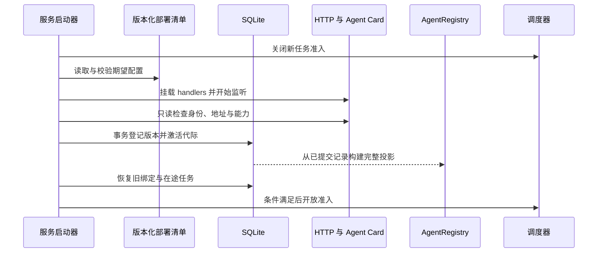
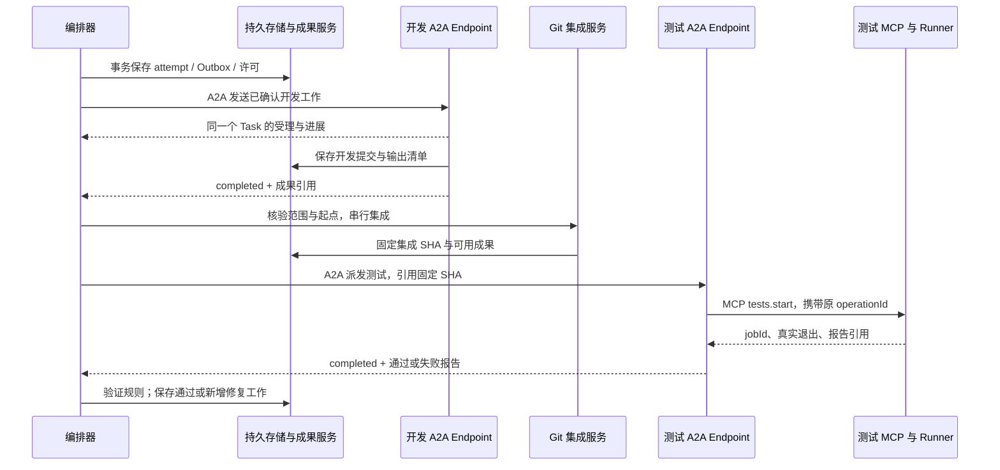
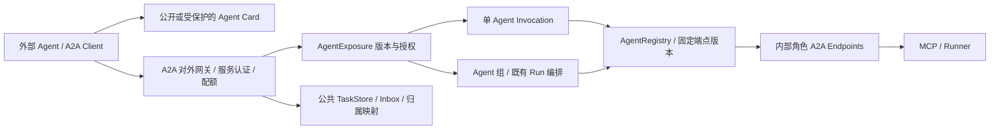

# 02 Agent Runtime、A2A 与 MCP

适用版本：V1.1。本文指定待实现接口和处理顺序；接口名称是 DevMesh 设计，不假定参考 Harness 或官方 SDK 已提供同名业务能力。

## 1. 服务拆分及依赖

| 服务 | 对外方法 | 注入依赖 | 禁止直接负责的事 |
| --- | --- | --- | --- |
| RoleRegistry | resolveRole、snapshotRole | 冻结配置、模板目录 | 修改 run 状态 |
| AgentRegistry | resolveForRun、resolveForInvocation、getRegistration、listAvailable | 已提交端点版本、角色绑定、健康投影 | 把未落库配置当成有效路由 |
| AgentRegistrationService | reconcileManifest、activateGeneration、drain | StorageService、受控部署清单、CardValidator | 根据模型提供的 URL 自动注册 |
| A2AExposureService | publishCard、resolveExposure、admitExternalTask | 对外发布版本、服务身份、项目授权、公共 TaskStore | 透传外部 caller 的内部执行许可 |
| AgentRuntime | activate、submitInput、requestStop、inspect | ModelProvider、ContextAssembler、ToolExecutor、SessionStore | 跳过计划派发另一个角色 |
| A2AAdapter | 标准发送、查询、订阅、取消 | 官方 SDK、DelegationInbox、TaskStore、Runtime | 把连接状态当作完成 |
| DelegationService | dispatchWork、reconcileTask | Scheduler 许可、Outbox、A2A Client | 自行扩大工作范围 |
| ToolExecutor | execute、inspect、requestStop | Policy、MCP Client、JobRegistry、Runner | 隐式重试未知写操作 |
| ResultVerifier | verifyOutput | schema、inputManifest、实际报告 | 凭 Agent 总结直接放行 |

组件构造按 Storage→Artifact→Registry 服务对象→Provider→Runtime→A2A/MCP handler 的依赖顺序完成；先挂载 HTTP 路由并开启监听，再检查本机 Agent Card，最后激活注册表并开放调度。监听不等于允许执行：启动检查及恢复期间执行准入门关闭。详细启动阶段见 §5.1.3。关闭时先关闭准入，再保存／核实在途，最后释放插件和数据库 Worker。

Cordis 的事件用于同进程通知；跨进程消息和恢复依据只能使用持久化命令与事件。注册通过可释放 effect 完成；活动 run／invocation 的插件快照不能被热更新替换。首版生产禁用任意脚本配置与代码热重载。

## 2. 角色配置与模型选择

```typescript
interface RoleSnapshot {
  role: 'product' | 'architect' | 'developer' | 'tester';
  revision: string;
  provider: string;
  model: string;
  promptArtifactId: string;
  outputSchemaId: string;
  allowedTools: string[];
  maxSteps: number;
  contextLimitTokens: number;
  outputReserveTokens: number;
  requestTimeoutMs: number;
  maxReadOnlyRetries: number;
}
```

首版新增工程默认值：单次 activation 最多 40 个模型步骤；单模型请求超时 120 秒；无响应连接建立超时 10 秒；只读且确定失败调用最多额外重试 2 次，退避 1／3 秒并加入抖动。它们是可配置执行上限，不代表模型响应速度承诺。当前实际值冻结到配置并可查看；产品规定的整体预算优先。

上下文容量不写固定“128K”等未经验证值。ModelProvider 注册 modelCapabilities：真实上下文容量、工具调用能力、结构化输出方式、token 计数方法、最大输出。若服务没有可靠 tokenizer，使用保守估计并预留空间；超限返回 CONTEXT_LIMIT，不截掉必要要求。

首个 Provider 适配团队可用的 DeepSeek API。具体模型 ID 是部署必填项；无可用模型仍能保存需求，但不显示已经开始模型理解。供应商差异隔离在 ModelProvider，角色配置不能携带密钥。

### 2.0.1 模型接入设置与密钥边界

工作台侧边栏底部“更多 → 设置”提供本机模型接入配置：Provider、Endpoint、模型 ID 与 API Key。保存写入 `<dataRoot>/settings/model.json`（非秘密）与 `model-secret.json`（文件权限 0600），密钥不进入数据库、不回显、不写日志；读取接口只返回“是否已保存密钥”。

- **校验**：Endpoint 必须为 https；仅 loopback 主机允许 http；拒绝 URL 内凭据、query 与 fragment。Provider 与模型 ID 限安全字符。
- **测试连接**：服务端使用已保存密钥请求 `GET {endpoint}/models`，6 秒超时；只返回状态分类，不返回密钥或响应正文。
- **模型选择**：设置弹窗可请求接入服务的 `/models` 并下拉选择，或保留当前值、手动输入。模型 ID 与 Runtime 共用 `opaqueKey` 校验（1～128 字符，字母或数字开头，后续允许字母、数字、点、下划线、连字符），不把服务商所有模型都声明为已支持；选择不会自动保存或热切换。发现使用未保存的接入信息时不落盘；已有密钥仅复用于同 Provider 和规范化 Endpoint，地址变化必须提供新密钥。列表请求禁止重定向，6 秒超时、响应最多 1 MiB、返回最多 1000 个去重的有效 ID，不回显服务商错误正文或密钥。
- **生效**：保存后需重启服务。预览启动器读取设置，构造 ModelProvider 与内置 Agent manifest，凭据解析只把 Key 交给 Provider；接入失败回退为无模型并记录，不伪造“已可用”。
- **边界**：这是单机本地操作者设置，不是企业密钥托管；多用户管理员隔离、轮换与审计留待后续。运行中的 Run 不热切换模型，仍按配置调整流程暂停、审查后应用。

### 2.0.2 Preparation 接线

- product／architect 角色端点必须声明 `devmesh.prepare.<role>`；修改技能需提升 endpoint revision 与 manifest revision，并重算 cardHash。
- `runtime.preparation` 指定 callerId 与 product／architect Provider；PreparationConsumer 从输入 outbox 建立 job，经 A2A 委托角色端点，模型结果写 requirement／plan revision。
- 企业代理会缓冲完整响应时，Provider connectTimeout 上限放宽到 120s；requestTimeout 保持 300s 上限。
- 计划确认仍执行既有校验：缺少 tester／集成输出等必要项时不可确认，不用放宽校验换取“可继续”。

### 2.1 按角色选择模型与冻结配置

| 角色 | 配置别名 | 必须实际检查的能力 |
| --- | --- | --- |
| 产品、架构 | planningModel | 中文理解、长文来源定位、约束保持、澄清与声明式计划 schema |
| 开发 | codingModel | TypeScript 修改、完整工具参数、编译错误修复、遵守工作区范围 |
| 测试 | testingModel | 从验收生成检查、原问题复现、解释真实报告、失败和未验证区分 |

这些别名可以指向同一模型，避免未经评测先引入多供应商。P0 固定任务看板、资源预约不重叠、已标明来源的缺陷修复三组样本，保存模型 ID、Prompt、schema 合格率、工具参数有效率、约束遗漏、真实验证结果和用量。模型擅长自然语言不等于通过代码与工具样本。

完整角色配置快照除上面的接口字段，还包括 providerEndpointId、供应商支持的采样参数、能力声明版本、token 计数方法、promptHash、toolSchemaHashes 和 credentialRef。供应商不支持的参数在配置检查时拒绝，不能静默忽略。用量记录区分供应商返回值与平台估计；没有可验证价格／账单依据时费用显示未知。

ModelProvider 统一输出可展示文本、完整 tool calls、finishReason、requestId、usage 和分类错误，并支持 AbortSignal。取消 HTTP 仅停止模型连接，不代表工具停止。默认不自动换模型；当前 run 调整模型按 [配置调整流程](./03_API与用户流程.md#7-配置查看连接检查与当前执行调整) 暂停、审查影响、应用新快照，旧 attempt 保留原模型与参数。

## 3. 模型循环与工具确认

下面以工作流 Attempt 为例；对外单 Agent 的模型循环通过 §8.5 的 ExecutionHost 使用同样的准入、持久化和停止规则。

```text
activate(attemptId, activationId, permit):
  核验许可与角色配置；装配有来源的上下文
  对每个 step:
    持久化 ModelRequestPrepared（inputManifest、脱敏请求、配置）
    调用 ModelProvider；增量仅用于 UI，最终回复持久化后才进入下一步
    若回复含工具请求:
      逐个解析完整 JSON；不执行未闭合的流式参数
      校验工具身份、参数、权限、资源范围及副作用等级
      先持久化 ToolOperation 与幂等键，再执行或提交后台 job
      保存真实结果后，将结果关联原 toolCallId 加入下一步上下文
    若回复为最终成果:
      校验角色输出 schema，保存成果并进入 ResultVerifier
      返回 A2A task 结果；由业务验证器决定工作结论
    每步重新检查许可、取消、预算和步数
```

单条模型回复包含多个工具时：只读工具可在配置并发内并行；涉及同一资源写入的调用串行；写操作与依赖其结果的读取按依赖顺序执行。模型给出的 toolCallId 仅在该回复内定位，平台 operationId 为独立稳定标识。

恢复时不重新执行已经有结果的 toolCall。模型回复已落库但工具尚未创建时，根据同一个 stepId + toolCallId 创建唯一操作；工具提交响应丢失时查原 operation/job。不能把整个模型步骤包在通用自动重试中。

Prompt 组成固定为：角色职责→任务与完成条件→必要约束和有效决定→输入来源→允许工具→输出 schema→剩余预算。上下文压缩保留来源列表、未决问题和验收；压缩结果也是版本化 artifact，原文可回溯。资料的矛盾必须指明各自来源，不自行选择其一；模型内部思维不进入产品记录、回放和导出，只保存可展示的回复、结构化动作及必要用量元数据。

SessionStore 采用 SQLite 消息／步骤索引和本地内容库：一个 attempt 对应一个 sessionId，多次 activation 可继续该会话；重试新 attempt 新建 session，并显式引用允许沿用的上下文。模型请求的 context manifest 和完整回复先持久化，再产生工具副作用。JSONL 是可重建阅读／导出投影，不能与数据库各自接受修改。实际目录、消息顺序、输入快照和恢复边界见 [D5 本地会话与文件存储](./05_数据与事务.md#7-本地会话与文件存储布局)。

## 4. 四类角色的输出约定

| 角色 | 必填输出 | 平台校验与后续 |
| --- | --- | --- |
| 产品 | requirements[{id,statement,sourceRefs,acceptance}], assumptions[], questions[{id,required,reason,blockingScope,defaultOption?}] | 来源可定位，必要问题可区分；默认值需用户主动选择 |
| 架构 | interfaces[], planDraft、risks[]、capabilityFit | 计划字段与 DAG 校验；必要范围不能被静默删减 |
| 开发 | baseCommit、resultCommit、changedFiles、checkRefs、unverified[]、handoffProposal | Git 确认 commit 和 diff；修改不越出工作区；集成服务处理后续 |
| 测试 | targetCommit、caseResults[]、coverageRef、defects[]、buildRef、previewRef? | 所有报告绑定 targetCommit；失败和缺失明确；按条件创建修复 |

`handoffProposal` 只是建议，包含目标角色、目标、引用成果和原因；编排器仅在当前计划已有相应工作或完成合法重规划后派发。Agent 不能自行在 A2A payload 中声明新授权。

角色输入与输出必须配套：产品读取原始目标、附件来源与已有应用摘要；架构读取已确认需求、模板能力、已有接口和预算；开发读取固定 baseCommit、接口、工作输入与允许修改范围；测试读取精确集成 SHA、必要验收集合、复现材料和检查配置。测试不能通过修改验收预期来“修复”失败；需要修改预期时回到需求变更流程。首版不开放无限递归子 Agent，新增跨角色工作都经过计划准入。

## 5. A2A 传输、身份和持久化

### 5.1 拓扑

四个角色提供真实 HTTP A2A endpoint，可同进程部署。编排器以服务主体身份调用，记录 `actualCaller=orchestrator`、`originRole`、`recipientRole`。来自开发的代码经平台交给测试时，其内容来源为开发，协议发送方仍为编排器。界面显示完整链路。

首版内部仅启用 A2A 1.0 JSON-RPC + SSE；入口经过服务认证与角色 allowlist。卡片来自部署注册表，不允许模型任意提供 URL 后直连。SDK负责标准对象编解码，扩展载荷使用 `schemaVersion=devmesh.work.v1`。普通短问答可返回 Message，进入工作清单的任务必须返回可查询 Task。

每个角色固定平台路由 `/internal/agents/{role}/a2a`，Agent Card 在 `/internal/agents/{role}/agent-card.json`；这些是本项目部署路径，报文仍使用标准 SDK。AgentRegistry 保存 endpointId、role、cardUrl、cardHash、协议／SDK 版本、supportedSkills、streaming、认证引用与最后检查。注册后读取卡片、校验能力和目标地址，再允许派单；卡片变化触发兼容性检查，不能自动扩大授权。TaskStore 的内存实现只用于测试。

标识归属必须区分：UserTask ID 是产品目标；runId 是本次执行；A2A taskId 仅在 endpointId 范围内唯一；contextId 由接收端定义；messageId 定位协议消息；operationId 定位可去重的业务动作。不能直接令这六个标识共用一个值来代替映射。

### 5.1.1 注册的对象、位置与权威来源

首版内置四角色采用**部署清单声明、启动时装载**。注册的是 Agent 端点和能力。Cordis 托管 AgentRegistry 等服务对象；AgentRegistry 提供业务寻址；HTTP 路由承接协议请求，三者职责分开。RoleRegistry 保存角色 Prompt／模型／工具配置，AgentRegistry 保存调用哪个端点。

| 层 | 具体内容 | 权威与更新规则 |
| --- | --- | --- |
| 版本化部署清单 | endpointId、角色、实现版本、地址／卡片、启用设置、认证引用 | 维护员声明本次期望配置；通过受控发布生效；不是运行时路由缓存 |
| SQLite 注册记录 | endpoint_registrations、registry_generations、role_endpoint_bindings、endpoint_checks | 已提交版本和生效代际是运行寻址与恢复的持久依据；历史不覆盖 |
| AgentRegistry 内存投影 | endpointId+revision 索引、role 到默认端点映射、能力与健康结果 | 由数据库重建；投影的 generationId 与 projectionRevision 均匹配数据库才参与准入；重启可丢弃重建 |
| Run 固定绑定 | run_endpoint_bindings、配置快照中的 endpointRevision | 执行创建时冻结；当前部署默认值改变不能替换旧 run 的目标 |

首版不引入独立 Nacos／Consul，也没有 Agent 自行对外注册的入口。对外发布 Agent Card 属于 §8 的 Exposure 管理，不能把内部 AgentRegistry 的全部内容直接公开。

### 5.1.2 部署清单示例与版本判定

以下是 DevMesh 内部配置示例，不是标准 Agent Card；所引用的 origin、实现和凭据必须在部署中实际配置。

```json
{
  "schemaVersion": "devmesh.agent-registry.v1",
  "manifestRevision": "agents-2026-11-10-01",
  "internalOriginRef": "control.internalOrigin",
  "credentialRef": "service.devmesh-orchestrator",
  "agents": [
    { "endpointId": "builtin.product", "role": "product", "hosting": "local", "agentDefinitionRef": "product@1", "enabled": true },
    { "endpointId": "builtin.architect", "role": "architect", "hosting": "local", "agentDefinitionRef": "architect@1", "enabled": true },
    { "endpointId": "builtin.developer", "role": "developer", "hosting": "local", "agentDefinitionRef": "developer@1", "enabled": true },
    { "endpointId": "builtin.tester", "role": "tester", "hosting": "local", "agentDefinitionRef": "tester@1", "enabled": true }
  ]
}
```

本地地址由已验证 internalOrigin 与 §5.1 的固定路径生成。以后拆服务时 hosting=remote 并显式给出受信任 endpointUrl/cardUrl，endpointId 保持逻辑身份。每个角色在一个生效代际只能有一个默认目标；多实例负载均衡放在该目标后面，不能随机选择多个不兼容 Agent。

上述示例是四角色默认绑定；扩展服务条目使用 agentKey／agentDefinitionRef，可不声明 workflow role，按 §8.5 的服务路径生成地址。所有端点版本仍进入同一注册表，只有声明四角色绑定的条目进入 role_endpoint_bindings。无界面热加载与模型自行注册能力。

计算规范清单哈希时包含解析后的地址、实现／协议版本、已声明的期望能力及 credentialRef，排除密钥值与健康时间。远端实际观察到的 Card 哈希保存为检查事实，不反向修改期望清单。当前生效 manifestRevision 同哈希重复启动复用原配置；同 revision 不同哈希拒绝；内容变化需要新 manifestRevision。已经被替换的历史清单不会因重启重新成为默认，回退规则见 §5.1.6。一次清单引用多个不可变 endpointRevision，发布只改变默认绑定，不改写历史行。

### 5.1.3 启动与首次注册顺序

1. 取得单实例锁，打开数据库并完成迁移，关闭调度和外部新任务准入；读取并校验清单。重复 endpointId、角色绑定冲突、未知实现或非法地址属于配置错误，不能继续发布半套绑定。
2. 构造角色 Provider／Runtime、内部 A2A handlers 和卡片路由；HTTP 开始监听。此时允许健康检查、卡片校验及经认证的恢复查询，新的执行请求返回服务准备中。避免“HTTP 尚未监听就请求自己的 Card”导致启动死锁。
3. 对本机／远端 Card 做只读检查，核对身份、协议、技能、地址、认证与实现可服务的版本。配置有效但某端点暂不可达，登记对应能力不可用；不能伪造在线，也不把所有独立能力一并判为失败。
4. 在一个注册事务中保存清单导入操作、缺少的不可变端点版本、代际默认绑定与检查结果，并切换 activeGeneration；同清单重复导入幂等。网络检查在事务外，提交时复核清单哈希。
5. 在同一个数据库读快照中读取 activeGeneration、projectionRevision 及关联记录，构建新的不可变内存索引，再原子替换 Registry 指针。替换前核对版本仍一致；有并发更新则按新快照重建。数据库已提交而进程在换缓存前崩溃，重启从数据库重建；缓存失败时保持准入关闭，不能回用旧缓存继续派单。
6. 扫描历史 run 的固定绑定和未终结 Task／job，保留手动暂停与未知作业。核心存储、注册投影和恢复扫描完成后开放 readiness；单 Agent 不可用表现为该能力阻塞，仍可保存需求、查询历史和运行其他具备条件的工作。



### 5.1.4 寻址、投递与历史任务

创建 run 时，从当前生效代际冻结各角色的 endpointId、endpointRevision、cardHash、协议和认证策略引用。调度调用 `resolveForRun(runId, role, purpose)`；purpose 区分创建／继续工作与查询／停止已有任务，不能每次直接查“最新 developer”。

准入事务重新校验该绑定仍受允许、检查结果未过期、许可与资源有效，再把端点版本写入 attempt 的输入清单和 Outbox 目标。sender 在实际发送前再次检查端点的停用／准入状态。已发送结果未知时按原端点与原 operation 查询；不能改地址重发来绕过未知副作用。

同一 URL 升级实现不保证还能处理旧配置。内置接收端核验请求的 endpointRevision 和 roleSnapshot 是否在当前实现的可服务集合中；不兼容返回 ENDPOINT_REVISION_UNAVAILABLE 并建立待办。历史 Task 查询／取消使用原接收端映射与持久 TaskStore，不能解析成新实现的新任务。

### 5.1.5 更新、停用、健康与恢复

首版端点地址／实现变更通过新部署清单发布并重启装载，生产不监听文件自动热改路由。健康状态在运行期更新；调整当前 run 的绑定使用 [当前执行配置调整流程](./03_API与用户流程.md#7-配置查看连接检查与当前执行调整)，先安全暂停、说明影响、确认后新增 run 绑定 revision，应用后仍暂停。

| 变化／故障 | 处理规则 |
| --- | --- |
| 相同清单重启 | 复用端点版本，重新检查健康；不能重复增加注册业务记录 |
| 新清单发布 | 新代际成为新 run 默认；旧 run 的绑定保留，必要时运行旧实现或阻塞并显式迁移 |
| 健康失败／过期 | 暂停该端点的新派发，现有任务继续查询；恢复健康不解除人工暂停 |
| Card 语义变化 | 标 NEEDS_REVIEW，不直接接受新增能力；经过新端点版本发布才能用于新调用 |
| 维护员停用端点 | 状态转 DRAINING，立即禁止新工作／新 activation；保留原任务查询、停止和结果归档 |
| 清单删除旧端点 | 旧版本转 DRAINING 并取消默认绑定；历史引用和已有任务记录保留 |
| 已无在途或固定 run 引用 | 可转 RETIRED；查询保留在 TaskStore／归档服务，按保留策略处理 |
| 配置无效、DB 失败或代际不同步 | 不开放执行准入；错误可见，不用内存或旧部署默认值掩盖失败 |

endpoint 的生命周期 ACTIVE／DRAINING／RETIRED 与可用性 UNKNOWN／HEALTHY／UNHEALTHY／NEEDS_REVIEW 分开记录。拟定只读健康检查每 60 秒一次、结果 120 秒过期；实际值部署配置化。关闭服务不删除注册记录；计划性卸载先停止准入并安全收尾。强制撤销认证是独立维护动作，应记录可能无法继续远端查询的影响，不能借撤销动作宣称旧任务已取消。

### 5.1.6 配置、数据库与内存 Registry 的初始化和同步契约

**单向生效链路为：部署配置声明期望 → 注册服务校验并提交数据库 → Registry 从已提交数据生成内存投影。** 运行时以数据库中的已提交版本和状态为准。禁止直接修改内存后异步补库，也不从内存反写部署清单；人工改表不属于支持的配置入口。

配置由唯一 `agentManifestPath` 指向的版本化清单读取；环境变量仅按部署 schema 解析地址／凭据引用等声明项，解析结果纳入规范配置哈希。读取或校验失败不等于空清单，不能据此下线全部端点。清单必须覆盖本次部署负责的完整端点集合；显式移除才执行既定 DRAINING 规则。

| 初始化或同步情形 | 数据库处理 | 内存与准入处理 |
| --- | --- | --- |
| 首次启动，数据库没有生效代际 | 完整校验后一次事务插入端点版本、绑定、检查、代际和生效指针 | 从已提交快照构建；完成前不开放执行 |
| 重启，清单与当前生效版本及哈希相同 | 复用版本和绑定；追加健康检查，不重复创建注册版本 | 丢弃旧进程内存，从 DB 重建；保留持久停用状态与旧任务绑定 |
| 部署新的、尚未导入的清单 revision | 校验后 CAS 切换新代际，历史版本继续保留 | 构建新投影并原子替换；新默认只用于新执行 |
| 同 revision 不同哈希，或清单损坏／缺失 | 拒绝导入；原记录保留，不当作删除命令 | 不开放新执行；可按已有授权提供历史查询与收尾 |
| 清单指向已被替换的历史 revision | 拒绝自动回切；需要发布新的 manifestRevision，显式引用拟恢复的配置 | 不因重启覆盖较新的数据库默认值；旧 run 也不自动迁移 |
| DB 提交前失败 | 全事务回滚；不能出现一半角色新、一半角色旧的代际 | 不发布候选内存投影 |
| DB 已提交，内存构建／替换失败 | 保留成功提交事实，不回滚为旧部署配置 | 标记不同步，关闭相关执行准入，重试从 DB 重建 |
| 内存丢失或通知丢失 | 不修改配置和持久业务事实 | 比对数据库版本并补建投影；旧缓存不可成为派发依据 |

generationId 标识不可变的部署绑定集合；新增 `projectionRevision` 标识影响寻址或准入的运行状态版本。激活代际、更新有效健康结果、停用／退役端点都在各自数据库事务中递增 projectionRevision。健康变化不制造新的 endpointRevision，也不覆盖清单的期望能力。

运行期间的同步步骤固定如下：

1. 检查服务在事务外探测端点；将结果写入 endpoint_checks，并在短事务内更新该端点运行状态及 projectionRevision。并发探测使用开始时分配的递增 checkSequence；较旧探测迟到只归档，不覆盖更新的已生效结果。
2. 维护停用操作同样先提交生命周期、原因、审计与 projectionRevision，再通知 Registry。重启导入相同清单不得仅凭 `enabled=true` 清除 DRAINING；重新启用须有明确维护决定与兼容性检查，保留审计。
3. 提交后发送进程内“投影需刷新”通知；通知只是加速信号。Registry 从同一 DB 快照重建索引，禁止逐条修改正在被调用者读取的 Map。首版拟每 5 秒比对一次 projectionRevision 作为漏通知兜底；该间隔不代表允许旧授权继续生效。
4. 每次执行准入事务及 Outbox 实际发送前仍读取 DB 复核代际、投影版本和目标状态。版本不符则拒绝使用该投影并触发刷新；停用立即阻止后续准入，不能等下一次缓存轮询。已经发送的任务按原任务映射核实，不能借刷新换地址重发。
5. DB 不可用、快照读取失败或版本无法核对时关闭新执行；仍允许的日志保存、原作业核实和停止按既定控制路径处理，不能把旧内存当成 DB 故障时的执行授权。

例如清单从 M1 发布到 M2：事务提交 G2／projectionRevision=12 后进程崩溃，重启从 DB 的 G2 重建，不再用内存 G1。若只是 G2 中某端点检查失败，更新到 projectionRevision=13；绑定集合仍是 G2，新的投影只改变该端点可用性，旧 run 的 endpointRevision 保持原值。

### 5.1.7 首版能力边界：受控注册，不等于完整动态服务发现

首版设计包含部署清单注册、数据库持久化、内存寻址、健康检查、维护停用，以及对外 Card／目录发布。新增端点地址或实现仍走受控部署与启动协调；健康探测只检查已登记目标，不扫描网络寻找未知 Agent。

本版没有设计为 Agent 启动后自动自注册、按心跳租约自动维护实例池、订阅注册中心自动增删实例或自动负载均衡／故障切换。对外 Agent Card 的发现能力与这些内部动态实例管理能力分别说明；也不能把本文的设计约定写成已实现、已联调的功能。

今后若引入动态注册中心，须另行定义注册主体认证、实例 ID 与租约、增量订阅和断线全量恢复、实例选择、版本兼容、排空与在途任务归属，并作为 AgentRegistry 的受控数据源适配接入；仍保留已提交状态权威与运行绑定规则，不能绕过准入直接替换在途目标。

### 5.2 业务载荷

```json
{
  "schemaVersion": "devmesh.work.v1",
  "operationId": "op_dispatch_01",
  "runId": "run_01",
  "workId": "work_test_01",
  "workRevision": 2,
  "attemptId": "attempt_01",
  "endpointId": "builtin.tester",
  "endpointRevision": 2,
  "grantId": "grant_01",
  "activationId": "activation_01",
  "runEpoch": 5,
  "workEpoch": 3,
  "requirementRevision": 4,
  "planRevision": 6,
  "inputManifestId": "manifest_01",
  "roleSnapshotId": "role_tester_07",
  "originRole": "developer",
  "targetRole": "tester",
  "requestedOutputSchema": "devmesh.test-result.v1"
}
```

认证主体、许可和完整目标从服务端解析，不能信任 body 的 originRole 代替授权。实际输入正文和成果通过已授权引用读取；引用范围不随模型请求扩大。

### 5.3 发送方顺序

1. 调度事务保存 attempt、operation、dispatch Outbox、事件。operationId 在事务前生成并在响应丢失后复用。
2. Outbox sender 领取短租约，发标准 A2A 请求。每次网络投递有 deliveryAttemptNo，业务 operationId 和 messageId 不变。
3. 接收反馈映射到 `(agentEndpointId,a2aTaskId)`；响应和映射在事务中提交。
4. SSE 断开仅标 transportDisconnected，查询原任务，必要时重新订阅。最终状态证据落库后归并，不依赖浏览器连接存活。

### 5.4 接收方：避免“双任务、单记录”

官方规范仅允许 SendMessage 可选幂等，不保证所有实现去重。因此入口增加 DelegationInbox：认证→解析 DevMesh 载荷→按 `(caller,operationId)` 检查请求哈希→在接收方事务内创建 Inbox 与预分配 A2A task、AcceptedWork 记录→提交→返回／订阅该 Task→Runtime 消费 AcceptedWork。

事务失败前不启动模型或工具。重发同哈希返回已有 Task，不再次调用普通 SDK 创建新 Task 的路径；同键不同哈希返回业务冲突。Adapter 在官方 request handler 扩展点连接 SDK TaskStore，必须控制任务 ID 和持久化顺序，不能在 handler 外简单套一个内存 Map。是否需要实现 SDK RequestHandler 接口由适配测试确定，标准协议层仍使用 SDK。

TaskStore、Inbox 与 AcceptedWork 共用 StorageService 事务接口，不能让 SDK 另开一份 better-sqlite3 连接。拆分成独立服务时，这三者仍须同属接收端数据库；发送端依赖网络幂等与核实，不依赖跨库事务。

DelegationInbox 只负责初次建任务。对已有 Task 的补充回答使用单独 MessageInbox，按 `(callerId, endpointId, messageId)` 去重；确认 taskId、contextId、问题版本与新的 activation 许可后，在同一接收事务保存消息、更新该 Task 并登记待激活记录，不新建 Task。同消息重发不再次激活。每次从等待恢复都重新取得角色槽位与 grant；attempt 上初次准入的 epoch 保留作历史，新的许可保存在 activation/grant 记录。暂停期间只有 Answer 落库，不能生成恢复激活。

若接入第三方 Agent 不支持上述业务扩展，则声明 `deduplication=unsupported`；发送结果未知后只查询已知任务或进入人工核实，不自动换新键重发。本期四个自有 Agent 必须实现幂等。

### 5.5 多轮、取消和流式成果

input-required 保存 questionId 与 A2A task 的映射，回答后以原 task/context 发送新 messageId；被人工暂停时先保存答案，恢复后再投递。A2A task 已终态时，恢复逻辑工作创建新 Task；旧 context 只有接收端允许且来源范围一致时才复用。

auth-required 映射为连接认证阻塞待办，由有连接维护权限的人处理；不能引导普通用户把服务密钥写入聊天。认证恢复后仍重新校验许可及配置快照，再继续原未终态任务；认证完成本身不是工作完成。

CancelTask 表示取消协议任务请求。Runtime 必须逐一停止工具 job，保存日志与差异后才能形成可信取消证据；SSE 断开、AbortSignal 触发、模型请求取消都不能替代后台 job 停止。

Artifact 分块先写接收临时区，按 artifactId 和分块序号去重。最后一块到达、完整哈希校验和原子发布成功后才登记 READY；有 Task completed 但缺 artifact 最后一块时保留任务协议事实，业务工作仍等待补齐或核实，禁止采用半个报告。

分块序号与内容哈希是自有 Agent 约定的 metadata 扩展，不能假定所有标准 A2A 事件都自带全局可重放序号。第三方缺少该扩展时，断流后以任务查询得到的完整成果快照校验，不直接拼接无法去重的增量；没有完整快照则保持材料缺失。

协议状态和事件绑定远端 task；平台额外维护接收顺序与处理水位。旧事件不会使终态回退；只有新的明确业务动作能建立后续任务。

### 5.6 A2A 与平台状态映射

以下是语义映射，wire 枚举由锁定 SDK 序列化，不能自行向标准任务增加“平台已验收”等状态。

| 协议事实 | 平台投影 | 下一步与限制 |
| --- | --- | --- |
| submitted | SUBMITTED，接收端已持久接受 | 不计为已经开始模型处理 |
| working | WORKING，记录实际活动起点 | 只在当前许可有效时推进 |
| input-required | INPUT_REQUIRED + 用户待办 | 无在途副作用才释放计算槽位；回答不解除手动暂停 |
| auth-required | 连接处理待办；保留原 attempt | 维护员修复认证，不向普通用户索取秘密 |
| completed | VERIFYING | schema、内容完整性、SHA、适用性及完成规则通过后才 SUCCEEDED |
| failed / rejected | 保存失败／拒绝原因，先核实副作用 | 明确无未知副作用才 FAILED；再决定能否安全重试 |
| canceled | 远端取消事实；本地 STOPPING 或核实中 | 工具／Runner 停止且材料保存后才结束 attempt／控制作业 |
| 断流／无响应／未知 | 最后已知状态 + OUTCOME_UNKNOWN 标记 | 查询原任务，不推断通过、不换键重跑 |

测试协议任务 completed 可以携带失败用例报告，此时业务验证 FAILED、交付阻塞；这三项必须同时可查询。

### 5.7 开发到测试的实际交接



在“开发完成、集成未完成”时不能提前以开发工作区启动最终验收；集成失败保留原提交并建立处理事项。业务和协议记录同时保留成果来源角色与真实调用方。

## 6. MCP 接入与副作用分类

| 服务 | 操作 | 权限／幂等 | 输出 |
| --- | --- | --- | --- |
| repo | read、diff、snapshot | 项目与 commit 只读；可重试 | 文件／差异／SHA |
| repo | workspaceRead、writeFile、deleteFile | 专属工作区；写范围与旧内容 CAS；原 operationId 核实；实际 Runner／编辑器 fencing | 实际文件 SHA、原操作落盘证明 |
| repo | commit、integrate | 指定 worktree／baseCommit；operationId 去重 | commit、treeHash、冲突文件 |
| docs | search、read | 授权附件；版本固定 | 段落、offset、原文 artifactId |
| tests | start、get、stop | start 使用 operationId；结果未知查询 jobId | job 状态、报告引用 |
| issues | create、linkFix、recordVerification | create 去重，更新带 issueRevision | 缺陷与变更历史 |
| pipeline | start、get、logs、artifacts | stage 配置冻结；禁默认生产发布 | pipelineId、各阶段及成果 |

五个服务以独立 identity 注册实际能力；即使同进程，Agent 仍通过官方 MCP Client 调用 Server。一个工具的别名不重复计数。连接检查与每项实际动作验收分开。

首版 repo 由受控 Git CLI／仓库服务实现，docs 由附件原文与关键词索引实现，tests 由 Runner 上的 Vitest／Playwright 实现，issues 由缺陷领域服务与 SQLite 实现，pipeline 由独立流水线记录管理安装、检查、构建与受限预览阶段。tests 的单次测试作业和 pipeline 的阶段编排有独立身份、状态和结果，不能将同一调用改名后计成两个接入。单个 run 按需使用，不强制每次调用全部五类。

开发 Agent 通过 repo 的文件工具实际修改其工作区，再请求受控 Git 提交；不能用提交接口存在或测试手工写文件替代开发闭环。文件写入／删除先保存原意图，在当前授权与实际目录独占许可下核对旧 SHA（新建要求不存在），使用同卷暂存／原子替换或隔离移动，并保存原操作关联的文件身份／材料证明。未核实编辑阻止后续写入／提交；丢回复只查询原记录与证明，不重放编辑，也不能仅凭当前内容哈希相同确认旧操作。只允许批准范围内的有界普通 UTF-8 源文件，拒绝链接、敏感路径和任意命令。

远端使用 Streamable HTTP，本地受管进程可使用 stdio；协议协商实际版本保存到连接快照，协商失败明确阻塞。长期作业使用本文业务 job 契约，不把可选协议扩展当成停止控制必需条件。内部直接文件操作标 source=internal；只有实际经 MCP Client／Server 的动作标 source=mcp。

工作流工具权限从 roleSnapshot、已确认计划、项目 ACL、作用域 permit 四者交集计算。单 Agent Invocation 使用已发布技能的工具策略、固定输入范围、服务 grant 与 invocation permit 的交集，不能继承完整项目写权限。工具的描述、schema 或 `readOnly` 提示不是权限依据。服务端按固定副作用分类表执行，模型不能修改等级。

MCP 连接有 endpointId、协议版本、能力快照、健康状态、最后检查时间。schema 变化后标需要重新校验；已开始 attempt 使用旧快照，旧版本不可用则阻塞，不静默切到新签名。连接级重连不能重放未核实写操作。

长期工具返回 `{jobId,status,acceptedAt,queryTool,stopTool}`，原调用结果持久保存。进度通知可丢失，job 查询是恢复入口。stdio 仅启动部署批准命令，参数数组执行；禁止拼接模型文本到 shell 启动命令。

## 7. 超时和错误归属

| 情况 | 处理服务 | 是否自动重试 |
| --- | --- | --- |
| 模型连接建立失败、无工具动作发生 | ModelProvider | 在余量内重试，记 attempt 内请求次数 |
| 模型回复中断，部分文本已显示 | Runtime | 保留中断消息；执行过的工具先核实，不能整体重放 |
| schema 不合法 | Runtime | 最多一次输出修正；仍不合法则失败 |
| A2A 首次提交响应丢失 | DelegationService | 仅对已声明幂等的自有端点用原键重发 |
| MCP 只读查询失败 | ToolExecutor | 有限退避 |
| MCP 写动作响应未知 | JobReconciler | 查询原 operation/job；不能盲目重复 |
| Runner 失联 | RunnerReconciler | 查询与告警；许可失效不等于已停止 |
| 取消被拒绝或无法核实 | RunService | 保持停止中，显示具体未解决作业 |

本方案基线核对：[A2A 1.0 操作与幂等](https://a2a-protocol.org/v1.0.0/specification/)、[官方 JS SDK](https://github.com/a2aproject/a2a-js)、[MCP TS SDK](https://github.com/modelcontextprotocol/typescript-sdk)。SDK 的具体包版本仍需实际安装联调冻结；本文没有将文档能力当成已通过的实现。

## 8. 对外发现、单 Agent 与 Agent 组服务

本节是本轮新增的扩展设计：DevMesh 同时作为内部协作的 A2A Client／Server，以及供外部 Agent 调用的 A2A 服务提供方。单个 Agent 和 Agent 组都通过受控对外入口发布，内部拓扑可在稳定协议入口后演进。下列域名均为示例，不表示已经部署或向外发布。

### 8.1 四种身份与组件边界

| 对象 | 作用 | 示例 |
| --- | --- | --- |
| AgentDefinition | 可加载的角色／服务实现、Prompt、输出契约和工具策略 | developer@1、tester@1 |
| AgentEndpoint | 一个可调用的内部／远端 A2A 实例地址及版本 | builtin.tester revision 2 |
| AgentGroupDefinition | 一组协作成员、入口技能、受限编排策略与输出契约 | dev-team@1，内部产品→架构→开发→测试 |
| AgentExposure | 对外身份、Card、公开技能、认证策略、配额及内部目标 | devmesh-dev-team、devmesh-tester |

四个产品角色仍是首版研发工作流的固定角色集合；可扩展注册使用字符串 agentKey／groupKey 和版本化定义，不以四值 role 枚举限制所有服务。新增实现经受控 TypeScript 插件发布；新增定义和 Exposure 不能让外部调用者上传任意脚本。服务技能使用独立 AgentDefinitionSnapshot，工作流继续使用 §2 的四角色 RoleSnapshot。

一个 Agent 组对外表现为一个 A2A Agent，有自己的 Card、Task 与 Artifact；组内仍用现有编排器和成员 A2A 交接。外部调用者只需理解组的输入和输出，不需要感知成员数量、运行地址或内部 DAG。对外 Group 的分解规则是 DevMesh 的业务设计，不新增 A2A 标准状态或私有传输方法。



对外网关首版是控制服务的独立路由模块，可由 HTTPS 反向代理转发；后续可拆成服务。它不直接转发到 `/internal/agents/*`，而是完成认证、业务接入和外部任务映射，再通过域服务或受限 Invocation 调度。

### 8.2 外部如何发现 DevMesh

采用三种发现入口：已知 Card URL 的直接配置、已知域名的标准 well-known Card、企业目录中的 Card 链接。A2A 提供 Card 描述与上述发现方式；企业目录的查询／注册 API 由目录产品约定。仅发布 Card 不会让未知网络上的 Agent 自动知道本服务存在，需要通过域名、接入文档或目录分发入口。[官方发现说明](https://a2a-protocol.org/latest/topics/agent-discovery/)

| 使用场景 | 本设计地址／方式 | 返回内容 |
| --- | --- | --- |
| 发现默认研发组 | `GET https://agents.example.com/.well-known/agent-card.json` | 默认发布的 dev-team Card，包含对外调用地址 |
| 指定 Agent 组 | `GET https://agents.example.com/groups/{groupKey}/agent-card.json` | 指定组 Card；该路径是 DevMesh 自定义直接发现地址 |
| 指定单 Agent | `GET https://agents.example.com/agents/{agentKey}/agent-card.json` | 指定单 Agent 的受限服务 Card |
| 查询已发布目录 | `GET https://agents.example.com/catalog/agents?skill=tests.verify-snapshot` | 经权限过滤的 exposureId、Card URL、技能、版本和可用性；这是 DevMesh API，不是 A2A 标准注册接口 |
| 接入企业 Agent 目录 | 维护员通过 DirectoryPublisher 发布已批准的 Card URL 与元数据 | 外部系统先查询企业目录，再访问本服务 Card |

根 well-known 只代表一个默认对外 Agent，不返回所有内部角色的数组。单 Agent 若需要独立域名发现，可配置 `https://tester.agents.example.com/.well-known/agent-card.json`；多 Card 的自定义路径必须通过明确 URL 或目录告诉调用方。

上述路径参数 agentKey／groupKey 是 Exposure 的对外 publicKey，可以与内部定义名称不同。它在发布后保持稳定；内部更名或迁移不要求接入方修改 URL。相同内部实现可按不同受限技能发布多个对外身份，各自拥有授权和配额。

Card 由已发布 Exposure 快照生成，只包含对外身份、技能、输入／输出媒体类型、协议地址和认证要求。内部地址、项目列表、Prompt、工具密钥及组内详细拓扑不出现在公开卡片。涉密技能可以保护整张 Card，或在实现并声明 `extendedAgentCard` 后通过标准扩展卡片操作按调用方返回授权能力。

### 8.3 对外地址与 Agent Card 示例

| 发布目标 | Card 中的 JSON-RPC URL | 内部映射 |
| --- | --- | --- |
| dev-team 组 | `https://agents.example.com/a2a/groups/dev-team` | GroupDefinition revision → 已有项目／Run 编排 |
| tester 单 Agent | `https://agents.example.com/a2a/agents/tester` | tester 的已发布服务技能 → Invocation → 固定内部端点 |
| developer 单 Agent | `https://agents.example.com/a2a/agents/developer` | 受限代码差异建议服务；不能直写项目接受分支 |

对外 URL 使用部署配置的 trusted publicBaseUrl 生成，不从请求 Host／转发头直接拼装。首期对外启用 A2A 1.0 JSON-RPC + SSE；HTTP+JSON／gRPC 可通过新增 adapter 扩展，未实现前不写入 Card。

下面是研发组的卡片设计示例，字段依据固定 [A2A v1.0.0 协议定义](https://raw.githubusercontent.com/a2aproject/A2A/v1.0.0/specification/a2a.proto)。应用 version 与协议 protocolVersion 独立；部署时由锁定 SDK 的类型／schema 生成并校验。

```json
{
  "name": "DevMesh Development Team",
  "description": "创建或迭代受管 Web 应用，交付版本化源码、验证报告和预览；实施计划与接受保留人工确认。",
  "version": "1.0.0",
  "supportedInterfaces": [
    { "url": "https://agents.example.com/a2a/groups/dev-team", "protocolBinding": "JSONRPC", "protocolVersion": "1.0" }
  ],
  "capabilities": { "streaming": true, "pushNotifications": false, "extendedAgentCard": false },
  "securitySchemes": {
    "serviceOAuth": {
      "oauth2SecurityScheme": {
        "flows": {
          "clientCredentials": {
            "tokenUrl": "https://identity.example.com/oauth2/token",
            "scopes": { "devmesh.group.invoke": "提交研发组请求", "devmesh.task.read": "查询本主体任务", "devmesh.task.cancel": "取消本主体委托" }
          }
        }
      }
    }
  },
  "securityRequirements": [{ "schemes": { "serviceOAuth": { "list": ["devmesh.group.invoke"] } } }],
  "defaultInputModes": ["text/plain", "application/json"],
  "defaultOutputModes": ["text/plain", "application/json"],
  "skills": [{
    "id": "devmesh.web-build",
    "name": "受管 Web 应用研发",
    "description": "根据目标完成理解、计划、实现和验证，按当前项目权限与确认流程交付。",
    "tags": ["web", "typescript", "development"],
    "examples": ["创建一个支持状态筛选和刷新后保留数据的任务看板"]
  }]
}
```

Card GET 可用 ETag 和短缓存；初始公开缓存上限拟定 60 秒。受保护／按调用方裁剪的卡片不进入共享缓存。缓存中仍有旧 Card 不构成调用授权：服务端对每个请求复核当前发布状态与权限。撤销发布立即关闭新请求准入，旧任务查询按归属和保留策略继续。

### 8.4 外部请求与完整交互

1. 对方获得域名或 Card URL，读取卡片，选择支持的 interface 与技能。
2. 对方管理员在企业身份系统申请服务身份；DevMesh 管理员授予指定 Exposure 与项目／工作空间范围。对方从 tokenUrl 取得短期 access token。Card 只说明认证方式，不提供 client secret，也不自动授予项目权限。
3. 外部客户端向 Card 声明的 URL 发送标准 A2A 请求，携带 `Authorization: Bearer …`、`A2A-Version: 1.0`。JSON-RPC 的方法采用 SendMessage／SendStreamingMessage／GetTask／SubscribeToTask／CancelTask，序列化由 SDK 负责。[A2A 1.0 绑定与操作](https://a2a-protocol.org/v1.0.0/specification/)
4. 网关鉴权和准入后先持久保存公共 Task、Inbox 与目标映射，再返回 taskId。调用方通过 SSE 观察进展，断线使用原 taskId 查询；需要继续澄清时向原 taskId/contextId 发送新 messageId。
5. 成果作为标准 Artifact 返回，绑定固定源码／报告版本。大文件使用有权限的短期下载地址，URL 过期只重新签发下载权限，不重新执行任务。

以下为示意请求正文。params.message.parts 的 data 是本项目业务契约 `devmesh.external-request.v1`；projectRef、目标技能和上下文只作请求参数，授权以服务端 grant 为准。

```json
{
  "jsonrpc": "2.0",
  "id": "rpc-001",
  "method": "SendMessage",
  "params": {
    "message": {
      "messageId": "msg-ext-001",
      "role": "ROLE_USER",
      "parts": [{ "data": {
        "schemaVersion": "devmesh.external-request.v1",
        "clientRequestId": "build-request-001",
        "skillId": "devmesh.web-build",
        "projectRef": "project-authorized-001",
        "goal": "增加任务标题搜索，保留已有任务与状态",
        "inputRefs": []
      } }]
    },
    "configuration": { "acceptedOutputModes": ["application/json", "text/plain"] }
  }
}
```

普通文本请求也可使用：服务端从 Exposure 的唯一入口技能和服务 grant 的默认项目范围解析；技能或项目不唯一时先保存仅含待澄清上下文的公共 Task，返回 input-required，不创建执行目标。补齐后再原子准入，不自行选择或创建无归属项目。inputRefs 只接受已授权上传／成果／快照引用，不根据任意 URL 或宿主路径抓取数据。公开的技能文档应列出业务 schema、必要引用与错误，不能要求调用方知道内部 runEpoch、workEpoch 或 grantId。

### 8.5 单 Agent 与 Agent 组的执行契约

**组调用**：公共 Task 绑定一个受管项目的 UserTask／Run。已授权的新建项目请求可进入 T1；已有项目仍受一个活动 run 的约束。额外请求不能悄悄合并到已有目标，应返回明确冲突或引导经授权的变更。一个公共 Task 对应一项委托，组内产生多个内部 A2A Task，不能复用同一个 taskId 代替父子映射。

保留现有人工边界：到计划确认、冲突裁决或交付接受时，公共 Task 可进入 input-required 并返回结构化 requiredAction、basisRevision 和受保护 reviewUrl。外部 Agent 可传递资料／澄清答案；凭普通服务 token 写“同意”不等于人类确认。第一版在 DevMesh 中由有权限的人完成必要确认后继续；将来若提供机器委托批准，需要单独定义授权契约，不能默认绕过本产品规则。组任务 completed 以所发布技能的完成契约为准；`devmesh.web-build` 默认要求交付接受成功，不能在仅生成代码时 completed。

**单 Agent 调用**：建立独立 AgentInvocation，发布窄范围服务技能，例如 requirements.extract、architecture.review、code.patch-proposal、tests.verify-snapshot。调用者提供授权输入快照，平台冻结 AgentDefinitionSnapshot（复用四角色时关联其 RoleSnapshot）、EndpointRevision、输出 schema 与预算。生成代码差异只能写 invocation 自己的沙箱／成果区；应用到项目必须进入正常 Run、计划与接受流程。

AgentInvocation 不伪装成项目 Run：它可以在产出符合该服务契约的报告／差异后完成，但不更新 Project.acceptedReleaseId、不占据“完整研发已接受”的结论。它有独立状态、尝试、步骤和工具记录，并受同一 Runner 全局配额与主体配额约束；未知写操作先核实、取消要真实停止。首版单 Agent 不接受任意宿主路径、仓库写权限或内部 permit。

Runtime 抽取 `ExecutionHost` 接口：提供读取输入、检查许可、保存步骤／工具结果、提交成果和停止能力。`WorkflowExecutionHost` 对接现有 Attempt，`InvocationExecutionHost` 对接新增 invocation 表组；共享模型循环和 ToolExecutor 策略，存储归属各自明确。Runner 操作登记通过稳定 operationId 关联宿主类型和宿主 ID；不能把 invocationId 填入原 attemptId 外键。

单 Agent 仍经真实内部 A2A 调用：使用 `schemaVersion=devmesh.invocation.v1` 的受控业务载荷，含 invocationId、invocationAttemptId、invocationEpoch、activationId、grantId、endpointId/revision、inputManifestRef 和 definitionSnapshotRef。接收端按 schema 选择对应 ExecutionHost／TaskStore；使用 invocation 专属 Inbox、Task 与待消费记录保持同事务，不能放宽原 run／attempt 外键来混存。通用 Agent 的内部路由可为 `/internal/services/{agentKey}/a2a`，已有四角色路由继续保留；对外调用者无权直接提交这些内部载荷。

### 8.6 接收去重、隔离与任务映射

对外使用独立 PublicTaskStore／ExternalInbox，与内部成员的 A2A TaskStore 分开。现有 a2a_tasks 表必须引用内部 attempt，不能直接拿来存尚未分解的公共组任务。

初次请求以 `(principalId, exposureId, clientRequestId)` 去重；没有业务键时使用稳定 messageId。相同键不同正文哈希返回冲突，相同键同正文返回原公共 Task。JSON-RPC id 只关联响应，不作业务去重键。补充消息按 `(principalId, publicTaskId, messageId)` 去重，不再次创建整组任务。

信息齐全并通过准入时，同一个接收事务保存 PublicTask、主体归属、Exposure 快照、Inbox、业务操作和 Dispatch Outbox；组模式同时创建／绑定唯一 UserTask／Run，单 Agent 模式创建 AgentInvocation。仅待澄清的 Task 不写 Dispatch，补齐后的准入事务创建唯一目标。提交前不启动 Runtime。异步消费者只激活已经保存的目标；响应丢失返回原公共 taskId。基础准入冲突在创建执行副作用前返回，必要时记录 rejected Task 或标准错误，不能半建项目后抛失联错误。

每次 GetTask／ListTasks／Subscribe／Cancel／Artifact 下载都检查 issuer+subject、授权项目、exposure 与 task owner；知道 taskId 或 contextId 不能查看他人任务。首版限额按主体的活动任务数、请求频率、输入规模和累计执行预算计算；外部流量与 UI 共用实际 Runner 容量，不能让外部请求绕过全局配额。

外部 CancelTask 只作用于其拥有的委托及明确映射的工作；组委托触发既有 Run 取消收尾，单 Agent 委托触发 invocation 停止。所有后代和外部 job 核实后才返回可信 canceled 状态；授权范围不包括取消同项目其他来源的任务。流连接中断不触发业务取消。

首期使用轮询与 SSE，不声明推送能力。以后启用 pushNotifications 时再增加回调地址校验、发送身份、投递 Outbox、重试和失败可见性；只有实际实现并验证后才更新 Card。初版不因外部请求提供任意 callback URL 就主动回连。

### 8.7 发布、扩展与迁移

发布由 ExposureService 管理：DRAFT→VALIDATING→PUBLISHED→DRAINING→RETIRED。VALIDATING 检查内部目标、技能 schema、权限／配额、域名证书和 Card；失败不发布。PUBLISHED 的不可变 exposureRevision 同时产生 Card 与路由策略，避免宣称的能力和实际 handler 不一致。版本内容、公开名称、内部 endpoint 和业务协议分别标识。

以上是首次发布生命周期；已有 PUBLISHED 版本时，新草稿及其校验有独立 draftStatus，当前入口继续提供已发布版本。新版本提交前不将现有入口退回 DRAFT；发布失败保留旧发布指针。已有 Task 的补充消息、查询和取消先解析其固定 exposureRevision／执行目标，不按最新路由另建任务。

默认部署关闭 externalA2A，维护员显式发布选定技能后开放。内部注册成功不自动对外发布；对外新调用冻结 exposureRevision 与目标定义。下线先取消目录展示并禁止新任务，保留已有 Task 的查询、取消和结果获取；在途全部结束且保留期满足才退役。旧客户端缓存不阻止立即撤销准入。

内部端点的期望配置由部署清单管理；对外 Exposure 由受权限控制的维护 API 显式发布，数据库中的已发布版本是权威，启动时恢复但不重复发布。externalA2A 总开关关闭新提交与发现展示；仍有在途任务时保留经认证的历史 Task 查询／取消入口。彻底关闭监听必须先排空，不能把配置关掉等同于远端任务已停止。

| 扩展需求 | 扩展位置与兼容要求 |
| --- | --- |
| 增加一个自有服务 Agent | 增加 AgentDefinition、内部端点、受限技能与 Exposure；不改固定网关路由分发算法 |
| 增加一个 Agent 组 | 新 GroupDefinition 的成员／DAG／契约校验后发布新 Exposure；拒绝递归组环与无预算分解 |
| 将成员拆到独立服务 | 更换内部端点版本与部署绑定，保持公共 Exposure URL；旧任务继续按原版本核实 |
| 接入企业／第三方目录 | 实现 DirectoryPublisher；外部目录保存发布元数据，不接管内部 Run 授权 |
| 多实例 A2A 网关 | 统一持久 PublicTaskStore、Inbox 与授权；SSE 重连可查原 Task；多控制写入前完成 PostgreSQL／分布式准入设计 |
| 新协议绑定或升级 | 新 adapter 与 Card interface；语义／schema 不兼容采用新技能或服务版本，旧任务查询协议保留到保留期结束 |

给外部接入方的最小交付包包括：Card URL、服务账号开通方式、授权项目范围、业务 schema／技能说明、标准请求样例、人工待办方式、幂等重试规则、状态／成果与取消说明。P0 做原型联调，P2/P3 完成注册与对外任务专项后再允许发布；目录地址与凭据由实际部署填写，本设计修改不等于已经上线外部端点。

### 撤销恢复的可信后端边界

完成协议由原配置backendPrincipalId持有，私有getAcceptanceAbortRecovery／completeAcceptanceAbort按原不可变准备、策略及决定校验，不以当前候选资格作为清理前提。owner可请求撤销，但不能提交清理成功标志。Runner组合器读取原控制决定、Runner SQLite清理、数据文件Worker回执及独立源服务查询；A2A／MCP／浏览器均不增加自行宣告完成的入口。物理恢复和源服务适配器须显式配置，缺配置不推断成功。

- 计划结构补全：architect 输出在落库前经 \completeArchitectDraft\ 确定性补全（过滤非法 writeScope、补齐空 requirementIds、缺失时补集成 commit-resolved 工作与覆盖全部需求的 tester 工作）；只补计划结构，不生成测试结果。
- 计划可确认条件仍由既有校验与问题回答共同决定；Prompt 调优后 \issues=[]\ 且确认返回 202。

