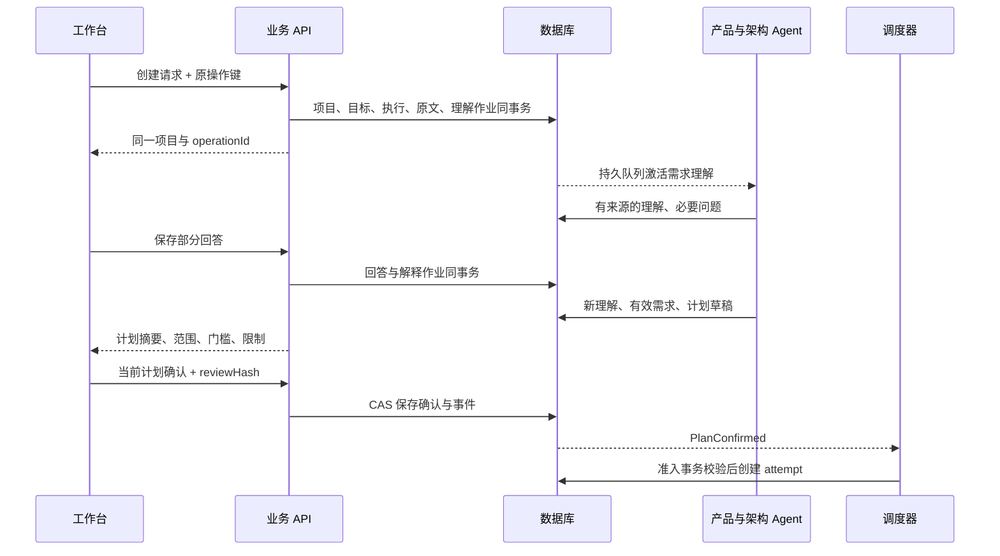

# 03 API 契约与工作台交互

适用版本：V1.1。业务与维护 API 路径以 `/api/v1` 为前缀；§8 单独列出的对外 A2A／Card 路由使用完整根路径。以下是首版业务契约，编码时转成 OpenAPI 与 Zod schema；不宣称已有服务可调用。A2A 协议请求不套用业务 REST 的响应 envelope。

## 1. 命令通用契约

客户端对每次用户动作生成 UUID `Idempotency-Key`，先存本地操作记录再发送；重发沿用原键。服务按 `(principalId, scopeId, key)` 去重，并保存规范请求哈希。同键不同参数返回 `409 IDEMPOTENCY_KEY_REUSED`。scopeId 为项目 ID；首次创建使用用户创建命名空间。操作键在项目记录保留期内不删除；离线草稿不包含服务密钥。

修改已有版本化资源必须传 `If-Match: "r17"`，业务载荷还要带所确认的内容版本。缺失前置条件返回 428；CAS 不匹配返回 412；内容已失效返回 409。校验顺序为认证→资源权限→原操作去重查询→新操作版本／状态校验：已成功请求的重发应返回原结果，不因现在版本增加而变成失败。

项目名称 1～80 字、任务标题 1～120 字；创建时可由平台生成，不作为提交需求的前置步骤。正文和名称按 Unicode code point 计数，不使用 JavaScript UTF-16 length 误算；超限仍保留输入。

返回约定：纯查询 200；单事务创建完成 201；已持久受理但需后台处理 202；非法字段 422；资源不向该用户公开时 404；权限不足但可知资源存在时 403；资源冲突 409；限流 429。502/503 不代表操作一定没有发生，客户端先查询原键。首版 JSON 请求上限 256 KiB，附件走独立流式上传。

```json
{
  "operationId": "op_01",
  "status": "ACCEPTED",
  "resource": { "projectId": "prj_01", "runId": "run_01", "revision": 18 },
  "links": { "operation": "/api/v1/operations/op_01" }
}
```

```json
{
  "error": {
    "code": "PLAN_SUPERSEDED",
    "message": "计划已经更新，请检查第 4 版后再确认。",
    "requestId": "req_01",
    "retryable": false,
    "details": { "submittedRevision": 3, "currentRevision": 4, "changedWorkIds": ["work_03"] }
  }
}
```

`GET /operations/{id}` 返回 ACCEPTED／RUNNING／WAITING／SUCCEEDED／FAILED／OUTCOME_UNKNOWN，包含已完成阶段、缺项、最近核实时间和可用动作。`GET /operations/lookup?scopeId=...&key=...` 用于“首个响应丢失，还不知道 operationId”；它仍检查主体权限。查询结果不存在只说明当前无持久记录，客户端可用原键再次发送，不能换键创建。

## 2. 请求、校验与落库边界

| 路径与方法 | 必填业务字段 | 条件、持久效果及返回 |
| --- | --- | --- |
| POST /attachments | multipart file、clientAttachmentId | 每文件独立 operation；流式大小／UTF-8／内容校验；返回 attachmentId、READY 或 FAILED |
| POST /projects | initialRequest.text、attachmentIds、clientDraftId | 同事务建 Project、UserTask、Run、输入与理解 operation；201；初始名称可自动生成 |
| POST /projects/{id}/tasks | kind、goal、attachmentIds、baseAcceptedReleaseId | 无活动 run；起点必须匹配当前接受版本；冲突返回 ACTIVE_RUN_EXISTS 并指向该 run；新目标草稿不覆盖它 |
| GET /projects/{id}/workspace | runId 可选 | 返回单一上下文快照、eventCursor、权限和允许动作；必须区分 current／history |
| POST /runs/{id}/messages | text、attachmentIds、clientMessageId、intentHint 可选 | 消息先持久化，意图判断异步；查询／解释不产生变更应用 |
| POST /runs/{id}/questions:answer | answers[{questionId,questionRevision,value}] | 仅提交已答项；全批校验后事务保存；返回 interpretationOperationId；不自动恢复暂停 |
| POST /runs/{id}/understanding:retry | failedInterpretationOperationId | 使用已保存答案重试解释；不复制回答、不增加回答介入数 |
| POST /runs/{id}/plans/{revision}:confirm | requirementRevision、reviewHash | 仅当前可确认计划；CAS 保存确认；OPEN 时发执行事件，PAUSED 时只保存确认 |
| POST /runs/{id}/plans/{revision}:feedback | text、workIds 可选 | 原计划立即标需修订、不可再确认；反馈落库后异步规划；保留反馈草稿 |
| POST /runs/{id}/changes | proposedText、sourceMessageId | 创建 proposal 和分析作业，不修改有效需求 |
| POST /changes/{id}:decide | action=confirm/reject、analysisId、basisHash | 串行队列、依据有效；confirm 202 并进入冻结／应用，reject 200 保留原范围 |
| POST /conflicts/{id}:decide | optionRevision、basisHash、optionId 或 rejectAllReason | 同 basis 只能一项有效决定；保存后应用与复验单独跟踪 |
| POST /runs/{id}:pause | reason 可选 | 关闭准入、epoch 递增、保存停止目标；202 返回 controlOperationId |
| POST /runs/{id}:resume | controlRevision、recoveryReviewHash | 必须已暂停且核实完成；通过时重新开放；否则 409 返回缺失材料或未知作业 |
| POST /runs/{id}:cancel | impactReviewHash | 影响摘要有效；进入不可撤销取消流程；202 |
| POST /works/{id}:retry | runId、failedAttemptId、retryReviewHash | 失败明确、无未知写入、输入有效、预算许可；新 attempt；暂停时只登记待恢复重试意图 |
| GET /runs/{id}/redo-review | 无 | 返回最新确认需求、原始代码起点、全部重做范围、阻塞条件和 reviewHash |
| POST /runs/{id}:redo | redoReviewHash | 绑定整个 UserTask；安全停止后创建关联 run；202；重复提交查询同一 redo operation |
| GET /runs/{id}/delivery-review | candidateId | 返回逐需求检查、证据、数据方案、接受条件和 reviewHash |
| POST /candidates/{id}/manual-checks | checkId、checkRevision、result、note、evidenceRefs | 人工结论独立保存；只能记录适用候选的检查，不改自动报告 |
| POST /candidates/{id}:return | requirementId、problem、evidenceRefs | 原范围缺陷走修复；新增目标先生成变更提案；允许用户纠正分类 |
| POST /candidates/{id}:accept | candidateRevision、reviewHash、dataPlanHash | 证据有效且无执行侧未知写入；202 进入数据准备与接受 operation，事务提交后结果包含 releaseId；提交前不显示接受成功 |
| POST /previews/{id}:stop | previewRevision、impactReviewHash | 只停止该预览，202 跟踪真实退出；不删除代码、记录或其他实例 |
| GET /runs/{id}/previews/{previewId} | 无 | 当前成员只读查询；明确未配置／恢复中／到期状态，不返回 Runner 端点或身份凭据 |
| GET /runs/{id}/previews/{previewId}/view | 无 | 只读预览入口；受限 iframe，GET 不签发票据或接受版本 |
| POST /runs/{id}/previews/{previewId}/access | 空 JSON；准确平台 Origin | 从可信身份签发一次性预览 ticket；不接受客户端 principal 或任意目标 URL |
| GET /runs/{id}/candidates/{candidateId}/materials/{key}/download | 无 | 解析原冻结交付材料，经权限及内容复核后以 attachment 下载；不执行 HTML、不接受或重新生成 |
| POST /artifacts/{id}/exports | format、includeRefs | 独立打包 operation；失败只重试打包，不回滚接受 |
| POST /exports/{id}/download-access | 无 | 重新鉴权签发短期下载凭据；原包哈希不变、不重做研发 |
| POST /runs/{id}/replay-exports | cutoffEventSeq、includeArtifacts | 固定截止快照；可导出执行中快照，明确 incomplete |
| POST /replay-imports | uploadId | 隔离校验与登记；返回 replayId；没有运行控制能力 |
| GET /replays/{id} | cursor／filter | 只读投影，无原项目权限的资料不暴露在线地址 |
| GET /runs/{id}/configuration | 无 | 返回当时配置快照、来源、限额；敏感值不回显 |
| POST /runs/{id}/budget-adjustments | expectedBudgetRevision、newLimit、reason、reviewHash | 作为配置调整的受限入口；先暂停、审查影响并确认；保存后仍暂停；不能降低统一质量门槛 |

长表中的 `reviewHash` 均由服务端对“对象 ID、有效版本、动作及影响摘要”计算并返回。它只用于绑定审查内容，不是授权令牌；权限仍由当前身份检查。

## 3. 从输入到开始执行的完整顺序



需求理解与规划本身是受预算和控制门约束的准备工作，不要求先确认尚未生成的实施计划；只有只读资料访问和保存分析成果权限。仓库实施、依赖安装及执行生成代码必须等实施计划确认。这样避免“所有 Agent 都要先有计划，计划又需 Agent 才能产生”的循环依赖。

输入意图保存 `classification={kind,confidence,source,basis}`。无法确定是查询还是变更时先要求说明；即使判为变更也只产生提案。已应用的误分类通过后续更正变更处理，不删除原生效记录。

## 4. 事件与重连

平台浏览器订阅使用 `/events` WebSocket，A2A SSE 是独立连接。事件字段如下；浏览器不得根据自由文本推断状态。

```json
{
  "schemaVersion": 1,
  "eventId": "evt_1042",
  "projectId": "prj_01",
  "runId": "run_01",
  "seq": 1042,
  "type": "AttemptStateChanged",
  "occurredAt": "2026-11-10T08:00:00.000Z",
  "observedAt": "2026-11-10T08:00:00.120Z",
  "timeSource": "producer",
  "resourceRevision": 18,
  "requirementRevision": 4,
  "planRevision": 6,
  "operationId": "op_01",
  "payload": { "attemptId": "attempt_01", "state": "VERIFYING" }
}
```

1. workspace 快照在同一个数据库读事务中返回投影与最后 `seq`。
2. WebSocket 订阅 `(runId, afterSeq)`；服务先注册有界实时缓冲，再读取历史补发，合并缓冲并按 seq 去重，避免“查完历史才订阅”的缺口。
3. 客户端仅按连续 seq 推进游标；重复丢弃，缺口先补查。慢客户端队列超过配置容量时发 resync-required 并断开，不能无限积压。
4. 权限变化、项目切换或断线后重新鉴权；游标不授予访问权。历史已归档则返回新快照与保留边界，不能把缺失事件伪装成完整回放。

模型 token 增量只作临时显示，不为每个 token 分配持久领域 seq；最终消息、工具动作、控制与决定必须持久化。断线后可恢复最终消息，未保存片段显示中断；不会用片段驱动工具。持久事件与 UI 临时增量使用不同消息类型。

occurredAt 是生产者提供的发生时间，observedAt 是平台接收并登记的时间；事件排序只用 seq。生产者未提供可信时间时，occurredAt 采用观察时间并标 timeSource=observed，不伪造远端发生时间。requirementRevision／planRevision 在准备阶段允许 null；有工作归属时同时保存 workId／attemptId。序列化必填字段由事件记录或当次持久 envelope 生成，不能查询“当前 run”补上已经变化的版本。

持久事件至少包括：InputSaved、UnderstandingUpdated、QuestionAnswered、PlanPublished／Confirmed、WorkAdmitted、AttemptStateChanged、A2ATaskObserved、ToolOperationUpdated、ArtifactRegistered、ChangeApplied、DecisionSaved、ControlProgress、ConfigurationApplied、CandidateUpdated、ReleaseAccepted、PreviewStateChanged 和 ExportUpdated。每类 payload 以 type 为判别字段验证 schema，字段不兼容时增加 schemaVersion，不让消费者猜字段含义。

## 5. 前端状态归属

| 状态 | 存储与键 | 更新规则 |
| --- | --- | --- |
| 业务状态、版本、权限、允许动作 | 服务端投影；projectId/runId/resourceId | 按事件版本替换；前端不乐观显示已暂停／已接受 |
| 正文、附件状态、未提交答案 | IndexedDB；userId/projectId/runId/formId/basisRevision | 输入即增量保存；登出清理本地敏感缓存；过期草稿可参考但不自动提交 |
| 当前页签、选中工作、滚动、阅读锚点 | 每个 workspace context 独立 UI store | 业务更新不重置；返回历史前保存当前位置 |
| 提交中的键与结果查询 | IndexedDB operation journal | 刷新后先核实原操作；明确完成才清除 pending 标记 |
| 回放播放位置／速度 | replayId 专用 store | 不与真实执行 pause、resume 共用命令 |

三栏共享 `WorkspaceContext={projectId,runId,mode:live|history|imported,replayId?}`。切换先取消旧读请求和订阅；迟到响应校验 contextToken，不能写到新项目。历史与导入模式从依赖注入层不提供 CommandClient，按钮隐藏只是第二层。

会话正文和附件的服务端索引／内容提交成功后才标“已保存”；本机 IndexedDB 中未提交草稿显示为草稿。重开页面从对应 run 的已提交消息和事件续读，不能读取服务器某个 JSONL 文件来猜当前状态。服务器文件、会话导出和 Runner 日志通过授权记录 ID 访问，API 不暴露任意宿主绝对路径；底层目录约定见 [D5 §7](./05_数据与事务.md#7-本地会话与文件存储布局)。

右侧固定五页签：**任务、协作、成果、预览、记录**。理解、计划、变更、冲突、收尾位于“任务”；配置与工具连接信息位于“协作”。从计划到工作到来源使用同一面板的内部导航栈，不连续打开多层抽屉。新事件只增加提示和未读数量；用户已在底部且未选择文字时才跟随消息滚动。

提交键处理：多行 Enter 换行，Ctrl+Enter（macOS 可映射 Cmd+Enter）或提交按钮发送；IME composition 期间 Enter/Ctrl+Enter 均不发送，并去除重复键事件。键盘可遍历关键待办与控制。关闭修改表单优先保存草稿；若 IndexedDB 保存失败，切项目／离开必须拦截并提供重试、继续编辑或明确放弃，不能静默丢失。非空输入应用示例先确认是否替换，示例只填文本不提交。

窄屏按左侧导航抽屉、中栏主区域、右侧全宽详情切换，顶部当前执行与待办入口常驻。取消／停止预览等确认框在真正提交前关闭不产生操作；提交受理后关闭进度面板不撤销后台作业。冲突推荐无默认选中项，“拒绝全部”必须有非空理由。不完整导入包先显示完整性说明，用户明确选择有效片段后才进入只读回放。

## 6. 状态反馈与权限

空列表、过滤无结果、加载失败、无权限、历史只读、后台待核实分别显示，不复用“暂无数据”。进度只显示真实工作数／事件时间；没有可靠估计展示未知，不能用时间流逝生成进度条。

首版使用组织 OIDC 登录、服务端 Session、HttpOnly/Secure/SameSite Cookie；开发环境可启用明确标识的本地测试身份，部署模式不得开放匿名项目写入。Cookie 写请求校验 CSRF 和 Origin；WebSocket 升级校验同源及 Session。OIDC 不可用时已存在只读会话依有效期处理，不能自动降级为管理员。

项目权限最小集合：viewer 查看授权成果；operator 提交、控制、决定、接受；owner 管理成员与项目保留配置。platform-maintainer 管理模型／MCP／Runner 连接，但不能仅因维护权限接受他人项目。每次 API、事件订阅、下载、预览入口都校验项目授权。首版是否映射企业现有角色由部署配置决定，但权限矩阵不能省略。

凭据存在部署密钥存储，业务记录只保留 credentialRef 和配置指纹。调试日志先去敏再写入；项目正文、附件和工具结果视为资料，不授予扩大权限的能力。下载响应禁止执行 HTML；Markdown 不解析原始 HTML，不允许 `javascript:` 链接。

## 7. 配置查看、连接检查与当前执行调整

### 7.1 三类配置与五种连接状态

`DeploymentDefaults` 是当前部署默认值；`RunConfigurationRevision` 是某 run 在一个生效区间使用的完整配置；`RoleSnapshot` 是具体 attempt 实际使用的角色配置。普通部署更新只影响以后创建的执行；当前 run 仅在显式调整应用成功后新增配置 revision，已有 attempt 和历史不回写。

配置视图分基础条件、执行限制、角色专业信息，包含模板、模型、A2A、MCP、工具范围、Prompt、并发、次数、时间与各类保留日期。打开当前部署比较视图只比较差异，不替换当次展示值。敏感项显示 configured/credentialRef，永不回显秘密。

| 连接展示状态 | 来源与可用范围 |
| --- | --- |
| 未配置 | 必要地址、认证引用或能力声明缺失；列出具体项 |
| 检查中 | 有 checkOperationId 和检查阶段；不覆盖最近一次结果事实 |
| 可用 | 最新检查通过并展示 checkedAt；不代表本 run 已实际调用 |
| 部分可用 | 能力列表中部分通过；只有通过且仍适用的能力可准入 |
| 不可用 | 必要检查失败、过期需重查或原能力不再兼容；阻塞消费者 |

EndpointCheck 保存配置 revision、能力／工具 schema 哈希、checkedAt、结果与原因。健康检查和实际调用记录分开。重新检查只做身份／能力发现等批准的只读动作；需要付费模型探测或实际副作用的验证使用明确的维护测试作业，不在打开配置页面时自动执行。

### 7.2 当前执行调整的状态与事务

调整对象限制为角色模型／Prompt、已批准的 A2A 端点版本和工具连接、并发／次数／时间和保留设置；模板或业务约束改变同时走需求／计划影响流程，不能借配置入口绕过范围确认。

1. 操作者提交明确的调整请求，说明对象和目标值。平台创建 adjustmentId；“暂停并分析调整”动作进入现有暂停流程。询问解释、查看比较或保存草稿不会暂停或改配置。
2. 安全暂停完成后，分析新旧差异、受影响工作、可保留成果和是否需要重新验证。维护员负责平台连接／资源的可用性配置；项目操作者负责是否将变化应用到本 run。二者权限不能互相替代。
3. 检查部署新配置与工具 schema、模型能力和配额。新限额不能低于已消耗量，不能抹除重试／修复历史；不能下调统一质量门槛或扩大为未授权工具。
4. 确认绑定 `basisConfigRevision + analysisId + diffHash + controlRevision`。重新检查仍为 PAUSED、没有未知写入、依据和维护校验仍有效。
5. 短事务新增不可变配置快照与 RunConfigurationRevision，更新有效绑定、预算 revision 和受影响 workEpoch，登记成果 held／复验要求，写 ConfigurationApplied 与操作结果。失败保留旧绑定；外部连接检查不在事务中进行。
6. 应用成功后仍 PAUSED；用户恢复时再核实必要条件。新 attempt 使用新配置，旧 attempt 保留原快照；已结束会话不伪装成使用新模型继续。

调整状态为 PROPOSED／WAITING_PAUSE／ANALYZING／WAITING_MAINTENANCE／REVIEW／APPLYING／APPLIED／REJECTED／FAILED。重复确认查原 operation；分析后配置或执行条件变化返回 CONFIG_BASIS_CHANGED，不自动套用旧确认。单纯修复同一连接的凭据且未改 endpoint／能力时登记维护审计与健康结果，不能顺带替换模型、Prompt 或工具权限。

### 7.3 补充接口

| 路径与方法 | 关键字段 | 行为 |
| --- | --- | --- |
| GET /runs/{id}/configuration?compare=deployment | 无 | 返回当次、历史 revision 与脱敏部署差异，保留配置页面位置 |
| POST /runs/{id}/configuration-exports | configRevision、format | 导出指定当次值与 Prompt；不读取当前默认值拼装历史 |
| GET /connections/{id}/status | runId | 返回授权可见的能力状态、检查时间、受影响工作 |
| POST /connections/{id}/checks | expectedConnectionRevision | 有维护权限；只读检查也记 operation，重复键复用 |
| POST /runs/{id}/configuration-adjustments | requestedChanges、reason、pauseReviewHash | 有执行控制权限；暂停并建立调整分析；202 |
| GET /configuration-adjustments/{id} | 无 | 返回阶段、差异、影响、维护缺项和允许操作 |
| POST /configuration-adjustments/{id}:confirm | basisConfigRevision、analysisId、diffHash、controlRevision | 新依据全部有效才受理；202；应用后仍暂停 |
| POST /configuration-adjustments/{id}:reject | basisConfigRevision、reason 可选 | 保留原配置与暂停状态；不隐含恢复 |

以上接口沿用本章幂等键、项目鉴权和 If-Match；维护员对部署的操作不能凭维护权限确认项目调整。保留期限缩短涉及已保存材料时必须展示将到期的范围和日期；确认配置变化不会在同一请求里静默删除历史文件。

### 7.4 内部注册表的可见性

连接详情返回 endpointId/revision、manifestRevision、activeGeneration、cardHash、生命周期、健康检查时间与过期时间，并区分“部署默认绑定”和“本 run 固定绑定”。维护诊断还返回数据库 projectionRevision、内存投影版本、同步状态和最近同步错误，不能只显示进程存活就认为注册已生效。平台维护员可查看脱敏的部署登记；项目操作者仅查看本项目使用的连接与影响。检查接口只刷新健康事实，不注册新端点、不把新 Card 的技能自动加入授权。

首版内部端点地址和实现通过受控部署清单启动协调，不提供开放的 `registerAgent(url)`。端点 DRAINING 停用与项目配置应用分别审计；旧绑定不能继续派新工作，查询／停止已有任务仍按原记录进行。注册启动、代际切换和恢复见 [D2 §5.1](./02_Agent与协议详细设计.md#51-拓扑)。

## 8. 对外 A2A 接入与发布管理

外部 Agent 使用服务身份的 OAuth 2.0 client credentials 与短期 Bearer token；浏览器继续使用 §6 的 OIDC Session。服务端校验 issuer、audience、有效期、scope、主体授权及 Task 归属，不能把服务 token 当作某个人的 Session。初版服务 scope 为 `devmesh.group.invoke`、`devmesh.agent.invoke`、`devmesh.task.read`、`devmesh.task.cancel`；具体项目／输入范围来自 service_grants，scope 本身不授予任意项目访问。调用接入包须说明各操作所需 scope；Card 中声明调用入口所需条件。

| 入口 | 认证与行为 |
| --- | --- |
| GET `/.well-known/agent-card.json` | 返回已发布的默认 Exposure Card；无默认发布时 404；按部署策略公开或保护 |
| GET `/agents/{agentKey}/agent-card.json`、`/groups/{groupKey}/agent-card.json` | 返回指定已发布 Card；检查公开范围，不包含内部地址 |
| GET `/catalog/agents` | DevMesh 自定义目录，按主体、skill、类型分页；只返回可见已发布项，默认需要服务认证 |
| POST `/a2a/agents/{agentKey}`、`/a2a/groups/{groupKey}` | 标准 JSON-RPC／SSE；SendMessage 等操作使用 A2A schema，不返回 `/api/v1` 的 operation envelope |

业务载荷和完整请求样例见 [D2 §8](./02_Agent与协议详细设计.md#8-对外发现单-agent-与-agent-组服务)。标准协议错误通过锁定 SDK 的错误类型返回，认证失败使用相应 HTTP／协议机制；项目冲突、预算不足、缺少资料等业务原因放在约定的结构化错误详情／Task 消息。不得自创 A2A 方法来替代查询、取消和补充消息。

维护接口以下仍以 `/api/v1` 为前缀，由维护员管理对外 Exposure；service_grants 的项目授权还需要项目 owner 批准，维护员不能单方取得他人项目调用权。

| 路径与方法 | 关键字段 | 行为 |
| --- | --- | --- |
| POST /agent-exposures | kind、publicKey、agentKey/groupKey、definitionRevision、skills、visibility、authPolicy、quotaPolicy | 建立 DRAFT；publicKey 是稳定对外路径，目标只引用受控登记的定义与端点 |
| PATCH /agent-exposures/{id} | 草稿变更、basisRevision | 修改草稿，撤销旧校验结果；已发布版本内容不可改写 |
| POST /agent-exposures/{id}/validations | draftRevision | 检查 Card、技能、权限、固定目标及部署可达性；202，记录 validationHash |
| POST /agent-exposures/{id}:publish | draftRevision、validationHash、expectedPublishedRevision | 复核依据，事务切换已发布版本、Card 与路由；旧 Task 仍引用旧版本 |
| POST /agent-exposures/{id}:drain | expectedPublishedRevision、reason | 禁止新委托并撤下目录项；保留已有 Task 查询／取消，不强杀任务 |
| GET /agent-exposures/{id}/status | 无 | 返回版本、校验、在途数、下线阶段与目录同步结果 |

所有维护变更都记录 Idempotency-Key、资源 If-Match 和审计；外部 A2A 消息则采用 D2 定义的 clientRequestId／messageId 去重，不能让客户端误以为 JSON-RPC id 能保证幂等。发布回执仅代表本地 Card／路由事务生效；企业目录同步走 Outbox，失败单独可见且可重试，不伪称第三方已收录。

任务等待人类确认时返回受保护的 reviewUrl 与 requiredAction，由授权人员在 DevMesh 操作；URL 不包含访问令牌，不因外部消息里出现“同意”就代替确认。外部服务撤权后不能继续接收新执行／新资料，停止由维护控制流程兜底；已打开 SSE 也按授权变更终止，不能靠长连接保留过期权限。

### 撤销完成与原请求恢复

撤销决定受理后显示ABORTING；服务清理或数据回执单独完成均不改变该结论。只有原后端提交全套核实证明并成功提交控制事务后才显示ABORTED，用户可以重新准备候选。原始SENT／UNKNOWN及错误仍可追溯；重复完成返回准确原结果，不重复事件。源仍有DISPATCHED／UNKNOWN写请求、健康过期或旧服务归属未核实时继续展示待核实，不能以超时清除。
