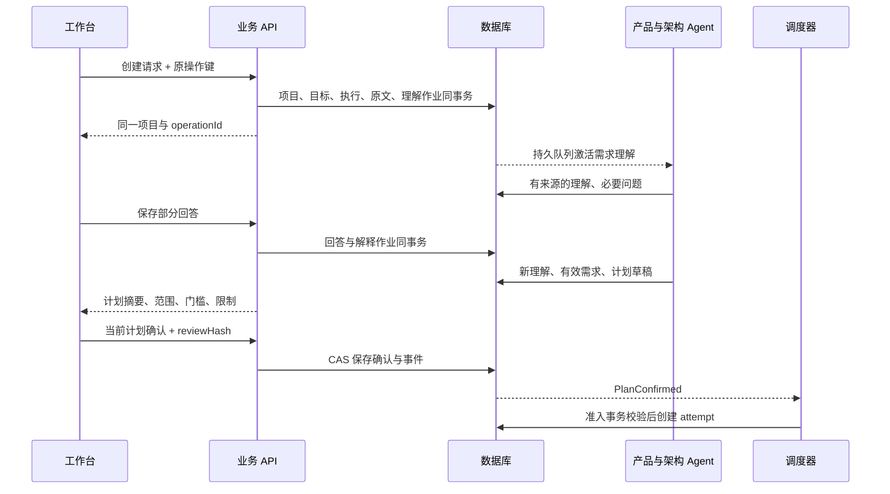

# 03 API 契约与工作台交互

适用版本：V1.1。业务与维护 API 路径以 `/api/v1` 为前缀；§8 单独列出的对外 A2A／Card 路由使用完整根路径。以下是首版业务契约，编码时转成 OpenAPI 与 Zod schema；不宣称已有服务可调用。A2A 协议请求不套用业务 REST 的响应 envelope。

## 1. 命令通用契约

客户端对每次用户动作生成 UUID `Idempotency-Key`，先存本地操作记录再发送；重发沿用原键。服务按 `(principalId, scopeId, key)` 去重，并保存规范请求哈希。同键不同参数返回 `409 IDEMPOTENCY_KEY_REUSED`。scopeId 为项目 ID；首次创建使用用户创建命名空间。操作键在项目记录保留期内不删除；离线草稿不包含服务密钥。

修改已有版本化资源必须传 `If-Match: "r17"`，业务载荷还要带所确认的内容版本。缺失前置条件返回 428；CAS 不匹配返回 412；内容已失效返回 409。校验顺序为认证→资源权限→原操作去重查询→新操作版本／状态校验：已成功请求的重发应返回原结果，不因现在版本增加而变成失败。

项目名称 1～80 字、任务标题 1～120 字；创建时可由平台生成，不作为提交需求的前置步骤。正文和名称按 Unicode code point 计数，不使用 JavaScript UTF-16 length 误算；超限仍保留输入。

返回约定：纯查询 200；单事务创建完成 201；已持久受理但需后台处理 202；非法字段 422；资源不向该用户公开时 404；权限不足但可知资源存在时 403；资源冲突 409；限流 429。502/503 不代表操作一定没有发生，客户端先查询原键。首版 JSON 请求上限 256 KiB，附件走独立流式上传。

```json
{
  "operationId": "op_01",
  "status": "ACCEPTED",
  "resource": { "projectId": "prj_01", "runId": "run_01", "revision": 18 },
  "links": { "operation": "/api/v1/operations/op_01" }
}
```

```json
{
  "error": {
    "code": "PLAN_SUPERSEDED",
    "message": "计划已经更新，请检查第 4 版后再确认。",
    "requestId": "req_01",
    "retryable": false,
    "details": { "submittedRevision": 3, "currentRevision": 4, "changedWorkIds": ["work_03"] }
  }
}
```

`GET /operations/{id}` 返回 ACCEPTED／RUNNING／WAITING／SUCCEEDED／FAILED／OUTCOME_UNKNOWN，包含已完成阶段、缺项、最近核实时间和可用动作。`GET /operations/lookup?scopeId=...&key=...` 用于“首个响应丢失，还不知道 operationId”；它仍检查主体权限。查询结果不存在只说明当前无持久记录，客户端可用原键再次发送，不能换键创建。

## 2. 请求、校验与落库边界

| 路径与方法 | 必填业务字段 | 条件、持久效果及返回 |
| --- | --- | --- |
| POST /attachments | multipart file、clientAttachmentId | 每文件独立 operation；流式大小／UTF-8／内容校验；返回 attachmentId、READY 或 FAILED |
| POST /projects | initialRequest.text、attachmentIds、clientDraftId | 同事务建 Project、UserTask、Run、输入与理解 operation；201；初始名称可自动生成 |
| POST /projects/{id}/tasks | kind、goal、attachmentIds、baseAcceptedReleaseId | 无活动 run；起点必须匹配当前接受版本；冲突返回 ACTIVE_RUN_EXISTS 并指向该 run；新目标草稿不覆盖它 |
| GET /projects/{id}/workspace | runId 可选 | 返回单一上下文快照、eventCursor、权限和允许动作；必须区分 current／history |
| POST /runs/{id}/messages | text、attachmentIds、clientMessageId、intentHint 可选 | 消息先持久化，意图判断异步；查询／解释不产生变更应用 |
| POST /runs/{id}/questions:answer | answers[{questionId,questionRevision,value}] | 仅提交已答项；全批校验后事务保存；返回 interpretationOperationId；不自动恢复暂停 |
| POST /runs/{id}/understanding:retry | failedInterpretationOperationId | 使用已保存答案重试解释；不复制回答、不增加回答介入数 |
| POST /runs/{id}/plans/{revision}:confirm | requirementRevision、reviewHash | 仅当前可确认计划；CAS 保存确认；OPEN 时发执行事件，PAUSED 时只保存确认 |
| POST /runs/{id}/plans/{revision}:feedback | text、workIds 可选 | 原计划立即标需修订、不可再确认；反馈落库后异步规划；保留反馈草稿 |
| POST /runs/{id}/changes | proposedText、sourceMessageId | 创建 proposal 和分析作业，不修改有效需求 |
| POST /changes/{id}:decide | action=confirm/reject、analysisId、basisHash | 串行队列、依据有效；confirm 202 并进入冻结／应用，reject 200 保留原范围 |
| POST /conflicts/{id}:decide | optionRevision、basisHash、optionId 或 rejectAllReason | 同 basis 只能一项有效决定；保存后应用与复验单独跟踪 |
| POST /runs/{id}:pause | reason 可选 | 关闭准入、epoch 递增、保存停止目标；202 返回 controlOperationId |
| POST /runs/{id}:resume | controlRevision、recoveryReviewHash | 必须已暂停且核实完成；通过时重新开放；否则 409 返回缺失材料或未知作业 |
| POST /runs/{id}:cancel | impactReviewHash | 影响摘要有效；进入不可撤销取消流程；202 |
| POST /works/{id}:retry | runId、failedAttemptId、retryReviewHash | 失败明确、无未知写入、输入有效、预算许可；新 attempt；暂停时只登记待恢复重试意图 |
| GET /runs/{id}/redo-review | 无 | 返回最新确认需求、原始代码起点、全部重做范围、阻塞条件和 reviewHash |
| POST /runs/{id}:redo | redoReviewHash | 绑定整个 UserTask；安全停止后创建关联 run；202；重复提交查询同一 redo operation |
| GET /runs/{id}/delivery-review | candidateId | 返回逐需求检查、证据、数据方案、接受条件和 reviewHash |
| POST /candidates/{id}/manual-checks | checkId、checkRevision、result、note、evidenceRefs | 人工结论独立保存；只能记录适用候选的检查，不改自动报告 |
| POST /candidates/{id}:return | requirementId、problem、evidenceRefs | 原范围缺陷走修复；新增目标先生成变更提案；允许用户纠正分类 |
| POST /candidates/{id}:accept | runId、candidateRevision、manifestHash、reviewHash、dataPlanHash、expectedAcceptedReleaseId、preparationOperationId／requestHash、expectedPreparationRevision／expectedObservationSequence、proofHash、confirmation=ACCEPT_RELEASE | 独立准备完成后实际复核冻结材料字节并执行T5；202的SUCCEEDED回执固定ACCEPTED及当时PENDING，发布另查；原键正文恢复先于新版本／配置检查 |
| POST /previews/{id}:stop | previewRevision、impactReviewHash | 只停止该预览，202 跟踪真实退出；不删除代码、记录或其他实例 |
| GET /runs/{id}/previews/{previewId} | 无 | 当前成员只读查询；明确未配置／恢复中／到期状态，不返回 Runner 端点或身份凭据 |
| GET /runs/{id}/previews/{previewId}/view | 无 | 只读预览入口；受限 iframe，GET 不签发票据或接受版本 |
| POST /runs/{id}/previews/{previewId}/access | 空 JSON；准确平台 Origin | 从可信身份签发一次性预览 ticket；不接受客户端 principal 或任意目标 URL |
| GET /runs/{id}/candidates/{candidateId}/materials/{key}/download | 无 | 解析原冻结交付材料，经权限及内容复核后以 attachment 下载；不执行 HTML、不接受或重新生成 |
| POST /artifacts/{id}/exports | format、includeRefs | 独立打包 operation；失败只重试打包，不回滚接受 |
| POST /exports/{id}/download-access | 无 | 重新鉴权签发短期下载凭据；原包哈希不变、不重做研发 |
| POST /runs/{id}/replay-exports | cutoffEventSeq、includeArtifacts | 固定截止快照；可导出执行中快照，明确 incomplete |
| POST /replay-imports | uploadId | 隔离校验与登记；返回 replayId；没有运行控制能力 |
| GET /replays/{id} | cursor／filter | 只读投影，无原项目权限的资料不暴露在线地址 |
| GET /runs/{id}/configuration | 无 | 返回当时配置快照、来源、限额；敏感值不回显 |
| POST /runs/{id}/budget-adjustments | expectedBudgetRevision、newLimit、reason、reviewHash | 作为配置调整的受限入口；先暂停、审查影响并确认；保存后仍暂停；不能降低统一质量门槛 |

长表中的 `reviewHash` 均由服务端对“对象 ID、有效版本、动作及影响摘要”计算并返回。它只用于绑定审查内容，不是授权令牌；权限仍由当前身份检查。

## 3. 从输入到开始执行的完整顺序



需求理解与规划本身是受预算和控制门约束的准备工作，不要求先确认尚未生成的实施计划；只有只读资料访问和保存分析成果权限。仓库实施、依赖安装及执行生成代码必须等实施计划确认。这样避免“所有 Agent 都要先有计划，计划又需 Agent 才能产生”的循环依赖。

输入意图保存 `classification={kind,confidence,source,basis}`。无法确定是查询还是变更时先要求说明；即使判为变更也只产生提案。已应用的误分类通过后续更正变更处理，不删除原生效记录。

## 4. 事件与重连

平台浏览器订阅使用 `/events` WebSocket，A2A SSE 是独立连接。事件字段如下；浏览器不得根据自由文本推断状态。

```json
{
  "schemaVersion": 1,
  "eventId": "evt_1042",
  "projectId": "prj_01",
  "runId": "run_01",
  "seq": 1042,
  "type": "AttemptStateChanged",
  "occurredAt": "2026-11-10T08:00:00.000Z",
  "observedAt": "2026-11-10T08:00:00.120Z",
  "timeSource": "producer",
  "resourceRevision": 18,
  "requirementRevision": 4,
  "planRevision": 6,
  "operationId": "op_01",
  "payload": { "attemptId": "attempt_01", "state": "VERIFYING" }
}
```

1. workspace 快照在同一个数据库读事务中返回投影与最后 `seq`。
2. WebSocket 订阅 `(runId, afterSeq)`；服务先注册有界实时缓冲，再读取历史补发，合并缓冲并按 seq 去重，避免“查完历史才订阅”的缺口。
3. 客户端仅按连续 seq 推进游标；重复丢弃，缺口先补查。慢客户端队列超过配置容量时发 resync-required 并断开，不能无限积压。
4. 权限变化、项目切换或断线后重新鉴权；游标不授予访问权。历史已归档则返回新快照与保留边界，不能把缺失事件伪装成完整回放。

模型 token 增量只作临时显示，不为每个 token 分配持久领域 seq；最终消息、工具动作、控制与决定必须持久化。断线后可恢复最终消息，未保存片段显示中断；不会用片段驱动工具。持久事件与 UI 临时增量使用不同消息类型。

occurredAt 是生产者提供的发生时间，observedAt 是平台接收并登记的时间；事件排序只用 seq。生产者未提供可信时间时，occurredAt 采用观察时间并标 timeSource=observed，不伪造远端发生时间。requirementRevision／planRevision 在准备阶段允许 null；有工作归属时同时保存 workId／attemptId。序列化必填字段由事件记录或当次持久 envelope 生成，不能查询“当前 run”补上已经变化的版本。

持久事件至少包括：InputSaved、UnderstandingUpdated、QuestionAnswered、PlanPublished／Confirmed、WorkAdmitted、AttemptStateChanged、A2ATaskObserved、ToolOperationUpdated、ArtifactRegistered、ChangeApplied、DecisionSaved、ControlProgress、ConfigurationApplied、CandidateUpdated、ReleaseAccepted、PreviewStateChanged 和 ExportUpdated。每类 payload 以 type 为判别字段验证 schema，字段不兼容时增加 schemaVersion，不让消费者猜字段含义。

## 5. 前端状态归属

| 状态 | 存储与键 | 更新规则 |
| --- | --- | --- |
| 业务状态、版本、权限、允许动作 | 服务端投影；projectId/runId/resourceId | 按事件版本替换；前端不乐观显示已暂停／已接受 |
| 正文、附件状态、未提交答案 | IndexedDB；userId/projectId/runId/formId/basisRevision | 输入即增量保存；登出清理本地敏感缓存；过期草稿可参考但不自动提交 |
| 当前页签、选中工作、滚动、阅读锚点 | 每个 workspace context 独立 UI store | 业务更新不重置；返回历史前保存当前位置 |
| 提交中的键与结果查询 | IndexedDB operation journal | 刷新后先核实原操作；明确完成才清除 pending 标记 |
| 回放播放位置／速度 | replayId 专用 store | 不与真实执行 pause、resume 共用命令 |

三栏共享 `WorkspaceContext={projectId,runId,mode:live|history|imported,replayId?}`。切换先取消旧读请求和订阅；迟到响应校验 contextToken，不能写到新项目。历史与导入模式从依赖注入层不提供 CommandClient，按钮隐藏只是第二层。

会话正文和附件的服务端索引／内容提交成功后才标“已保存”；本机 IndexedDB 中未提交草稿显示为草稿。重开页面从对应 run 的已提交消息和事件续读，不能读取服务器某个 JSONL 文件来猜当前状态。服务器文件、会话导出和 Runner 日志通过授权记录 ID 访问，API 不暴露任意宿主绝对路径；底层目录约定见 [D5 §7](./05_数据与事务.md#7-本地会话与文件存储布局)。

右侧固定五页签：**任务、协作、成果、预览、记录**。理解、计划、变更、冲突、收尾位于“任务”；配置与工具连接信息位于“协作”。从计划到工作到来源使用同一面板的内部导航栈，不连续打开多层抽屉。新事件只增加提示和未读数量；用户已在底部且未选择文字时才跟随消息滚动。

提交键处理：多行 Enter 换行，Ctrl+Enter（macOS 可映射 Cmd+Enter）或提交按钮发送；IME composition 期间 Enter/Ctrl+Enter 均不发送，并去除重复键事件。键盘可遍历关键待办与控制。关闭修改表单优先保存草稿；若 IndexedDB 保存失败，切项目／离开必须拦截并提供重试、继续编辑或明确放弃，不能静默丢失。非空输入应用示例先确认是否替换，示例只填文本不提交。

窄屏按左侧导航抽屉、中栏主区域、右侧全宽详情切换，顶部当前执行与待办入口常驻。取消／停止预览等确认框在真正提交前关闭不产生操作；提交受理后关闭进度面板不撤销后台作业。冲突推荐无默认选中项，“拒绝全部”必须有非空理由。不完整导入包先显示完整性说明，用户明确选择有效片段后才进入只读回放。

## 6. 状态反馈与权限

空列表、过滤无结果、加载失败、无权限、历史只读、后台待核实分别显示，不复用“暂无数据”。进度只显示真实工作数／事件时间；没有可靠估计展示未知，不能用时间流逝生成进度条。

首版使用组织 OIDC 登录、服务端 Session、HttpOnly/Secure/SameSite Cookie；开发环境可启用明确标识的本地测试身份，部署模式不得开放匿名项目写入。Cookie 写请求校验 CSRF 和 Origin；WebSocket 升级校验同源及 Session。OIDC 不可用时已存在只读会话依有效期处理，不能自动降级为管理员。

项目权限最小集合：viewer 查看授权成果；operator 提交、控制、决定、接受；owner 管理成员与项目保留配置。platform-maintainer 管理模型／MCP／Runner 连接，但不能仅因维护权限接受他人项目。每次 API、事件订阅、下载、预览入口都校验项目授权。首版是否映射企业现有角色由部署配置决定，但权限矩阵不能省略。

凭据存在部署密钥存储，业务记录只保留 credentialRef 和配置指纹。调试日志先去敏再写入；项目正文、附件和工具结果视为资料，不授予扩大权限的能力。下载响应禁止执行 HTML；Markdown 不解析原始 HTML，不允许 `javascript:` 链接。

## 7. 配置查看、连接检查与当前执行调整

### 7.1 三类配置与五种连接状态

`DeploymentDefaults` 是当前部署默认值；`RunConfigurationRevision` 是某 run 在一个生效区间使用的完整配置；`RoleSnapshot` 是具体 attempt 实际使用的角色配置。普通部署更新只影响以后创建的执行；当前 run 仅在显式调整应用成功后新增配置 revision，已有 attempt 和历史不回写。

配置视图分基础条件、执行限制、角色专业信息，包含模板、模型、A2A、MCP、工具范围、Prompt、并发、次数、时间与各类保留日期。打开当前部署比较视图只比较差异，不替换当次展示值。敏感项显示 configured/credentialRef，永不回显秘密。

| 连接展示状态 | 来源与可用范围 |
| --- | --- |
| 未配置 | 必要地址、认证引用或能力声明缺失；列出具体项 |
| 检查中 | 有 checkOperationId 和检查阶段；不覆盖最近一次结果事实 |
| 可用 | 最新检查通过并展示 checkedAt；不代表本 run 已实际调用 |
| 部分可用 | 能力列表中部分通过；只有通过且仍适用的能力可准入 |
| 不可用 | 必要检查失败、过期需重查或原能力不再兼容；阻塞消费者 |

EndpointCheck 保存配置 revision、能力／工具 schema 哈希、checkedAt、结果与原因。健康检查和实际调用记录分开。重新检查只做身份／能力发现等批准的只读动作；需要付费模型探测或实际副作用的验证使用明确的维护测试作业，不在打开配置页面时自动执行。

### 7.2 当前执行调整的状态与事务

调整对象限制为角色模型／Prompt、已批准的 A2A 端点版本和工具连接、并发／次数／时间和保留设置；模板或业务约束改变同时走需求／计划影响流程，不能借配置入口绕过范围确认。

1. 操作者提交明确的调整请求，说明对象和目标值。平台创建 adjustmentId；“暂停并分析调整”动作进入现有暂停流程。询问解释、查看比较或保存草稿不会暂停或改配置。
2. 安全暂停完成后，分析新旧差异、受影响工作、可保留成果和是否需要重新验证。维护员负责平台连接／资源的可用性配置；项目操作者负责是否将变化应用到本 run。二者权限不能互相替代。
3. 检查部署新配置与工具 schema、模型能力和配额。新限额不能低于已消耗量，不能抹除重试／修复历史；不能下调统一质量门槛或扩大为未授权工具。
4. 确认绑定 `basisConfigRevision + analysisId + diffHash + controlRevision`。重新检查仍为 PAUSED、没有未知写入、依据和维护校验仍有效。
5. 短事务新增不可变配置快照与 RunConfigurationRevision，更新有效绑定、预算 revision 和受影响 workEpoch，登记成果 held／复验要求，写 ConfigurationApplied 与操作结果。失败保留旧绑定；外部连接检查不在事务中进行。
6. 应用成功后仍 PAUSED；用户恢复时再核实必要条件。新 attempt 使用新配置，旧 attempt 保留原快照；已结束会话不伪装成使用新模型继续。

调整状态为 PROPOSED／WAITING_PAUSE／ANALYZING／WAITING_MAINTENANCE／REVIEW／APPLYING／APPLIED／REJECTED／FAILED。重复确认查原 operation；分析后配置或执行条件变化返回 CONFIG_BASIS_CHANGED，不自动套用旧确认。单纯修复同一连接的凭据且未改 endpoint／能力时登记维护审计与健康结果，不能顺带替换模型、Prompt 或工具权限。

### 7.3 补充接口

| 路径与方法 | 关键字段 | 行为 |
| --- | --- | --- |
| GET /runs/{id}/configuration?compare=deployment | 无 | 返回当次、历史 revision 与脱敏部署差异，保留配置页面位置 |
| POST /runs/{id}/configuration-exports | configRevision、format | 导出指定当次值与 Prompt；不读取当前默认值拼装历史 |
| GET /connections/{id}/status | runId | 返回授权可见的能力状态、检查时间、受影响工作 |
| POST /connections/{id}/checks | expectedConnectionRevision | 有维护权限；只读检查也记 operation，重复键复用 |
| POST /runs/{id}/configuration-adjustments | requestedChanges、reason、pauseReviewHash | 有执行控制权限；暂停并建立调整分析；202 |
| GET /configuration-adjustments/{id} | 无 | 返回阶段、差异、影响、维护缺项和允许操作 |
| POST /configuration-adjustments/{id}:confirm | basisConfigRevision、analysisId、diffHash、controlRevision | 新依据全部有效才受理；202；应用后仍暂停 |
| POST /configuration-adjustments/{id}:reject | basisConfigRevision、reason 可选 | 保留原配置与暂停状态；不隐含恢复 |

以上接口沿用本章幂等键、项目鉴权和 If-Match；维护员对部署的操作不能凭维护权限确认项目调整。保留期限缩短涉及已保存材料时必须展示将到期的范围和日期；确认配置变化不会在同一请求里静默删除历史文件。

### 7.4 内部注册表的可见性

连接详情返回 endpointId/revision、manifestRevision、activeGeneration、cardHash、生命周期、健康检查时间与过期时间，并区分“部署默认绑定”和“本 run 固定绑定”。维护诊断还返回数据库 projectionRevision、内存投影版本、同步状态和最近同步错误，不能只显示进程存活就认为注册已生效。平台维护员可查看脱敏的部署登记；项目操作者仅查看本项目使用的连接与影响。检查接口只刷新健康事实，不注册新端点、不把新 Card 的技能自动加入授权。

首版内部端点地址和实现通过受控部署清单启动协调，不提供开放的 `registerAgent(url)`。端点 DRAINING 停用与项目配置应用分别审计；旧绑定不能继续派新工作，查询／停止已有任务仍按原记录进行。注册启动、代际切换和恢复见 [D2 §5.1](./02_Agent与协议详细设计.md#51-拓扑)。

## 8. 对外 A2A 接入与发布管理

外部 Agent 使用服务身份的 OAuth 2.0 client credentials 与短期 Bearer token；浏览器继续使用 §6 的 OIDC Session。服务端校验 issuer、audience、有效期、scope、主体授权及 Task 归属，不能把服务 token 当作某个人的 Session。初版服务 scope 为 `devmesh.group.invoke`、`devmesh.agent.invoke`、`devmesh.task.read`、`devmesh.task.cancel`；具体项目／输入范围来自 service_grants，scope 本身不授予任意项目访问。调用接入包须说明各操作所需 scope；Card 中声明调用入口所需条件。

| 入口 | 认证与行为 |
| --- | --- |
| GET `/.well-known/agent-card.json` | 返回已发布的默认 Exposure Card；无默认发布时 404；按部署策略公开或保护 |
| GET `/agents/{agentKey}/agent-card.json`、`/groups/{groupKey}/agent-card.json` | 返回指定已发布 Card；检查公开范围，不包含内部地址 |
| GET `/catalog/agents` | DevMesh 自定义目录，按主体、skill、类型分页；只返回可见已发布项，默认需要服务认证 |
| POST `/a2a/agents/{agentKey}`、`/a2a/groups/{groupKey}` | 标准 JSON-RPC／SSE；SendMessage 等操作使用 A2A schema，不返回 `/api/v1` 的 operation envelope |

业务载荷和完整请求样例见 [D2 §8](./02_Agent与协议详细设计.md#8-对外发现单-agent-与-agent-组服务)。标准协议错误通过锁定 SDK 的错误类型返回，认证失败使用相应 HTTP／协议机制；项目冲突、预算不足、缺少资料等业务原因放在约定的结构化错误详情／Task 消息。不得自创 A2A 方法来替代查询、取消和补充消息。

维护接口以下仍以 `/api/v1` 为前缀，由维护员管理对外 Exposure；service_grants 的项目授权还需要项目 owner 批准，维护员不能单方取得他人项目调用权。

| 路径与方法 | 关键字段 | 行为 |
| --- | --- | --- |
| POST /agent-exposures | kind、publicKey、agentKey/groupKey、definitionRevision、skills、visibility、authPolicy、quotaPolicy | 建立 DRAFT；publicKey 是稳定对外路径，目标只引用受控登记的定义与端点 |
| PATCH /agent-exposures/{id} | 草稿变更、basisRevision | 修改草稿，撤销旧校验结果；已发布版本内容不可改写 |
| POST /agent-exposures/{id}/validations | draftRevision | 检查 Card、技能、权限、固定目标及部署可达性；202，记录 validationHash |
| POST /agent-exposures/{id}:publish | draftRevision、validationHash、expectedPublishedRevision | 复核依据，事务切换已发布版本、Card 与路由；旧 Task 仍引用旧版本 |
| POST /agent-exposures/{id}:drain | expectedPublishedRevision、reason | 禁止新委托并撤下目录项；保留已有 Task 查询／取消，不强杀任务 |
| GET /agent-exposures/{id}/status | 无 | 返回版本、校验、在途数、下线阶段与目录同步结果 |

所有维护变更都记录 Idempotency-Key、资源 If-Match 和审计；外部 A2A 消息则采用 D2 定义的 clientRequestId／messageId 去重，不能让客户端误以为 JSON-RPC id 能保证幂等。发布回执仅代表本地 Card／路由事务生效；企业目录同步走 Outbox，失败单独可见且可重试，不伪称第三方已收录。

任务等待人类确认时返回受保护的 reviewUrl 与 requiredAction，由授权人员在 DevMesh 操作；URL 不包含访问令牌，不因外部消息里出现“同意”就代替确认。外部服务撤权后不能继续接收新执行／新资料，停止由维护控制流程兜底；已打开 SSE 也按授权变更终止，不能靠长连接保留过期权限。

### 撤销完成与原请求恢复

撤销决定受理后显示ABORTING；服务清理或数据回执单独完成均不改变该结论。只有原后端提交全套核实证明并成功提交控制事务后才显示ABORTED，用户可以重新准备候选。原始SENT／UNKNOWN及错误仍可追溯；重复完成返回准确原结果，不重复事件。源仍有DISPATCHED／UNKNOWN写请求、健康过期或旧服务归属未核实时继续展示待核实，不能以超时清除。

### Release 独立访问入口（2026-11-13 开发增量）

已增加 GET /api/v1/runs/:runId/releases/:releaseId、GET /view 和 POST /access 的显式组件。当前成员可读查询，GET 不签票据；仅当前接受指针对应的 PUBLISHED 原路由、准确 Runner 实例、当前 guard／fences 和实际 HTTP 健康均核实后 AVAILABLE。未配置为 NOT_CONFIGURED，未发布或事实不确定为 RECOVERING，历史版本为 NOT_CURRENT，不隐式回退。POST 要求空 JSON、平台准确 Origin 和当前成员身份。

独立 RELEASE 用途，dmr_ticket／dmr_session 与 __Host-devmesh-release Cookie；票据最长60秒、会话最长5分钟，哈希持久化，原子兑换，撤权即时检查。r-<摘要> 主机与预览 p- 主机分开。页面先 POST 领票、跨站兑换、GET 核实 Cookie，再加载受限 iframe；仅业务网关收到应用凭据，平台身份不透传。Viewer 只读；每项写与业务响应再次核实当前权限和原门。默认平台／物理适配器未启用，详见 packages/preview-gateway/RELEASE.md。

### 已接受版本交付入口（2026-11-13 开发增量）

GET /api/v1/releases/:releaseId/exports/view 提供独立 React 18 交付页，原 Release /view 链接到该页；历史已接受版本同样可导出。页面展示原接受时间、准确源码 SHA、当前／历史标识、作业状态及校验信息。GET 只读取原事实，不创建或重试。固定 client.js 也要求当前成员，使用本地 tsdown 浏览器构建、完整第三方许可证和 nonce CSP，不加载 CDN。完整工作台仍按 P1-04 的 React／Vite 选型实施。

创建只由按钮 POST 触发：先在当前标签 sessionStorage 保存每个 Release 的 UUID 原键，再提交；结果丢失或刷新后显示“核实创建请求”，仅用户点击才以原键核实，不在加载／轮询中自动 POST。不能保存原键时拒绝新建。成功后显示固定原任务；分页每页20条，以稳定游标前后翻页，当前创建任务另行固定展示。只有 QUEUED／PACKING 可见任务每2秒 GET 核实，后台标签暂停，单页单在途请求并有15秒合作取消；关闭页面取消在途请求，BFCache 恢复重新加载以鉴权。

canRetry 由服务端基于原创建者、当前成员及 FAILED／过期 PACKING 计算；客户端不推断所有者。重试发送原 generation，下载仅对 READY 原归档提供链接。状态无法核实时隐藏下载并关闭创建／重试，刷新可恢复；401／403／404清除作业并要求重新进入。Bootstrap JSON 转义 HTML 特殊字符，错误只映射固定用户文案。此入口未配置企业身份；实际宿主须注入可信 IdentityResolver，浏览器夹具不是登录实现。

### 候选逐项人工审查入口（2026-11-13 开发增量）

预览页链接到 GET /api/v1/runs/:runId/candidates/:candidateId/review/view，独立 React 页面展示准确源码SHA、候选资格、原自动检查、完整必要人工项和Run内当前退回。人工项每组20条，记录实际操作／预期／观察／证据和明确PASS／FAIL；预期来自原冻结条目，只读显示。退回明确区分原范围缺陷与新增范围，原范围须关联条目；纠正及有理由撤回都追加历史，不自动实施修复／变更。

同级 GET /review 返回公共投影与Run ETag；POST /review/results、/review/rejections 使用原UUID Idempotency-Key、Run If-Match和当前记录 previousResultId，原成功回执恢复先于新操作版本检查，仍复核当前owner。GET /review/history、/review/rejections/history 按条目／退回ID及 afterSequence 读取，默认20／最多100；/view 与 /client.js 也检查当前成员。不存在或不可见的对象统一404，其余陈旧审查以明确冲突返回；不暴露后端目录／策略或写入能力。该审查入口本身不触发接受；接受入口按下文单独的两阶段契约及可信装配执行。

服务端 canRecord 只对当前有效候选和可交互REVIEW的owner开放；canWithdrawRejections允许相同Run尚可交互的owner有理由撤回历史候选退回，历史不能新批准。该能力不参与reviewHash，也不改变原自动质量。仅审查全部通过且没有OPEN退回时显示“逐项审查已完成”；版本仍须独立准备和T5接受。

页面每个Run／当前标签最多一份待核实提交，先把原payload／UUID／If-Match写入sessionStorage，再POST；刷新后只由用户点击核实原请求，不自动改正文、换键或重发。无法存储或旧记录无法读取时关闭新提交，核对后可显式清除损坏的填写记录；服务端明确拒绝时，用户须刷新核对再决定放弃本次填写。失联关闭新提交，撤权清除审查／历史并关闭动作。单在途、15秒合作取消、离开取消，BFCache恢复重载鉴权。JSON转义、nonce CSP、React惰性文本与固定本地资产共同保护用户观察及错误元数据。

### 准确接受准备与T5私有入口（2026-11-13 开发增量）

GET /runs/:runId/candidates/:candidateId/acceptance 返回准确SHA、candidateRevision、manifest／review／dataPlan hash、原方案与当前接受指针、Run ETag、显式策略是否匹配、owner能力、替换确认及项目未决准备阻塞。GET /acceptance/preparations 默认20／最多100条原行序号游标；GET /acceptance/preparations/:operationId 返回原意图、当前resolution和readiness摘要。读取不驱动外部准备或刷新健康，能力投影只是当前观察，实际命令仍独立鉴权及CAS。

POST /acceptance/preparations 保存原意图；/replacement-confirmations 独立确认准确REPLACE；/preparations/:operationId/close-unsent 仅关闭从未派发；/preparations/:operationId/abort 记录有理由撤销决定。统一标准UUID及Run If-Match，原成功重放仍核实当前owner及原正文。撤销回执decisionState=RECORDED，不声明清理完成。已派发UNKNOWN不通过新意图、超时或普通关闭替代。

POST /candidates/:candidateId:accept 使用本节表格的完整两阶段正文，经ReleaseAcceptor实际读取全部冻结材料并校验SHA后才调用T5；客户端不能提交proof正文、端点／路径／后端身份或任意目标dataset。成功回执有原operationId和固定accepted结果，links.preparation指向当前成员可读的准确原准备URL；其当时PENDING不是当前发布状态。准备及撤销操作不冒充现有InputOperation，后者只查询其本来登记的输入类操作。原接受回执未知时以原UUID／正文核实，不发新键。

可信宿主通过startPlatform的acceptancePolicies提供projectId→已登记policyHash快照，Input API由宿主装配既有ReleaseAcceptor；默认不配置。DB中的策略须匹配冻结模板／数据方案；客户端不得选择未在宿主快照启用的策略。缺配置关闭新准备／接受，但成员读取原状态、owner核实已提交原请求及请求适用清理不依赖重启新后端。此入口不自动登记策略、派发准备或提供公共后端回执端点；真实准备／恢复器仍须可信装配。投影不返回原storageKey、Runner端点／主体、原prepared proof／claim或物理围栏细节。

### 两阶段接受的私有React页面（2026-11-13 开发增量）

候选审查可进入 /runs/:runId/candidates/:candidateId/acceptance/view；同级client.js只对当前成员返回本地React脚本，页面及脚本复用Input API身份、Host／Origin、无Cookie认证和no-store边界。nonce CSP禁止frame、对象、任意外部脚本与原生表单提交，固定接受依据以转义JSON引导；没有默认登录或公开入口。

页面展示准确SHA、candidate／manifest／review／dataPlan摘要、冻结／当前接受指针，INITIAL空／演示、PRESERVE_MIGRATE原迁移材料和REPLACE来源及初始数据均保持候选固定。REPLACE有独立确认，创建准备与最终接受分别勾选确认；刷新、切换原准备或失败会清除确认，避免将旧同意套用新观察。未配置、未审查、来源变化、项目未知操作及就绪缺失分别由服务端能力关闭；查询不驱动后端或刷新健康。

准备历史使用20项原游标，明确区分尚未派发、已派发、UNKNOWN和当前就绪／过期。未派发关闭与有理由撤销各自确认；ABORTING只表示决定已记录，仍显示清理待核实，不能呈现ABORTED。最终接受固定所选原准备revision、requestHash、原观察sequence／proofHash及其接受依据，不用当前候选摘要替换历史准备。成功显示原接受回执；当时PENDING与已接受版本页面的当前发布状态分开，可进入独立导出。

每Run／标签页在POST前保存原请求种类、正文、UUID及If-Match。准备、替换、关闭、撤销和接受均使用原请求显式核实，重新加载不自动POST；未知结果保留原记录，新动作关闭。明确拒绝后也须成功刷新并由用户决定才丢弃本次填写；损坏或不可写会话存储关闭新提交。当前成员撤权／降权发现后清空受保护内容并关闭操作；请求串行、超时有界、离页取消，BFCache恢复重新加载。

此页面是私有接受入口，可信准备后端advance／恢复消费仍另行装配，未配置时保持关闭。真实企业登录、完整React／Vite工作台、正向后继保留／替换业务链与物理容器验收继续单独完成。

原准备列表通过有界私有Worker请求，在同一次同步事务内读取准确候选／审查依据、全部原准备与readiness；相同原主体、候选版本、审查、数据方案、Run epoch和来源绑定的有效性只在本页事务内复用，不跨请求缓存。各条resolution、proof与当前健康仍独立投影，响应前再次复核成员；不会逐条往返Worker。公开能力属于读取时观察，不能替代写入时的当前owner、原正文／版本／观察校验；GET不更新健康或派发。

### 可信接受准备后台消费（2026-11-13 开发增量）

startPlatform可通过可信acceptancePreparation工厂显式装配接受准备消费者；没有工厂不扫描或派发。要求Input API、持久存储和acceptancePolicies启动快照；工厂绑定的project／policyHash须匹配该快照，并通过私有Worker读取核实已登记策略的backendPrincipalId／backendRef／runnerId。重复项目、禁用后端或无效限制拒绝启动，失败释放服务。后端实例不能从HTTP／MCP／普通JSON配置注入，不安装默认物理适配器。

私有未决工作查询排除FAILED、ABORTING／ABORTED和COMMITTED；历史不占消费页。最多32个显式项目、跨项目最多2个并行后端调用、每项目串行，有界范围／页预算和轮转游标；并发tick合并。PREPARED仍经preflight及writer一次性许可，SENT／UNKNOWN只查询原对象；周期独立核实当前健康，不改变不可变proof，GET不刷新。异常记录受限错误码并按轮询重试，不自动接受、发布或清理。

停机同步停止新扫描和派发授权，preflight之后及后端最终授权回调复核停止标志；已经开始的调用真实排空后才关闭Worker。后端接口没有强制取消，不能以超时竞赛假装调用结束或释放名额；实际适配器需自行提供有界I/O。此显式宿主能力不代表CLI默认安装真实Runner，登录／真实Linux与物理围栏／完整工作台仍另行验收。

### 可信已接受发布后台消费（2026-11-13 开发增量）

startPlatform通过显式releasePublication可信工厂安装原发布消费者，绑定projectId／policyHash／principalId／backendRef／runnerId和后端实例；默认无发布器。要求持久存储与DB已登记原接受策略完全匹配，不要求新接受入口或Input API仍启用，允许关闭新接受后恢复原已接受版本。所有绑定校验和后续宿主组合成功后才启动消费，配置错误拒绝启动并释放资源；外部适配器资源由构造者管理。

私有工作页只返回当前accepted_release_id的PENDING／SENT／UNKNOWN；已发布与被取代历史不占工作页，原历史接口保留。最多32项目、每项目唯一绑定、跨项目最多2并发、范围／页预算、轮转与tick合并。原PENDING经一次许可publish，SENT／UNKNOWN先inspect，仅在原continuation授权成立且后端提供resume时续接原Runner日志；未知已派发阶段只查询，未派发下一阶段仍经独立许可。不得重建Release／T5或重做数据迁移；缺后端／充分事实保持UNKNOWN。失败保留接受事实及关闭的目标写门，完整发布证明仍由writer原子核实并开门。

停机同步关闭新扫描、publish／resume最终授权；preflight后再次复核，实际调用排空后关闭存储。后端无强制取消，由实际适配器保证有界I/O；PUBLISHED不作为工作周期改写或延长健康。该宿主增量不代表默认CLI已安装物理Provider，也不替代真实容器、围栏、后继业务链或产品验收。

### 可信撤销后台消费（2026-11-13 开发增量）

startPlatform的acceptanceAbort可信工厂固定project／policyHash／主体／backendRef／Runner及原后端，启动核实DB策略，所有后续组合成功才开始扫描。仅要求持久存储；新接受入口关闭或原owner撤权后，已确认撤销仍由原后端恢复。默认不安装物理清理器。私有工作页只取存在原撤销决定但无completion的准备，原历史保留；最多32项目、每项目串行、最多2并发及范围／页预算、轮转、tick合并。

RunnerAcceptanceAbortCoordinator核实清理器与finalizer的Runner／controller／主体／backendRef一致，按原服务清理→数据永久撤权与原源恢复→控制面完成串联。未知已派发阶段只查原对象，不能重建准备、替用户撤销或删除dataset。完成仍由原writer核实准确proof、目标闭门、适用原源归属与新鲜健康／未知写屏障；缺证据保持ABORTING。

停止同步中止信号，原清理阶段许可前后、driver最终授权、数据Worker授权与进入后续finalizer步骤检查停止。数据Worker超时／退出后，父进程仍排空其未返回的authority RPC，之后才结束advance、释放名额或关闭存储。适配器无强制取消，须自行有界I/O；真实物理Driver／fence／源恢复与后继业务链继续单独验收。

### 原预览生命周期后台消费

startPlatform显式previewLifecycle工厂提供固定项目／策略／service主体／backendRef／Runner和PreviewExecutionBackend，启动按DB原策略核实，全部后续宿主组合成功后才扫描；默认无后端，持久存储必需，Input API／网关／身份单独装配。只恢复已登记原预览，不自动创建dataset或owner决定，不自动接受／发布。原一次启动／停止、SENT／UNKNOWN只查询、周期健康保持原receipt、确定键到期停止和Release归属保护沿用原内核。最多32项目、跨项目2并发、单项目串行、有界轮转／页预算和tick合并；stop同步关闭扫描及最终授权，预检后复核，实际调用排空后才关闭存储。

可信宿主可显式配置 `previewDatasets(services)`，核实DB原策略／项目／服务主体／backendRef／Runner，默认关闭且不依赖新入口、模型或身份。专用私有工作页只扫描已有DATASET_PREPARE未决操作，有限页／范围轮转、项目串行及最多2项目并发；原SENT／UNKNOWN只查、不重做初始化。不创建owner决定、预览或接受。准备器预检后复核停止，实际文件Worker建原日志前请求当前owner／候选／源与停机授权；超时关闭线程及迟到授权但等待已开始的父RPC排空后交还名额，宿主最后关闭存储。直接可信后端的可选授权保持兼容，宿主与准备器始终提供授权。

准确候选预览管理私有API新增workspace、dataset／preview详情与明确owner创建／停止意图。可信previewPolicies启动快照选择原策略供新数据／启动使用，默认关闭，不等于后端健康；既有历史与原键恢复保留。writer一次成员投影，数据／预览各1～20项独立游标，排除内部路径／Runner／实例／proof；创建沿用Run强If-Match和UUID，停止独立STOP_PREVIEW／原预览版本与impact hash、只USER并保护Release归属。GET不派发／刷新健康／接受。React管理页继续下一增量。

### 准确候选预览管理页面增量

preview-management/view和client.js为受保护成员入口；逐项审查提供管理链接。nonce CSP／转义初始JSON，GET不准备、派发、停止、签票据或接受。React显示固定候选、INITIAL或已接受来源隔离方案、数据／预览原记录和各10项独立游标；跨页保留选中原记录。数据准备、启动和原服务停止各自确认，刷新／切换／错误清除确认。启动有效期由UI选2～1440分钟，保存绝对expiresAt后再提交；服务端仍校验首次60秒～24小时，避免一分钟输入在网络传输后必低于服务端最小值。

每Run sessionStorage先保存严格原UUID／候选／完整正文及创建Run If-Match或停止原preview版本／impact hash，随后才POST；刷新／重进不重发，仅显式核实原提交。未知结果保留并禁止新提交，条件拒绝须刷新成功后再明确放弃；损坏／不可用存储关闭新操作。权限撤销清空受保护UI，pagehide取消请求、bfcache恢复重载。新创建默认关闭时保留历史及原停止／恢复。REPLACE接受计划在此仍使用来源隔离快照，替换确认留在接受入口。

### 后继数据方案与替换确认顺序

REPLACE交付是方案收集，先固定原作业输出与当前sourceReleaseId，再冻结候选并逐项审查。交付／冻结不要求尚未能够绑定候选的通用CHANGE批准，也不授权替换。接受页已有独立replacement-confirmations命令绑定准确候选／manifestHash／reviewHash／原接受指针／dataPlanHash／decisionId及owner、UUID、Run If-Match；确认后才允许准备。审查改变使旧确认失效。保留迁移的准确artifact与INITIAL来源限制保持；实际执行／T5／发布仍分离。

### 替换确认的追加历史

冻结方案的replacementDecisionId保持不变，首次确认保存为不可变锚点；审查变化后再次明确确认，使用新原UUID和当前Run If-Match，向acceptance_data_confirmations追加当前reviewHash的记录。旧确认仍可按原键恢复原回执，但不能授权新审查。同一owner以最新Run条件重复当前已确认审查时，新键返回409 ACCEPTANCE_REPLACEMENT_ALREADY_CONFIRMED。确认和准备均核对准确候选、manifest、来源、方案、decisionId和当前owner；旧键重放仍先核实当前权限。准备查询当前审查的准确历史确认，不改写首次决定。

再次确认的并发条件：成功确认推进Run版本；并发持相同旧If-Match的另一请求返回412，最新If-Match下重复当前已确认审查的新键返回409。保持原键恢复与当前权限核实，不调整版本前置校验顺序。

冻结依据仍有效时，其他当前owner不能借用原确认，须用自己的新原UUID和当前Run条件明确确认。历史按decisionId／reviewHash／actorId去重，原操作者和首次决定保留，撤权后原键回执不可恢复。

原冻结／上游操作依赖的主体权限失效时，候选继续陈旧，其他owner的确认不能恢复它；需要先产生有效候选。本次验证多个当前owner对仍有效候选分别确认，并验证原冻结主体失去owner权限（包括仅保留operator）时不放宽既有资格检查，不宣称完整owner交接产品流程。

### 后继接受到第二次发布

第二轮T5完成后，原只读接受服务仍须退役，随后由ReleasePublisher协调准确源服务停止／容器和网络移除、原围栏递增、独立可写目标及当前路由；完整证明落入控制事务后才开放目标。路由generation递增为2，旧dataset保持CLOSED并转为RETIRED。两轮Release／acceptance commit／promotion Outbox及原T5回执保留；发布状态更新不改写原接受回执。

源清理或路由丢回执时只查询原Runner journal和reservation，检查前不得重放物理动作；控制与Runner重开仍使用原证明。源容器消失的当前证明决定旧容量释放，不能仅凭发出删除请求释放容量。最终控制提交丢ACK时恢复已提交PUBLISHED；路由事务失败保留已完成T5和双门关闭，核实原完整物理证明后继续。

同库两轮真实T5后的本地组合验证已覆盖保留／替换数据和第二次发布，实际模板HTTP写入新目标、旧业务记录保留。共用HTTP夹具按当前挂载dataset查门，路由夹具按项目维护唯一当前绑定；物理围栏／guard／容器／网络／路由仍为受控事实，不代表真实后台写入隔离、Linux或独立Release网关验收。

### 工作台本地持久输入基础

工作台受保护React入口接入独立浏览器存储模块与初始三栏／五页签。IndexedDB草稿键包含可信主体／项目／Run／表单／依据，本地revision在同一事务CAS，陈旧页不得覆盖。原命令正文／UUID／条件在事务完成前不交给发送方；commands稀疏唯一pendingForm索引跨basis锁住同一主体／项目／Run／表单，版本变化不能绕过旧未知请求。原信封只读，非成功观察保持锁，准确成功输入回执与草稿清空／新clientDraftId／释放锁同事务；旧正文保留于命令历史。

原API POST包装回执与operation lookup核心回执分别按既有严格契约解析；包装的resource／links还须与原结果和operationId一致，再保存统一核心观察。损坏草稿、错位上下文或原命令路径关闭准入。浏览器schema版本独立，versionchange关闭旧连接，旧代码拒绝较新schema且不删除原数据。此模块不自行发HTTP、不替代服务端授权；页面负责保存提示、导航保护、显式恢复按钮，实时订阅继续实施。

### 工作台受保护入口与原提交恢复

新增GET `/api/v1/workbench/view`、`/api/v1/workbench/client.js`，复用默认拒绝未配置身份的Input API边界。页面允许准确projectId／runId选择，runId须同时有projectId；渲染前检查成员与执行归属，异步读取后再次检查成员。HTML使用nonce CSP、转义bootstrap和no-store；页面／脚本GET不创建项目、输入或其他业务操作。

bootstrap主体来自可信IdentityResolver；页面JSON请求携带可选`X-DevMesh-Principal`，服务端在解析JSON、保存内容或业务写入前核对当前主体。该头只限制已认证请求，不建立身份；不匹配403、重复400，旧客户端未提供时保持原行为。账号变化或当前执行不可见时清空受保护UI、推进本页请求代际并取消旧读取；迟到项目列表不能重新填回已清空内容。

新项目／补充输入先事务保存原UUID、原正文、clientDraftId和If-Match，完成后才POST。页面重进只加载本机状态，不自动发送；用户明确核实原提交，lookup404保留原记录，可再明确按同一信封继续。成功回执只证明输入已持久，不表示后台理解／执行完成。条件拒绝仍保留原信封，本增量尚未实现经确认关闭已拒绝命令的流程；不得通过换键或换basis绕过未决记录。

导航先完成当前本机保存，失败保留内存输入并阻止切换；允许重试或明确放弃本页未保存修改。快速切换取消旧上下文请求并按代际拒收迟到结果。每上下文保存当前页签／窄屏面板选择。历史／viewer上下文不挂载命令输入与本机命令连接；显示已保存输入并提供返回当前执行。手动刷新合并原消息ID，保留输入basis、草稿、焦点和选择；新Run版本须明确切换，旧草稿通过原生有界游标分页作为参考，复制正文后使用当前依据，不改旧请求。

Enter换行；Ctrl／Cmd+Enter提交时检查IME及重复键，操作期间同步互斥。五页签支持方向键／Home／End，窄屏按项目／输入／详情切换。附件／新任务、准确候选交付导航、WebSocket和完整首次路径继续按OpenSpec实施；初始页签与输入链路不等于完整工作台验收。

### 工作台理解、计划与准确来源

任务页读取真实understanding／plan review，核对项目、Run、需求／计划版本及Run资源版本；并发依据变化时提示刷新，不混合生成确认依据。理解、问题、分层DAG、工作和来源共用最多16层内部返回栈。工作详情按原计划显示目标、需求、依赖、输入、输出、检查、写入范围与资源估计；问题显示已保存状态／回答，并提供当前版本回答表单，不默认选择或回答。DAG仅使用服务端校验后的拓扑，图节点与列表进入同一工作详情。

新增GET /api/v1/runs/{runId}/sources?ref=<JSON>，严格接受message／artifact／requirement三种引用。同Run消息定位原正文；artifact必须以准确ID／SHA出现在已保存理解、需求或计划中，并为READY；需求按准确版本和ID读取。内容最多2MiB、严格UTF-8与SHA核实，异步读取后再次复核权限／来源。返回有界纯文本或需求对象，页面转义显示，不执行HTML、不暴露磁盘路径。读取可以登记并释放READ租约；不产生输入、确认或执行等业务事实。公共错误契约保留CONTENT_CORRUPT 409、CONTENT_TOO_LARGE 413及CONTENT_TYPE_INVALID 415。

计划确认使用独立plan-confirm本地原命令，绑定主体／项目／Run／Run版本／planRevision／requirementRevision／reviewHash及适用carryForwardHash。用户每次进入须重新勾选，事务保存原UUID／正文／If-Match后才POST；确认前保存输入区草稿。刷新和来源浏览不自动确认；丢ACK只明确核实或重用原信封。原键lookup404和条件拒绝均保留原锁，不自动换键；准确成功回执只释放本表单锁，不改消息草稿或历史。viewer／历史不挂载确认组件，确认回执不表示执行或发布完成。附件／新任务、交付导航和WS继续实施。

### 工作台问题回答与原提交

理解详情为当前非viewer成员提供独立回答表单，读取准确问题版本和原选项ID，不采用defaultOption；空项不入批次，用户可部分回答。questions-answer本机上下文包含主体／项目／Run、Run资源版本、需求版本和问题版本，选项仍按同版本快照验证。答案逐次事务CAS保存，本机事务提交成功后才显示本机已保存；内部返回、页签／项目切换及刷新均先排空，失败保留本页选择并阻止离开。多页陈旧写不能覆盖已保存内容；用户可重试保存，或重新勾选确认放弃本页未保存的回答后读取已保存草稿，读取成功前仍保留本页内存答案。该入口不删除持久草稿或待核实原提交。

原信封固定questions:answer路径、原UUID／批次／If-Match，事务入队后才POST。准确成功回执核实project／Run及interpretationOperationId，只说明答案已保存，后续理解仍待处理。重进不自动提交；即使服务端已ANSWERED或不再允许新回答，当前成员仍可核实原提交，恢复入口不依赖OPEN问题数量。原lookup404或版本／条件冲突保留原锁，不换键。

旧依据回答仅供参考，明确复制仍匹配当前问题版本／选项的内容后再审阅；未知原信封不可复制绕过。schema1新增可选answers字段以读取旧草稿，旧项目／消息键及信封不变，不清库；严格校验答案范围／大小／去重，原成功释放仅对应表单。历史／viewer不挂载回答存储或写入客户端。附件、新任务仍继续按2.3实施；过期原提交按下节的明确核实关闭规则处理。

### 工作台过期原提交的明确关闭

原消息、问题回答和计划确认保留既有原键重放及lookup恢复；单次404、412、409或网络失败均不能解锁。用户每次重新明确勾选关闭后，先读取受保护的准确项目／Run当前快照，核对非viewer及资源版本严格高于原If-Match，再顺序查询同主体／scope／UUID。已有操作按真实回执观察；后一次lookup须使用includeAbsence=true，200严格返回准确主体／scope／key且operation:null，才形成STALE_BASIS关闭记录；权限不可见的404永不构成不存在证明。默认lookup响应保持兼容，新增选择写入契约及OpenAPI。不能反转／并行读取，也不适用于无版本条件的新项目创建。

服务端这三类命令在同一事务里按原键重放，首次执行才检查单调Run版本；较新版本后不存在的旧请求以后也不能首次生效。本机关闭事务CAS核对原命令完整观察、未决指针和草稿版本；成功回执或其他页的观察不能被关闭覆盖。释放准确锁同时保留原信封、clientDraftId、原正文／答案，记录独立closure，不伪造SUCCEEDED，不清空草稿。旧依据草稿标记closedKey并拒绝原地新键入队；当前新依据仅明确参考／复制后重新审阅，不自动复制、换键或POST。关闭事务失败则原锁和内容保持。schema1新增可选字段，旧草稿继续读取，旧代码遇到关闭记录安全拒绝。

### 工作台原请求的独立恢复入口

当前非viewer的准确Run在新消息准入关闭、计划成为history／不可读、问题依据不可读时，显示对应原提交恢复区域，与正常表单互斥。恢复按主体／项目／Run／表单严格读取pendingForm索引，在只读事务验证完整原命令和准确草稿pendingKey／revision，不要求当前计划或问题依据，不创建草稿、UUID或新信封，不改schema1。历史Run／viewer不挂载本机命令客户端。

区域仅显式核实原键、继续原正文／原If-Match，或按顺序证明明确关闭；普通404／未知／权限失败保留原记录。原确认成功只表示旧计划的原决定，不确认当前新计划；终态恢复不开放新消息。当前计划确认另须与当前工作台Run／需求／计划／资源版本完全匹配；依据加载过程中的旧投影不能开放新确认。

### 附件本机日记基础（版本2，页面接入继续）

沿用原生devmesh.workbench，版本1→2只增加uploads及主体索引，不迁移或重写旧草稿／原信封／pendingForm唯一索引。每个文件保存原UUID、clientAttachmentId、准确名称、派生文本MIME、原字节和SHA-256，2MiB／UTF-8／无NUL及既有文件名规则先验证。选择与准确草稿uploadKeys／revision在同一事务提交；正文保存保留选择，解除选择不删除或取消原上传。当前每主体最多32份驻留内容、256条日记，未知结果不自动清理。

上传成功回执与附件GET观察分开保存；只接受准确附件ID、clientAttachmentId、名称、大小和READY，不能自造服务端hash字段。主输入入队比较完整观察／版本及准确原字节，冻结既有项目／消息attachmentIds；未核实、移除、损坏或并发变化均拒绝，不能省略为[]。真实服务端T1最终检查当前归属／READY，原请求冻结后不改附件。明确成功／失败后才可显式释放本机字节，保留原信封／hash／结果与观察；释放不等于服务端删除。

本增量仅为本地存储与事务基础，当前页面尚未提供附件选择／上传／核实／清理控件。原项目创建因附件永久移除的关闭／新草稿、完整附件交互和新任务另行继续；不得使用Run的STALE_BASIS证明关闭无版本的项目创建，也不因此完成2.3。

### 原结果反馈跨刷新保留

原操作成功或关闭已在本机事务提交后，结果反馈由工作台父层保存，与“正在刷新／刷新失败”分开显示，刷新导致的表单重挂载不清除已保存结果。切换项目／执行或身份、权限失效时清除该反馈；已过期页面的回调不能恢复旧上下文提示。反馈只说明原提交／原决定已保存，不表示后续理解、实施或发布完成；刷新仍不自动POST。

### 已保存结果的跨面板反馈

原请求成功回执或核实关闭已提交本机事务后，唯一结果提示放在共享顶部区；390px窄屏切换项目／输入／详情均可见，工作区刷新和子表单重挂载不清除。切项目／Run或身份／权限失效按原规则清除，旧上下文回调仍不得恢复提示。提示仅说明原请求结果，不能表示后续实施完成。计划尚在读取时显示读取中；读取失败且没有可读计划时显示“当前计划暂不可读”，不能显示“尚无计划”这一未经核实的事实。
