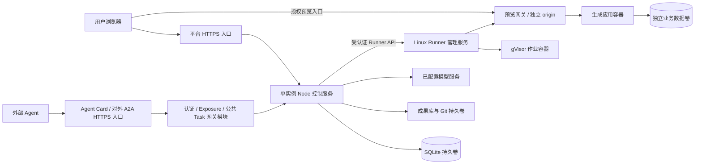

# 04 执行隔离、故障恢复与交付

适用版本：V1.1。本文约定各阶段可观察的证据，不把“请求已发出”写成“操作已完成”。

## 1. 进程与资源边界

控制面运行 Node.js，生成代码在独立 Linux Runner 节点执行。Windows 可以开发、运行控制面与工作台；正式完整验收连接 Linux Runner。Docker Desktop 可用于开发调试，不把它等同于已经验证的 gVisor 部署。

Runner 有受信任的管理服务和不受信任的作业容器。仅管理服务持有 Docker 接口；控制面、Agent 及作业容器均不挂载 Docker socket。作业由固定镜像 digest、允许的命令类型和参数组成，禁止模型传宿主命令或任意 bind mount。

| 资源 | 首版工程默认值 | 实施方式 |
| --- | --- | --- |
| 活跃生成／测试作业 | 单 Runner 全局 4；单 run 最多 2 个角色槽位；独立 invocation 共用全局容量 | 调度准入与 Runner 二次限流；超出排队 |
| 单作业资源 | 2 vCPU、4 GiB 内存、10 GiB 临时盘、256 PID | cgroup、配额与运行配置；根据模板压测调整并快照 |
| 单命令最长时间 | 10 分钟，且不超过所属 run／invocation 剩余活动预算 | Runner 计时与停止处理；预览为单独受保留策略管理的服务 |
| 停止宽限 | TERM 后 10 秒再 KILL | 进程组／容器级；核实退出码、挂载和子进程，不只杀父 shell |
| 网络 | 默认拒绝；构建可访问批准的软件源代理 | 网络策略与 egress proxy；屏蔽控制面、内网、云元数据和宿主 |
| 文件 | 只读镜像 + 本工作区 + 专属临时目录 | 非 root、drop capabilities、no-new-privileges、禁止越界符号链接 |

上述资源值是待压测的初始配置，不能作为部署实测容量。安装依赖的生命周期脚本也在沙箱中执行；软件源凭据由代理持有，不注入生成应用。模型和 MCP 的服务凭据绝不进入生成代码容器。

## 2. Runner Job 契约与租约

`POST /runner/v1/jobs` 接收 operationId、permit、imageDigest、workspaceRef、commandSpec、resourceLimits、networkPolicyRef、outputSpec。Runner 在本地持久登记 `(controllerIdentity,operationId,requestHash,jobId)` 后才创建容器；同键同哈希返回同 job，异参数拒绝。

permit 必须是服务端可验证的判别联合：`ownerKind=workflowAttempt` 时含 runId/runEpoch、workId/workEpoch、attemptId；`ownerKind=invocationAttempt` 时含 invocationId/invocationEpoch、invocationAttemptId。两者都有 grantId、activationId、资源范围和有效期。Runner 按类型核验对应宿主，不能接受混用字段或把 invocation ID 当工作流 attempt ID。独立服务只挂载其输入快照及专属工作区，不能获得项目仓库接受分支或原业务 dataset 的写权限。

`GET /jobs/{id}` 返回 QUEUED／STARTING／RUNNING／STOPPING／EXITED／OUTCOME_UNKNOWN，以及 containerId、实际起止、exitCode、logCursor、outputRefs、lastHeartbeat、stopEvidence。`POST /jobs/{id}:stop` 幂等；`GET /jobs/by-operation/{operationId}` 解决启动响应丢失。日志按 jobId + offset 续读，不能要求重新执行命令才能取日志。

许可分为控制面准入许可和 Runner 执行租约：拟定每 5 秒续租、15 秒失去有效续租后停止新子动作并终止该作业。许可过期期间的效果必须核实；不能假定网络分区发生时副作用瞬间消失。Runner 本地使用单调时钟计时，记录控制代际，拒绝旧代际续租。

Runner 重启扫描本地登记及 Docker 标签找到原容器：存在则接管监控；已退出则采集输出；登记存在但容器证据缺失则标未知。控制面只能在原 job 已确定停止后新建 attempt。租约到期、数据库锁释放、控制实例切换本身都不是重试依据。

## 3. Git 起点、集成和修复

Project 有受保护的 Git 仓库；每次 UserTask 固定 baseCommit 为创建时的已接受 SHA，新建应用固定模板初始 SHA。每 attempt 建立工作区分支，命名仅用内部 ID，所有命令参数数组传递，禁用 hooks、外部 Git helper 及不受控配置。

开发返回 resultCommit 后，集成服务先验证仓库归属、baseCommit、差异范围与 permit，按串行集成锁创建候选集成 commit。开发分支不直接更新项目接受指针。测试只 checkout 精确集成 SHA；不能测试不断变化的工作目录。

集成冲突保存 base/ours/theirs 和冲突路径，交回开发处理，或在涉及需求／接口决定时进入冲突流程。不能用自动覆盖选择消除冲突。局部变更后仍在进行的无关分支，在集成时重新验证依赖；若基础接口已变，不因它“之前是无关分支”而跳过检查。

测试失败建立 defect，保存复现输入、原失败、预期和证据。修复通过新工作接在失败结果之后：`开发 D1 → 验证 T1(失败事实) → 修复 D2 → 复验 T2`。失败节点作为“有确定验证结果”满足修复节点的进入条件，不作为“质量通过”满足交付条件；依赖边需显式 `requiredOutcome=success|completed-with-findings`，禁止给原 DAG 加回边。最多两轮自动修复，保留全部失败历史。

整次重做创建新工作区，只从 UserTask.baseCommit 和最新确认需求构建；原未接受的 diff、测试通过、临时预览不作为新执行的完成材料。旧 run 已失败／取消则保持原终态；活动 run 安全取消后创建关联新 run。数据库层失败可事务回滚；外部准备失败保留新 run 和原创建 operation，按钮“继续创建”只重试准备阶段。

## 4. 暂停与取消的阶段清单

| 阶段 | 执行动作 | 进度证据 |
| --- | --- | --- |
| 关闭准入 | controlGate 变更、runEpoch 增加；冻结待派发队列 | 控制事务事件 |
| 请求停止 | 对模型请求、A2A task、MCP job、Runner job 分别登记停止意图 | 每个 target 的操作键与回执 |
| 核实执行 | 原进程／远端任务查询；明确哪些已经退出、哪些未知 | query 时间、远端状态、stopEvidence |
| 保存材料 | 日志、已返回成果、工作区 diff、可恢复文件清单写入成果库 | 哈希、大小、READY 状态、恢复清单 |
| 处理预览 | 暂停保留现有预览至到期；取消停止本 run 未接受预览 | previewId 与实际停止结果 |
| 完成收尾 | 全部必要项成功才 PAUSED 或 CANCELLED | controlOperation 完成事件 |

超过 30 秒仍在核实时显示正在核实、未解决项与最近检查时间；不自动成功。保存失败只重试相应文件／阶段。记录停止证据后才能释放相关工作占用；若最终保存尚未完成，可以释放已证明空闲的计算资源，但 run 仍不能恢复。

暂停后保存答案、计划确认、冲突决定、重试意图都只落库，恢复事务一次性重新检查其有效性。恢复采用“旧 attempt 中断终结 + 新 attempt 使用已保存材料”的默认规则；只有无工具在途、协议任务未终态的澄清会话可继续原 attempt。恢复不是把被杀掉的 JavaScript 调用栈序列化后接着运行。

## 5. 崩溃恢复矩阵

| 故障切点 | 可见持久事实 | 恢复动作 | 禁止动作 |
| --- | --- | --- | --- |
| 用户命令提交后、HTTP 响应前 | operation 与业务修改已提交 | 原键返回原结果 | 新建第二个项目／run |
| attempt 创建后、A2A 发送前 | Outbox=PENDING | 原 operation 发送 | 新 attempt |
| A2A 接收端提交后、回应前 | Inbox 与 Task、AcceptedWork | 原键返回原 Task | 第二次 Runtime 激活 |
| 工具提交后、返回 jobId 前 | ToolOperation，无确定结果 | 用原 operation 查询 Runner／MCP | 换键重跑写操作 |
| 进程崩溃、容器还活着 | attempt 未终结、Runner 可查询 | 控制面先冻结准入，接管核实 | 直接把 running 变 failed 并重试 |
| 暂停部分完成后重启 | 控制意图与逐目标阶段 | 从未完成阶段继续，保持暂停意图 | 启动时默认 OPEN |
| 文件已发布、DB 未登记 | 孤立内容哈希文件 | 重试登记或延迟 GC | 当成交付成果直接引用 |
| DB 元数据 PENDING、上传不完整 | staging 记录与临时文件 | 续传／重传，READY 前不可用 | 用部分报告验收 |
| 接受事务提交前崩溃 | candidate READY，项目旧指针 | 原 operation 重新验证并提交 | UI 显示接受成功 |
| 接受提交后、路由切换前崩溃 | 新 acceptedRelease 与 promotion Outbox | 恢复路由发布，显示服务恢复中 | 回滚接受历史或重做研发 |
| 导出任务失败 | 已接受成果和 export operation | 只重新打包 | 改写接受版本 |
| 注册代际提交后、内存切换前崩溃 | registry_generations 与 activeGeneration | 重建完整 Registry 投影再准入 | 继续用旧缓存派单 |
| 对外受理提交后、公共 Task 响应前崩溃 | ExternalInbox、PublicTask、Run／Invocation 与 Outbox | 原业务键返回原 Task，查询原目标 | 新建第二份委托 |
| Exposure 发布后、企业目录同步前崩溃 | 已发布版本、目录 Outbox | 恢复发布元数据同步，旧 Task 按固定版本核实 | 为追目录同步成功重跑业务 |

控制服务单实例持有本机进程锁，存储不放 NFS；不同控制进程不可同时操作同一数据目录。启动扫描尚未终结 attempt／invocationAttempt、公共 Task、未确认外部动作、控制作业、Outbox、PENDING 文件、预览和发布操作。迁移、注册投影与本地恢复扫描结束前 readiness 显示恢复中；可以开放授权只读查询，不开放新执行。扫描后，对仍未知的宿主保持冻结，其余具备条件的独立任务可以准入；不能将某个远端失联转化为永久关闭所有独立能力。

## 6. 交付候选与质量判定

ReleaseCandidate 固定：codeCommit、requirementRevision、planRevision、templateRevision、checkConfigHash、requiredCheckIds、reportRefs、buildArtifactHash、previewImageDigest、dataPlanHash。材料变化产生 candidateRevision，不覆盖已审查版本。

验收矩阵一行对应一条有效必要需求，每条关联自动检查和必要人工检查。状态 PASS／FAIL／MISSING／NOT_APPLICABLE／STALE；总判定只能从结构化事实计算。NOT_APPLICABLE 必须有允许该情况的规则与证据，不能成为任意跳过按钮。

接受条件：所有必要需求通过；必要测试零失败、零跳过／缺失；代码与类型检查通过；业务代码行覆盖率 ≥80%、分支 ≥70%；统计分母为 0 的分支按 PRD 记录不适用及证据；无未解决高严重缺陷；源码、运行说明、逐项验证、协作记录与脱敏角色 Prompt／配置均可取；预览构建、报告、代码 SHA 一致；人工检查已完成；无未知写操作或待应用变更；数据处理方案有效。统一门槛不能由模型或普通预算调整接口降低。

覆盖率以模板配置的业务源码 glob 为分母，包含本次未执行的业务文件；只排除构建产物、第三方依赖、类型定义和无业务逻辑的固定配置，排除清单冻结在计划并可审查。Agent 生成的业务代码、含校验／权限／数据处理的模板代码都纳入统计。不得只统计被测试文件或临时增加排除项刷过阈值。空业务文件集合返回 COVERAGE_SCOPE_EMPTY，不能算 100%。

前后端分别提供原始覆盖报告，再按 `代码 SHA + 规范源码路径 + 行／分支标识` 去重，汇总覆盖数量与可覆盖总量：整体行覆盖率＝去重已覆盖行数／去重可覆盖行数，分支同理。不能平均前后端百分比，也不能对同一共享源码重复计分母；缺少一侧必要报告时整体结果为 MISSING。source map 必须映射到相同 SHA 的业务源码，无法映射的报告不可作为接受证据。

测试报告携带 checkId、代码 SHA、测试配置哈希、命令、退出码、起止、原始日志、结果文件哈希和执行环境。人工报告携带操作者、时间、候选版本、操作与预期，单独呈现。Agent 的总结只能作说明。

## 7. 预览、业务数据与接受的两阶段处理

平台数据库与生成应用数据库分离。应用使用 template 自带后端 SQLite，独立 datasetId；预览应用及其数据不共用控制面目录。预览记录 previewId、candidateId、imageDigest、datasetId、数据来源、过期时间、状态及访问策略。

首次预览使用声明的空数据或演示数据。迭代预览默认使用已接受数据的隔离快照，显示快照时间；预览测试写入不回写原数据。计划明确接受时采用保留并迁移原数据，还是经用户确认使用新数据。未经确认不清库，不把预览克隆数据无声覆盖原数据。

接受分两阶段，不能把外部数据迁移藏在 SQLite 事务里：

1. **准备**：用户确认接受后建立 acceptance operation，固定代码和数据策略。若保留原数据，应用网关关闭旧 dataset 的写入口并等待在途写入结束，快照最新数据；在新 dataset 执行已测试迁移与完整性检查，启动新镜像并验证健康。持有带 fencing 的写门，原预览可只读，明确显示准备进度。所有阶段幂等、可核实。准备失败保留原版本，核实未发生切换后重开旧写入口。
2. **提交**：在短事务中复查 candidate、当前接受指针、数据准备凭证和全部质量条件，创建 Release、更新 Project.acceptedReleaseId、完成 run、写入路由 promotion Outbox 与事件。事务失败不显示接受成功；已提交则接受事实不可回滚，路由失败单独恢复。

写门关闭期间所有应用写入口都受网关控制，模板不允许绕开网关的后台业务写入。新服务在数据库提交前不能对用户开放写入，旧服务在路由切换成功前保持写门关闭；切换依 releaseId 幂等完成，随后只给新 dataset 开放写入。若 Runner／网关失联，维持待核实，不同时打开两份数据。

准备证明与当前可用性分别持久化。证明固定原接受请求、候选／审查／数据方案、目标数据／schema／迁移／完整性、源关门与物理 fence、目标关闭 fence 和准确 Runner 服务／RELEASE_HELD claim，首次保存后不可替换。可信后端每次观察须实际重新核实原 fence 仍持有、目标仍关闭、原服务与归属仍有效且健康；0～30 秒的新鲜健康、观察 准备版本／观察 sequence 双 CAS 和跨 UNKNOWN 不回退的归属版本共同限定当前 READY。失联／过期保留历史但关闭当前可用性，不能凭原成功回执直接提交。唯一派发许可丢 ACK 后只查询原对象；准备 READY 不创建 Release。私有协议字段或逻辑零在途本身不能替代物理隔离证据，未配置实际后端则关闭。

接受与预览使用同一 dataset 台账，但策略用途和真实准备操作分别保留。接受意图登记独立 PREPARING 元数据及初始 CLOSED 逻辑门，不伪造预览 effect、不创建业务文件；准备证明落库才推进 WRITE_FROZEN。保留迁移记录物理 origin；REPLACE 仅保留原 baseReleaseId，不能声称复制了旧数据。接受准备数据无限期保留标记独立于预览 TTL。准确接受后端关闭源逻辑门须固定原操作／hash／fence；丢 ACK 恢复原闭门，不能超时重开。物理排空、Runner 服务、发布开放新门与 T5 仍是后续独立事实。

实际接受数据准备使用独立 ACCEPTANCE v2 journal，固定原接受请求、releaseId、目标 dataset 和应用 UUID；原 journal 排他创建后才可取得物理 custody。可信适配器须真实排除源／目标的全部写入及已准入处理，逻辑 CLOSED、零计数或本地进程锁都不够。适配器没有默认实现，缺配置不派发；新建前、取得 custody 前和快照后发布前均复核当前授权，持有证明记录后不可换代。工作线程超时或任何步骤中断保留原文件，恢复只核实原 journal／custody／receipt，不重新取得 fence、不重建数据、不补发迁移。

首版固定 web-crud-v1 同 schema 复制：PRESERVE_MIGRATE 的原 migrationRef 必须读取到准确材料字节、匹配 SHA-256 且在操作者可信摘要清单中，内容须是受限 COPY_SAME_SCHEMA 声明；任意 SQL／脚本和跨 schema 升级继续关闭。SQLite 一致备份包含快照时已提交 WAL，不复制未提交状态；新副本替换应用 UUID并执行固定 profile／完整性／容量检查。INITIAL／经原决定确认的 REPLACE 按 EMPTY／DEMO 新建，REPLACE 仍需原源 custody，但 origin 为 null。落盘回执绑定实际文件 hash／大小、原 journal／custody 文件摘要与迁移引用；目标未开放前恢复须核实相同文件字节。数据 MATERIALIZED 只是一项准备证据，不能直接视为完整 READY、服务健康、Release 或 T5。

模板只读连接须启用 SQLite 原生 readOnly／query_only，并保留既有 journal_mode；不能只拒绝 mutate 却在启动时切换 WAL、修改验收目标文件头。只读打开／查询／关闭保持原数据文件摘要，进程锁仍仅为准入约束，不作为其他写入已隔离的证明。

接受服务使用独立 ACCEPTANCE 原服务请求，固定完整接受依据、实际数据回执及原源／目标 fences，不能翻译成预览 effect。Runner v7 的独立预留、只读 profile 和 network／create／start 日志绑定准确 operation／release／dataset；动作先持久 SENT，只有一次 dispatch 才可执行，丢 ACK 只核实原对象。作业、预览与接受服务在同一个 Runner writer 核算 slot／CPU／内存，跨 controller／用途的 dataset 独占；UNKNOWN／重启继续扣除，未派发取消或准确原容器 EXITED 才释放。接受服务不进入预览到期／清理扫描。

接受服务的 `devmesh.acceptance-service-claim.v1` 与旧预览 claim 分开，固定原接受 hash、原服务 requestHash、reservation／profile、release／candidate／review／dataset／image 及原实例。新鲜健康与准确归属核实后才能取得 RELEASE_HELD，原 claim／实例／端口不可替换；HELD 丢 ACK 恢复原归属，不按 TTL 解除。HELD 仅为准备阶段记录，不能视为 T5 或 RELEASE_OWNED。

显式 `RunnerAcceptancePreparationBackend` 组合实际数据组件、Runner 原服务日志、直接 ACCEPTANCE Driver 和原端点 HTTP 健康检查；只在当前授权和原物理 fences 均匹配时创建／启动。Docker Driver 复用公共 OCI／沙箱核验，接受用途的整个 `/data` 只读挂载且 `APP_READ_ONLY=true`，固定 runsc、非 root、只读根、硬配额／资源、独占隔离网络与 loopback 发布端口。缺 Linux、quota、networkIsolation 或物理 custody 适配器不启用，平台启动不自动安装可信后端。

Runner v8 前向迁移保存不可变完整准备 proof，不修改 v2～v7 迁移正文／历史摘要。首次准确健康和 HELD 后固定 `preparedAt`、claim、custodyRevision、数据与 fences；后续真实健康／持有观察更新当前状态，原 proof 不随心跳或重启变化。数据、动作或 proof 回执未知时只查询原对象，不能重新初始化、重新取得 fence，或在恢复查询中补发尚未获许可的后继动作。完整 READY 须经控制面原准备／最新观察 CAS 接收；安全撤销、OWNED／路由发布和真实物理环境分别验收。

接受准备实例的只读挂载／环境和原 profile 不可变，T5 后仅开放逻辑写门不会使该实例具备写能力。发布必须独立验证准确原归属下的新可写服务、健康及写 fence 交接；不得改写准备 profile／proof、凭接受成功直接宣布应用可写，或同时放开旧新 dataset。当前已增加下文的 Runner v11 独立可写发布组件与受控联调；独立 Release 访问组件已增加；真实物理转换和默认平台装配仍须分别实施与验收。

安全撤销先保存 owner 的不可变原决定，绑定原准备 operation／正文／hash／revision、实际已有 proofHash 或 null、原因及操作者。Run scope／强 If-Match／明确确认的新命令与 T5 在同一 writer 互斥；已接受或原指针改变不能撤销，原依据失效或取消仍可关闭原执行权。ABORTING 关闭继续准备、当前 READY、新观察和源闭门；恢复准备器跳过，原后端只按原 hash 恢复决定。原派发历史、proof、目标 CLOSED、数据与占用保留。决定前已获许可的外部动作仍可能在途，拒收迟到 READY 不证明 Runner 已停；须按原对象核实。决定不证明服务已停／移除或物理 fence 已解除，不重开旧门、不生成 ABORTED；独立清理及源恢复证明齐全后才允许解除占用，完整安全撤销仍待实现。

T5 为独立 owner 命令，详细事务见 D5。可信调用层先实际读取冻结材料，原键成功恢复直接交回 writer 校验权限／原正文；新提交在本地短事务核实准确准备与最新观察、完整审查和指针，原子保存接受事实、必要人工完成、Run 终态及专用发布意图。原自动质量和评估不改写，发布失败单独呈现。该领域代码／受控后端验证不代表真实服务和物理 fence 已就绪，也不代表发布消费者已装配；完整 4.1／4.3／5.1 仍按各自证据验收。

Runner 服务撤销由显式后端按原主体读取准确控制决定，v9 保留旧迁移正文／历史并扩充 REMOVED，保存不可变原撤销记录和独立 STOP／CONTAINER_REMOVE／NETWORK_REMOVE 日志。即使没有 reservation 也封闭迟到创建；旧已获许可的动作仅允许查询原对象，未知 CREATE／未核实 ID 不释放占用。只有无容器动作的服务可取消；原 CREATED 不伪造 EXITED。每个外部动作只由唯一派发执行，Driver 核实完整原 profile、准确 ID 和停止状态，移除不带 force／volumes，原网络须为空。成功完整 ID 查询确认消失后，容器证明、REMOVED／容量释放和事件原子提交；丢 ACK／重启只查询，网络清理在释放服务容量后继续可恢复。数据／原 claim／proof 保留，物理数据 fence 和源恢复尚未核实则控制面仍 ABORTING，不能解除项目未核实占用或重开旧门。

服务／网络原清理已核实后，独立数据撤销后端按相同控制决定和 Runner 清理摘要保存原目标目录的唯一 `abort-operation.json`，绑定已见数据 journal／fences。物理适配器必须永久封禁原准备的后续 acquire／写入、核实在途操作，按原持有与递增 generation 恢复准确源 release 归属并保持目标 CLOSED；缺本地 fences 文件也须查询原物理记录。丢回执或重启只 inspectAbort，原完成证明写入独占 `abort-receipt.json`，不删除原业务数据或准备证据。准备 Worker 见撤销日志即关闭继续准备。物理源归属只标 CONTROL_CLOSED，控制面原门／未知写／源服务和项目占用仍须独立核实，不能仅凭数据证明自动重开门或标 ABORTED；未配置物理适配器默认关闭。

该规则覆盖“用户正在向旧版本增加任务，同时点接受新版本”的竞态。准备后代码、计划或数据策略变更则原接受操作失效并重新审查；正常新增业务记录由最终冻结快照纳入，不要求每条记录变化都重新确认产品计划。

准备意图先固定准确候选／reviewHash、原接受指针、镜像和数据方案，由服务端预留唯一 releaseId／新目标 datasetId。REPLACE 使用独立的准确主体确认；策略登记或 PREPARED 的持久 ACK 不证明文件、迁移、fencing 或健康已准备好。每项目仅保留一个未核实准备，只有一次派发许可；SENT／UNKNOWN 仅查原对象，不靠 TTL 重建。仅准确从未派发的意图可由当前负责人明确关闭，状态／历史／operation／事件同事务。

源代码接受与预览服务状态分别显示：提交成功后路由暂不可用，显示“已接受，预览恢复中”，不能说应用健康或篡改接受历史。预览到期停容器，保留代码、报告和数据按各自策略处理；到期时间未设置时明确待设置，不作永久保存承诺。

预览计算资源释放区分“原实例已退出”和“原容器已移除”。从未启动的 CREATED 容器不能伪造 EXITED；受信任 Runner 必须保存原启动／停止请求、profile 和完整对象 ID，在停止归属下显式移除原容器，并以成功查询确认该 ID 消失，记录独立 REMOVED 证明及 PREVIEW_REMOVED 回执。清理观察、容量释放与历史同事务提交；命令超时、非零、inspect 找不到、未知创建结果均不足以释放。容器和独占空网络分别保存唯一派发及观察日志，丢回执后只查原 ID，不重复移除；网络清理扫描包含已释放容量的原记录。接受准备持有或已接受归属、运行中／未知对象及未登记旧对象不能被预览到期清理。清理不删除 dataset，真实 Docker／隔离与平台装配必须另行验证。

## 8. 预览访问与回放包

生成应用运行在与平台不同的 origin；不得共享平台 Cookie、localStorage 或 Service Worker scope。访问入口检查项目权限，签发短期、仅预览用途的凭据；iframe 使用受限 sandbox，页面不能读取平台身份。源码下载以 attachment 提供，HTML 报告在隔离域或清理后的阅读器显示。

每个预览使用独立 host，正式部署还须与平台隔离可注册域及 Cookie 作用域；换端口或共享 path 不能满足完整隔离。可信装配固定 gatewayId、projectId、service principal 及配置 hash，访问绑定准确原候选／镜像／dataset／实例与 Runner loopback 端点。每次准入和发送前重新核实当前成员、健康、期限及原 fence；健康年龄须在 0～30 秒内，控制节点回拨后落在未来的原观察不能当作新鲜，原历史与未确定写保留。viewer 仅安全方法读取，owner／operator 可写预览业务，不扩大平台操作权限。Runner loopback 只能由具备原 Runner 身份的本地适配器连接，不能直接当成远端控制节点的本机目标。

短期用途凭据拆成一次性 ticket（最长 60 秒）和 session（最长 5 分钟），均不超过原预览期限；由可信网关使用 256 bit 随机数生成，控制数据库仅存 SHA-256、原目标及不可变消费／撤销历史。消费票据与创建唯一原会话在同一事务，丢 ACK 后只允许准确原内部参数查询，不签发替代会话。每个项目／成员最多 20 个有效未消费 ticket 和 20 个有效 session；逻辑容量与原写请求占用独立。

网关选用 Node.js 原生 HTTPS／HTTP，域边界用锁版本 tldts 及包含私有后缀的 PSL 解析，不以最后两段域名推断。每预览 host 由 previewId 摘要导出；独立可注册域、证书和路由来自可信配置，预览网关在 loopback-development 也使用 HTTPS 并核实连接来源。平台可信身份入口签发 ticket 后，浏览器仅向准确预览 host 的 JSON POST 兑换；核实准确平台 Origin／CORS，设置 host-only、Secure、HttpOnly、SameSite=None Cookie。预览业务写入必须来自该预览 Origin；所有请求的 Cookie／Authorization／Origin／Referer／代理身份头均不转发，上游 Set-Cookie／跳转头不向浏览器透传。CSP 限制 worker、父页面、连接及嵌套 frame；真实浏览器验证单独留证，不能只凭响应头宣称隔离已验收。

本地平台允许固定 loopback IP／端口作为平台 origin，预览仍为独立 DNS host／HTTPS，双方不能共享 Cookie 作用域；共享模式不采用该例外，仍要求平台 HTTPS 与不同可注册域。访问入口复用可信平台身份，状态／页面 GET 不签发票据；POST 需准确平台 Origin 和空 JSON。浏览器兑换后在原预览 host 查询会话，确认 Cookie 实际可用再加载受限 iframe，未配置、恢复、到期或凭据未保留明确提示。成果下载只从准确冻结材料引用读取，经原 hash／大小与发送前成员复核，以 attachment／octet-stream／nosniff／sandbox 返回；不接受任意路径或内容 hash，不产生接受事实。

原数据后端显式登记 dataset 写门；缺登记不开放访问。关门请求固定原 operation／hash，递增 fence 并保存不可变历史，与访问派发在同一 writer 串行。每个请求保存原方法／原始路径／body hash／净化后 headers hash、目标、用户及 fence，唯一许可后才可转发；旧缺少 headers hash 的记录只读恢复，不获转发。业务写键按 gateway 配置／主体／预览隔离并绑定稳定原请求；重试只返回原状态，不再调用 HTTP，模板客户端保留该原键。许可丢 ACK 或 DISPATCHED／UNKNOWN 重启不重发。已派发或 UNKNOWN 写请求持续计数，关闭门后允许按当前 fence 新准入安全方法读取。

Runner 转发器核实原预留、启动 hash、候选／镜像／dataset、实例、生命周期、新鲜实际 HTTP 健康与原 loopback 高端口，只在原 Runner 本地连接。不允许请求指定 URL、DNS 目标、重定向、连接复用或自动重试，限制正文／响应／时间／并发。业务 HTTP 构造前的明确拒绝可记录 NOT_SENT，构造后响应不完整保持 UNKNOWN；响应完整后先保存原传输观察，再复核当前会话／成员才返回正文。注销可撤销原会话，但不能解除已派发或未知写。

上述门及请求计数仅为逻辑准入。GET／HEAD 分类不强制应用数据库只读，模板安全方法无副作用及禁止后台绕写须另行验证；HTTP 完整响应（包括错误状态）不等于业务写成功或后台写入排空。T5 前还须核实实际在途处理及 Runner 停止／数据 fencing 等外部证明，不能用计数为零伪造 WRITE_FROZEN／迁移完成。关闭旧门后不靠 TTL 自动重开，须先证明未发生接受切换。本地私有授权表不代表 HTTP 网关、浏览器凭据或生产装配已经完成。

回放导出使用只读快照，manifest 保存 schemaVersion、project/run 标识、cutoffSeq、完整性、记录条数、文件路径／哈希／大小、缺失项、导出配置摘要。仅记录与授权成果进入包；凭据、平台 Session、运行授权不导出。

导入先在隔离目录预检：压缩总量 ≤200 MiB，实际展开累计 ≤1 GiB，文件 ≤20,000；拒绝路径穿越、绝对路径、符号链接、设备文件、大小伪报、递归压缩和未知 schema。规范化路径后拒绝重复条目，包含 Windows 大小写／路径分隔符折叠后重名，避免校验一个文件却读到覆盖后的另一个文件。流式计数，不信任 ZIP 中宣称的解压大小；哈希一致后才登记资料。危险包整体拒绝；安全但不完整包标 cutoff 和缺项，由用户明确选择后只读查看可信部分。

回放使用记录的历史事实生成投影，不解析历史动作去调用真实 CommandClient。过滤、播放、定位只改变播放游标。导入包里的 projectId 不获得在线项目权限；在线材料链接仍独立鉴权。对比和指标按 run 分开，重做关联不合并成绩。

## 9. 运行维护与退出策略

升级先关闭准入、完成或安全暂停在途、保存一致性备份，再迁移 schema。SQLite 使用一致性备份接口或维护窗口快照，不在运行中直接只复制 `.db` 而遗漏 WAL。备份集合包含控制数据库、会话／附件／成果内容、Git refs／对象、Runner 登记与必要归档材料、应用 dataset 和版本 manifest；密钥按部署密钥策略另行备份。生成中的 JSONL、缓存和视图文件不能替代这个备份集合；检查点、完整性与迁移步骤见 [D5 §7.7](./05_数据与事务.md#77-备份迁移和后续存储扩展)。

恢复先在新数据目录验证 manifest／哈希／schema，启动只读检查后接管 Runner，确认旧控制实例不可写，再开放。失败不破坏原目录。数据库迁移仅在备份可验证且目标版本支持时运行；不承诺任意数据库降级。

指标至少包含 outbox 最老等待、未知外部作业数、收尾耗时、事件补发缺口、DB Worker 队列延迟、Runner 配额、成果登记失败、接受后发布积压、注册代际差异、端点健康过期和对外限流／拒绝量。日志关联 requestId/projectId/runId/workId/attemptId/operationId/jobId；外部链路再关联 exposureId/revision、principalId、publicTaskId、invocationId。真实凭据和完整敏感工具响应不得进入诊断日志。业务审计与普通日志分开保留。

首版故障恢复目标作为 P0/P1 压测指标拟定：已提交命令不丢失；控制进程重启后 60 秒内完成本地扫描；外部失联不设虚假完成期限。实际 RTO、容量和保留时间在部署验收填写，不把拟定指标写成实测保障。

## 10. 最小部署拓扑与配置



本机开发安装 Node、pnpm、Git，Web 与控制服务本机运行；没有部署 OIDC 的开发模式只监听 loopback。完整共享演示使用 HTTPS、企业身份和 Linux Runner；Docker Compose 可以组织控制服务与持久卷，但不能把只适用于开发的身份配置开放到团队网络。

控制节点试运行起点为 4 vCPU／8 GiB，Runner 为 8 vCPU／16 GiB，均为待压测建议。Runner 至少保留 1 vCPU／2 GiB 给管理与系统，准入取“全局作业数上限、剩余 CPU、剩余内存、磁盘和项目配额”的最小值。按每 job 2 vCPU／4 GiB，空闲上述节点最多容纳 3 个此规格 job；已有预览还要扣除其资源，不能因配置全局上限 4 就超额派发。

镜像预装固定 Node、pnpm、Git、浏览器及测试工具，digest 进入 run 快照。P0 必须验证真实 Playwright、构建、数据持久化和停止动作在 runsc 下的行为。兼容问题不能降级到控制服务执行生成代码；可切换经过同等隔离与停止专项验收的专用 VM Runner Provider，并明确记录 runtime 类型。

持久目录分为控制节点、Runner 节点和独立备份位置。以下为部署摘要；完整目录、会话格式、原子写入和清理规则统一见 [D5 §7](./05_数据与事务.md#7-本地会话与文件存储布局)，不维护另一套不同路径规范：

```text
<storage.dataRoot>/
  db/devmesh.sqlite                 控制状态、会话索引；含 SQLite 管理的 WAL/SHM
  artifacts/sha256/                 不可变会话正文、附件、模型载荷、成果
  repositories/<projectId>/repo.git/ 项目 Git 仓库
  views/sessions/<sessionId>/       可重建的 manifest／JSONL 阅读投影
  staging/                         上传、导入与导出的未完成材料
  logs/                            有界诊断日志
  cache/                           可重建缓存
<runner.dataRoot>/
  registry/runner.sqlite           本地 job、操作去重与停止证据
  workspaces/<attemptId>/           工作流尝试的隔离 checkout
  invocations/<invocationAttemptId>/ 单 Agent 尝试工作区
  datasets/<projectId>/<datasetId>/ 应用业务数据及原准备日志，独立保留
  job-outputs/<jobId>/              待归档日志块与成果
<storage.backupRoot>/<backupId>/    一致性备份集合和 manifest
```

控制面只能通过受认证 API 访问 Runner，不直接挂载 Runner 的所有工作区。备份读取采用明确的授权与一致性流程；临时目录清理不能连带清除 dataset 或未上传成果。控制面 Windows 示例根目录为 `D:/DevMeshData/control`，正式 Runner 示例为 `/var/lib/devmesh/runner`；部署按实际持久盘配置，不把示例路径写死在代码中。工作区需在实际结束、必要 Git commit 已入受控仓库、材料得到持久归档 ACK 后才能清理。

部署必填配置按以下分组检查，不在文档填入真实凭据：

| 配置组 | 必要字段 | 缺项时行为 |
| --- | --- | --- |
| server / identity | publicBaseUrl、bindAddress、OIDC issuer/client、sessionSecretRef | 共享部署无法鉴权则不开放写入口；开发身份仅 loopback |
| storage | dataRoot、backupRoot、layoutVersion、容量告警／限制值、收尾保留空间 | 根目录不可识别、无持久盘、不可写或空间不足不开放新执行；不能退回临时目录 |
| models | endpointId、modelId、credentialRef、已验证能力 | 可保存输入，相关理解／执行阻塞 |
| internalA2A / mcp | agentManifestPath/revision、internalOrigin、实现与协议版本、能力、serviceCredentialRef | 清单冲突不激活；端点暂不可用只阻塞消费者 |
| externalA2A | enabled、trusted publicBaseUrl、默认 exposureId、OAuth issuer/audience、允许 scope、请求／流／主体配额 | 默认关闭新外部委托；已发布版本从 DB 恢复；缺少真实身份与 HTTPS 不允许发布 |
| runner | endpoint、服务身份、dataRoot、镜像 digest、runtime、资源／日志配额 | 缺运行条件时允许需求／计划准备，禁止实际生成代码作业 |
| preview | 独立 origin、访问策略、到期策略、dataset 配额 | 不显示可用 Demo；交付按必要预览条件阻塞 |
| retention | 源码、成果、历史、业务数据、预览各自策略 | 未确定值显示待设置；不能当作永久保留 |

内部服务凭据校验调用主体、audience、作用域、有效期及对应宿主 permit；外部凭据按 service_grants 换成受限内部许可，不能透传用户提交的 permit。内网可达不代表有权调用。反向代理暴露业务 API、允许的预览入口以及显式发布的 Card／目录／公共 A2A 路由，内部 A2A/MCP/Runner 管理路径不公开。`/health/live` 只报告进程存活；`/health/ready` 返回迁移、恢复、存储和准入条件，单项端点可用性在连接详情体现。

外部 SSE 禁止代理缓冲，配置连接数上限、心跳和空闲超时；每次重连重新鉴权，并通过公共 Task 查询恢复。共享部署的域名、证书、反向代理路径与身份系统均须真实配置，发布 Card 中的绝对 URL 要从外部网络联调。对外网关首版与单控制实例共库；拆出无状态网关不等于允许多个进程同时写本机 SQLite。多控制实例启用前先完成共享存储、租约和分布式准入迁移。

## 11. 完整交付材料与可下载清单

交付候选必须有可检查的材料 manifest，不能只有一个源码 ZIP 或一段测试总结。下表是逻辑目录，实际成果可以分别下载；最终压缩包失败只影响打包，不改变已接受事实。

| 逻辑材料 | 内容与版本依据 |
| --- | --- |
| manifest.json | projectId、runId、candidateId/revision、codeCommit、需求／计划／配置版本、文件哈希、大小、完整性 |
| source/ | 精确 SHA 的业务源码、锁文件、migration；不含运行密钥、node_modules 和用户业务数据 |
| README.md / runbook.md | 安装、运行、测试、配置引用、数据保存／迁移、已知限制及实际验证环境 |
| requirements/ | 需求与来源、澄清、假设、有效决定、逐项验收状态 |
| plans/ | 已确认计划、DAG 与各次变更；每项工作的输入、输出和依赖 |
| reports/ | 前后端测试、覆盖原始数据、合并结果、代码检查、构建、缺陷及复验；绑定 SHA |
| collaboration/ | 消息、A2A 交接、MCP/内部调用、控制与决策记录；包含失败和实际调用方 |
| agent-config/ | 四角色实际 Prompt、模型／参数、允许工具与限制；记录各 attempt 的配置版本，不含秘密 |
| preview.json | 镜像 digest、代码 SHA、数据来源、访问方式、到期与当前状态；不嵌入长期访问令牌 |

必要材料缺失时列明缺项并阻塞相应交付条件；不是拿旧版本配置或报告补齐。用户单独下载部分成果不等于接受。导出包声明截止 seq 与包含范围；外部引用未收录正文时说明无法离线读取的范围。资料外发不包含业务 dataset，除非用户对数据导出另有明确授权及独立处理方案。

### 接受撤销完成握手

RunnerAcceptanceAbortFinalizer显式启用，按原决定查询已清理的原容器／网络和数据abort原回执，绑定controller及清理摘要。存在旧源时再查询原Release的准确镜像、恢复后fence、RELEASE_OWNED／READ_WRITE服务及30秒内健康；查询不启动服务或续约。控制writer复核旧接受指针、准确源门及未完成写请求，只重开本准备关闭的旧源门，门fence／revision各递增。未关闭的OPEN源门不制造关开历史，目标仍永久CLOSED。原物理适配器及可写发布转换独立实施，控制协议通过不能视为真实源服务恢复或完整4.1／4.3验收。

### 接受后的发布消费与恢复

T5原promotion Outbox不可变，原接受回执保留提交时的PENDING。独立release_publications投影当前发布状态，私有原策略后端以revision CAS取得唯一PENDING→SENT派发许可；丢许可ACK、SENT或UNKNOWN先查询原发布，不重新prepare、初始化数据、迁移或替换实例。显式resume可按文末v12协议继续原请求尚未派发的阶段，原全局publish不重派。ReleasePublisher仅显式注入可信后端，未配置时保持PENDING，不安装伪成功后端。

接受准备服务的只读profile、挂载和APP_READ_ONLY不改写。物理发布适配器必须永久撤销原准备，核实原只读容器及网络消失，另建不同reservation／profile／instance／network的READ_WRITE、RELEASE_OWNED服务。可写实例的每个入口必须受物理控制写门约束；目标fence严格继承原HELD并保持ARMED／CONTROL_CLOSED，源保持后继RETIRED／CLOSED，不能先开放裸可写HTTP再补控制状态。

派发基准固定目标门、原准备关闭的源门、原项目路由release／hash／generation。稳定发布proof绑定原Outbox／prepared proof、准确服务／路由和上述基准；恢复另提交30秒内原服务、路由及fences观察，不能重签proof延长健康。控制事务确认当前接受指针、准确数据快照、无未知写及相同基准后，保存证明／观察、CAS路由为上一代加一、目标dataset READY／源RETIRED、目标开门、历史及事件。旧接受事实不回退；之后查询历史PUBLISHED不代表当前健康或当前路由。

当前实现包括发布控制协议、writer、显式通用消费器及后文的 Runner v11 独立可写服务容量／持久阶段组件。独立 Release 访问组件见后文；真实物理撤权与 guard、实际路由和导出仍按4.3继续实施与验收，未启用默认平台装配。

### Runner 发布交接的只读服务退役

RunnerReleaseRetirementBackend只负责发布前半段，显式注入原控制存储、原准备controller、可信移除Driver和永久撤权Authority；缺任一配置关闭。适配器自行从控制库核实原SENT／UNKNOWN发布及固定basis，不能让调用方提交任意清理决定。原T5、prepared proof、服务profile／容器／网络与Runner本地稳定proof必须逐项一致。登记唯一交接后，按REVOKE_PREPARATION→STOP→CONTAINER_REMOVE→NETWORK_REMOVE顺序，每步独立持久SENT／OBSERVED和唯一dispatch。

Authority须永久撤销原准备的acquire／renew／写入，并核实之前已获许可的动作终止，不能用SQLite标志、文件或逻辑门替代物理保证。撤权证明之后才可停止／移除原只读服务；Driver执行前复核控制授权与原动作，移除采用准确ID和独立成功查询证明。容器消失观察、原接受服务REMOVED、容量释放和服务历史同一writer提交，网络消失另记。原profile、claim、prepared proof与数据文件保留；只读服务退役不转为可写、不开放写门、不完成发布。

登记ACK或任一步ACK丢失后，inspect只查询已登记原动作，不重复撤权／停止／移除，也不开始后续未派发步骤；跨阶段继续由文末v12显式resume协议执行。登记持续持有dataset交接占用，容器释放容量后也不能被其他预览或接受服务抢占。后继可写服务／容量及fence／guard协议组件见下一节；独立Release入口见HTTP节，真实物理适配器、实际路由和导出继续4.3，缺配置默认关闭。

### Runner 独立可写发布组件（2026-11-13）

RunnerReleaseServiceBackend 显式组合原只读退役、后继物理 Authority、可写 Docker Driver 与路由 provider，默认关闭。ARM_FENCES 严格继承原 HELD 的 fenceId／更高代／previousHoldHash，目标保持 CONTROL_CLOSED，源保持 RETIRED／CLOSED。迭代核实本地原 service／route／claim，准确清理源容器和网络后才分配独立可写容量；缺原本地证明的外部源关闭。

GUARD_ENFORCE 先于 NETWORK_CREATE／CREATE／START，覆盖物理代和控制门约束下所有业务数据写入；创建／启动前末次授权并复核完整 OCI／profile／配额／guard。健康后由 writer 生成 RELEASE_OWNED claim，再绑定准确前代路由的下一代。稳定 proof 从日志一次派生，返回观察前重新核实原对象／健康／guard／fence／route／旧实例消失，最终开门仍只发生在控制发布事务。

模板只读连接不在业务盘创建 writer.lock。可写发布使用 /tmp/devmesh-runtime 的运行锁，启动与健康不改业务数据库，首次获准写入才切 WAL；临时锁不充当跨容器排他。实际业务盘的直接写入与后台写入必须由物理 guard 阻断，缺 provider 不启用。inspect仍只查已有阶段，丢回执不重发或发下一步；显式继续协调见v12节，独立访问入口见HTTP节。默认装配、导出和物理环境继续，不提前完成整个4.3。

物理 guard 后续每次写准入须核实同一控制视图内接受指针、PUBLISHED、当前 route hash／代、原 claim／实例／profile／serviceRequestHash、READY dataset 和 OPEN 门；首次开门 fence／revision 为原 targetGate basis 各加一，原 datasetOperationId／datasetRequestHash 保持，close 字段清空。新的关闭或修订拒绝旧准入，排空在途写由物理 Authority 保证，后续重新开门不复用原许可。Routes.bind 只登记受控准备绑定，公开可见性服从控制库原子路由视图，不能提前切公共流量；入口授权和对外开放另行实施。

### Release HTTP 与恢复边界（2026-11-13 开发增量）

RunnerReleaseHttpTransport 必须显式绑定原 RunnerReleaseServiceBackend。固定 target 包含 RELEASE、项目／运行／版本／候选／manifest／policy、原准备／promotion／publication proof、原 reservation／profile／claim／完整容器和网络 ID、loopback endpoint 及 routeHash／generation。稳定证明只用于身份；发送前重新 query 原服务、guard／fences／路由、实际 HTTP 健康和当前控制授权，不创建／启动／绑定后续阶段。

ReleaseGateway 在独立 TLS 主机接受哈希会话，每次准备与一次派发都核实成员及当前版本。请求体和允许头摘要固定，原门 fence／revision 入请求摘要。仅一次 native loopback HTTP，无重试／重定向／客户端地址；派发 ACK 丢失不调用 transport，构造后的不完整结果 UNKNOWN，禁止重派。响应先持久观察再核实当前成员，不把撤权等同于业务未发生。请求／响应／并发／时限均有界。独立显式访问链路已实现；阶段继续协调见下节，默认应用装配和导出仍待完成。

当前重新开放后的门必须等于原发布证明的初次 OPEN；后继准备撤销后换代的原 Release，仍须原物理服务／guard／fence 恢复及新授权协议，不能据此增量宣称完整迭代恢复可用。

## 发布阶段继续协调（Runner v12）

ReleasePublisher 在恢复 SENT／UNKNOWN 时先 inspect 原操作；只有显式后端提供 resume 且控制面 continuation 核验通过，才协调后继阶段。该核验固定原请求／basis、当前接受指针、关闭写门及无未决写，不重新接受或重新授予全局 publish。原 verifyReleasePublication 仍只接受 SENT。每个物理阶段的唯一许可位于 Runner 单 writer；已派发阶段只查询，前驱未核实不申请下一阶段，inspect 自身永不派发。退役和可写服务的登记／容量／profile／claim／proof 恢复相同原身份，配置或物理事实不匹配关闭推进。

PROFILE_PREPARE 把配额 prepare 纳入唯一阶段；prepare 前最后核实原控制和动作授权，prepared 只验证原目录及字节限额。Runner v12 对旧 profile 标 INSPECT_ONLY，不声称旧配额已完成、不在恢复中再 enforce；新 profile 同事务标 EXECUTE_ONCE，许可或结果未知仅查询。真实物理 provider、独立导出、默认装配、正式后继保留／替换和门换代后的源服务恢复仍按完整验收实施。

## 验收数据准备的外部调用排空

验收数据准备的 Worker 退出与父进程调用排空独立：LocalSqliteAcceptanceDatasetBackend 跟踪原 Worker 发起的 preflight／acquire／inspect／verify、最终授权及可信迁移读取。超时终止线程并关闭迟到授权，实际 RPC 全部结束后才返回 UNKNOWN、释放有界名额或允许消费者完成停机；未返回的外部调用继续占位，适配器须自行限制 I/O。原日志、文件和物理 custody 保留，不完整原操作只查询、不重做 acquire／初始化／迁移。无原日志的只读预检不虚构派发；不安装默认物理后端，不改变持久格式。

## 已验收版本独立导出（迁移44）

按原 Release 固定候选／源码 SHA、实际需求／计划／角色配置、控制事件 seq 和会话消息游标及正式材料引用，在独立事务登记 export job。QUEUED→PACKING→READY／FAILED；原创建者与当前成员、generation／claim token／租约共同控制材料读取和归档写入。失败需显式重排原任务；启用的宿主消费者可在原租约过期后按原代际 CAS 恢复崩溃打包。首次准备的 ZIP manifest／hash／size 不变，已注册丢回执查询 READY。材料 FK 阻止 GC，物理原字节恢复仍需 CAS 校验；打包不得执行工作、迁移、发布或改动验收。

已实现排队／列出／查询／重试／下载 API 和显式 ReleaseExporter／LocalReleaseExportSources。平台 `releaseExports.enabled: true` 显式装配本地消费者，默认关闭，要求持久存储；不依赖模型或 Runner。私有分页扫描只处理当前成员创建的 QUEUED／过期 PACKING，不自动重跑普通 FAILED；一轮有界、最多两并发。停止先关 API 准入，再取消并等待当前打包，最后关 SQLite；90秒协作取消不是底层调用已退出证明。原受控 bare Git／原正式内容、实际配置与协作记录进入有界 ZIP32 STORE，manifest逐项 hash／size／转换／排除范围，平台字段净化而项目源码／构建／镜像保留原字节；业务数据、平台权限与私有模型输入／推理不导出。交付 scope 完整不等于平台可回放备份。具体边界及接入见 packages/result-verifier/EXPORTS.md；产品界面、完整4.3／5.1／5.2与真实物理、后继流程继续单独验收。

### 交付页与导出消费者的职责

独立 React 交付页已接入原 Release 页面和现有导出 API，只管理原作业的显式创建／核实、状态、重试和下载。页面加载、分页、轮询和返回均不启动打包；只有配置启用的宿主消费者或显式 ReleaseExporter 推进持久 QUEUED。失联后的 sessionStorage 原键用于恢复创建回执，不保存票据／权限或材料正文。当前成员和原创建者约束仍由服务端逐请求执行，UI 中的能力投影不替代授权。

入口与实际归档通过本地 Worker／CAS／Git／HTTP／React／Edge 联合开发验证；上游 T5／镜像准入和物理事实为显式夹具，企业身份、完整工作台及真实 Linux、后继保留／替换流程继续独立验收。

### 2026-11-16 P2-01 控制生命周期离线开发记录

2026-11-16：P2-01提前开发增量完成，变更8/8。新增迁移0046（run_control_targets、recovery_review_hash）、pauseRun／cancelRun／resumeRun／recordControlTarget／finishControl／getControlStatus／listControlRuns、RunControlCoordinator（显式ControlStopBackend、未知／STOPPING只inspect、保存失败只重试保存、30秒overdue）、受保护HTTP控制API与工作台控制状态（真实Edge断线重连验证）。受控后端测试覆盖pause／resume／cancel、崩溃重启、未知目标、保存重试与30秒提示；真实Runner／容器停止、真实模型／OIDC／Linux未执行，正式P2-01与G1～G4不变。


### 2026-11-16 P2-02 崩溃恢复扫描离线开发记录

2026-11-16：P2-02提前开发增量完成，变更5/5。新增只读getRecoveryState与平台RecoveryScan：报告控制中的Run、活动／未知attempt、Outbox PENDING／LEASED／RECONCILE、未结束准备；不自动OPEN、不终结UNKNOWN、不重放外部动作，过期租约转RECONCILE待原键核实。崩溃矩阵覆盖暂停跨重启、未知attempt、租约过期与原键回报；recovery-scan 5/5。真实Runner／容器／工具／接受物理恢复未执行，正式P2-02与G1～G4不变。


### 2026-11-16 P2-03 变更提案与依据决定离线开发记录

2026-11-16：P2-03提前开发增量完成，变更4/4。新增迁移0047与change_proposals；proposeChange／decideChange／getChange／listChanges及受保护HTTP API落地，依据hash派生、旧依据拒绝、来源唯一、终态保护；影响图／局部冻结／应用复验与T3未实现。change测试3/3、迁移7/7。正式P2-03与G1～G4不变。


### 2026-11-16 P2-04 安全重做离线开发记录

2026-11-16：P2-04提前开发增量完成，变更3/3。新增迁移0048 run_redos与redoRun，仅从FAILED／CANCELLED创建固定baseCommit的新PREPARING Run，不复制旧计划／候选／diff，活动Run拒绝、同键幂等；受保护:redo API与REDO_REQUIRES_TERMINAL错误码。RetryWork审计确认仅契约、attempt级重建与预算桶未实现；材料复用矩阵／T4／T10未实现。redo测试2/2、迁移7/7。正式P2-04与G1～G4不变。


### 2026-11-16 P2-05 配置调整离线开发记录

2026-11-16：P2-05提前开发增量完成，变更3/3。新增config_control generation与config_adjustments；propose／confirm配置调整要求PAUSED、代际CAS、应用后仍暂停、重启保持；受保护API与OpenAPI；Registry同步沿用既有manifest／projection测试不重写。配置与端点逐字段映射／T16／T17未执行。正式P2-05与G1～G4不变。


### 2026-11-16 P2-06 独立 Invocation 离线开发记录

2026-11-16：P2-06提前开发增量完成，变更4/4。新增迁移0050 invocations与create／get／list／transition；受保护Invocation API与OpenAPI；同键幂等、同键不同请求拒绝、显式状态机与终态保护；公共Task/Inbox、主体配额与取消核实审计确认未实现。invocation测试3/3、迁移7/7。正式P2-06与G1～G4不变。


### 2026-11-16 P2-07 内容 pin 与 GC 边界离线开发记录

2026-11-16：P2-07提前开发增量完成，变更4/4。新增content_pins与pin／release／list／diagnostics及受保护API／OpenAPI；明确无删除路径，GC／归档／分块日志／容量／T22／T23未实现。content-pins测试3/3、迁移7/7。正式P2-07与G1～G4不变。


### 2026-11-16 P2-06 公共任务内核离线开发记录

2026-11-16：P2-06公共任务内核增量完成，变更3/3。新增public_tasks、enqueue／claim／complete与主体配额、租约、终态；受保护API与OpenAPI；缺信息补齐／取消核实／T7／T20／T21未实现。public-tasks测试3/3、迁移7/7。正式P2-06与G1～G4不变。


### 2026-11-16 P2-07 内容归档账本离线开发记录

2026-11-16：内容归档账本增量完成，变更3/3。归档request／ack／get／list与受保护API／OpenAPI落地；ACK不删除、丢失ACK保持REQUESTED；无删除／GC路径。content-archive测试2/2、迁移7/7。正式P2-07与G1～G4不变。

