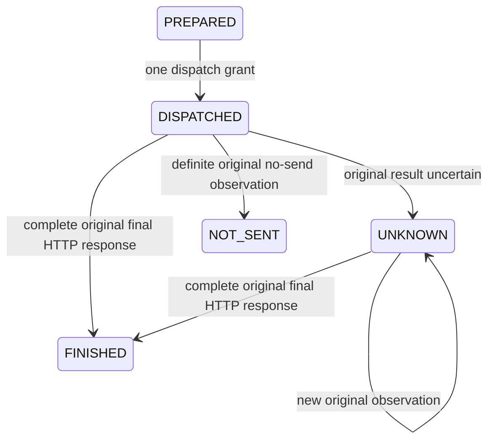

# Private preview access admission

Migration 34 adds durable admission commands to `SqliteStorage.request`. There is
no HTTP route, browser session or forwarding transport in this increment. These
commands are for explicitly configured, trusted composition; a caller-supplied
`principalId` is not an authentication mechanism.

The owner registers `registerPreviewAccessPolicy` for a project with an immutable
gateway ID, configuration hash and service principal. The configured original
dataset backend calls `enrollPreviewWriteGate` with its exact preparation operation
and request hash. Either missing registration closes access. Reenrollment returns
the existing gate, including a closed gate; it never reopens it.

The gateway calls `resolvePreviewAccess` on behalf of a current project member.
It receives the original candidate, manifest, image, data operation, start operation,
instance, Runner, loopback endpoint, expiry and gate fence. HEALTHY must be between
zero and 30 seconds old; a future observation after a clock rollback is unavailable.
Only the original Runner-local transport can interpret its loopback address. It is
not an arbitrary URL or a remote platform host's loopback connection target.

`preparePreviewAccessRequest` binds a unique request ID to a method, path and body
hash and the exact original target, subject and fence. Headers and body are not a
forwarding implementation; the future transport must validate and bind the actual
request it sends. GET/HEAD require an empty body hash. Other supported methods
require owner/operator membership and an OPEN gate. A viewer cannot obtain a write
method grant. This classification does not enforce physical database read-only
access or prove that generated GET/HEAD routes have no side effects.

`beginPreviewAccessRequest` returns `dispatch: true` once. Only that returned grant
may send a request, after `previewAccessRequestAuthorized` succeeds immediately
before sending. A lost grant acknowledgement, repeat begin, DISPATCHED or UNKNOWN
record never grants another send. A successful final check can race a subsequent
close; the existing dispatch stays counted, so physical quiescence cannot be
inferred from the close itself.

`recordPreviewAccessObservation` is private to the configured gateway. FINISHED
requires a final status (200–599), response hash and original observation time;
it includes error responses and does not prove business success. NOT_SENT is not
allowed after UNKNOWN. Original observations and immutable history commit together;
times cannot go backwards. An identical terminal observation is idempotent.

The backend uses `closePreviewWriteGate` with an immutable close operation/hash and
expected fence. Close and dispatch serialize in the same writer transaction. Close
first rejects old prepared dispatches; dispatch first remains pending. All gateways
share DISPATCHED/UNKNOWN write counts. Counts are a live projection, not a separate
gate revision or a physical database drain certificate. `getPreviewWriteGate` is
backend-only. Closing increments the fence; new safe reads may use the current
fence, and new writes are rejected. There is no reopen command.

`getPreviewAccessRequest` and bounded `listPreviewAccessRequests` expose original
records only to their configured gateway. They support internal recovery even after
the user's access expires or membership is revoked, so that the trusted transport
can finish accounting for its own dispatch. A public adapter must independently
check the current user before returning protected content. Recovery never replays
an uncertain request. Pending UNKNOWN writes survive expiry and Worker restart.

The logical gate does not change a READY dataset into WRITE_FROZEN, create a
Release, change an accepted pointer or complete T5. Actual request processing,
background writes, Runner/data fencing and proof of no accepted switch are needed
before physical quiescence or reopening an old write path can be asserted. HTTP,
short-lived purpose credentials, per-preview host/cookie isolation, browser tests
and trusted production composition remain OpenSpec 3.1 obligations.
