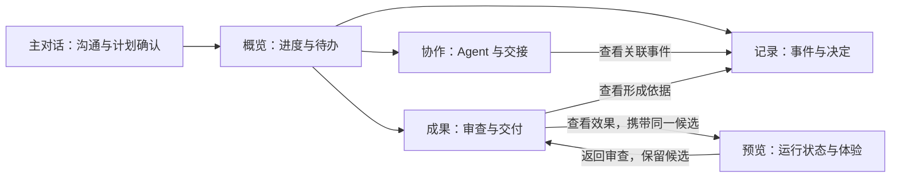

# DevMesh 执行详情整改方案

状态：用户已授权实施第一阶段；第二阶段保留规划。实际完成和验证范围见开发复核记录。

日期：2026-11-20。关联父工作包：P1-08；关联现有变更：`refine-desktop-conversation-ui`、`implement-workbench-first-path`。第一阶段由本轮实施；正式工作包与阶段门槛按实际依赖和证据单独维护。

## 1. 整改目标与依据

面向查看研发任务的用户，让执行详情清楚回答五个问题：现在进行到哪里、Agent 如何协作、产生了什么成果、应用能否体验、过程如何追溯。

本轮按现有工具型产品的模块迭代处理。商业化方式不作为本次界面整改前提。收益重点是减少重复阅读、无效切换和版本混淆。

依据：

- `DevMesh_PRD_V10.0.md`：5.1 工作台布局；5.2.4 协作；5.2.8 成果与预览；5.2.9 历史记录。
- `design/03_API与用户流程.md`：前端状态归属、对话工作台与执行详情页签恢复。
- `project/plans/2026-11-18-ue-ui-refinement-proposal.md`：默认收起、桌面阅读空间、准确方案与成果。
- 当前代码：`conversation-details.tsx`、`conversation-work-context.tsx`、`workbench-delivery.tsx`、`conversation-delivery.tsx`、`preview-management-client.tsx`。

### 已核实的问题

| 编号 | 当前问题 | 影响 | 整改方向 |
| --- | --- | --- | --- |
| R01 | 成果、预览调用同一个交付组件，仅标题区分 | 切换后几乎相同，不知道在哪里体验应用 | 独立展示，各自保留自己的主操作 |
| R02 | 协作混放用户权限、工作分工、需求变更和配置调整 | Agent 协作过程无法辨识 | 以 Agent、交接和工具为核心；调整其他信息归属 |
| R03 | 任务同时展开需求、完整方案和当前工作 | 侧栏过长，当前状态及待办不突出 | 先概览、后明细，按需打开完整内容 |
| R04 | 记录重复聊天正文，执行事件只有简单名称 | 难以追溯决定、失败及状态变化 | 默认展示执行事件，消息通过定位引用 |
| R05 | 窄面板承载候选、审阅、接受及预览入口集合 | 主要动作不明确，频繁跳转 | 按页签设定一个首要目标，复杂表单采用明确专用入口 |
| R06 | 原 PRD 部分页内说明仍将澄清、计划确认放在右侧，与后续对话方案不一致 | 实施可能继续产生重复表单 | 实施时同步更新受影响正文、页面索引和验收条目 |

## 2. 总体结构

保留五个入口，短标签统一为：**概览、协作、成果、预览、记录**。将“任务”改为“概览”，避免与左侧用户任务、内部工作项混用。

面板标题使用“执行详情”，内部完整标题分别为“执行概览”“Agent 协作”“成果与验收”“应用预览”“执行记录”。短标签适配窄面板，无障碍名称使用完整标题。

| 区域 | 唯一主要职责 |
| --- | --- |
| 主对话区 | 表达需求、补充说明、回答问题、审阅与确认计划、接收重要结果摘要 |
| 右侧执行详情 | 查看真实状态、证据和对象明细，定位需要处理的事项 |
| 专用页面 | 完成逐项审查、接受交付、预览数据管理、导出等复杂流程 |

对话摘要与详情明细允许引用同一事实，但不重复挂载确认表单。打开或切换页签只读取信息。

## 3. 五个页签的功能设计

### 3.1 概览：现在怎样、下一步是什么

默认按以下顺序呈现：

1. 本轮目标、执行模式、当前阶段与状态、最近核实时间。
2. 需要你处理：问题、计划审阅、变更、冲突、成果审查；按阻塞影响排序。每项显示原因与“去处理”。
3. 当前工作：名称、主责角色、真实状态、等待或失败原因；点击打开该工作详情。
4. 需求与计划：默认只显示摘要、版本及查看入口；完整内容默认折叠。
5. 能力与阻塞：仅在影响本轮执行时显示缺少的资源及下一步。

规则：

- 计划确认定位主区当前方案卡；不在概览再生成一份确认表单。
- 需求变更、冲突归入“需要你处理”；已完成决定进入记录。
- 无可靠待办投影时，只显示已经能够核实的事项，并标明覆盖范围，不声称已汇总所有待办。
- 不以阶段估计完成百分比；只有可核实的同一计划工作数量才显示“已完成 X / 共 Y 项”。
- 查看具体工作后返回，保留原滚动和选中工作。变更与冲突的处理入口沿用准确对象；未接入的入口不展示可执行按钮。

### 3.2 协作：Agent 做了什么、如何衔接

内容按“参与角色 → 交接 → 工具调用 → 本次配置”组织。

| 内容 | 展示字段 | 规则 |
| --- | --- | --- |
| 参与角色 | 角色、具体 Agent（可读取时）、承担工作、最近状态 | 工作角色不冒充实际在线 Agent；角色未分配、工作尚未派发明确区分 |
| 交接 | 发送方、接收方、所属工作、交接内容摘要、接收及处理状态、输出 | 有真实记录才显示；点击关联工作或成果 |
| 工具调用 | 用途、调用方、所属工作、工具来源、结果、起止或观察时间 | 区分 MCP 与内部工具；参数及日志默认折叠、脱敏 |
| 本次配置 | 本轮实际使用的模型、工具与限制快照 | 收在折叠区；明确区别当前全局配置和本次快照 |

成员权限不再作为“协作”的主内容；只读身份保留为面板上下文提示。只有已有成员管理入口时才提供对应跳转，不因本次整改新增成员管理系统。

需求变更提案移到概览待办；配置调整的已发生记录归入记录，协作仅展示实际配置与相关记录入口。“配置代际”等技术字段置于高级详情。

第一阶段可先用现有工作上下文提供真实角色分工。交接和工具若缺少可授权读取的投影，明确显示“当前详情尚未接入交接／工具记录”，不显示“暂无协作”，不补造活动。

### 3.3 成果：交付内容与质量判断

顶部固定版本选择与依据状态。主体依次为：

1. 需求验收摘要：通过、未通过、待人工、未验证；只能来自现有审查事实。
2. 检查与报告：真实测试、缺陷、差异及证据入口；接口未提供的数量和结论不展示。
3. 交付材料：文件、代码包与下载状态；尚未形成交付包时说明条件。
4. 审查与接受：进入逐项审查或接受流程，目标固定为当前选中候选。

主操作按事实确定：未审查时“审查此版本”，满足接受条件时“进入交付确认”，已接受时“查看交付材料”。条件不足时显示原因，不以候选已冻结或自动检查通过推断可接受。

“查看效果”为次操作，切换到预览并保留当前候选，不再在成果里复制预览管理区。

项目已接受版本单独显示为“项目当前版本”，注明来源执行；不得将来自其他执行的版本混称为本轮成果。项目版本与本轮候选使用不同对象标识，不能由同一无类型版本选择器互相替换。

第一阶段复用现有候选、审查、接受和导出能力，允许以准确专用页面完成复杂操作。验收摘要所需数据若缺失，保留“查看审查结果”入口，不能填入示意统计。

### 3.4 预览：先显示状态，再提供体验

预览页签只展示当前选中候选的应用预览，不再列出审查、接受和交付包按钮。

| 状态 | 默认内容 | 主操作 |
| --- | --- | --- |
| 尚无候选 | 尚未形成可预览版本及当前阶段 | 查看概览 |
| 未启用预览能力 | 对应候选、缺少的运行条件 | 查看条件 |
| 数据未准备／尚未启动 | 候选、数据来源、准备条件 | 管理并启动预览 |
| 启动中 | 启动状态、最近核实时间 | 刷新状态 |
| 已就绪且访问可用 | 候选、可用性、有效期、数据说明 | 打开应用 |
| 停止中／结果未知 | 原操作与待核实内容 | 核实状态 |
| 已停止／已过期／失败 | 原预览状态、原因与适用版本 | 查看管理；满足条件时进入再次启动流程 |

“最近观察就绪”与“当前访问可用”分开，打开前由原预览入口重新校验，不把旧健康观察当作实时可访问证明。

第一阶段默认新窗口体验；准备数据、启动和停止沿用既有专用管理页及其确认、请求恢复流程。侧栏提供真实状态摘要和入口，不复制一套写操作。内嵌预览放在后续大视图能力中，需另行验证隔离、Cookie 与访问授权。

停止预览、取消研发任务、接受版本分别显示作用对象；停止不能误解为删除数据，预览中的业务数据说明沿用当前数据方案。

### 3.5 记录：发生了什么、为什么变化

默认展示执行事件时间线，聊天内容通过“定位相关消息”查看，不再重复展示最近 20 条完整消息。

- 每条事件：时间、参与对象、动作及结果、所属工作或版本、关联证据入口。
- 优先保留：计划与授权、工作推进、失败与恢复、变更决定、候选形成、接受、预览和导出状态变化。
- 模型临时输出不当成已保存执行事实，不展示模型内部思维。
- 未识别事件显示“未识别的事件类型 + 原类型名称”，高级详情展示脱敏数据，不统一掩盖成“记录已更新”。
- 第一阶段明确展示“最近 N 条执行事件”，不宣称完整回放。第二阶段接入受保护的分页、类型／工作筛选及明细。
- 读取失败、历史已清理、部分事件未接入与真实零记录分别处理。

第二阶段逐步增加关键决定筛选与执行总结；交付包属于成果，过程回放包属于记录，下载动作按对象区分。

## 4. 共用交互规则

### 4.1 上下文与版本

- 五个页签始终属于同一项目和执行。顶部固定任务名、当前／历史及只读状态。
- 成果和预览共享候选选择及分页位置。首次没有用户选择时，仅在服务端能够明确最新候选时默认选中，并标明规则。
- 出现新候选时提示“有新版本”，不自动替换正在审查或预览的版本。
- 从成果切到预览携带准确候选；从工作或事件进入成果携带准确工作／候选引用。
- 切换项目或执行时隔离读取、选择和本机偏好，旧响应不能更新新面板。
- 旧偏好中的“任务”迁移到“概览”；内部使用稳定页签标识，标签修改不使已有阅读记录失效。

### 4.2 版式与操作位置

- 保留深色风格与详情默认收起；桌面展开目标宽度 360px，正文不足 640px 时改为覆盖面板。
- 面板由固定标题与页签、独立滚动内容、必要的局部操作区组成。标题状态不随长内容滚走。
- 完整方案、复杂比较提供大视图或明确专用页面，不把完整内容强塞进 360px。
- 专用页面优先复用已打开的同一目标；新窗口打开需预留窗口并处理浏览器拦截，不在异步保存结束后无反馈地打开。
- 返回保留候选、页签、筛选与阅读位置；关闭详情或按 Escape 回到原对话位置，草稿和附件保持。
- 页签支持方向键、首尾键和明显焦点；小屏采用全宽详情，关闭后回到原输入。

### 4.3 状态、权限与提交

- 所有区域区分加载中、读取失败、尚未产生、未接入、结果待核实；部分读取失败不清空其他已核实区域。
- “可查看”不等于“可操作”，沿用服务端真实权限与状态条件；历史内容按对象可用动作判断，不统一开放历史写操作。
- 页签切换、刷新及展开不发起业务 POST；查看不自动确认方案、接受交付、启动或停止预览。
- 未核实提交使用原请求恢复机制；新布局不丢失原键、正文、版本条件和回执。
- 权限撤销及时清空受限内容；不能只禁用按钮仍保留旧敏感信息。

## 5. 两阶段实施与完成边界

### 第一阶段：消除重复，形成清晰可用的详情

| 顺序 | 实施项 | 完成标准 |
| --- | --- | --- |
| 1 | 统一概览、候选选择与上下文；迁移旧阅读偏好 | 切页、返回、刷新保持正确对象；新事件不抢选择 |
| 2 | 拆分成果和预览的展示组件，共享候选数据和读取逻辑 | 两页内容及主操作明确不同，均能进入准确专用页面 |
| 3 | 概览收敛为阶段、真实待办、工作、折叠需求／计划 | 首屏可找到当前状态及下一步，主区无重复确认表单 |
| 4 | 协作移除需求变更与权限主区，展示真实角色与工作 | 缺失交接／工具能力如实标明，不显示模拟状态 |
| 5 | 记录改为事件列表与来源定位，移除重复聊天全文 | 能区分事件，明确最近范围和读取缺项 |
| 6 | 对齐专用页返回、加载与异常状态、桌面和小屏布局 | 无失效入口、无草稿丢失，相关对象准确 |

第一阶段主要复用现有接口。预览状态摘要复用已有候选预览管理读取接口；必要时做小范围展示适配。发现服务端字段不足时明确缺项，不能用前端推断代替。

### 第二阶段：补齐协作过程与追溯能力

1. 核查并补充可授权读取的 Agent、A2A 交接、MCP／内部工具投影，明确字段来源、关联标识和分页。
2. 补充事件类型、脱敏详情、关联消息／工作／成果定位，以及带保留边界的分页与筛选。
3. 补齐审查摘要、真实阻塞原因和待办汇总，统一概览与成果状态口径。
4. 在可核实事件与报告基础上生成执行总结，区分活动执行的阶段小结与结束结论。

这些是数据与契约工作，不能作为第一阶段纯界面调整顺带宣称完成。所需接口是否已存在、缺失字段和具体投入，在实施前逐项核查；本方案不提供未经核实的工期。

## 6. 代码和文档落点

| 落点 | 建议调整 |
| --- | --- |
| `conversation-details.tsx` | 稳定页签标识、面板分派、独立区域读取与错误反馈 |
| `conversation-work-context.tsx` | 概览摘要、工作详情、完整需求／计划按需阅读 |
| `workbench-delivery.tsx` | 提取共享候选读取与选择；成果展示和预览展示分开 |
| `conversation-delivery.tsx` | 主区仅保留成果摘要，动作定位同一候选，避免新增重复接受表单 |
| `conversation-workbench.tsx` | 共享上下文、面板开关、阅读恢复、主区定位 |
| `workbench-reading.ts` 与本机偏好 | 兼容旧标签，按准确执行存储选择与阅读位置 |
| 预览／审查／接受专用页 | 保留现有写操作和恢复行为，统一对象说明与返回入口 |
| PRD、D3、实施与验收文档 | 删除相互矛盾的表单归属说明；增加阶段范围和对应验收条目 |

实施时在关联 OpenSpec 中维护 proposal、design、tasks 和行为增量规格；按实际代码、测试和复核证据更新 P1-08，不将方案完成视为工作包完成。

## 7. 验收场景

| 编号 | 场景 | 必须满足 |
| --- | --- | --- |
| AC01 | 打开正在执行的任务 | 概览首屏呈现阶段、状态及已知阻塞／待办，能定位下一步 |
| AC02 | 选择候选 A 后在成果、预览间切换 | 始终保持 A；成果不显示预览控制列表，预览不显示接受／导出区 |
| AC03 | 阅读 A 时产生候选 B | 仅提示新版本，不自动改选 B；显式切换后重新读取依据 |
| AC04 | 无候选、未启用预览、已停止、未知状态 | 分别显示准确原因；打开预览动作仅在重新校验后访问正确对象 |
| AC05 | 预览准备／启动／停止结果未核实 | 原请求保留，刷新和重入不自动重发；确认受理不显示为已完成 |
| AC06 | 查看角色、交接、工具 | 只展示真实记录，未接入与零记录区分；可定位准确工作或成果 |
| AC07 | 读取记录和较早记录 | 第一阶段明确最近范围；第二阶段分页无遗漏／重复，顺序以服务端序号为准 |
| AC08 | 部分请求失败或未知事件类型 | 显示局部错误和原事件类型，不显示假空态或笼统成功 |
| AC09 | 快速切换任务、迟到响应、权限撤销 | 不串执行或候选；撤权清除敏感内容；无遗留写入口 |
| AC10 | 开关详情、返回专用页面、刷新 | 已保存阅读偏好可恢复；草稿、附件、未核实请求不丢失 |
| AC11 | 1600／1440／1280／1024px 桌面及 390px 小屏 | 无横向溢出，页签及主操作可达，键盘能退出并返回原焦点 |
| AC12 | 仅切页、查看、刷新 | 无额外业务 POST，不触发确认、接受、执行或预览控制 |
| AC13 | 当前项目版本来自其他执行 | 明确来源，与本轮候选分区；点击携带原版本及原执行 |
| AC14 | 浏览器阻止新窗口或返回位置保存失败 | 明确反馈并保留当前页面，不丢草稿，不误报已打开 |

执行验证应包含真实 API／数据库事实与浏览器路径；有条件无法覆盖时记录缺项。文档检查不能替代应用验收。

## 8. 效果评估与待核实项

先用固定任务场景评估：用户能否在概览首屏识别状态与下一步；能否从指定候选进入对应预览；能否找到一次失败或接受决定的依据。记录是否完成、点击数及迷失原因，整改前后使用同一组场景。不编造当前基线与收益百分比。

实施前需核实：交接／工具可读 API 覆盖、事件详情及保留范围、审查摘要字段、专用页返回上下文能力。第一阶段不依赖这些缺项全部补齐，但每个未接入区域必须准确说明。

建议评审顺序：先确认五个页签的职责和两阶段范围，再用“执行中、有候选、预览不可用、历史只读”四类页面验证布局，随后实施第一阶段。
